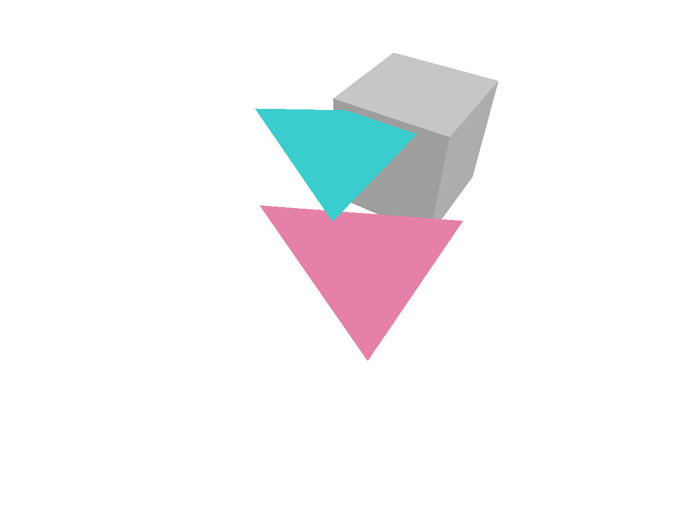
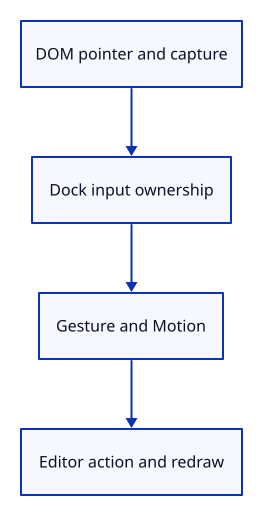

# 3.5.1 · Connect captured pointers to the editor

**Chapter 3 · Documents, editing and ownership · Section 3.5 · Captured pointers and wheel units** · [Contents](contents.md)

**Typing: 23–46 minutes.** [Estimate](typing-load.md).

Deliver canvas pointer events to Gesture when the command dock has not consumed them. Capture the accepted pointer so events keep arriving outside the canvas. Apply any returned action through Editor.

## Type

Continue from [Convert pointer motion to editor actions](20c-motion.md). [Save or recover your work](recovery.md).

### 1. `Cargo.toml`

Enable the browser event bindings used by the command dock.

<details>
<summary>Locate the existing block</summary>

```toml

[dependencies]
wasm-bindgen = "=0.2.128"
web-sys = { version = "=0.3.105", features = ["Window", "Document", "Element", "HtmlCanvasElement", "EventTarget", "AddEventListenerOptions", "Event", "PointerEvent", "MouseEvent", "KeyboardEvent", "WheelEvent", "FocusOptions", "DomRect", "HtmlElement"] }
console_error_panic_hook = "=0.1.7"
wasm-bindgen-futures = "=0.4.78"
wgpu = "=29.0.4"
```

</details>

Edit the existing block to match this code; keep unchanged lines:

```toml
--8<-- "journey/code/21-gestures-dock-01.toml"
```

### 2. `src/browser.rs`

Import the gesture state. Retain the canvas and one gesture across pointer events. Begin choosing between submitted commands and pointer gestures. Use pointer gestures only when the dock has not consumed input; apply any resulting action. Use the retained pointer canvas for resizing. Keep the callback open for pointer event registration. Track pointer presses, capture and release; cancel on blur or resize and suppress the browser context menu.

Edit these blocks from bottom to top. Keep the surrounding lines unchanged.

<details>
<summary>Locate this block</summary>

```rust
        &options,
    )?;
    window.add_event_listener_with_callback("resize", update.as_ref().unchecked_ref())?;
    // Both event sources retain this one callback for the lifetime of the page.
    update.forget();
    report("Canvas pixels, depth and camera resize together.");
    Ok(())
}

fn resize(
    window: &web_sys::Window,
    canvas: &web_sys::HtmlCanvasElement,
```

</details>

Replace it with:

```rust
        &options,
    )?;
    window.add_event_listener_with_callback("resize", update.as_ref().unchecked_ref())?;
    window.add_event_listener_with_callback("blur", update.as_ref().unchecked_ref())?;
    // Both event sources retain this one callback for the lifetime of the page.
    update.forget();
    report("Right-drag to orbit. Left-click to select. A cancelled drag stops immediately.");
    Ok(())
}

fn pointer_action(
    event: &web_sys::Event,
    canvas: &web_sys::HtmlCanvasElement,
    gesture: &mut Gesture,
) -> Option<Action> {
    match event.type_().as_str() {
        "contextmenu" => {
            event.prevent_default();
            return None;
        }
        "blur" | "resize" => {
            gesture.cancel();
            return None;
        }
        _ => {}
    }
    let pointer = event.dyn_ref::<web_sys::PointerEvent>()?;
    let id = pointer.pointer_id();
    let position = [pointer.client_x() as f64, pointer.client_y() as f64];
    let motion = match event.type_().as_str() {
        "pointerdown" => {
            if pointer.is_primary() && gesture.press(id, pointer.button(), position) {
                event.prevent_default();
                if canvas.set_pointer_capture(id).is_err() {
                    gesture.cancel();
                }
            }
            None
        }
        "pointermove" => gesture.move_to(id, position),
        "pointerup" => {
            let motion = gesture.release(id, position);
            let _ = canvas.release_pointer_capture(id);
            motion
        }
        "pointercancel" | "lostpointercapture" => {
            gesture.cancel_pointer(id);
            None
        }
        _ => None,
    }?;
    let rect = canvas.get_bounding_client_rect();
    motion.action([rect.left(), rect.top(), rect.width(), rect.height()])
}

fn resize(
    window: &web_sys::Window,
    canvas: &web_sys::HtmlCanvasElement,
```

<details>
<summary>Locate this block</summary>

```rust
        "keydown",
        "keyup",
        "blur",
        "click",
    ] {
        canvas.add_event_listener_with_callback(name, update.as_ref().unchecked_ref())?;
    }
```

</details>

Replace it with:

```rust
        "keydown",
        "keyup",
        "blur",
    ] {
        canvas.add_event_listener_with_callback(name, update.as_ref().unchecked_ref())?;
    }
```

<details>
<summary>Locate this block</summary>

```rust
        }
        if resize(
            &browser_window,
            &input_canvas,
            &surface,
            &mut config,
            &mut renderer,
```

</details>

Replace it with:

```rust
        }
        if resize(
            &browser_window,
            &pointer_canvas,
            &surface,
            &mut config,
            &mut renderer,
```

<details>
<summary>Locate this block</summary>

```rust
                "view reset" => Action::ResetView,
                _ => return,
            };
            match editor.apply(action) {
                Ok(Change::Scene) => renderer.set_scene(&editor.scene, editor.selected),
                Ok(Change::View) => {}
```

</details>

Replace it with:

```rust
                "view reset" => Action::ResetView,
                _ => return,
            };
            Some(action)
        } else if !panel.consumed {
            pointer_action(&event, &pointer_canvas, &mut gesture)
        } else {
            None
        };
        if let Some(action) = action {
            match editor.apply(action) {
                Ok(Change::Scene) => renderer.set_scene(&editor.scene, editor.selected),
                Ok(Change::View) => {}
```

<details>
<summary>Locate this block</summary>

```rust
                return;
            }
        };
        let line = line.or_else(|| {
            let mouse = event.dyn_ref::<web_sys::MouseEvent>()?;
            (event.type_() == "click"
                && !panel.consumed
                && mouse
                    .target()
                    .and_then(|target| target.dyn_into::<web_sys::Element>().ok())
                    .is_some_and(|target| target.id() == "canvas"))
            .then(|| "canvas".into())
        });
        if let Some(line) = line {
            let action = match line.as_str() {
                "canvas" => {
                    let Some(event) = event.dyn_ref::<web_sys::MouseEvent>() else {
                        return;
                    };
                    let rect = input_canvas.get_bounding_client_rect();
                    if rect.width() <= 0.0 || rect.height() <= 0.0 {
                        return;
                    }
                    Action::Pick([
                        (2.0 * (event.client_x() as f64 - rect.left()) / rect.width() - 1.0) as f32,
                        (1.0 - 2.0 * (event.client_y() as f64 - rect.top()) / rect.height()) as f32,
                    ])
                }
                "example box" => Action::AddBox,
                "example triangle" => Action::ToggleExtra,
                "select next" => Action::SelectNext,
```

</details>

Replace it with:

```rust
                return;
            }
        };
        let action = if let Some(line) = line {
            let action = match line.as_str() {
                "example box" => Action::AddBox,
                "example triangle" => Action::ToggleExtra,
                "select next" => Action::SelectNext,
```

<details>
<summary>Locate this block</summary>

```rust
    }
    let input_canvas = canvas.clone();
    let browser_window = window.clone();
    let update = Closure::<dyn FnMut(web_sys::Event)>::new(move |event: web_sys::Event| {
        let line = match panel.update(Some(&event), &input_canvas) {
            Ok(line) => line,
```

</details>

Replace it with:

```rust
    }
    let input_canvas = canvas.clone();
    let browser_window = window.clone();
    let pointer_canvas = canvas.clone();
    let mut gesture = Gesture::default();
    let update = Closure::<dyn FnMut(web_sys::Event)>::new(move |event: web_sys::Event| {
        let line = match panel.update(Some(&event), &input_canvas) {
            Ok(line) => line,
```

<details>
<summary>Locate this block</summary>

```rust
use crate::background::Background;
use crate::editor::{Action, Change, Editor};
use crate::renderer::Renderer;
use crate::viewport::Viewport;
use wasm_bindgen::{JsCast, JsValue, closure::Closure};
```

</details>

Replace it with:

```rust
use crate::background::Background;
use crate::editor::{Action, Change, Editor};
use crate::gesture::Gesture;
use crate::renderer::Renderer;
use crate::viewport::Viewport;
use wasm_bindgen::{JsCast, JsValue, closure::Closure};
```

<details>
<summary>Complete updated block reference</summary>

```rust
use crate::background::Background;
use crate::editor::{Action, Change, Editor};
use crate::gesture::Gesture;
use crate::renderer::Renderer;
use crate::viewport::Viewport;
use wasm_bindgen::{JsCast, JsValue, closure::Closure};

pub fn report(message: &str) {
    if let Some(document) = web_sys::window().and_then(|window| window.document()) {
        if let Some(status) = document.get_element_by_id("status") {
            status.set_text_content(Some(message));
            if message.starts_with("Cannot") { let _ = status.remove_attribute("hidden"); }
        }
    }
}

pub async fn run() -> Result<(), JsValue> {
    let window = web_sys::window().ok_or("No browser window")?;
    let document = window.document().ok_or("No document")?;
    let canvas: web_sys::HtmlCanvasElement = document
        .get_element_by_id("canvas")
        .ok_or("Missing canvas")?
        .dyn_into()?;
    let instance = wgpu::Instance::new(wgpu::InstanceDescriptor {
        backends: wgpu::Backends::BROWSER_WEBGPU,
        flags: Default::default(),
        memory_budget_thresholds: Default::default(),
        backend_options: Default::default(),
        display: None,
    });
    let surface = instance
        .create_surface(wgpu::SurfaceTarget::Canvas(canvas.clone()))
        .map_err(|error| JsValue::from_str(&error.to_string()))?;
    let adapter = instance
        .request_adapter(&wgpu::RequestAdapterOptions {
            compatible_surface: Some(&surface),
            ..Default::default()
        })
        .await
        .map_err(|error| JsValue::from_str(&error.to_string()))?;
    let (device, queue) = adapter
        .request_device(&wgpu::DeviceDescriptor::default())
        .await
        .map_err(|error| JsValue::from_str(&error.to_string()))?;
    device.on_uncaptured_error(std::sync::Arc::new(|error| report(&error.to_string())));
    let limit = device.limits().max_texture_dimension_2d;
    let width = (window.inner_width()?.as_f64().ok_or("No window width")? as u32).clamp(1, limit);
    let height = (window.inner_height()?.as_f64().ok_or("No window height")? as u32).clamp(1, limit);
    canvas.set_width(width);
    canvas.set_height(height);
    let mut config = surface
        .get_default_config(&adapter, width, height)
        .ok_or("No compatible surface format")?;
    config.view_formats = vec![config.format.add_srgb_suffix()];
    surface.configure(&device, &config);
    let mut editor = Editor::default();
    let mut renderer = Renderer::new(
        device,
        queue,
        config.format.add_srgb_suffix(),
        &editor.scene,
    );
    renderer.resize(Viewport { width, height });
    let mut panel = crate::panel::Panel::new(
        &renderer,
        config.format.add_srgb_suffix(),
        &[
            "Help",
            "Example Box",
            "Example Triangle",
            "Select Next",
            "Delete",
            "Undo",
            "Redo",
            "Background",
            "Zoom In",
            "Zoom Out",
            "Pan Left",
            "Pan Right",
            "Orbit Right",
            "Orbit Up",
            "View Isometric",
            "View Reset",
        ],
    );
    panel.update(None, &canvas)?;
    if resize(
        &window,
        &canvas,
        &surface,
        &mut config,
        &mut renderer,
        &mut editor,
    ) {
        panel.update(None, &canvas)?;
        present(
            &surface,
            &renderer,
            &editor.background,
            &editor.camera.uniform(),
            &mut panel,
        )?;
    }
    let input_canvas = canvas.clone();
    let browser_window = window.clone();
    let pointer_canvas = canvas.clone();
    let mut gesture = Gesture::default();
    let update = Closure::<dyn FnMut(web_sys::Event)>::new(move |event: web_sys::Event| {
        let line = match panel.update(Some(&event), &input_canvas) {
            Ok(line) => line,
            Err(error) => {
                report(&format!("Cannot read command: {error:?}"));
                return;
            }
        };
        let action = if let Some(line) = line {
            let action = match line.as_str() {
                "example box" => Action::AddBox,
                "example triangle" => Action::ToggleExtra,
                "select next" => Action::SelectNext,
                "delete" => Action::Delete,
                "undo" => Action::Undo,
                "redo" => Action::Redo,
                "background" => Action::Background,
                "zoom in" => Action::Zoom(2.0),
                "zoom out" => Action::Zoom(0.5),
                "pan left" => Action::Pan(-0.25, 0.0),
                "pan right" => Action::Pan(0.25, 0.0),
                "orbit right" => Action::Orbit(std::f64::consts::FRAC_PI_4, 0.0),
                "orbit up" => Action::Orbit(0.0, std::f64::consts::FRAC_PI_6),
                "view isometric" => Action::Isometric,
                "view reset" => Action::ResetView,
                _ => return,
            };
            Some(action)
        } else if !panel.consumed {
            pointer_action(&event, &pointer_canvas, &mut gesture)
        } else {
            None
        };
        if let Some(action) = action {
            match editor.apply(action) {
                Ok(Change::Scene) => renderer.set_scene(&editor.scene, editor.selected),
                Ok(Change::View) => {}
                Err(error) => {
                    report(error);
                    return;
                }
            }
        }
        if resize(
            &browser_window,
            &pointer_canvas,
            &surface,
            &mut config,
            &mut renderer,
            &mut editor,
        ) {
            if let Err(error) = panel.update(None, &input_canvas) {
                report(&format!("Cannot lay out commands: {error:?}"));
                return;
            }
            if let Err(error) = present(
                &surface,
                &renderer,
                &editor.background,
                &editor.camera.uniform(),
                &mut panel,
            ) {
                report(&format!("Cannot redraw: {error:?}"));
            }
        }
    });
    for name in [
        "pointerdown",
        "pointermove",
        "pointerup",
        "pointercancel",
        "lostpointercapture",
        "contextmenu",
        "keydown",
        "keyup",
        "blur",
    ] {
        canvas.add_event_listener_with_callback(name, update.as_ref().unchecked_ref())?;
    }
    let options = web_sys::AddEventListenerOptions::new();
    options.set_passive(false);
    canvas.add_event_listener_with_callback_and_add_event_listener_options(
        "wheel",
        update.as_ref().unchecked_ref(),
        &options,
    )?;
    window.add_event_listener_with_callback("resize", update.as_ref().unchecked_ref())?;
    window.add_event_listener_with_callback("blur", update.as_ref().unchecked_ref())?;
    // Both event sources retain this one callback for the lifetime of the page.
    update.forget();
    report("Right-drag to orbit. Left-click to select. A cancelled drag stops immediately.");
    Ok(())
}

fn pointer_action(
    event: &web_sys::Event,
    canvas: &web_sys::HtmlCanvasElement,
    gesture: &mut Gesture,
) -> Option<Action> {
    match event.type_().as_str() {
        "contextmenu" => {
            event.prevent_default();
            return None;
        }
        "blur" | "resize" => {
            gesture.cancel();
            return None;
        }
        _ => {}
    }
    let pointer = event.dyn_ref::<web_sys::PointerEvent>()?;
    let id = pointer.pointer_id();
    let position = [pointer.client_x() as f64, pointer.client_y() as f64];
    let motion = match event.type_().as_str() {
        "pointerdown" => {
            if pointer.is_primary() && gesture.press(id, pointer.button(), position) {
                event.prevent_default();
                if canvas.set_pointer_capture(id).is_err() {
                    gesture.cancel();
                }
            }
            None
        }
        "pointermove" => gesture.move_to(id, position),
        "pointerup" => {
            let motion = gesture.release(id, position);
            let _ = canvas.release_pointer_capture(id);
            motion
        }
        "pointercancel" | "lostpointercapture" => {
            gesture.cancel_pointer(id);
            None
        }
        _ => None,
    }?;
    let rect = canvas.get_bounding_client_rect();
    motion.action([rect.left(), rect.top(), rect.width(), rect.height()])
}

fn resize(
    window: &web_sys::Window,
    canvas: &web_sys::HtmlCanvasElement,
    surface: &wgpu::Surface<'_>,
    config: &mut wgpu::SurfaceConfiguration,
    renderer: &mut Renderer,
    editor: &mut Editor,
) -> bool {
    let rect = canvas.get_bounding_client_rect();
    let limit = renderer.device.limits().max_texture_dimension_2d;
    let Some(size) = Viewport::from_css(
        rect.width(),
        rect.height(),
        window.device_pixel_ratio(),
        limit,
    ) else {
        return false;
    };
    if size.width != config.width || size.height != config.height {
        canvas.set_width(size.width);
        canvas.set_height(size.height);
        config.width = size.width;
        config.height = size.height;
        surface.configure(&renderer.device, config);
        renderer.resize(size);
    }
    editor.camera.aspect = size.aspect();
    true
}

fn present(
    surface: &wgpu::Surface<'_>,
    renderer: &Renderer,
    background: &Background,
    transform: &[f32; 16],
    panel: &mut crate::panel::Panel,
) -> Result<(), JsValue> {
    let frame = match surface.get_current_texture() {
        wgpu::CurrentSurfaceTexture::Success(frame)
        | wgpu::CurrentSurfaceTexture::Suboptimal(frame) => frame,
        other => {
            return Err(JsValue::from_str(&format!(
                "Surface unavailable: {other:?}"
            )));
        }
    };
    let view = frame.texture.create_view(&wgpu::TextureViewDescriptor {
        format: Some(frame.texture.format().add_srgb_suffix()),
        ..Default::default()
    });
    renderer.draw(&view, background, transform);
    panel.draw(renderer, &view);
    frame.present();
    Ok(())
}
```

</details>

<details>
<summary>Optional patch references</summary>

Use these original edit fragments when comparing a saved checkpoint. Apply the complete blocks above.

```text
--8<-- "journey/code/21-gestures-window-1.rs"
```

```text
--8<-- "journey/code/21-gestures-window-2.rs"
```

```text
--8<-- "journey/code/21-gestures-window-3.rs"
```

```text
--8<-- "journey/code/21-gestures-window-4.rs"
```

```text
--8<-- "journey/code/21-gestures-window-5.rs"
```

```text
--8<-- "journey/code/21-gestures-window-6.rs"
```

```text
--8<-- "journey/code/21-gestures-window-7.rs"
```

</details>

## Run and check

In your project:

```sh
cd workspace/journey
REGEN_PROTO=0 cargo build --lib --locked --target wasm32-unknown-unknown -j1
REGEN_PROTO=0 CARGO_BUILD_JOBS=1 trunk serve --port 8780
```

Open `http://127.0.0.1:8780/`. Keep an existing Trunk server running; saving rebuilds it.

Right-drag the scene, then release. Further movement must stop orbiting; a left click still selects a face.

### Recorded visual result

**Previous native render — current verification pending.**

The native frame applies a right-drag Motion through Editor and verifies the turned box face. Chrome separately checks actual capture, release and cancellation.



*This recorded image predates a source or checker change. Rebuild this checkpoint before using it as current evidence; browser controls require separate acceptance.*

This reference image is shared with [3.4.4 · Convert pointer motion to editor actions](20c-motion.md). It does not demonstrate a new feature by itself.

<details>
<summary>Code explanation and diagram</summary>

Release capture on pointer-up. Clear gesture state on cancellation, lost capture, blur or resize; suppress the browser context menu for right-drag navigation.

DOM pointer → Gesture → Motion::action → Editor → redraw.



Why do we need both browser pointer capture and our own active pointer ID?

Capture keeps delivering events outside the canvas. The ID tells our application which pointer owns the gesture. Neither replaces the other: a second pointer must not finish the first gesture, and lost capture must clear our state.

Study estimate, including typing and experiments: 1–1.5 hours.

</details>

<details>
<summary>Optional experiment</summary>

Change the four-pixel click threshold to twenty. Try a short left drag, then restore four. Explain why this distance is measured in CSS pixels: doubling display density should not make the same hand movement harder to classify. Finally undo adding the box after orbiting. The box should disappear while the camera stays where you put it.

</details>

<details>
<summary>Check and save your work</summary>

Restore experimental edits, then run from `session_viewer`:

```sh
npm --prefix ../session_tests run course -- check 3.5.1
npm --prefix ../session_tests run course -- save 3.5.1
```

Source comparison leaves your project untouched. [Save and recovery instructions](recovery.md).

</details>

<details>
<summary>Viewer coverage and verification</summary>

The maintained viewer keeps richer gesture state and cancellation listeners in `src/app/input.rs`. This checkpoint establishes one active pointer and cancellation; touch orbit, wheel zoom and drawing tools will extend the same route rather than editing geometry inside DOM callbacks.

Chrome verifies actual right-drag orbit and release, movement outside the canvas, lost capture, pointer cancellation, blur, resize and left-click classification. The final view restores the initial accepted orbit.

[Full validation scope](release.md).

To reproduce the scripted acceptance of the reference checkpoint, run from `session_viewer` with the [course bundle server](release.md#reproduce) running on port 8781:

```sh
npm --prefix ../session_tests run course -- capture 3.5.1
```

This uses the verified reference bundle; it does not check or change your typed project.

</details>
