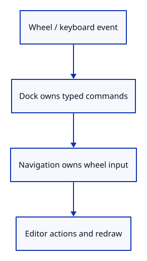

# 3.6.1 · Deliver wheel input without keyboard feature shortcuts

**Chapter 3 · Documents, editing and ownership · Section 3.6 · Shortcuts and asynchronous files** · [Contents](contents.md)

**Typing: 17–34 minutes.** [Estimate](typing-load.md).

Route wheel events through navigation::wheel, prevent page scrolling when zoom is handled, and keep printable keyboard input in the command dock. Focus the canvas when a pointer press starts navigation.

## Type

Continue from [Convert wheel units to camera zoom](21a-wheel.md). [Save or recover your work](recovery.md).

### 1. `Cargo.toml`

Enable the browser event bindings used by the command dock.

<details>
<summary>Locate the existing block</summary>

```toml

[dependencies]
wasm-bindgen = "=0.2.128"
web-sys = { version = "=0.3.105", features = ["Window", "Document", "Element", "HtmlCanvasElement", "EventTarget", "AddEventListenerOptions", "Event", "MouseEvent", "PointerEvent", "DomRect", "KeyboardEvent", "WheelEvent", "FocusOptions", "HtmlElement"] }
console_error_panic_hook = "=0.1.7"
wasm-bindgen-futures = "=0.4.78"
wgpu = "=29.0.4"
```

</details>

Edit the existing block to match this code; keep unchanged lines:

```toml
--8<-- "journey/code/22-shortcuts-dock-01.toml"
```

### 2. `src/browser.rs`

Route unconsumed canvas input through navigation_action. Retain the shared callback and dispatch wheel or pointer navigation. Focus the canvas and capture accepted pointer presses; cancel if either operation fails.

Edit these blocks from bottom to top. Keep the surrounding lines unchanged.

<details>
<summary>Locate this block</summary>

```rust
        "pointerdown" => {
            if pointer.is_primary() && gesture.press(id, pointer.button(), position) {
                event.prevent_default();
                if canvas.set_pointer_capture(id).is_err() {
                    gesture.cancel();
                }
            }
```

</details>

Replace it with:

```rust
        "pointerdown" => {
            if pointer.is_primary() && gesture.press(id, pointer.button(), position) {
                event.prevent_default();
                let options = web_sys::FocusOptions::new();
                options.set_prevent_scroll(true);
                if canvas.focus_with_options(&options).is_err()
                    || canvas.set_pointer_capture(id).is_err()
                {
                    gesture.cancel();
                }
            }
```

<details>
<summary>Locate this block</summary>

```rust
    window.add_event_listener_with_callback("blur", update.as_ref().unchecked_ref())?;
    // Both event sources retain this one callback for the lifetime of the page.
    update.forget();
    report("Right-drag to orbit. Left-click to select. A cancelled drag stops immediately.");
    Ok(())
}

fn pointer_action(
    event: &web_sys::Event,
    canvas: &web_sys::HtmlCanvasElement,
```

</details>

Replace it with:

```rust
    window.add_event_listener_with_callback("blur", update.as_ref().unchecked_ref())?;
    // Both event sources retain this one callback for the lifetime of the page.
    update.forget();
    report("Wheel zooms; type commands anywhere in the drawing. Escape cancels a drag.");
    Ok(())
}

fn navigation_action(
    event: &web_sys::Event,
    canvas: &web_sys::HtmlCanvasElement,
    gesture: &mut Gesture,
) -> Option<Action> {
    let action = match event.type_().as_str() {
        "wheel" => {
            let wheel = event.dyn_ref::<web_sys::WheelEvent>()?;
            let mode = wheel.delta_mode();
            crate::navigation::wheel(
                wheel.delta_y(),
                mode,
                canvas.get_bounding_client_rect().height(),
            )
        }
        "keydown" => {
            let key = event.dyn_ref::<web_sys::KeyboardEvent>()?;
            if key.is_composing() || key.alt_key() {
                return None;
            }
            if key.key() == "Escape" {
                gesture.cancel();
                event.prevent_default();
                return None;
            }
            return None;
        }
        _ => return pointer_action(event, canvas, gesture),
    }?;
    event.prevent_default();
    Some(action)
}

fn pointer_action(
    event: &web_sys::Event,
    canvas: &web_sys::HtmlCanvasElement,
```

<details>
<summary>Locate this block</summary>

```rust
            };
            Some(action)
        } else if !panel.consumed {
            pointer_action(&event, &pointer_canvas, &mut gesture)
        } else {
            None
        };
```

</details>

Replace it with:

```rust
            };
            Some(action)
        } else if !panel.consumed {
            navigation_action(&event, &pointer_canvas, &mut gesture)
        } else {
            None
        };
```

<details>
<summary>Complete updated block reference</summary>

```rust
use crate::background::Background;
use crate::editor::{Action, Change, Editor};
use crate::gesture::Gesture;
use crate::renderer::Renderer;
use crate::viewport::Viewport;
use wasm_bindgen::{JsCast, JsValue, closure::Closure};

pub fn report(message: &str) {
    if let Some(document) = web_sys::window().and_then(|window| window.document()) {
        if let Some(status) = document.get_element_by_id("status") {
            status.set_text_content(Some(message));
            if message.starts_with("Cannot") { let _ = status.remove_attribute("hidden"); }
        }
    }
}

pub async fn run() -> Result<(), JsValue> {
    let window = web_sys::window().ok_or("No browser window")?;
    let document = window.document().ok_or("No document")?;
    let canvas: web_sys::HtmlCanvasElement = document
        .get_element_by_id("canvas")
        .ok_or("Missing canvas")?
        .dyn_into()?;
    let instance = wgpu::Instance::new(wgpu::InstanceDescriptor {
        backends: wgpu::Backends::BROWSER_WEBGPU,
        flags: Default::default(),
        memory_budget_thresholds: Default::default(),
        backend_options: Default::default(),
        display: None,
    });
    let surface = instance
        .create_surface(wgpu::SurfaceTarget::Canvas(canvas.clone()))
        .map_err(|error| JsValue::from_str(&error.to_string()))?;
    let adapter = instance
        .request_adapter(&wgpu::RequestAdapterOptions {
            compatible_surface: Some(&surface),
            ..Default::default()
        })
        .await
        .map_err(|error| JsValue::from_str(&error.to_string()))?;
    let (device, queue) = adapter
        .request_device(&wgpu::DeviceDescriptor::default())
        .await
        .map_err(|error| JsValue::from_str(&error.to_string()))?;
    device.on_uncaptured_error(std::sync::Arc::new(|error| report(&error.to_string())));
    let limit = device.limits().max_texture_dimension_2d;
    let width = (window.inner_width()?.as_f64().ok_or("No window width")? as u32).clamp(1, limit);
    let height = (window.inner_height()?.as_f64().ok_or("No window height")? as u32).clamp(1, limit);
    canvas.set_width(width);
    canvas.set_height(height);
    let mut config = surface
        .get_default_config(&adapter, width, height)
        .ok_or("No compatible surface format")?;
    config.view_formats = vec![config.format.add_srgb_suffix()];
    surface.configure(&device, &config);
    let mut editor = Editor::default();
    let mut renderer = Renderer::new(
        device,
        queue,
        config.format.add_srgb_suffix(),
        &editor.scene,
    );
    renderer.resize(Viewport { width, height });
    let mut panel = crate::panel::Panel::new(
        &renderer,
        config.format.add_srgb_suffix(),
        &[
            "Help",
            "Example Box",
            "Example Triangle",
            "Select Next",
            "Delete",
            "Undo",
            "Redo",
            "Background",
            "Zoom In",
            "Zoom Out",
            "Pan Left",
            "Pan Right",
            "Orbit Right",
            "Orbit Up",
            "View Isometric",
            "View Reset",
        ],
    );
    panel.update(None, &canvas)?;
    if resize(
        &window,
        &canvas,
        &surface,
        &mut config,
        &mut renderer,
        &mut editor,
    ) {
        panel.update(None, &canvas)?;
        present(
            &surface,
            &renderer,
            &editor.background,
            &editor.camera.uniform(),
            &mut panel,
        )?;
    }
    let input_canvas = canvas.clone();
    let browser_window = window.clone();
    let pointer_canvas = canvas.clone();
    let mut gesture = Gesture::default();
    let update = Closure::<dyn FnMut(web_sys::Event)>::new(move |event: web_sys::Event| {
        let line = match panel.update(Some(&event), &input_canvas) {
            Ok(line) => line,
            Err(error) => {
                report(&format!("Cannot read command: {error:?}"));
                return;
            }
        };
        let action = if let Some(line) = line {
            let action = match line.as_str() {
                "example box" => Action::AddBox,
                "example triangle" => Action::ToggleExtra,
                "select next" => Action::SelectNext,
                "delete" => Action::Delete,
                "undo" => Action::Undo,
                "redo" => Action::Redo,
                "background" => Action::Background,
                "zoom in" => Action::Zoom(2.0),
                "zoom out" => Action::Zoom(0.5),
                "pan left" => Action::Pan(-0.25, 0.0),
                "pan right" => Action::Pan(0.25, 0.0),
                "orbit right" => Action::Orbit(std::f64::consts::FRAC_PI_4, 0.0),
                "orbit up" => Action::Orbit(0.0, std::f64::consts::FRAC_PI_6),
                "view isometric" => Action::Isometric,
                "view reset" => Action::ResetView,
                _ => return,
            };
            Some(action)
        } else if !panel.consumed {
            navigation_action(&event, &pointer_canvas, &mut gesture)
        } else {
            None
        };
        if let Some(action) = action {
            match editor.apply(action) {
                Ok(Change::Scene) => renderer.set_scene(&editor.scene, editor.selected),
                Ok(Change::View) => {}
                Err(error) => {
                    report(error);
                    return;
                }
            }
        }
        if resize(
            &browser_window,
            &pointer_canvas,
            &surface,
            &mut config,
            &mut renderer,
            &mut editor,
        ) {
            if let Err(error) = panel.update(None, &input_canvas) {
                report(&format!("Cannot lay out commands: {error:?}"));
                return;
            }
            if let Err(error) = present(
                &surface,
                &renderer,
                &editor.background,
                &editor.camera.uniform(),
                &mut panel,
            ) {
                report(&format!("Cannot redraw: {error:?}"));
            }
        }
    });
    for name in [
        "pointerdown",
        "pointermove",
        "pointerup",
        "pointercancel",
        "lostpointercapture",
        "contextmenu",
        "keydown",
        "keyup",
        "blur",
    ] {
        canvas.add_event_listener_with_callback(name, update.as_ref().unchecked_ref())?;
    }
    let options = web_sys::AddEventListenerOptions::new();
    options.set_passive(false);
    canvas.add_event_listener_with_callback_and_add_event_listener_options(
        "wheel",
        update.as_ref().unchecked_ref(),
        &options,
    )?;
    window.add_event_listener_with_callback("resize", update.as_ref().unchecked_ref())?;
    window.add_event_listener_with_callback("blur", update.as_ref().unchecked_ref())?;
    // Both event sources retain this one callback for the lifetime of the page.
    update.forget();
    report("Wheel zooms; type commands anywhere in the drawing. Escape cancels a drag.");
    Ok(())
}

fn navigation_action(
    event: &web_sys::Event,
    canvas: &web_sys::HtmlCanvasElement,
    gesture: &mut Gesture,
) -> Option<Action> {
    let action = match event.type_().as_str() {
        "wheel" => {
            let wheel = event.dyn_ref::<web_sys::WheelEvent>()?;
            let mode = wheel.delta_mode();
            crate::navigation::wheel(
                wheel.delta_y(),
                mode,
                canvas.get_bounding_client_rect().height(),
            )
        }
        "keydown" => {
            let key = event.dyn_ref::<web_sys::KeyboardEvent>()?;
            if key.is_composing() || key.alt_key() {
                return None;
            }
            if key.key() == "Escape" {
                gesture.cancel();
                event.prevent_default();
                return None;
            }
            return None;
        }
        _ => return pointer_action(event, canvas, gesture),
    }?;
    event.prevent_default();
    Some(action)
}

fn pointer_action(
    event: &web_sys::Event,
    canvas: &web_sys::HtmlCanvasElement,
    gesture: &mut Gesture,
) -> Option<Action> {
    match event.type_().as_str() {
        "contextmenu" => {
            event.prevent_default();
            return None;
        }
        "blur" | "resize" => {
            gesture.cancel();
            return None;
        }
        _ => {}
    }
    let pointer = event.dyn_ref::<web_sys::PointerEvent>()?;
    let id = pointer.pointer_id();
    let position = [pointer.client_x() as f64, pointer.client_y() as f64];
    let motion = match event.type_().as_str() {
        "pointerdown" => {
            if pointer.is_primary() && gesture.press(id, pointer.button(), position) {
                event.prevent_default();
                let options = web_sys::FocusOptions::new();
                options.set_prevent_scroll(true);
                if canvas.focus_with_options(&options).is_err()
                    || canvas.set_pointer_capture(id).is_err()
                {
                    gesture.cancel();
                }
            }
            None
        }
        "pointermove" => gesture.move_to(id, position),
        "pointerup" => {
            let motion = gesture.release(id, position);
            let _ = canvas.release_pointer_capture(id);
            motion
        }
        "pointercancel" | "lostpointercapture" => {
            gesture.cancel_pointer(id);
            None
        }
        _ => None,
    }?;
    let rect = canvas.get_bounding_client_rect();
    motion.action([rect.left(), rect.top(), rect.width(), rect.height()])
}

fn resize(
    window: &web_sys::Window,
    canvas: &web_sys::HtmlCanvasElement,
    surface: &wgpu::Surface<'_>,
    config: &mut wgpu::SurfaceConfiguration,
    renderer: &mut Renderer,
    editor: &mut Editor,
) -> bool {
    let rect = canvas.get_bounding_client_rect();
    let limit = renderer.device.limits().max_texture_dimension_2d;
    let Some(size) = Viewport::from_css(
        rect.width(),
        rect.height(),
        window.device_pixel_ratio(),
        limit,
    ) else {
        return false;
    };
    if size.width != config.width || size.height != config.height {
        canvas.set_width(size.width);
        canvas.set_height(size.height);
        config.width = size.width;
        config.height = size.height;
        surface.configure(&renderer.device, config);
        renderer.resize(size);
    }
    editor.camera.aspect = size.aspect();
    true
}

fn present(
    surface: &wgpu::Surface<'_>,
    renderer: &Renderer,
    background: &Background,
    transform: &[f32; 16],
    panel: &mut crate::panel::Panel,
) -> Result<(), JsValue> {
    let frame = match surface.get_current_texture() {
        wgpu::CurrentSurfaceTexture::Success(frame)
        | wgpu::CurrentSurfaceTexture::Suboptimal(frame) => frame,
        other => {
            return Err(JsValue::from_str(&format!(
                "Surface unavailable: {other:?}"
            )));
        }
    };
    let view = frame.texture.create_view(&wgpu::TextureViewDescriptor {
        format: Some(frame.texture.format().add_srgb_suffix()),
        ..Default::default()
    });
    renderer.draw(&view, background, transform);
    panel.draw(renderer, &view);
    frame.present();
    Ok(())
}
```

</details>

<details>
<summary>Optional patch references</summary>

Use these original edit fragments when comparing a saved checkpoint. Apply the complete blocks above.

```text
--8<-- "journey/code/22-shortcuts-window-1.rs"
```

```text
--8<-- "journey/code/22-shortcuts-window-2.rs"
```

```text
--8<-- "journey/code/22-shortcuts-window-3.rs"
```

</details>

## Run and check

In your project:

```sh
cd workspace/journey
REGEN_PROTO=0 cargo build --lib --locked --target wasm32-unknown-unknown -j1
REGEN_PROTO=0 CARGO_BUILD_JOBS=1 trunk serve --port 8780
```

Open `http://127.0.0.1:8780/`. Keep an existing Trunk server running; saving rebuilds it.

Wheel over the scene to zoom. Click the canvas and type Pan Right; the first character reaches the dock and Enter pans the view.

### Recorded visual result

**Previous native render — current verification pending.**

The helper adds the box, chooses Isometric, applies a −120-pixel wheel input, then the same Pan Right action used by the command. Pixel checks verify the resulting face; browser checks verify wheel delivery and typing ownership.


*This recorded image predates a source or checker change. Rebuild this checkpoint before using it as current evidence; browser controls require separate acceptance.*

This reference image is shared with [3.5.2 · Convert wheel units to camera zoom](21a-wheel.md). It does not demonstrate a new feature by itself.

<details>
<summary>Code explanation and diagram</summary>

There is no keyboard feature map. Text-editing keys stay with the dock; Escape can cancel gesture state through the navigation route when the dock has not consumed it.

Wheel → navigation_action → Editor; printable key → command dock → typed Action.



Why request a non-passive wheel listener?

Handled wheel navigation must call prevent_default so the browser does not scroll the page.

Study estimate, including typing and experiments: 0.5–1 hours.

</details>

<details>
<summary>Optional experiment</summary>

Change wheel sensitivity from 0.002 to 0.001, predict the difference, and try it before restoring the value. Run `Undo` after several wheel movements: it removes the box while preserving the camera. Run `Redo` to restore it. Explain why navigation does not enter document history. Finally Tab away during a drag; the canvas blur listener should cancel it.

</details>

<details>
<summary>Check and save your work</summary>

Restore experimental edits, then run from `session_viewer`:

```sh
npm --prefix ../session_tests run course -- check 3.6.1
npm --prefix ../session_tests run course -- save 3.6.1
```

Source comparison leaves your project untouched. [Save and recovery instructions](recovery.md).

</details>

<details>
<summary>Viewer coverage and verification</summary>

The maintained viewer routes mouse and phone navigation through src/app/input.rs. Printable input activates the command dock immediately; named commands share the existing state and history. This checkpoint keeps wheel zoom centred on the camera target. Pointer-centred zoom and phone gestures will extend navigation without introducing keyboard feature shortcuts.

Chrome checks actual wheel zoom without page scrolling, equivalent line/page wheel events, and immediate typing after canvas focus without keyboard feature shortcuts.

[Full validation scope](release.md).

To reproduce the scripted acceptance of the reference checkpoint, run from `session_viewer` with the [course bundle server](release.md#reproduce) running on port 8781:

```sh
npm --prefix ../session_tests run course -- capture 3.6.1
```

This uses the verified reference bundle; it does not check or change your typed project.

</details>
