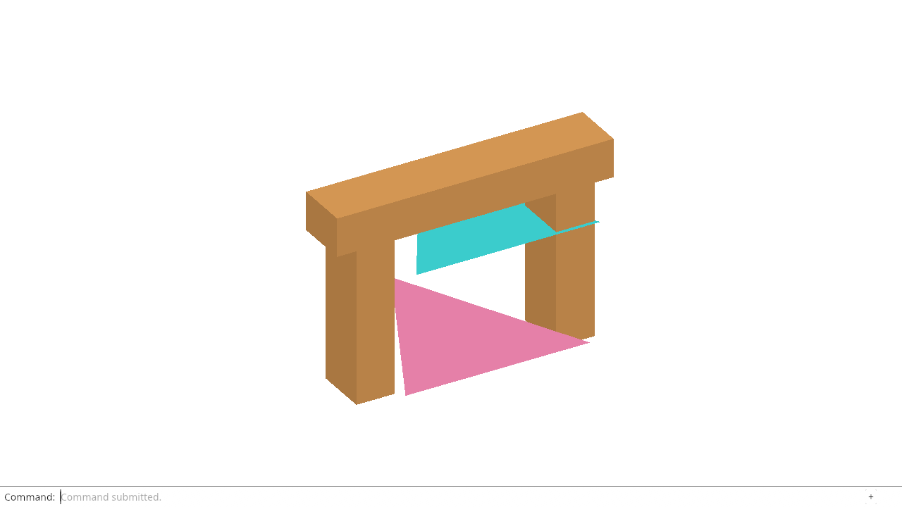

# Validated files, bounds and useful projections

Open a three-piece frame from a protobuf file, fit it in either projection, select one part and undo the whole import.

<a id="checkpoint-22a-records"></a>
<a id="checkpoint-22b-session"></a>
<a id="checkpoint-22c-decode"></a>
<a id="checkpoint-22d-import"></a>
<a id="checkpoint-22e-file-reader"></a>
<a id="checkpoint-23-import"></a>
<a id="checkpoint-23a-bounds"></a>
<a id="checkpoint-23b-fit-camera"></a>
<a id="checkpoint-24-fit"></a>
<a id="checkpoint-24a-projection"></a>
<a id="checkpoint-24b-projection-actions"></a>
<a id="checkpoint-25-projection"></a>
<a id="checkpoint-26-selected"></a>
<a id="checkpoint-26a-keys"></a>

## Prerequisites and ownership

Complete [One drawing size and one captured gesture](19a-viewport.md). You need stable object IDs, shared mesh ownership, transactional document history, camera rays and the command dock.

This subject introduces `src/document.rs`, `src/specimen.rs`, `examples/sample.rs`, `src/file_input.rs`, `src/bounds.rs`, `src/shortcuts.rs` and their five test modules. They teach file admission, retained source references, bounds and shortcut classification.

The current checkpoint also changes `src/scene.rs`, `src/editor.rs`, `src/browser.rs`, `src/camera.rs`, `src/panel.rs`, `src/lib.rs`, `Cargo.toml` and `index.html`. These eight existing-file changes remain an ownership conflict; combining the internal steps does not resolve it or establish production parity.

The smallest compatible command registration boundary is production's `Spec`, `Action` and `REGISTRY`: completion metadata and parsing belong to a verb; the shared callback dispatches the parsed action. Import completion must enter that same dispatcher with its retained bytes and request identity. Bounds belong to the scene owner, projection and fitting to the camera owner, and keyboard ownership to the input owner. Their final implementations must move into those subjects before this checkpoint can satisfy finished ownership. The maintained action interface borrows `State`; substituting a second permanent editor interface would leave another endpoint migration.

## Build

### Admit a complete document before changing the scene

Type `src/document.rs`:

```rust
--8<-- "journey/code/22a-final-2.rs"
```

Type `src/scene.rs`:

```rust
--8<-- "journey/code/22a-final-7.rs"
```


`document::load` first checks the byte limit, decodes a protobuf record and validates its topology. Only then does it construct a kernel `Session` and derive display meshes. Returning `Loaded` means all these operations succeeded; no partially decoded document has reached the scene.

The checkpoint accepts one to sixty-four meshes within four MiB. Each mesh needs distinct source identity, finite coordinates, existing vertex references and supported triangle or quad faces. Stored triangulations must also reference existing faces and vertices. Unsupported placements, definitions, geometry families and colour modes are rejected explicitly. These are checkpoint restrictions, not the production decoder's capabilities.

`Source` pairs an `Rc<Session>` with the original mesh GUID. Cloning the reference keeps the original kernel document available without copying it into every displayed object. A viewer `ObjectId` identifies one occurrence in the scene; it is not the source GUID. Importing the same bytes twice creates different viewer IDs while retaining the same authored GUID values in two document owners.

### Make import one undo transaction

Type `src/editor.rs`:

```rust
--8<-- "journey/code/22a-final-8.rs"
```

Type `src/specimen.rs`:

```rust
--8<-- "journey/code/22a-final-4.rs"
```

Type `examples/sample.rs`:

```rust
--8<-- "journey/code/22a-final-5.rs"
```

Type `src/document_tests.rs`:

```rust
--8<-- "journey/code/22a-final-6.rs"
```


`Scene::import` inserts each derived mesh and attaches its source reference. `Editor::apply` performs decoding before opening the history transaction, then uses `try_edit` for the insertion. A failure rolls the scene back, including a failure after some insertions. A successful import creates one undo step for the whole file.

Camera operations return a view change and do not enter document history. Undoing an import therefore removes all three imported parts without undoing a subsequent zoom. Selection is repaired after document changes because its object might no longer exist.

The specimen constructs two posts and a beam with the live kernel, assigns colours and exports a session. The sample executable writes those bytes to `sample.pb`; tests and the browser exercise the same representation. The document tests cover shared source identity across undo/redo, repeated imports, malformed records and preservation of an existing redo branch after rejection.

### Deliver only the current file request

Type `src/file_input.rs`:

```rust
--8<-- "journey/code/22a-final-9.rs"
```

Type `index.html`:

```html
--8<-- "journey/code/22a-final-10.html"
```

Type `src/browser.rs`:

```rust
--8<-- "journey/code/22a-final-11.rs"
```


The browser opens a hidden file input in response to the `Open` command. Clearing the input's value after selection lets the same file be selected again. Each selection increments a shared request counter before checking its size. An oversized newer request therefore invalidates an older pending read even though it never reads its own bytes.

`File.arrayBuffer()` completes asynchronously. Its continuation compares the captured request ID with the current counter before dispatching `viewer-file`. A stale completion cannot import geometry or replace the current error message. The event carries a JavaScript byte array; the event receiver checks its size again before copying it to Rust and producing the import action.

The input element, web-sys file/event features and browser listener are wiring for this delivery path. They do not transfer scene or GPU ownership into the asynchronous continuation. JavaScript reads can finish in any order; the document transaction still runs through the event handler.

### Fit a bounding sphere through the narrower opening

Type `src/bounds.rs`:

```rust
--8<-- "journey/code/22a-final-12.rs"
```

Type `src/camera.rs`:

```rust
--8<-- "journey/code/22a-final-14.rs"
```

Type `src/fit_tests.rs`:

```rust
--8<-- "journey/code/22a-final-13.rs"
```

Type `src/projection_tests.rs`:

```rust
--8<-- "journey/code/22a-final-15.rs"
```

Type `src/selected_fit_tests.rs`:

```rust
--8<-- "journey/code/22a-final-16.rs"
```


`Bounds` accumulates componentwise minima and maxima. Its centre is their midpoint and its radius is half the box diagonal. Empty scenes have no bounds. Selected fitting traverses only the chosen object's vertices, using the same geometric definition.

Perspective fitting must satisfy both horizontal and vertical fields of view. The horizontal half-angle comes from the aspect ratio and vertical half-angle. Divide the sphere radius by the sine of the smaller half-angle, then apply the 1.1 margin. This is why an upright viewport requires a greater distance than a wide viewport for the same sphere.

Orthographic projection has no perspective shrinkage with depth. Here the distance parameter controls its visible half-height, so fitting uses the tangent of the vertical half-angle and the smaller of the aspect ratio and one. A degenerate point bound receives a usable fallback radius. Fitting preserves orientation and aspect; it changes the target, scale and depth-related radius.

Both projections produce a view-projection matrix and use its inverse to construct picking rays. Unprojecting normalized depths zero and one gives the ray's endpoints and finite range. The same method supports both projections without a second picking implementation.

The fit tests project all box corners at wide and upright aspect ratios. Projection tests check ray agreement, orthographic parallelism and depth range. Selected-fit tests distinguish fitting one object from fitting the entire scene and check that view changes leave history intact.

### Respect the owner of keyboard input

Type `src/shortcuts.rs`:

```rust
--8<-- "journey/code/22a-final-17.rs"
```

Type `src/shortcuts_tests.rs`:

```rust
--8<-- "journey/code/22a-final-19.rs"
```

Type `src/panel.rs`:

```rust
--8<-- "journey/code/22a-final-18.rs"
```


Shortcut classification is a pure function. Alt combinations and text composition do not become scene commands. Command-Z, Command-Shift-Z and Command-Y may operate on document history when they do not belong to nonempty focused text. An unmodified F fits only when text input does not own the keyboard.

The panel rejects repeated keydown events before asking the classifier. The browser prevents the default action only for an accepted shortcut and dispatches its command through the existing command path. The shortcut tests exercise text focus, modifiers and composition separately from browser event delivery.

### Register the subject

Type `Cargo.toml`:

```toml
--8<-- "journey/code/22a-final-1.toml"
```

Type `src/lib.rs`:

```rust
--8<-- "journey/code/22a-final-3.rs"
```

## Run and observe

From `session_viewer`, run `npm --prefix ../session_tests run course -- check 22a-records` against your handwritten project. Build and serve with the [repository resource guards](../maintaining.md); automated runtime validation uses `npm --prefix ../session_tests run course -- verify 22a-records` under those guards.

Build the sample executable under the repository's resource guards, then open its `sample.pb` through the viewer's `Open` command. The scene should gain two brown posts and their top beam beside the existing triangles. `View Isometric` and `Fit` should bring the complete scene into view. Switch between `View Perspective` and `View Orthographic`, fitting again after each switch. Selecting one part and running `Fit Selected` should frame that part without deleting its neighbours.

Undo once: all three imported parts should disappear together. Redo should restore their identities and source ownership. Import a malformed file after creating a redo branch: the scene, selection and redo branch should survive. Repeat at a wide and an upright viewport; fitting should preserve geometry proportions.



The [upright browser result](../screenshots/journey/records-fitted-20261114-portrait.png) keeps the imported frame and existing triangles inside the viewport after Fit. The initial camera and Fit Selected can leave other objects outside the view.

## Predict and try

Begin reading one valid file, then select an oversized file before the first read finishes. Predict which result is allowed to change the scene. The newer selection owns the request counter even though it is rejected before reading; the old successful read must not import later or overwrite the rejection message.

Next import the specimen twice, select a part and undo the second import. Predict whether the first import's source GUID changes. Its GUID belongs to the retained source document and stays unchanged; viewer occurrence IDs distinguish the imports.

## Question and answer

Why does an imported object need both a viewer ID and a source GUID?

The viewer ID identifies one scene occurrence. The source GUID identifies geometry in its retained kernel document, so repeated imports can preserve authored references without sharing scene identity.

## Validation

The 67-file cumulative checkpoint passes 73 native library tests, optimized WASM and Trunk builds, and desktop/upright browser checks. Actual file selection, stale reads, transactional import, projection fitting, keyboard ownership and early mathematics navigation passed. The [runtime receipt](release/records-runtime-windows-20261114.json) binds these results to the exact source and captured frames. Viewport emulation does not establish physical-phone or selected hardware-adapter acceptance.

The restricted importer is not the maintained production decoder; eight existing files still change here. Finished-subject ownership and production parity remain unfinished. The earlier [native](release/records-native-windows-20261114.json), [documentation](release/records-docs-windows-20261114.json) and [fixture](release/records-fixture-windows-20261114.json) receipts retain their original validation scopes.

Continue with [Local sources, world placement and display caches](consolidation/27-placement.md).
