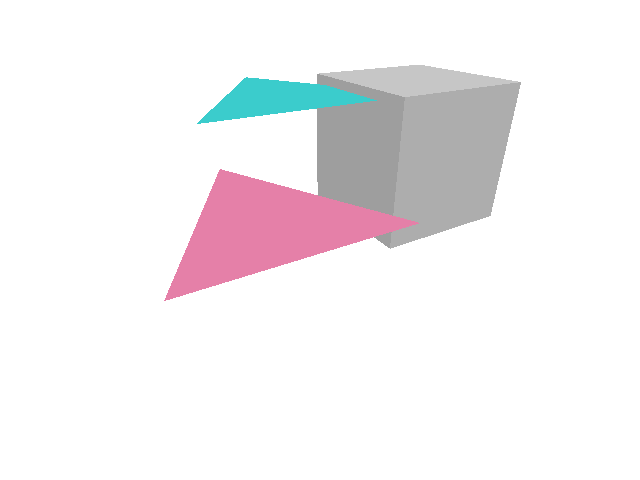
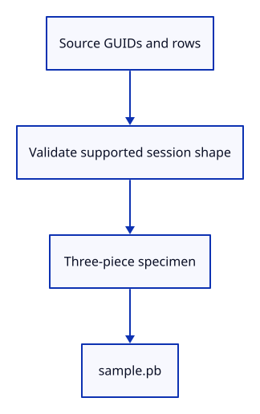

# 3.6.3 · Validate session identity and build a sample file

**Chapter 3 · Documents, editing and ownership · Section 3.6 · Shortcuts and asynchronous files** · [Contents](contents.md)

**Typing: 28–56 minutes.** [Estimate](typing-load.md).

Retain a shared Session with its display meshes and source GUIDs. Validate the supported session shape and flat tree before decoding it into kernel objects.

## Type

Continue from [Validate a raw mesh record](22a-records.md). [Save or recover your work](recovery.md).

### 1. `src/document.rs`

Import the GUID set used by session validation. Check supported geometry, unique GUIDs and one flat tree row per mesh.

<details>
<summary>Locate the existing block</summary>

```rust
use crate::mesh::Mesh;
use session_rust::{proto, Session};
use std::rc::Rc;

pub const MAX_BYTES: usize = 4 * 1024 * 1024;

#[derive(Clone)]
pub struct Source {
    pub document: Rc<Session>,
    pub guid: String,
}

pub struct Loaded {
    pub document: Rc<Session>,
    pub meshes: Vec<(String, Mesh)>,
}

pub fn validate_mesh(mesh: &proto::Mesh) -> Result<(), &'static str> {
    if mesh.vertices.len() > 10_000 || mesh.faces.is_empty() || mesh.faces.len() > 10_000 {
        return Err("A mesh needs faces and at most 10,000 vertices and faces");
    }
    if mesh.color_mode != 0 { return Err("Per-face and per-vertex colours arrive later"); }
    for (&key, vertex) in &mesh.vertices {
        if key > u32::MAX as u64 || [vertex.x, vertex.y, vertex.z].iter().any(|v| !v.is_finite()) {
            return Err("Invalid vertex key or coordinate");
        }
    }
    for (&key, face) in &mesh.faces {
        if key > u32::MAX as u64 || !(3..=4).contains(&face.vertices.len()) || !face.holes.is_empty()
            || face.vertices.iter().any(|key| !mesh.vertices.contains_key(key)) {
            return Err("This checkpoint needs triangles or quads with existing vertices and no holes");
        }
    }
    for (key, triangles) in &mesh.triangulation {
        if !mesh.faces.contains_key(key) || triangles.vertices.len() % 3 != 0
            || triangles.vertices.iter().any(|key| !mesh.vertices.contains_key(key)) {
            return Err("Invalid stored triangulation");
        }
    }
    Ok(())
}

#[cfg(test)]
mod record_checks {
    use super::validate_mesh;

    #[test]
    fn raw_mesh_records_are_checked_before_construction() {
        let mut record = session_rust::Mesh::create_box(1.0, 1.0, 1.0).to_proto();
        assert!(validate_mesh(&record).is_ok());
        record.vertices.values_mut().next().unwrap().x = f64::NAN;
        assert!(validate_mesh(&record).is_err());
        record.vertices.values_mut().for_each(|vertex| vertex.x = 0.0);
        record.faces.values_mut().next().unwrap().vertices[0] = u64::MAX;
        assert!(validate_mesh(&record).is_err());
    }
}
```

</details>

Edit the existing block to match this code; keep unchanged lines:

```rust
use crate::mesh::Mesh;
use session_rust::{proto, Session};
use std::{collections::HashSet, rc::Rc};

pub const MAX_BYTES: usize = 4 * 1024 * 1024;

#[derive(Clone)]
pub struct Source {
    pub document: Rc<Session>,
    pub guid: String,
}

pub struct Loaded {
    pub document: Rc<Session>,
    pub meshes: Vec<(String, Mesh)>,
}

pub fn validate(message: &proto::Session) -> Result<(), &'static str> {
    let objects = message.objects.as_ref().ok_or("Session has no objects")?;
    if !message.xforms.is_empty() || message.definitions.is_some() || !message.interactions.is_empty() {
        return Err("Placements, definitions and interactions arrive in later checkpoints");
    }
    let other = objects.points.len() + objects.lines.len() + objects.planes.len()
        + objects.bboxes.len() + objects.polylines.len() + objects.pointclouds.len()
        + objects.nurbscurves.len() + objects.nurbssurfaces.len() + objects.breps.len()
        + objects.elements.len() + objects.components.len() + objects.sheets.len() + objects.instances.len();
    if other != 0 || objects.meshes.is_empty() || objects.meshes.len() > 64 {
        return Err("This checkpoint accepts 1–64 meshes and no other geometry types");
    }
    let mut guids = HashSet::new();
    for mesh in &objects.meshes {
        if mesh.guid.is_empty() || !guids.insert(mesh.guid.as_str()) {
            return Err("Every mesh needs a distinct source GUID");
        }
        validate_mesh(mesh)?;
    }
    if let Some(root) = message.tree.as_ref().and_then(|tree| tree.root.as_ref()) {
        let names: HashSet<_> = root.children.iter().map(|node| node.name.as_str()).collect();
        if names != guids || root.children.len() != guids.len()
            || root.children.iter().any(|node| !node.children.is_empty()) {
            return Err("This checkpoint needs one flat tree row per mesh");
        }
    }
    Ok(())
}

pub fn validate_mesh(mesh: &proto::Mesh) -> Result<(), &'static str> {
    if mesh.vertices.len() > 10_000 || mesh.faces.is_empty() || mesh.faces.len() > 10_000 {
        return Err("A mesh needs faces and at most 10,000 vertices and faces");
    }
    if mesh.color_mode != 0 { return Err("Per-face and per-vertex colours arrive later"); }
    for (&key, vertex) in &mesh.vertices {
        if key > u32::MAX as u64 || [vertex.x, vertex.y, vertex.z].iter().any(|v| !v.is_finite()) {
            return Err("Invalid vertex key or coordinate");
        }
    }
    for (&key, face) in &mesh.faces {
        if key > u32::MAX as u64 || !(3..=4).contains(&face.vertices.len()) || !face.holes.is_empty()
            || face.vertices.iter().any(|key| !mesh.vertices.contains_key(key)) {
            return Err("This checkpoint needs triangles or quads with existing vertices and no holes");
        }
    }
    for (key, triangles) in &mesh.triangulation {
        if !mesh.faces.contains_key(key) || triangles.vertices.len() % 3 != 0
            || triangles.vertices.iter().any(|key| !mesh.vertices.contains_key(key)) {
            return Err("Invalid stored triangulation");
        }
    }
    Ok(())
}

#[cfg(test)]
mod record_checks {
    use super::validate_mesh;

    #[test]
    fn raw_mesh_records_are_checked_before_construction() {
        let mut record = session_rust::Mesh::create_box(1.0, 1.0, 1.0).to_proto();
        assert!(validate_mesh(&record).is_ok());
        record.vertices.values_mut().next().unwrap().x = f64::NAN;
        assert!(validate_mesh(&record).is_err());
        record.vertices.values_mut().for_each(|vertex| vertex.x = 0.0);
        record.faces.values_mut().next().unwrap().vertices[0] = u64::MAX;
        assert!(validate_mesh(&record).is_err());
    }
}
```

<details>
<summary>Optional patch references</summary>

Use these original edit fragments when comparing a saved checkpoint. Apply the complete blocks above.

```text
--8<-- "journey/code/22b-session-import.rs"
```

```text
--8<-- "journey/code/22b-session-validator.rs"
```

</details>

### 2. `src/specimen.rs`

Build a small three-piece frame with the real kernel. This is our file specimen, not a second renderer or a new file format.

Create the file and type:

```rust
--8<-- "journey/code/23-import-02.rs"
```

<details>
<summary>Optional authoring helper</summary>

Copy this supplied authoring helper once. Use the linked data or recorded comparison for the browser exercise; you do not need to compile or run this native helper.

### 3. `examples/sample.rs`

Supply this optional course-author fixture generator; browser exercises use the linked data files or recorded comparison.

Copy this supplied file:

```text
--8<-- "journey/code/23-import-03.rs"
```

</details>

### 4. `src/lib.rs`

Register the specimen builder.

<details>
<summary>Locate the existing block</summary>

```rust
pub mod document;
```

</details>

After that block, type:

```rust
--8<-- "journey/code/22b-session-register.rs" skip=18
```

### 5. `src/document.rs`

Check that the specimen passes validation and duplicate source GUIDs are rejected.

<details>
<summary>Locate the existing block</summary>

```rust

#[cfg(test)]
mod record_checks {
    use super::validate_mesh;

    #[test]
    fn raw_mesh_records_are_checked_before_construction() {
        let mut record = session_rust::Mesh::create_box(1.0, 1.0, 1.0).to_proto();
        assert!(validate_mesh(&record).is_ok());
        record.vertices.values_mut().next().unwrap().x = f64::NAN;
        assert!(validate_mesh(&record).is_err());
        record.vertices.values_mut().for_each(|vertex| vertex.x = 0.0);
        record.faces.values_mut().next().unwrap().vertices[0] = u64::MAX;
        assert!(validate_mesh(&record).is_err());
    }
}
```

</details>

After that block, type:

```rust
--8<-- "journey/code/22b-session-tests.rs" skip=590
```

## Run and check

In your project:

```sh
cd workspace/journey
REGEN_PROTO=0 cargo build --lib --locked --target wasm32-unknown-unknown -j1
REGEN_PROTO=0 CARGO_BUILD_JOBS=1 trunk serve --port 8780
```

Open `http://127.0.0.1:8780/`. Keep an existing Trunk server running; saving rebuilds it.

Download the [supplied sample.pb](fixtures/sample-23.pb) for the next browser import exercise. Its three meshes have distinct source identities; the supplied validation checks also cover duplicate GUIDs.

### Recorded visual result

**Previous native render — current verification pending.**



*This recorded image predates a source or checker change. Rebuild this checkpoint before using it as current evidence; browser controls require separate acceptance.*

This reference image is shared with [3.5.2 · Convert wheel units to camera zoom](21a-wheel.md). It does not demonstrate a new feature by itself.

<details>
<summary>Code explanation and diagram</summary>

HashSet compares unique mesh GUIDs with tree row names. The specimen builder creates three named meshes and writes their protobuf bytes to sample.pb.

Source GUIDs and flat rows → validated Session shape; specimen → sample.pb.



Why keep GUID separate from ObjectId?

GUID names a source mesh. ObjectId will name a particular viewer import, so the same source can be imported more than once.

Study estimate, including typing and experiments: 0.75–1.25 hours.

</details>

<details>
<summary>Optional experiment</summary>

Change the top beam width in the specimen, write sample.pb again, then restore the original value.

</details>

<details>
<summary>Check and save your work</summary>

Restore experimental edits, then run from `session_viewer`:

```sh
npm --prefix ../session_tests run course -- check 3.6.3
npm --prefix ../session_tests run course -- save 3.6.3
```

Source comparison leaves your project untouched. [Save and recovery instructions](recovery.md).

</details>

<details>
<summary>Viewer coverage and verification</summary>

Keep the source document separate from its display meshes. Later checkpoints extend supported geometry and input while retaining identity and undo boundaries.

Native checks validate session GUIDs and flat rows. The example writes the real sample file; Chrome still retains the earlier input route.

[Full validation scope](release.md).

To reproduce the scripted acceptance of the reference checkpoint, run from `session_viewer` with the [course bundle server](release.md#reproduce) running on port 8781:

```sh
npm --prefix ../session_tests run course -- capture 3.6.3
```

This uses the verified reference bundle; it does not check or change your typed project.

</details>
