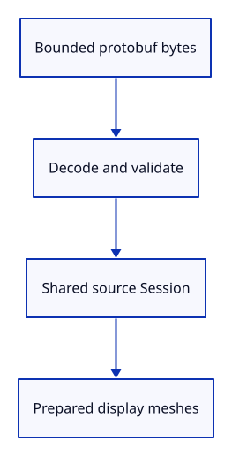

# 3.6.4 · Decode and prepare the whole import

**Chapter 3 · Documents, editing and ownership · Section 3.6 · Shortcuts and asynchronous files** · [Contents](contents.md)

**Typing: 7–14 minutes.** [Estimate](typing-load.md).

Bound byte length, decode the protobuf message, validate it, then construct one shared Session and every display mesh. Return Loaded only when the whole preparation succeeds.

## Type

Continue from [Validate session identity and build a sample file](22b-session.md). [Save or recover your work](recovery.md).

### 1. `src/document.rs`

Import the protobuf decoding trait. Decode bounded bytes and prepare every display mesh before returning a Loaded document. Keep mesh validation private to the completed loader. Replace the preparation-only record check with the complete loader checks. Replace the preparation-only session check with byte-level loader checks.

Edit these blocks from bottom to top. Keep the surrounding lines unchanged.

<details>
<summary>Locate this block</summary>

```rust
    }
    Ok(())
}

#[cfg(test)]
mod record_checks {
    use super::validate_mesh;

    #[test]
    fn raw_mesh_records_are_checked_before_construction() {
        let mut record = session_rust::Mesh::create_box(1.0, 1.0, 1.0).to_proto();
        assert!(validate_mesh(&record).is_ok());
        record.vertices.values_mut().next().unwrap().x = f64::NAN;
        assert!(validate_mesh(&record).is_err());
        record.vertices.values_mut().for_each(|vertex| vertex.x = 0.0);
        record.faces.values_mut().next().unwrap().vertices[0] = u64::MAX;
        assert!(validate_mesh(&record).is_err());
    }
}

#[cfg(test)]
mod session_checks {
    use prost::Message;

    #[test]
    fn the_specimen_has_distinct_meshes_and_flat_rows() {
        let mut record = session_rust::proto::Session::decode(crate::specimen::bytes().as_slice()).unwrap();
        assert!(super::validate(&record).is_ok());
        let meshes = &mut record.objects.as_mut().unwrap().meshes;
        meshes[1].guid = meshes[0].guid.clone();
        assert!(super::validate(&record).is_err());
    }
}
```

</details>

Replace it with:

```rust
    }
    Ok(())
}
```

<details>
<summary>Locate this block</summary>

```rust
    Ok(())
}

pub fn validate_mesh(mesh: &proto::Mesh) -> Result<(), &'static str> {
    if mesh.vertices.len() > 10_000 || mesh.faces.is_empty() || mesh.faces.len() > 10_000 {
        return Err("A mesh needs faces and at most 10,000 vertices and faces");
    }
```

</details>

Replace it with:

```rust
    Ok(())
}

fn validate_mesh(mesh: &proto::Mesh) -> Result<(), &'static str> {
    if mesh.vertices.len() > 10_000 || mesh.faces.is_empty() || mesh.faces.len() > 10_000 {
        return Err("A mesh needs faces and at most 10,000 vertices and faces");
    }
```

<details>
<summary>Locate this block</summary>

```rust
    pub meshes: Vec<(String, Mesh)>,
}

pub fn validate(message: &proto::Session) -> Result<(), &'static str> {
    let objects = message.objects.as_ref().ok_or("Session has no objects")?;
    if !message.xforms.is_empty() || message.definitions.is_some() || !message.interactions.is_empty() {
        return Err("Placements, definitions and interactions arrive in later checkpoints");
```

</details>

Replace it with:

```rust
    pub meshes: Vec<(String, Mesh)>,
}

pub fn load(bytes: &[u8]) -> Result<Loaded, &'static str> {
    if bytes.len() > MAX_BYTES { return Err("This checkpoint accepts files up to 4 MiB"); }
    let message = proto::Session::decode(bytes).map_err(|_| "Invalid session protobuf")?;
    validate(&message)?;
    let document = Rc::new(Session::from_proto(message).map_err(|_| "Cannot construct session")?);
    let mut meshes = Vec::new();
    for mesh in document.objects.meshes.iter() {
        meshes.push((mesh.guid().to_owned(), Mesh::from_kernel(mesh)?));
    }
    Ok(Loaded { document, meshes })
}

fn validate(message: &proto::Session) -> Result<(), &'static str> {
    let objects = message.objects.as_ref().ok_or("Session has no objects")?;
    if !message.xforms.is_empty() || message.definitions.is_some() || !message.interactions.is_empty() {
        return Err("Placements, definitions and interactions arrive in later checkpoints");
```

<details>
<summary>Locate this block</summary>

```rust
use crate::mesh::Mesh;
use session_rust::{proto, Session};
use std::{collections::HashSet, rc::Rc};
```

</details>

Replace it with:

```rust
use crate::mesh::Mesh;
use prost::Message;
use session_rust::{proto, Session};
use std::{collections::HashSet, rc::Rc};
```

<details>
<summary>Complete updated block reference</summary>

```rust
use crate::mesh::Mesh;
use prost::Message;
use session_rust::{proto, Session};
use std::{collections::HashSet, rc::Rc};

pub const MAX_BYTES: usize = 4 * 1024 * 1024;

#[derive(Clone)]
pub struct Source {
    pub document: Rc<Session>,
    pub guid: String,
}

pub struct Loaded {
    pub document: Rc<Session>,
    pub meshes: Vec<(String, Mesh)>,
}

pub fn load(bytes: &[u8]) -> Result<Loaded, &'static str> {
    if bytes.len() > MAX_BYTES { return Err("This checkpoint accepts files up to 4 MiB"); }
    let message = proto::Session::decode(bytes).map_err(|_| "Invalid session protobuf")?;
    validate(&message)?;
    let document = Rc::new(Session::from_proto(message).map_err(|_| "Cannot construct session")?);
    let mut meshes = Vec::new();
    for mesh in document.objects.meshes.iter() {
        meshes.push((mesh.guid().to_owned(), Mesh::from_kernel(mesh)?));
    }
    Ok(Loaded { document, meshes })
}

fn validate(message: &proto::Session) -> Result<(), &'static str> {
    let objects = message.objects.as_ref().ok_or("Session has no objects")?;
    if !message.xforms.is_empty() || message.definitions.is_some() || !message.interactions.is_empty() {
        return Err("Placements, definitions and interactions arrive in later checkpoints");
    }
    let other = objects.points.len() + objects.lines.len() + objects.planes.len()
        + objects.bboxes.len() + objects.polylines.len() + objects.pointclouds.len()
        + objects.nurbscurves.len() + objects.nurbssurfaces.len() + objects.breps.len()
        + objects.elements.len() + objects.components.len() + objects.sheets.len() + objects.instances.len();
    if other != 0 || objects.meshes.is_empty() || objects.meshes.len() > 64 {
        return Err("This checkpoint accepts 1–64 meshes and no other geometry types");
    }
    let mut guids = HashSet::new();
    for mesh in &objects.meshes {
        if mesh.guid.is_empty() || !guids.insert(mesh.guid.as_str()) {
            return Err("Every mesh needs a distinct source GUID");
        }
        validate_mesh(mesh)?;
    }
    if let Some(root) = message.tree.as_ref().and_then(|tree| tree.root.as_ref()) {
        let names: HashSet<_> = root.children.iter().map(|node| node.name.as_str()).collect();
        if names != guids || root.children.len() != guids.len()
            || root.children.iter().any(|node| !node.children.is_empty()) {
            return Err("This checkpoint needs one flat tree row per mesh");
        }
    }
    Ok(())
}

fn validate_mesh(mesh: &proto::Mesh) -> Result<(), &'static str> {
    if mesh.vertices.len() > 10_000 || mesh.faces.is_empty() || mesh.faces.len() > 10_000 {
        return Err("A mesh needs faces and at most 10,000 vertices and faces");
    }
    if mesh.color_mode != 0 { return Err("Per-face and per-vertex colours arrive later"); }
    for (&key, vertex) in &mesh.vertices {
        if key > u32::MAX as u64 || [vertex.x, vertex.y, vertex.z].iter().any(|v| !v.is_finite()) {
            return Err("Invalid vertex key or coordinate");
        }
    }
    for (&key, face) in &mesh.faces {
        if key > u32::MAX as u64 || !(3..=4).contains(&face.vertices.len()) || !face.holes.is_empty()
            || face.vertices.iter().any(|key| !mesh.vertices.contains_key(key)) {
            return Err("This checkpoint needs triangles or quads with existing vertices and no holes");
        }
    }
    for (key, triangles) in &mesh.triangulation {
        if !mesh.faces.contains_key(key) || triangles.vertices.len() % 3 != 0
            || triangles.vertices.iter().any(|key| !mesh.vertices.contains_key(key)) {
            return Err("Invalid stored triangulation");
        }
    }
    Ok(())
}
```

</details>

<details>
<summary>Optional patch references</summary>

Use these original edit fragments when comparing a saved checkpoint. Apply the complete blocks above.

```text
--8<-- "journey/code/22c-decode-message.rs"
```

```text
--8<-- "journey/code/22c-decode-load.rs"
```

```text
--8<-- "journey/code/22c-decode-private.rs"
```

</details>

<details>
<summary>Supplied validation fixture</summary>

Copy this supplied authoring fixture once. Continue with the browser build below; the course does not require running native tests.

### 2. `src/document_tests.rs`

Optional authoring fixture. Reject malformed bytes, oversize files and unsupported records before construction.

Copy this supplied file:

```text
--8<-- "journey/code/22c-decode-tests.rs"
```

</details>

### 3. `src/lib.rs`

Register the byte-level loader checks.

<details>
<summary>Locate the existing block</summary>

```rust
pub mod specimen;
```

</details>

After that block, type:

```rust
--8<-- "journey/code/22c-decode-register.rs" skip=18
```

## Run and check

In your project:

```sh
cd workspace/journey
REGEN_PROTO=0 cargo build --lib --locked --target wasm32-unknown-unknown -j1
REGEN_PROTO=0 CARGO_BUILD_JOBS=1 trunk serve --port 8780
```

Open `http://127.0.0.1:8780/`. Keep an existing Trunk server running; saving rebuilds it.

Inspect the supplied state fixtures. Invalid bytes, oversized data and unsupported records are refused before scene insertion.

### Recorded visual result

**Previous native render — current verification pending.**


*This recorded image predates a source or checker change. Rebuild this checkpoint before using it as current evidence; browser controls require separate acceptance.*

This reference image is shared with [3.5.2 · Convert wheel units to camera zoom](21a-wheel.md). It does not demonstrate a new feature by itself.

<details>
<summary>Code explanation and diagram</summary>

The ? operator stops at the first error. No scene or history is changed here, so a bad later mesh cannot leave a partial import.

Bytes → decoded record → validation → shared Session and prepared Mesh values.



Why prepare all meshes before editing the scene?

A preparation error then leaves the current scene, selection and redo branch untouched.

Study estimate, including typing and experiments: 0.75–1.25 hours.

</details>

<details>
<summary>Optional experiment</summary>

Read the six malformed-record cases and predict which validation rule rejects each one.

</details>

<details>
<summary>Check and save your work</summary>

Restore experimental edits, then run from `session_viewer`:

```sh
npm --prefix ../session_tests run course -- check 3.6.4
npm --prefix ../session_tests run course -- save 3.6.4
```

Source comparison leaves your project untouched. [Save and recovery instructions](recovery.md).

</details>

<details>
<summary>Viewer coverage and verification</summary>

Keep the source document separate from its display meshes. Later checkpoints extend supported geometry and input while retaining identity and undo boundaries.

Native checks exercise actual byte decoding and preparation failures. Chrome retains the earlier input route until the completed import is connected.

[Full validation scope](release.md).

To reproduce the scripted acceptance of the reference checkpoint, run from `session_viewer` with the [course bundle server](release.md#reproduce) running on port 8781:

```sh
npm --prefix ../session_tests run course -- capture 3.6.4
```

This uses the verified reference bundle; it does not check or change your typed project.

</details>
