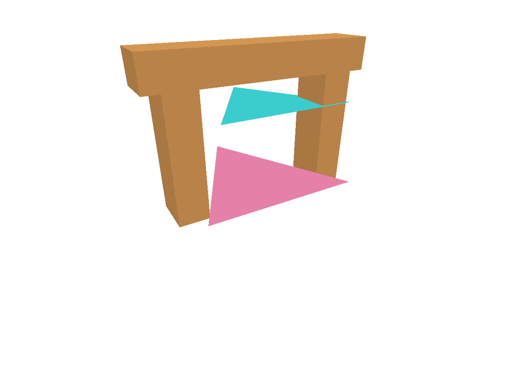
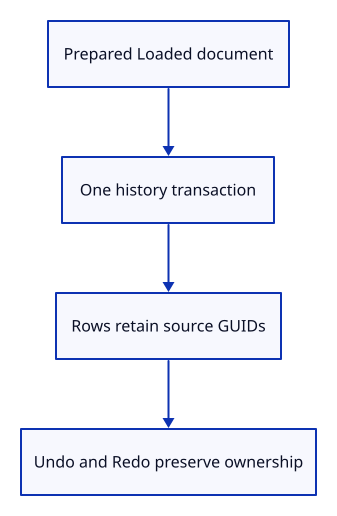

# 3.6.5 · Commit an import as one undoable action

**Chapter 3 · Documents, editing and ownership · Section 3.6 · Shortcuts and asynchronous files** · [Contents](contents.md)

**Typing: 8–15 minutes.** [Estimate](typing-load.md).

Attach the retained source Session and GUID to every imported object. Prepare bytes before starting History::try_edit, then insert the whole loaded file as one document action.

## Type

Continue from [Decode and prepare the whole import](22c-decode.md). [Save or recover your work](recovery.md).

### 1. `src/scene.rs`

An imported display object remembers the document and source GUID it came from. Demo objects have no source document. Keep the existing insertion path for demo objects. All imported rows share one retained source session. History will wrap this entire insertion in one transaction.

Edit these blocks from bottom to top. Keep the surrounding lines unchanged.

<details>
<summary>Locate this block</summary>

```rust
        let next = self.next_id.checked_add(1).ok_or("Object IDs exhausted")?;
        let id = ObjectId(self.next_id);
        self.next_id = next;
        self.objects.push(Object { id, mesh: Rc::new(mesh) });
        Ok(id)
    }

    pub fn remove(&mut self, id: ObjectId) -> bool {
        let Some(index) = self.objects.iter().position(|object| object.id == id) else { return false; };
        self.objects.remove(index);
```

</details>

Replace it with:

```rust
        let next = self.next_id.checked_add(1).ok_or("Object IDs exhausted")?;
        let id = ObjectId(self.next_id);
        self.next_id = next;
        self.objects.push(Object { id, mesh: Rc::new(mesh), source: None });
        Ok(id)
    }

    pub fn import(&mut self, loaded: crate::document::Loaded) -> Result<(), &'static str> {
        for (guid, mesh) in loaded.meshes {
            self.insert(mesh)?;
            self.objects.last_mut().unwrap().source = Some(crate::document::Source {
                document: Rc::clone(&loaded.document), guid,
            });
        }
        Ok(())
    }

    pub fn remove(&mut self, id: ObjectId) -> bool {
        let Some(index) = self.objects.iter().position(|object| object.id == id) else { return false; };
        self.objects.remove(index);
```

<details>
<summary>Locate this block</summary>

```rust
pub struct Object {
    pub id: ObjectId,
    pub mesh: Rc<Mesh>,
}

#[derive(Clone)]
```

</details>

Replace it with:

```rust
pub struct Object {
    pub id: ObjectId,
    pub mesh: Rc<Mesh>,
    pub source: Option<crate::document::Source>,
}

#[derive(Clone)]
```

<details>
<summary>Complete updated block reference</summary>

```rust
use crate::mesh::Mesh;
use std::rc::Rc;

#[derive(Clone, Copy, Debug, PartialEq, Eq)]
pub struct ObjectId(u32);

#[derive(Clone)]
pub struct Object {
    pub id: ObjectId,
    pub mesh: Rc<Mesh>,
    pub source: Option<crate::document::Source>,
}

#[derive(Clone)]
pub struct Scene {
    objects: Vec<Object>,
    next_id: u32,
    extra: Option<ObjectId>,
}

impl Scene {
    pub fn demo() -> Self {
        let pink = Mesh::new(vec![
            [-0.7, -0.6, 0.25, 0.9, 0.25, 0.45],
            [ 0.5, -0.6, 0.25, 0.9, 0.25, 0.45],
            [-0.1,  0.6, 0.25, 0.9, 0.25, 0.45],
        ], vec![0, 1, 2]).expect("Valid pink triangle");
        let turquoise = Mesh::new(vec![
            [-0.4, -0.2, 0.75, 0.05, 0.7, 0.7],
            [ 0.8, -0.2, 0.75, 0.05, 0.7, 0.7],
            [ 0.2,  0.8, 0.75, 0.05, 0.7, 0.7],
        ], vec![0, 1, 2]).expect("Valid turquoise triangle");
        let mut scene = Self { objects: Vec::new(), next_id: 1, extra: None };
        scene.insert(pink).expect("ID available");
        scene.insert(turquoise).expect("ID available");
        scene
    }

    pub fn restore(&mut self, mut saved: Self) {
        saved.next_id = saved.next_id.max(self.next_id);
        *self = saved;
    }

    pub fn objects(&self) -> &[Object] {
        &self.objects
    }

    pub fn insert(&mut self, mesh: Mesh) -> Result<ObjectId, &'static str> {
        let next = self.next_id.checked_add(1).ok_or("Object IDs exhausted")?;
        let id = ObjectId(self.next_id);
        self.next_id = next;
        self.objects.push(Object { id, mesh: Rc::new(mesh), source: None });
        Ok(id)
    }

    pub fn import(&mut self, loaded: crate::document::Loaded) -> Result<(), &'static str> {
        for (guid, mesh) in loaded.meshes {
            self.insert(mesh)?;
            self.objects.last_mut().unwrap().source = Some(crate::document::Source {
                document: Rc::clone(&loaded.document), guid,
            });
        }
        Ok(())
    }

    pub fn remove(&mut self, id: ObjectId) -> bool {
        let Some(index) = self.objects.iter().position(|object| object.id == id) else { return false; };
        self.objects.remove(index);
        if self.extra == Some(id) {
            self.extra = None;
        }
        true
    }

    pub fn contains(&self, id: ObjectId) -> bool {
        self.objects.iter().any(|object| object.id == id)
    }

    pub fn next(&self, current: Option<ObjectId>) -> Option<ObjectId> {
        if self.objects.is_empty() {
            return None;
        }
        let index = self.objects.iter().position(|object| Some(object.id) == current)
            .map_or(0, |index| index + 1);
        Some(self.objects[index % self.objects.len()].id)
    }

    pub fn add_box(&mut self) -> Result<ObjectId, &'static str> {
        let mut source = session_rust::Mesh::create_box(0.8, 0.8, 0.8);
        source.transform(&session_rust::Xform::translation(0.9, 0.0, 0.4));
        source.set_objectcolor(session_rust::Color::new(0.65, 0.65, 0.65, 1.0));
        self.insert(Mesh::from_kernel(&source)?)
    }

    pub fn toggle_extra(&mut self) {
        if let Some(id) = self.extra.take() {
            self.remove(id);
        } else {
            let extra = Mesh::new(vec![
                [-0.9, 0.3, 0.5, 0.2, 0.8, 0.3],
                [-0.4, 0.3, 0.5, 0.2, 0.8, 0.3],
                [-0.65, 0.9, 0.5, 0.2, 0.8, 0.3],
            ], vec![0, 1, 2]).expect("Valid extra triangle");
            self.extra = Some(self.insert(extra).expect("ID available"));
        }
    }
}

#[cfg(test)]
mod tests {
    use super::*;

    #[test]
    fn removal_moves_a_row_without_changing_its_identity() {
        let mut scene = Scene::demo();
        let first = scene.objects()[0].id;
        let second = scene.objects()[1].id;
        assert!(scene.remove(first));
        assert_eq!(scene.objects()[0].id, second);
        assert_eq!(scene.next(None), Some(second));
        assert!(!scene.contains(first));
        scene.toggle_extra();
        assert_ne!(scene.objects()[1].id, first);
        assert_ne!(scene.objects()[1].id, second);
    }

    #[test]
    fn toggling_the_extra_object_uses_its_id_after_other_removals() {
        let mut scene = Scene::demo();
        scene.toggle_extra();
        let extra = scene.objects()[2].id;
        scene.remove(scene.objects()[0].id);
        scene.toggle_extra();
        assert!(!scene.contains(extra));
        assert_eq!(scene.objects().len(), 1);
    }
}
```

</details>

<details>
<summary>Optional patch references</summary>

Use these original edit fragments when comparing a saved checkpoint. Apply the complete blocks above.

```text
--8<-- "journey/code/23-import-06.rs"
```

```text
--8<-- "journey/code/23-import-07.rs"
```

```text
--8<-- "journey/code/23-import-08.rs"
```

</details>

### 2. `src/editor.rs`

Make file import an ordinary document action. Prepare first, commit second. A decode or mesh error cannot clear redo or leave half an import in the scene.

Edit these blocks from bottom to top. Keep the surrounding lines unchanged.

<details>
<summary>Locate this block</summary>

```rust
                self.selected = self.camera.ray(screen)
                    .and_then(|ray| crate::picking::pick(&self.scene, &ray));
            }
            Action::AddBox => {
                self.history.try_edit(&mut self.scene, |scene| scene.add_box().map(|_| ()))?;
            }
```

</details>

Replace it with:

```rust
                self.selected = self.camera.ray(screen)
                    .and_then(|ray| crate::picking::pick(&self.scene, &ray));
            }
            Action::Import(bytes) => {
                let loaded = crate::document::load(&bytes)?;
                self.history.try_edit(&mut self.scene, |scene| scene.import(loaded))?;
            }
            Action::AddBox => {
                self.history.try_edit(&mut self.scene, |scene| scene.add_box().map(|_| ()))?;
            }
```

<details>
<summary>Locate this block</summary>

```rust

pub enum Action {
    Pick([f32; 2]),
    AddBox,
    ToggleExtra,
    SelectNext,
```

</details>

Replace it with:

```rust

pub enum Action {
    Pick([f32; 2]),
    Import(Vec<u8>),
    AddBox,
    ToggleExtra,
    SelectNext,
```

<details>
<summary>Complete updated block reference</summary>

```rust
use crate::{background::Background, camera::Camera, history::History, scene::{ObjectId, Scene}};

pub enum Action {
    Pick([f32; 2]),
    Import(Vec<u8>),
    AddBox,
    ToggleExtra,
    SelectNext,
    Delete,
    Undo,
    Redo,
    Background,
    Zoom(f32),
    Pan(f32, f32),
    Orbit(f64, f64),
    Isometric,
    ResetView,
}

#[derive(Debug, PartialEq, Eq)]
pub enum Change {
    View,
    Scene,
}

pub struct Editor {
    pub scene: Scene,
    pub selected: Option<ObjectId>,
    pub camera: Camera,
    pub background: Background,
    history: History,
}

impl Default for Editor {
    fn default() -> Self {
        Self {
            scene: Scene::demo(),
            selected: None,
            camera: Camera::default(),
            background: Background::default(),
            history: History::default(),
        }
    }
}

impl Editor {
    pub fn apply(&mut self, action: Action) -> Result<Change, &'static str> {
        match action {
            Action::Pick(screen) => {
                self.selected = self.camera.ray(screen)
                    .and_then(|ray| crate::picking::pick(&self.scene, &ray));
            }
            Action::Import(bytes) => {
                let loaded = crate::document::load(&bytes)?;
                self.history.try_edit(&mut self.scene, |scene| scene.import(loaded))?;
            }
            Action::AddBox => {
                self.history.try_edit(&mut self.scene, |scene| scene.add_box().map(|_| ()))?;
            }
            Action::ToggleExtra => self.history.edit(&mut self.scene, Scene::toggle_extra),
            Action::SelectNext => self.selected = self.scene.next(self.selected),
            Action::Delete => {
                if let Some(id) = self.selected.take() {
                    self.history.edit(&mut self.scene, |scene| { scene.remove(id); });
                }
            }
            Action::Undo => { self.history.undo(&mut self.scene); }
            Action::Redo => { self.history.redo(&mut self.scene); }
            view => {
                match view {
                    Action::Background => self.background.toggle(),
                    Action::Zoom(factor) => self.camera.zoom(factor),
                    Action::Pan(dx, dy) => self.camera.pan(dx, dy),
                    Action::Orbit(yaw, pitch) => self.camera.orbit(yaw, pitch),
                    Action::Isometric => self.camera.isometric(),
                    Action::ResetView => {
                        let aspect = self.camera.aspect;
                        self.camera = Camera { aspect, ..Camera::default() };
                    }
                    _ => unreachable!("Document actions were handled above"),
                }
                return Ok(Change::View);
            }
        }
        // Deletion and history travel can invalidate selection; repair it in one place.
        self.selected = self.selected.filter(|id| self.scene.contains(*id));
        Ok(Change::Scene)
    }
}

#[cfg(test)]
mod tests {
    use super::*;

    #[test]
    fn resetting_the_view_preserves_its_current_aspect() {
        let mut editor = Editor::default();
        editor.camera.aspect = 2.0;
        editor.apply(Action::Zoom(2.0)).unwrap();
        editor.apply(Action::ResetView).unwrap();
        assert_eq!(editor.camera.aspect, 2.0);
        assert_eq!(editor.camera.distance, 3.0);
    }

    #[test]
    fn undo_changes_the_document_without_rewinding_the_view() {
        let mut editor = Editor::default();
        editor.apply(Action::AddBox).unwrap();
        editor.apply(Action::Zoom(2.0)).unwrap();
        editor.apply(Action::Background).unwrap();
        editor.apply(Action::Undo).unwrap();
        assert_eq!(editor.scene.objects().len(), 2);
        assert_eq!(editor.camera.distance, 1.5);
        assert_eq!(editor.background.rgb(), [0.9, 0.9, 0.9]);
    }

    #[test]
    fn undo_repairs_selection_and_empty_delete_preserves_redo() {
        let mut editor = Editor::default();
        editor.apply(Action::AddBox).unwrap();
        for _ in 0..3 {
            editor.apply(Action::SelectNext).unwrap();
        }
        let box_id = editor.selected.unwrap();
        editor.apply(Action::Undo).unwrap();
        assert!(editor.selected.is_none());
        editor.apply(Action::Delete).unwrap();
        editor.apply(Action::Redo).unwrap();
        assert!(editor.scene.contains(box_id));
    }

    #[test]
    fn picking_a_moved_view_uses_the_editors_current_camera() {
        let mut editor = Editor::default();
        editor.apply(Action::Pan(0.2, 0.1)).unwrap();
        let point = session_rust::Point::new(0.2, 0.3, 0.75);
        let screen = editor.camera.view_projection().transform_point(&point);
        assert_eq!(editor.apply(Action::Pick([screen[0] as f32, screen[1] as f32])).unwrap(), Change::Scene);
        assert_eq!(editor.selected, Some(editor.scene.objects()[1].id));
        assert_eq!(editor.apply(Action::Zoom(2.0)).unwrap(), Change::View);
    }
}
```

</details>

<details>
<summary>Optional patch references</summary>

Use these original edit fragments when comparing a saved checkpoint. Apply the complete blocks above.

```text
--8<-- "journey/code/23-import-09.rs"
```

```text
--8<-- "journey/code/23-import-10.rs"
```

</details>

<details>
<summary>Supplied validation fixture</summary>

Copy this supplied authoring fixture once. Continue with the browser build below; the course does not require running native tests.

### 3. `src/document_tests.rs`

Optional authoring fixture. Import editor actions and shared-owner comparison for transaction checks.

<details>
<summary>Locate the existing block</summary>

```text
use crate::{document, specimen};
use prost::Message;
use session_rust::proto;
```

</details>

Update the existing block with this supplied code; keep unchanged lines:

```text
--8<-- "journey/code/22d-import-test-imports.rs"
```

</details>

<details>
<summary>Supplied validation fixture</summary>

Copy this supplied authoring fixture once. Continue with the browser build below; the course does not require running native tests.

### 4. `src/document_tests.rs`

Optional authoring fixture. Check whole-file Undo/Redo, failed import and repeated source identities.

<details>
<summary>Locate the existing block</summary>

```text
#[test]
fn malformed_and_unsupported_records_are_refused_before_construction()
```

</details>

Update the existing block with this supplied code; keep unchanged lines:

```text
--8<-- "journey/code/22d-import-tests.rs"
```

</details>

## Run and check

In your project:

```sh
cd workspace/journey
REGEN_PROTO=0 cargo build --lib --locked --target wasm32-unknown-unknown -j1
REGEN_PROTO=0 CARGO_BUILD_JOBS=1 trunk serve --port 8780
```

Open `http://127.0.0.1:8780/`. Keep an existing Trunk server running; saving rebuilds it.

Inspect the supplied state fixtures. One Undo removes the whole file; Redo restores its IDs and shared source; a failed import preserves selection and redo.

### Recorded visual result

**Previous native render — current verification pending.**



*This recorded image predates a source or checker change. Rebuild this checkpoint before using it as current evidence; browser controls require separate acceptance.*

<details>
<summary>Code explanation and diagram</summary>

Rc::clone shares source ownership. Local ObjectId remains unique across imports; snapshots retain the same source allocation on Undo and Redo.

Loaded document → one history edit → rows with source identity → display.



Why retain Rc<Session> on imported rows?

Display arrays omit source metadata. Shared Session ownership keeps that information available without copying it into each row.

Study estimate, including typing and experiments: 0.75–1.25 hours.

</details>

<details>
<summary>Optional experiment</summary>

Trace the supplied two-import fixture. Compare local IDs, source GUIDs and source allocation identity; browser file selection connects in the next lesson.

</details>

<details>
<summary>Check and save your work</summary>

Restore experimental edits, then run from `session_viewer`:

```sh
npm --prefix ../session_tests run course -- check 3.6.5
npm --prefix ../session_tests run course -- save 3.6.5
```

Source comparison leaves your project untouched. [Save and recovery instructions](recovery.md).

</details>

<details>
<summary>Viewer coverage and verification</summary>

Keep the source document separate from its display meshes. Later checkpoints extend supported geometry and input while retaining identity and undo boundaries.

Native checks apply the import through Editor and render its three orange pieces. Chrome retains the previous input route until file reads are connected.

[Full validation scope](release.md).

To reproduce the scripted acceptance of the reference checkpoint, run from `session_viewer` with the [course bundle server](release.md#reproduce) running on port 8781:

```sh
npm --prefix ../session_tests run course -- capture 3.6.5
```

This uses the verified reference bundle; it does not check or change your typed project.

</details>
