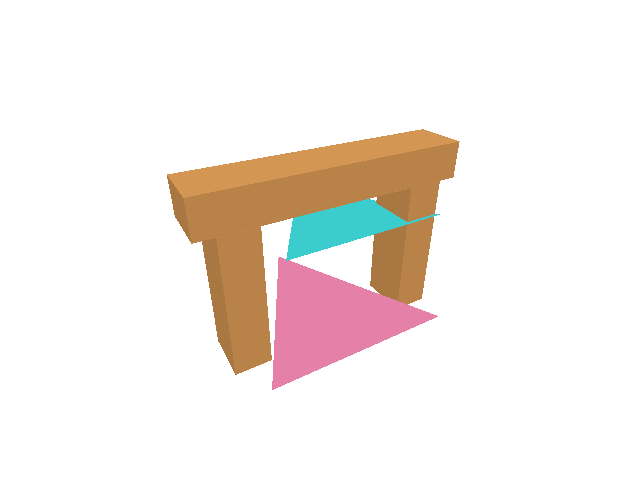
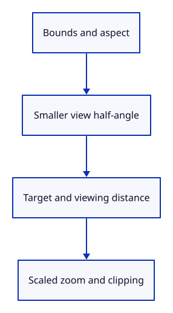

# 3.7.3 · Fit the camera around the bounds

**Chapter 3 · Documents, editing and ownership · Section 3.7 · Opening files and scene bounds** · [Contents](contents.md)

**Typing: 8–16 minutes.** [Estimate](typing-load.md).

Aim the camera at the bounds centre and back away until its enclosing sphere fits the smaller horizontal or vertical half-angle. Preserve orientation and keep a small margin.

## Type

Continue from [Measure the displayed scene bounds](23a-bounds.md). [Save or recover your work](recovery.md).

### 1. `src/camera.rs`

Keep the fitted scene scale with the camera. Distance says where the eye is; radius says how large the scene is. The original small demonstration scene starts with a one-unit radius. Fit will measure the real bounds. Fit the enclosing sphere through the smaller half-angle: distance = radius × 1.1 / sin(angle). Scale zoom limits with scene radius to prevent a jump after fitting a large model. Scale near and far clipping planes with camera distance and scene radius.

Edit these blocks from bottom to top. Keep the surrounding lines unchanged.

<details>
<summary>Locate this block</summary>

```rust
            self.target[2] - forward[2] * self.distance,
        );
        let view = Xform::look_at_right_handed(&eye, &target, &up);
        let projection = Xform::perspective(60.0_f64.to_radians(), self.aspect, 0.01, 100.0);
        projection * view
    }
```

</details>

Replace it with:

```rust
            self.target[2] - forward[2] * self.distance,
        );
        let view = Xform::look_at_right_handed(&eye, &target, &up);
        let near = self.distance * NEAR_FRACTION;
        let far = (self.distance * 10.0).max(self.distance + self.radius * 2.0);
        let projection = Xform::perspective(60.0_f64.to_radians(), self.aspect, near, far);
        projection * view
    }
```

<details>
<summary>Locate this block</summary>

```rust

    pub fn zoom(&mut self, factor: f32) {
        if factor.is_finite() && factor > 0.0 {
            self.distance = (self.distance / factor as f64).clamp(0.2, 50.0);
        }
    }
```

</details>

Replace it with:

```rust

    pub fn zoom(&mut self, factor: f32) {
        if factor.is_finite() && factor > 0.0 {
            self.distance = (self.distance / factor as f64).clamp(self.radius * 0.2, self.radius * 50.0);
        }
    }
```

<details>
<summary>Locate this block</summary>

```rust
}

impl Camera {
    pub fn pan(&mut self, dx: f32, dy: f32) {
        let right = self.orientation.rotate_vector(Vector::x_axis());
        let up = self.orientation.rotate_vector(Vector::z_axis());
```

</details>

Replace it with:

```rust
}

impl Camera {
    pub fn fit(&mut self, bounds: &crate::bounds::Bounds) {
        let half_y = 30.0_f64.to_radians();
        let half_x = (self.aspect * half_y.tan()).atan();
        let radius = bounds.radius();
        self.radius = if radius > 0.0 { radius } else { 1.0 };
        self.target = bounds.centre();
        self.distance = self.radius * 1.1 / half_x.min(half_y).sin();
    }

    pub fn pan(&mut self, dx: f32, dy: f32) {
        let right = self.orientation.rotate_vector(Vector::x_axis());
        let up = self.orientation.rotate_vector(Vector::z_axis());
```

<details>
<summary>Locate this block</summary>

```rust
        Self {
            target: [0.0; 3],
            distance: 3.0,
            orientation: Quaternion::from_axis_angle(Vector::x_axis(), -std::f64::consts::FRAC_PI_2),
            aspect: 640.0 / 480.0,
        }
```

</details>

Replace it with:

```rust
        Self {
            target: [0.0; 3],
            distance: 3.0,
            radius: 1.0,
            orientation: Quaternion::from_axis_angle(Vector::x_axis(), -std::f64::consts::FRAC_PI_2),
            aspect: 640.0 / 480.0,
        }
```

<details>
<summary>Locate this block</summary>

```rust
pub struct Camera {
    pub target: [f64; 3],
    pub distance: f64,
    pub orientation: Quaternion,
    pub aspect: f64,
}
```

</details>

Replace it with:

```rust
pub struct Camera {
    pub target: [f64; 3],
    pub distance: f64,
    pub radius: f64,
    pub orientation: Quaternion,
    pub aspect: f64,
}
```

<details>
<summary>Complete updated block reference</summary>

```rust
use session_rust::{Point, Quaternion, Vector, Xform};

pub struct Ray {
    pub origin: Point,
    pub direction: Vector,
    pub max_distance: f64,
}

pub struct Camera {
    pub target: [f64; 3],
    pub distance: f64,
    pub radius: f64,
    pub orientation: Quaternion,
    pub aspect: f64,
}

impl Default for Camera {
    fn default() -> Self {
        Self {
            target: [0.0; 3],
            distance: 3.0,
            radius: 1.0,
            orientation: Quaternion::from_axis_angle(Vector::x_axis(), -std::f64::consts::FRAC_PI_2),
            aspect: 640.0 / 480.0,
        }
    }
}

impl Camera {
    pub fn fit(&mut self, bounds: &crate::bounds::Bounds) {
        let half_y = 30.0_f64.to_radians();
        let half_x = (self.aspect * half_y.tan()).atan();
        let radius = bounds.radius();
        self.radius = if radius > 0.0 { radius } else { 1.0 };
        self.target = bounds.centre();
        self.distance = self.radius * 1.1 / half_x.min(half_y).sin();
    }

    pub fn pan(&mut self, dx: f32, dy: f32) {
        let right = self.orientation.rotate_vector(Vector::x_axis());
        let up = self.orientation.rotate_vector(Vector::z_axis());
        for i in 0..3 {
            self.target[i] += dx as f64 * right[i] + dy as f64 * up[i];
        }
    }

    pub fn zoom(&mut self, factor: f32) {
        if factor.is_finite() && factor > 0.0 {
            self.distance = (self.distance / factor as f64).clamp(self.radius * 0.2, self.radius * 50.0);
        }
    }

    pub fn rotate(&mut self, radians: f32) {
        self.orbit(radians as f64, 0.0);
    }

    pub fn orbit(&mut self, yaw: f64, pitch: f64) {
        let right = self.orientation.rotate_vector(Vector::x_axis());
        let turn = Quaternion::from_axis_angle(Vector::z_axis(), yaw);
        let tilt = Quaternion::from_axis_angle(right, pitch);
        self.orientation = (turn * (tilt * self.orientation.duplicate())).normalized();
    }

    pub fn isometric(&mut self) {
        let turn = Quaternion::from_axis_angle(Vector::z_axis(), -std::f64::consts::FRAC_PI_6);
        let right = turn.rotate_vector(Vector::x_axis());
        let tilt = Quaternion::from_axis_angle(right, -std::f64::consts::FRAC_PI_6);
        self.orientation = (tilt * turn).normalized();
    }

    pub fn view_projection(&self) -> Xform {
        let forward = self.orientation.rotate_vector(Vector::y_axis());
        let up = self.orientation.rotate_vector(Vector::z_axis());
        let target = Point::new(self.target[0], self.target[1], self.target[2]);
        let eye = Point::new(
            self.target[0] - forward[0] * self.distance,
            self.target[1] - forward[1] * self.distance,
            self.target[2] - forward[2] * self.distance,
        );
        let view = Xform::look_at_right_handed(&eye, &target, &up);
        let near = self.distance * NEAR_FRACTION;
        let far = (self.distance * 10.0).max(self.distance + self.radius * 2.0);
        let projection = Xform::perspective(60.0_f64.to_radians(), self.aspect, near, far);
        projection * view
    }

    pub fn uniform(&self) -> [f32; 16] {
        self.view_projection().to_f32()
    }

    pub fn ray(&self, screen: [f32; 2]) -> Option<Ray> {
        if screen.iter().any(|value| !value.is_finite() || value.abs() > 1.0) {
            return None;
        }
        let inverse = self.view_projection().inverse()?;
        let origin = inverse.transform_point(&Point::new(screen[0] as f64, screen[1] as f64, 0.0));
        let end = inverse.transform_point(&Point::new(screen[0] as f64, screen[1] as f64, 1.0));
        let delta = &end - &origin;
        let max_distance = delta.magnitude();
        if !max_distance.is_finite() || max_distance <= 0.0 {
            return None;
        }
        Some(Ray { origin, direction: delta.normalized(), max_distance })
    }
}

#[cfg(test)]
mod tests {
    use super::*;

    #[test]
    fn the_target_stays_centred_after_pan_zoom_and_turn() {
        let mut camera = Camera::default();
        camera.pan(0.25, -0.5);
        camera.zoom(2.0);
        camera.rotate(0.7);
        camera.orbit(0.3, 0.2);
        let target = Point::new(camera.target[0], camera.target[1], camera.target[2]);
        let screen = camera.view_projection().transform_point(&target);
        assert!(screen[0].abs() < 1.0e-9 && screen[1].abs() < 1.0e-9);
        assert!((0.0..1.0).contains(&screen[2]));
    }

    #[test]
    fn repeated_orbit_keeps_the_camera_axes_orthonormal() {
        let mut camera = Camera::default();
        for _ in 0..1_000 {
            camera.orbit(0.01, 0.02);
        }
        let right = camera.orientation.rotate_vector(Vector::x_axis());
        let forward = camera.orientation.rotate_vector(Vector::y_axis());
        let up = camera.orientation.rotate_vector(Vector::z_axis());
        for axis in [&right, &forward, &up] {
            assert!((axis.magnitude() - 1.0).abs() < 1.0e-10);
        }
        assert!(right.dot(&forward).abs() < 1.0e-10);
        assert!(right.dot(&up).abs() < 1.0e-10);
        assert!(forward.dot(&up).abs() < 1.0e-10);
    }

    #[test]
    fn a_projected_point_lies_on_its_unprojected_ray() {
        let camera = Camera::default();
        let world = Point::new(0.4, 0.2, 0.75);
        let screen = camera.view_projection().transform_point(&world);
        let ray = camera.ray([screen[0] as f32, screen[1] as f32]).unwrap();
        let offset = &world - &ray.origin;
        assert!(offset.cross(&ray.direction).magnitude() < 1.0e-6);
        assert!(offset.dot(&ray.direction) > 0.0);
        assert!(offset.magnitude() < ray.max_distance);
        assert!(camera.ray([f32::NAN, 0.0]).is_none());
    }
}
```

</details>

<details>
<summary>Optional patch references</summary>

Use these original edit fragments when comparing a saved checkpoint. Apply the complete blocks above.

```text
--8<-- "journey/code/24-fit-04.rs"
```

```text
--8<-- "journey/code/24-fit-05.rs"
```

```text
--8<-- "journey/code/24-fit-06.rs"
```

```text
--8<-- "journey/code/24-fit-07.rs"
```

```text
--8<-- "journey/code/24-fit-08.rs"
```

</details>

<details>
<summary>Supplied validation fixture</summary>

Copy this supplied authoring fixture once. Continue with the browser build below; the course does not require running native tests.

### 2. `src/fit_tests.rs`

Optional authoring fixture. Check projected corners, preserved orientation and zoom after fitting.

<details>
<summary>Locate the existing block</summary>

```text
use crate::bounds::Bounds;

#[test]
fn bounds_measure_vertices_and_define_the_empty_case() {
    let mut bounds = Bounds::point([-2.0, 1.0, 0.0]);
    bounds.include([2.0, 3.0, 2.0]);
    assert_eq!(bounds.centre(), [0.0, 2.0, 1.0]);
    assert!((bounds.radius() - 6.0_f64.sqrt()).abs() < 1.0e-12);
    let mut scene = crate::scene::Scene::demo();
    assert!(scene.bounds().is_some());
    while let Some(id) = scene.next(None) { scene.remove(id); }
    assert!(scene.bounds().is_none());
}
```

</details>

Update the existing block with this supplied code; keep unchanged lines:

```text
--8<-- "journey/code/23b-fit-camera-tests.rs"
```

</details>

### 3. `src/camera.rs`

Keep the current near fraction independent of scene radius.

<details>
<summary>Locate the existing block</summary>

```rust
pub struct Ray {
```

</details>

Edit the existing block to match this code; keep unchanged lines:

```rust
pub const NEAR_FRACTION:f64=1.0e-4;

pub struct Ray {
```

<details>
<summary>Optional patch references</summary>

Use these original edit fragments when comparing a saved checkpoint. Apply the complete blocks above.

```text
--8<-- "journey/code/23b-fit-camera-near.rs"
```

</details>

<details>
<summary>Supplied validation fixture</summary>

Copy this supplied authoring fixture once. Continue with the browser build below; the course does not require running native tests.

### 4. `src/camera.rs`

Supply geometric near-cut or f32 depth-resolution checks in original millimetre coordinates.

<details>
<summary>Locate the existing block</summary>

```text
ew_projection().transform_point(&world);
        let ray = camera.ray([screen[0] as f32, screen[1] as f32]).unwrap();
        let offset = &world - &ray.origin;
        assert!(offset.cross(&ray.direction).magnitude() < 1.0e-6);
        assert!(offset.dot(&ray.direction) > 0.0);
        assert!(offset.magnitude() < ray.max_distance);
        assert!(camera.ray([f32::NAN, 0.0]).is_none());
    }
}
```

</details>

After that block, append this supplied code:

```text
--8<-- "journey/code/23b-fit-camera-depth-tests.rs" skip=400
```

</details>

## Run and check

In your project:

```sh
cd workspace/journey
REGEN_PROTO=0 cargo build --lib --locked --target wasm32-unknown-unknown -j1
REGEN_PROTO=0 CARGO_BUILD_JOBS=1 trunk serve --port 8780
```

Open `http://127.0.0.1:8780/`. Keep an existing Trunk server running; saving rebuilds it.

Inspect the supplied state fixtures. Every corner remains inside the view across scales and aspect ratios, and fitting preserves orientation.

### Recorded visual result

**Previous native render — current verification pending.**



*This recorded image predates a source or checker change. Rebuild this checkpoint before using it as current evidence; browser controls require separate acceptance.*

<details>
<summary>Code explanation and diagram</summary>

Store the measured radius on Camera. Use it for zoom limits and far depth reach. Keep the near plane at one ten-thousandth of eye distance, independently of scene size, so nearby CAD geometry remains visible when zooming into a large model.

Bounds centre/radius and aspect → camera target, distance and clipping.



Why use the smaller half-angle?

That direction limits the visible space. Using only the vertical angle would crop a scene in a tall window.

Study estimate, including typing and experiments: 0.75–1.25 hours.

</details>

<details>
<summary>Optional experiment</summary>

Change the 1.1 margin to 1.4, predict a smaller drawing, then restore it.

</details>

<details>
<summary>Check and save your work</summary>

Restore experimental edits, then run from `session_viewer`:

```sh
npm --prefix ../session_tests run course -- check 3.7.3
npm --prefix ../session_tests run course -- save 3.7.3
```

Source comparison leaves your project untouched. [Save and recovery instructions](recovery.md).

</details>

<details>
<summary>Viewer coverage and verification</summary>

Fitting changes camera parameters, not document geometry. Later lessons add tighter corner fitting, selected bounds and camera-relative coordinates.

Native checks fit across scale and aspect, and GPU readback renders the fitted frame. Chrome retains the earlier file and command route until Fit reaches Editor.

[Full validation scope](release.md).

To reproduce the scripted acceptance of the reference checkpoint, run from `session_viewer` with the [course bundle server](release.md#reproduce) running on port 8781:

```sh
npm --prefix ../session_tests run course -- capture 3.7.3
```

This uses the verified reference bundle; it does not check or change your typed project.

</details>
