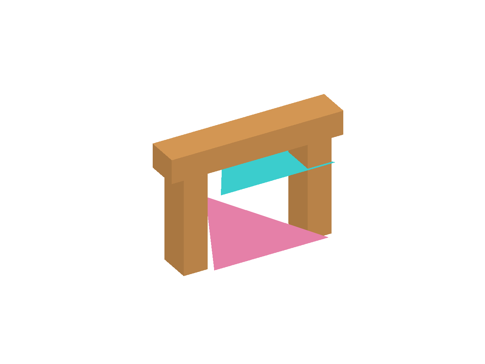
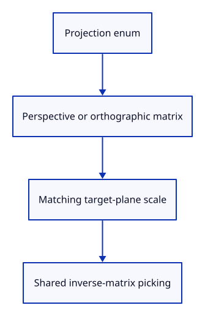

# 3.8.2 · Build perspective and orthographic camera matrices

**Chapter 3 · Documents, editing and ownership · Section 3.8 · Fit and projection changes** · [Contents](contents.md)

**Typing: 8–16 minutes.** [Estimate](typing-load.md).

Add Projection to Camera and choose the matching matrix. Give orthographic projection the same target-plane half-height as perspective: distance × tan(30°).

## Type

Continue from [Run Fit through the command line](24-fit.md). [Save or recover your work](recovery.md).

### 1. `src/camera.rs`

Name the projection choices with an enum; derive copying and equality for this small value. Projection belongs to the view, alongside its orientation and size. It is not a property of an object. Start with the perspective view you already know. Reset view will restore this default too. Use the shared angle so fitting and drawing cannot quietly use different fields of view. Choose the projection matrix; match orthographic size at the target plane and retain visible depth in 0–1.

Edit these blocks from bottom to top. Keep the surrounding lines unchanged.

<details>
<summary>Locate this block</summary>

```rust
        let view = Xform::look_at_right_handed(&eye, &target, &up);
        let near = self.distance * NEAR_FRACTION;
        let far = (self.distance * 10.0).max(self.distance + self.radius * 2.0);
        let projection = Xform::perspective(60.0_f64.to_radians(), self.aspect, near, far);
        projection * view
    }
```

</details>

Replace it with:

```rust
        let view = Xform::look_at_right_handed(&eye, &target, &up);
        let near = self.distance * NEAR_FRACTION;
        let far = (self.distance * 10.0).max(self.distance + self.radius * 2.0);
        let projection = match self.projection {
            Projection::Perspective => Xform::perspective(2.0 * HALF_FOV, self.aspect, near, far),
            Projection::Orthographic => {
                let h = self.distance * HALF_FOV.tan();
                let w = h * self.aspect;
                let depth_range = (self.distance + 2.0 * self.radius).max(1.0e-6);
                Xform::orthographic(-w, w, -h, h, -depth_range, depth_range)
            }
        };
        projection * view
    }
```

<details>
<summary>Locate this block</summary>

```rust
            radius: 1.0,
            orientation: Quaternion::from_axis_angle(Vector::x_axis(), -std::f64::consts::FRAC_PI_2),
            aspect: 640.0 / 480.0,
        }
    }
}

impl Camera {
    pub fn fit(&mut self, bounds: &crate::bounds::Bounds) {
        let half_y = 30.0_f64.to_radians();
        let half_x = (self.aspect * half_y.tan()).atan();
        let radius = bounds.radius();
        self.radius = if radius > 0.0 { radius } else { 1.0 };
```

</details>

Replace it with:

```rust
            radius: 1.0,
            orientation: Quaternion::from_axis_angle(Vector::x_axis(), -std::f64::consts::FRAC_PI_2),
            aspect: 640.0 / 480.0,
            projection: Projection::Perspective,
        }
    }
}

impl Camera {
    pub fn fit(&mut self, bounds: &crate::bounds::Bounds) {
        let half_y = HALF_FOV;
        let half_x = (self.aspect * half_y.tan()).atan();
        let radius = bounds.radius();
        self.radius = if radius > 0.0 { radius } else { 1.0 };
```

<details>
<summary>Locate this block</summary>

```rust
    pub radius: f64,
    pub orientation: Quaternion,
    pub aspect: f64,
}

impl Default for Camera {
```

</details>

Replace it with:

```rust
    pub radius: f64,
    pub orientation: Quaternion,
    pub aspect: f64,
    pub projection: Projection,
}

impl Default for Camera {
```

<details>
<summary>Locate this block</summary>

```rust

pub const NEAR_FRACTION:f64=1.0e-4;

pub struct Ray {
    pub origin: Point,
    pub direction: Vector,
```

</details>

Replace it with:

```rust

pub const NEAR_FRACTION:f64=1.0e-4;

const HALF_FOV: f64 = std::f64::consts::FRAC_PI_6;

#[derive(Clone, Copy, Debug, PartialEq, Eq)]
pub enum Projection {
    Perspective,
    Orthographic,
}

pub struct Ray {
    pub origin: Point,
    pub direction: Vector,
```

<details>
<summary>Complete updated block reference</summary>

```rust
use session_rust::{Point, Quaternion, Vector, Xform};

pub const NEAR_FRACTION:f64=1.0e-4;

const HALF_FOV: f64 = std::f64::consts::FRAC_PI_6;

#[derive(Clone, Copy, Debug, PartialEq, Eq)]
pub enum Projection {
    Perspective,
    Orthographic,
}

pub struct Ray {
    pub origin: Point,
    pub direction: Vector,
    pub max_distance: f64,
}

pub struct Camera {
    pub target: [f64; 3],
    pub distance: f64,
    pub radius: f64,
    pub orientation: Quaternion,
    pub aspect: f64,
    pub projection: Projection,
}

impl Default for Camera {
    fn default() -> Self {
        Self {
            target: [0.0; 3],
            distance: 3.0,
            radius: 1.0,
            orientation: Quaternion::from_axis_angle(Vector::x_axis(), -std::f64::consts::FRAC_PI_2),
            aspect: 640.0 / 480.0,
            projection: Projection::Perspective,
        }
    }
}

impl Camera {
    pub fn fit(&mut self, bounds: &crate::bounds::Bounds) {
        let half_y = HALF_FOV;
        let half_x = (self.aspect * half_y.tan()).atan();
        let radius = bounds.radius();
        self.radius = if radius > 0.0 { radius } else { 1.0 };
        self.target = bounds.centre();
        self.distance = self.radius * 1.1 / half_x.min(half_y).sin();
    }

    pub fn pan(&mut self, dx: f32, dy: f32) {
        let right = self.orientation.rotate_vector(Vector::x_axis());
        let up = self.orientation.rotate_vector(Vector::z_axis());
        for i in 0..3 {
            self.target[i] += dx as f64 * right[i] + dy as f64 * up[i];
        }
    }

    pub fn zoom(&mut self, factor: f32) {
        if factor.is_finite() && factor > 0.0 {
            self.distance = (self.distance / factor as f64).clamp(self.radius * 0.2, self.radius * 50.0);
        }
    }

    pub fn rotate(&mut self, radians: f32) {
        self.orbit(radians as f64, 0.0);
    }

    pub fn orbit(&mut self, yaw: f64, pitch: f64) {
        let right = self.orientation.rotate_vector(Vector::x_axis());
        let turn = Quaternion::from_axis_angle(Vector::z_axis(), yaw);
        let tilt = Quaternion::from_axis_angle(right, pitch);
        self.orientation = (turn * (tilt * self.orientation.duplicate())).normalized();
    }

    pub fn isometric(&mut self) {
        let turn = Quaternion::from_axis_angle(Vector::z_axis(), -std::f64::consts::FRAC_PI_6);
        let right = turn.rotate_vector(Vector::x_axis());
        let tilt = Quaternion::from_axis_angle(right, -std::f64::consts::FRAC_PI_6);
        self.orientation = (tilt * turn).normalized();
    }

    pub fn view_projection(&self) -> Xform {
        let forward = self.orientation.rotate_vector(Vector::y_axis());
        let up = self.orientation.rotate_vector(Vector::z_axis());
        let target = Point::new(self.target[0], self.target[1], self.target[2]);
        let eye = Point::new(
            self.target[0] - forward[0] * self.distance,
            self.target[1] - forward[1] * self.distance,
            self.target[2] - forward[2] * self.distance,
        );
        let view = Xform::look_at_right_handed(&eye, &target, &up);
        let near = self.distance * NEAR_FRACTION;
        let far = (self.distance * 10.0).max(self.distance + self.radius * 2.0);
        let projection = match self.projection {
            Projection::Perspective => Xform::perspective(2.0 * HALF_FOV, self.aspect, near, far),
            Projection::Orthographic => {
                let h = self.distance * HALF_FOV.tan();
                let w = h * self.aspect;
                let depth_range = (self.distance + 2.0 * self.radius).max(1.0e-6);
                Xform::orthographic(-w, w, -h, h, -depth_range, depth_range)
            }
        };
        projection * view
    }

    pub fn uniform(&self) -> [f32; 16] {
        self.view_projection().to_f32()
    }

    pub fn ray(&self, screen: [f32; 2]) -> Option<Ray> {
        if screen.iter().any(|value| !value.is_finite() || value.abs() > 1.0) {
            return None;
        }
        let inverse = self.view_projection().inverse()?;
        let origin = inverse.transform_point(&Point::new(screen[0] as f64, screen[1] as f64, 0.0));
        let end = inverse.transform_point(&Point::new(screen[0] as f64, screen[1] as f64, 1.0));
        let delta = &end - &origin;
        let max_distance = delta.magnitude();
        if !max_distance.is_finite() || max_distance <= 0.0 {
            return None;
        }
        Some(Ray { origin, direction: delta.normalized(), max_distance })
    }
}

#[cfg(test)]
mod tests {
    use super::*;

    #[test]
    fn the_target_stays_centred_after_pan_zoom_and_turn() {
        let mut camera = Camera::default();
        camera.pan(0.25, -0.5);
        camera.zoom(2.0);
        camera.rotate(0.7);
        camera.orbit(0.3, 0.2);
        let target = Point::new(camera.target[0], camera.target[1], camera.target[2]);
        let screen = camera.view_projection().transform_point(&target);
        assert!(screen[0].abs() < 1.0e-9 && screen[1].abs() < 1.0e-9);
        assert!((0.0..1.0).contains(&screen[2]));
    }

    #[test]
    fn repeated_orbit_keeps_the_camera_axes_orthonormal() {
        let mut camera = Camera::default();
        for _ in 0..1_000 {
            camera.orbit(0.01, 0.02);
        }
        let right = camera.orientation.rotate_vector(Vector::x_axis());
        let forward = camera.orientation.rotate_vector(Vector::y_axis());
        let up = camera.orientation.rotate_vector(Vector::z_axis());
        for axis in [&right, &forward, &up] {
            assert!((axis.magnitude() - 1.0).abs() < 1.0e-10);
        }
        assert!(right.dot(&forward).abs() < 1.0e-10);
        assert!(right.dot(&up).abs() < 1.0e-10);
        assert!(forward.dot(&up).abs() < 1.0e-10);
    }

    #[test]
    fn a_projected_point_lies_on_its_unprojected_ray() {
        let camera = Camera::default();
        let world = Point::new(0.4, 0.2, 0.75);
        let screen = camera.view_projection().transform_point(&world);
        let ray = camera.ray([screen[0] as f32, screen[1] as f32]).unwrap();
        let offset = &world - &ray.origin;
        assert!(offset.cross(&ray.direction).magnitude() < 1.0e-6);
        assert!(offset.dot(&ray.direction) > 0.0);
        assert!(offset.magnitude() < ray.max_distance);
        assert!(camera.ray([f32::NAN, 0.0]).is_none());
    }
}

#[cfg(test)]
mod near_range_tests{
 use super::*;
 #[test]
 fn large_scene_radius_does_not_cut_geometry_just_ahead_of_the_eye(){
  for distance in [0.001,1.,1000.]{let mut camera=Camera::default();camera.distance=distance;camera.radius=distance*100000.;
   let forward=camera.orientation.rotate_vector(Vector::y_axis());let point=|gap:f64|Point::new(camera.target[0]+forward[0]*(gap-distance),camera.target[1]+forward[1]*(gap-distance),camera.target[2]+forward[2]*(gap-distance));
   let matrix=camera.view_projection();let inside=matrix.transform_point(&point(distance*NEAR_FRACTION*2.));let cut=matrix.transform_point(&point(distance*NEAR_FRACTION*0.5));
   assert!((0.0..1.0).contains(&inside[2]),"near geometry remains in view: {inside:?}");assert!(cut[2]<0.,"the near plane still cuts ahead of the eye");
  }
 }
}
```

</details>

<details>
<summary>Optional patch references</summary>

Use these original edit fragments when comparing a saved checkpoint. Apply the complete blocks above.

```text
--8<-- "journey/code/25-projection-01.rs"
```

```text
--8<-- "journey/code/25-projection-02.rs"
```

```text
--8<-- "journey/code/25-projection-03.rs"
```

```text
--8<-- "journey/code/25-projection-04.rs"
```

```text
--8<-- "journey/code/25-projection-06.rs"
```

</details>

<details>
<summary>Supplied validation fixture</summary>

Copy this supplied authoring fixture once. Continue with the browser build below; the course does not require running native tests.

### 2. `src/projection_tests.rs`

Optional authoring fixture. Check target-plane scale, depth-independent size and parallel picking rays.

Copy this supplied file:

```text
--8<-- "journey/code/24a-projection-tests.rs"
```

</details>

### 3. `src/lib.rs`

Register the new checks without changing the production browser entry point.

<details>
<summary>Locate the existing block</summary>

```rust
#[cfg(test)]
mod fit_tests;
#[cfg(test)]
mod navigation_tests;
#[cfg(test)]
mod gesture_tests;
```

</details>

Edit the existing block to match this code; keep unchanged lines:

```rust
--8<-- "journey/code/25-projection-fullscreen-1.rs"
```

<details>
<summary>Supplied validation fixture</summary>

Copy this supplied authoring fixture once. Continue with the browser build below; the course does not require running native tests.

### 4. `src/camera.rs`

Supply geometric near-cut or f32 depth-resolution checks in original millimetre coordinates.

<details>
<summary>Locate the existing block</summary>

```text
]*(gap-distance),camera.target[2]+forward[2]*(gap-distance));
   let matrix=camera.view_projection();let inside=matrix.transform_point(&point(distance*NEAR_FRACTION*2.));let cut=matrix.transform_point(&point(distance*NEAR_FRACTION*0.5));
   assert!((0.0..1.0).contains(&inside[2]),"near geometry remains in view: {inside:?}");assert!(cut[2]<0.,"the near plane still cuts ahead of the eye");
  }
 }
}
```

</details>

After that block, append this supplied code:

```text
--8<-- "journey/code/24a-projection-depth-tests.rs" skip=400
```

</details>

## Run and check

In your project:

```sh
cd workspace/journey
REGEN_PROTO=0 cargo build --lib --locked --target wasm32-unknown-unknown -j1
REGEN_PROTO=0 CARGO_BUILD_JOBS=1 trunk serve --port 8780
```

Open `http://127.0.0.1:8780/`. Keep an existing Trunk server running; saving rebuilds it.

Inspect the supplied state fixtures. Switching preserves target-plane scale; orthographic size ignores depth and its pick rays are parallel.

### Recorded visual result

**Previous native render — current verification pending.**



*This recorded image predates a source or checker change. Rebuild this checkpoint before using it as current evidence; browser controls require separate acceptance.*

<details>
<summary>Code explanation and diagram</summary>

Projection is a small Copy enum. Inverse-matrix picking remains shared: perspective rays spread out, while orthographic rays have separate origins and parallel directions.

Keep the orthographic depth interval tied to scene reach, without the perspective far-plane multiplier. This preserves useful depth separation for thin CAD parts.

Projection enum → camera matrix → drawing and inverse-matrix rays.



Why can one picking method support both projections?

It inverts the selected camera matrix. The resulting near and far points define the correct ray for that matrix.

Study estimate, including typing and experiments: 0.75–1.25 hours.

</details>

<details>
<summary>Optional experiment</summary>

Switch the browser between perspective and orthographic projection. Predict how distance changes apparent object size in perspective, then compare the drawing.

</details>

<details>
<summary>Check and save your work</summary>

Restore experimental edits, then run from `session_viewer`:

```sh
npm --prefix ../session_tests run course -- check 3.8.2
npm --prefix ../session_tests run course -- save 3.8.2
```

Source comparison leaves your project untouched. [Save and recovery instructions](recovery.md).

</details>

<details>
<summary>Viewer coverage and verification</summary>

Drawing and picking consume the same selected camera matrix. Later lessons add tighter fitting, named views and reversed depth without putting view choices into document history.

Native checks establish projection scale and ray geometry; GPU readback draws orthographic geometry. Chrome retains the existing perspective Fit command route until mode commands are connected.

[Full validation scope](release.md).

</details>
