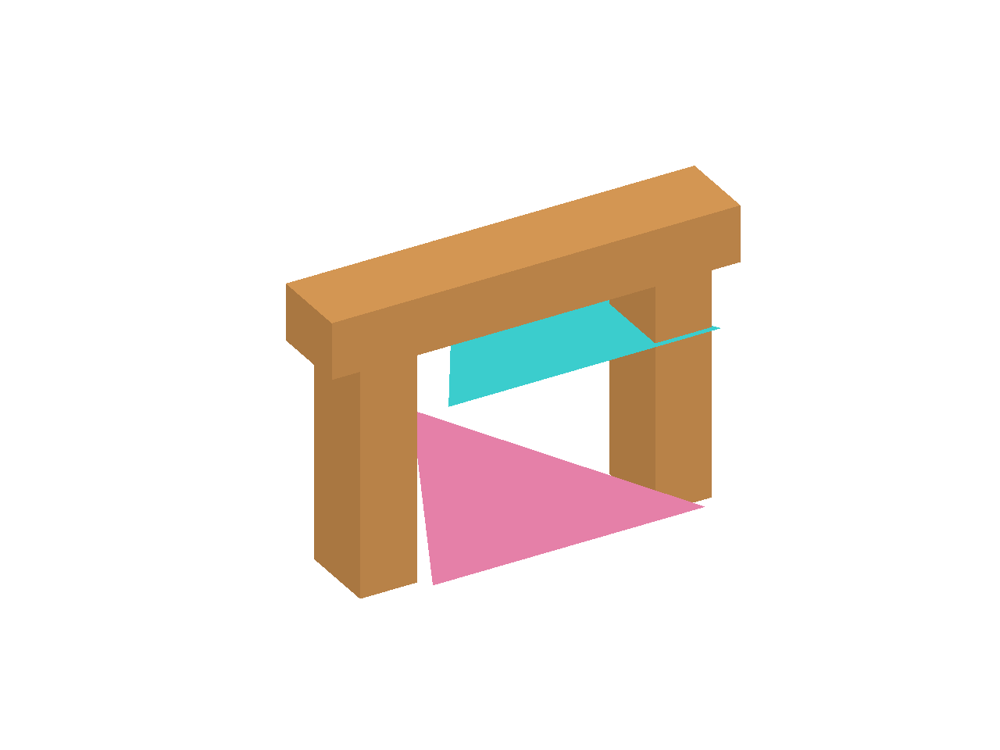
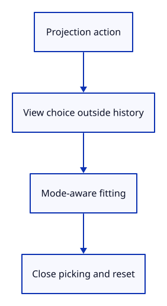

# 3.8.3 · Fit and change projection through the editor

**Chapter 3 · Documents, editing and ownership · Section 3.8 · Fit and projection changes** · [Contents](contents.md)

**Typing: 4–8 minutes.** [Estimate](typing-load.md).

Fit an enclosing sphere using the selected projection. Perspective uses the smaller half-angle; orthographic uses the smaller half-extent.

## Type

Continue from [Build perspective and orthographic camera matrices](24a-projection.md). [Save or recover your work](recovery.md).

### 1. `src/camera.rs`

Fit the sphere through a perspective half-angle or the smaller orthographic half-extent.

<details>
<summary>Locate the existing block</summary>

```rust
        self.distance = self.radius * 1.1 / half_x.min(half_y).sin();
```

</details>

Edit the existing block to match this code; keep unchanged lines:

```rust
--8<-- "journey/code/25-projection-05.rs"
```

### 2. `src/editor.rs`

Carry the requested projection in Action for the named view commands. Change projection without moving the camera or creating a document history entry.

Edit these blocks from bottom to top. Keep the surrounding lines unchanged.

<details>
<summary>Locate this block</summary>

```rust
                    Action::Pan(dx, dy) => self.camera.pan(dx, dy),
                    Action::Orbit(yaw, pitch) => self.camera.orbit(yaw, pitch),
                    Action::Isometric => self.camera.isometric(),
                    Action::Fit => {
                        if let Some(bounds) = self.scene.bounds() {
                            self.camera.fit(&bounds);
```

</details>

Replace it with:

```rust
                    Action::Pan(dx, dy) => self.camera.pan(dx, dy),
                    Action::Orbit(yaw, pitch) => self.camera.orbit(yaw, pitch),
                    Action::Isometric => self.camera.isometric(),
                    Action::Projection(mode) => self.camera.projection = mode,
                    Action::Fit => {
                        if let Some(bounds) = self.scene.bounds() {
                            self.camera.fit(&bounds);
```

<details>
<summary>Locate this block</summary>

```rust
    Isometric,
    ResetView,
    Fit,
}

#[derive(Debug, PartialEq, Eq)]
```

</details>

Replace it with:

```rust
    Isometric,
    ResetView,
    Fit,
    Projection(crate::camera::Projection),
}

#[derive(Debug, PartialEq, Eq)]
```

<details>
<summary>Complete updated block reference</summary>

```rust
use crate::{background::Background, camera::Camera, history::History, scene::{ObjectId, Scene}};

pub enum Action {
    Pick([f32; 2]),
    Import(Vec<u8>),
    AddBox,
    ToggleExtra,
    SelectNext,
    Delete,
    Undo,
    Redo,
    Background,
    Zoom(f32),
    Pan(f32, f32),
    Orbit(f64, f64),
    Isometric,
    ResetView,
    Fit,
    Projection(crate::camera::Projection),
}

#[derive(Debug, PartialEq, Eq)]
pub enum Change {
    View,
    Scene,
}

pub struct Editor {
    pub scene: Scene,
    pub selected: Option<ObjectId>,
    pub camera: Camera,
    pub background: Background,
    history: History,
}

impl Default for Editor {
    fn default() -> Self {
        Self {
            scene: Scene::demo(),
            selected: None,
            camera: Camera::default(),
            background: Background::default(),
            history: History::default(),
        }
    }
}

impl Editor {
    pub fn apply(&mut self, action: Action) -> Result<Change, &'static str> {
        match action {
            Action::Pick(screen) => {
                self.selected = self.camera.ray(screen)
                    .and_then(|ray| crate::picking::pick(&self.scene, &ray));
            }
            Action::Import(bytes) => {
                let loaded = crate::document::load(&bytes)?;
                self.history.try_edit(&mut self.scene, |scene| scene.import(loaded))?;
            }
            Action::AddBox => {
                self.history.try_edit(&mut self.scene, |scene| scene.add_box().map(|_| ()))?;
            }
            Action::ToggleExtra => self.history.edit(&mut self.scene, Scene::toggle_extra),
            Action::SelectNext => self.selected = self.scene.next(self.selected),
            Action::Delete => {
                if let Some(id) = self.selected.take() {
                    self.history.edit(&mut self.scene, |scene| { scene.remove(id); });
                }
            }
            Action::Undo => { self.history.undo(&mut self.scene); }
            Action::Redo => { self.history.redo(&mut self.scene); }
            view => {
                match view {
                    Action::Background => self.background.toggle(),
                    Action::Zoom(factor) => self.camera.zoom(factor),
                    Action::Pan(dx, dy) => self.camera.pan(dx, dy),
                    Action::Orbit(yaw, pitch) => self.camera.orbit(yaw, pitch),
                    Action::Isometric => self.camera.isometric(),
                    Action::Projection(mode) => self.camera.projection = mode,
                    Action::Fit => {
                        if let Some(bounds) = self.scene.bounds() {
                            self.camera.fit(&bounds);
                        }
                    }
                    Action::ResetView => {
                        let aspect = self.camera.aspect;
                        self.camera = Camera { aspect, ..Camera::default() };
                    }
                    _ => unreachable!("Document actions were handled above"),
                }
                return Ok(Change::View);
            }
        }
        // Deletion and history travel can invalidate selection; repair it in one place.
        self.selected = self.selected.filter(|id| self.scene.contains(*id));
        Ok(Change::Scene)
    }
}

#[cfg(test)]
mod tests {
    use super::*;

    #[test]
    fn resetting_the_view_preserves_its_current_aspect() {
        let mut editor = Editor::default();
        editor.camera.aspect = 2.0;
        editor.apply(Action::Zoom(2.0)).unwrap();
        editor.apply(Action::ResetView).unwrap();
        assert_eq!(editor.camera.aspect, 2.0);
        assert_eq!(editor.camera.distance, 3.0);
    }

    #[test]
    fn undo_changes_the_document_without_rewinding_the_view() {
        let mut editor = Editor::default();
        editor.apply(Action::AddBox).unwrap();
        editor.apply(Action::Zoom(2.0)).unwrap();
        editor.apply(Action::Background).unwrap();
        editor.apply(Action::Undo).unwrap();
        assert_eq!(editor.scene.objects().len(), 2);
        assert_eq!(editor.camera.distance, 1.5);
        assert_eq!(editor.background.rgb(), [0.9, 0.9, 0.9]);
    }

    #[test]
    fn undo_repairs_selection_and_empty_delete_preserves_redo() {
        let mut editor = Editor::default();
        editor.apply(Action::AddBox).unwrap();
        for _ in 0..3 {
            editor.apply(Action::SelectNext).unwrap();
        }
        let box_id = editor.selected.unwrap();
        editor.apply(Action::Undo).unwrap();
        assert!(editor.selected.is_none());
        editor.apply(Action::Delete).unwrap();
        editor.apply(Action::Redo).unwrap();
        assert!(editor.scene.contains(box_id));
    }

    #[test]
    fn picking_a_moved_view_uses_the_editors_current_camera() {
        let mut editor = Editor::default();
        editor.apply(Action::Pan(0.2, 0.1)).unwrap();
        let point = session_rust::Point::new(0.2, 0.3, 0.75);
        let screen = editor.camera.view_projection().transform_point(&point);
        assert_eq!(editor.apply(Action::Pick([screen[0] as f32, screen[1] as f32])).unwrap(), Change::Scene);
        assert_eq!(editor.selected, Some(editor.scene.objects()[1].id));
        assert_eq!(editor.apply(Action::Zoom(2.0)).unwrap(), Change::View);
    }
}
```

</details>

<details>
<summary>Optional patch references</summary>

Use these original edit fragments when comparing a saved checkpoint. Apply the complete blocks above.

```text
--8<-- "journey/code/25-projection-07.rs"
```

```text
--8<-- "journey/code/25-projection-08.rs"
```

</details>

<details>
<summary>Supplied validation fixture</summary>

Copy this supplied authoring fixture once. Continue with the browser build below; the course does not require running native tests.

### 3. `src/projection_tests.rs`

Optional authoring fixture. Import bounds and editor actions for fitting, selection and history checks.

<details>
<summary>Locate the existing block</summary>

```text
use crate::camera::{Camera, Projection};
use session_rust::{Point, Vector};
```

</details>

Update the existing block with this supplied code; keep unchanged lines:

```text
--8<-- "journey/code/24b-projection-test-imports.rs"
```

</details>

<details>
<summary>Supplied validation fixture</summary>

Copy this supplied authoring fixture once. Continue with the browser build below; the course does not require running native tests.

### 4. `src/projection_tests.rs`

Optional authoring fixture. Check orthographic fitting, close selection, view history and reset.

<details>
<summary>Locate the existing block</summary>

```text
    assert!(camera.ray([-0.5, 0.0]).unwrap().direction
        .cross(&camera.ray([0.5, 0.0]).unwrap().direction).magnitude() > 0.1);
}
```

</details>

After that block, append this supplied code:

```text
--8<-- "journey/code/24b-projection-editor-tests.rs" skip=137
```

</details>

## Run and check

In your project:

```sh
cd workspace/journey
REGEN_PROTO=0 cargo build --lib --locked --target wasm32-unknown-unknown -j1
REGEN_PROTO=0 CARGO_BUILD_JOBS=1 trunk serve --port 8780
```

Open `http://127.0.0.1:8780/`. Keep an existing Trunk server running; saving rebuilds it.

Inspect the supplied state fixtures. Orthographic fitting contains every corner in tall and wide views; close picking and document Undo keep the chosen view coherent.

### Recorded visual result

**Previous native render — current verification pending.**



*This recorded image predates a source or checker change. Rebuild this checkpoint before using it as current evidence; browser controls require separate acceptance.*

<details>
<summary>Code explanation and diagram</summary>

Carry Projection in an editor action. Changing it preserves camera parameters and document history; Reset View still restores the perspective default.

Selected projection → fit opening; Action::Projection → view-only change.



Why keep projection outside document history?

It changes how the document is seen. Undo should restore geometry while retaining the current view choice.

Study estimate, including typing and experiments: 0.75–1.25 hours.

</details>

<details>
<summary>Optional experiment</summary>

Read the close-orthographic picking test and predict what Reset View does to its projection choice.

</details>

<details>
<summary>Check and save your work</summary>

Restore experimental edits, then run from `session_viewer`:

```sh
npm --prefix ../session_tests run course -- check 3.8.3
npm --prefix ../session_tests run course -- save 3.8.3
```

Source comparison leaves your project untouched. [Save and recovery instructions](recovery.md).

</details>

<details>
<summary>Viewer coverage and verification</summary>

Drawing and picking consume the same selected camera matrix. Later lessons add tighter fitting, named views and reversed depth without putting view choices into document history.

Native checks and GPU readback establish editor mode changes, orthographic fitting and close picking. Chrome retains the previous Fit route until the named projection commands are connected.

[Full validation scope](release.md).

</details>
