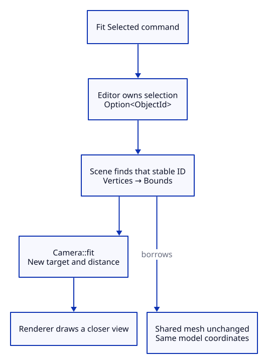

# 3.10.1 · Frame one object without changing its size

**Chapter 3 · Documents, editing and ownership · Section 3.10 · Object framing and keyboard history** · [Contents](contents.md)

**Typing: 10–20 minutes.** [Estimate](typing-load.md).

Make `Fit Selected` use one object's bounds with the same fitting policy as `Fit`.

## Type

Continue from [Run the named projection commands](25-projection.md). [Save or recover your work](recovery.md).

### 1. `src/scene.rs`

Find one stable ID and collect only its displayed vertices. An absent ID or empty mesh returns None.

<details>
<summary>Locate the existing block</summary>

```rust
    pub fn objects(&self) -> &[Object] {
```

</details>

Edit the existing block to match this code; keep unchanged lines:

```rust
--8<-- "journey/code/26-selected-01.rs"
```

### 2. `src/editor.rs`

Name a separate action for fitting the selection. Borrow the selected ID, ask Scene for its bounds, and reuse Camera::fit. Neither the mesh nor document history changes.

Edit these blocks from bottom to top. Keep the surrounding lines unchanged.

<details>
<summary>Locate this block</summary>

```rust
                            self.camera.fit(&bounds);
                        }
                    }
                    Action::ResetView => {
                        let aspect = self.camera.aspect;
                        self.camera = Camera { aspect, ..Camera::default() };
```

</details>

Replace it with:

```rust
                            self.camera.fit(&bounds);
                        }
                    }
                    Action::FitSelected => {
                        if let Some(bounds) = self.selected
                            .and_then(|id| self.scene.selected_bounds(id))
                        {
                            self.camera.fit(&bounds);
                        }
                    }
                    Action::ResetView => {
                        let aspect = self.camera.aspect;
                        self.camera = Camera { aspect, ..Camera::default() };
```

<details>
<summary>Locate this block</summary>

```rust
    Isometric,
    ResetView,
    Fit,
    Projection(crate::camera::Projection),
}
```

</details>

Replace it with:

```rust
    Isometric,
    ResetView,
    Fit,
    FitSelected,
    Projection(crate::camera::Projection),
}
```

<details>
<summary>Complete updated block reference</summary>

```rust
use crate::{background::Background, camera::Camera, history::History, scene::{ObjectId, Scene}};

pub enum Action {
    Pick([f32; 2]),
    Import(Vec<u8>),
    AddBox,
    ToggleExtra,
    SelectNext,
    Delete,
    Undo,
    Redo,
    Background,
    Zoom(f32),
    Pan(f32, f32),
    Orbit(f64, f64),
    Isometric,
    ResetView,
    Fit,
    FitSelected,
    Projection(crate::camera::Projection),
}

#[derive(Debug, PartialEq, Eq)]
pub enum Change {
    View,
    Scene,
}

pub struct Editor {
    pub scene: Scene,
    pub selected: Option<ObjectId>,
    pub camera: Camera,
    pub background: Background,
    history: History,
}

impl Default for Editor {
    fn default() -> Self {
        Self {
            scene: Scene::demo(),
            selected: None,
            camera: Camera::default(),
            background: Background::default(),
            history: History::default(),
        }
    }
}

impl Editor {
    pub fn apply(&mut self, action: Action) -> Result<Change, &'static str> {
        match action {
            Action::Pick(screen) => {
                self.selected = self.camera.ray(screen)
                    .and_then(|ray| crate::picking::pick(&self.scene, &ray));
            }
            Action::Import(bytes) => {
                let loaded = crate::document::load(&bytes)?;
                self.history.try_edit(&mut self.scene, |scene| scene.import(loaded))?;
            }
            Action::AddBox => {
                self.history.try_edit(&mut self.scene, |scene| scene.add_box().map(|_| ()))?;
            }
            Action::ToggleExtra => self.history.edit(&mut self.scene, Scene::toggle_extra),
            Action::SelectNext => self.selected = self.scene.next(self.selected),
            Action::Delete => {
                if let Some(id) = self.selected.take() {
                    self.history.edit(&mut self.scene, |scene| { scene.remove(id); });
                }
            }
            Action::Undo => { self.history.undo(&mut self.scene); }
            Action::Redo => { self.history.redo(&mut self.scene); }
            view => {
                match view {
                    Action::Background => self.background.toggle(),
                    Action::Zoom(factor) => self.camera.zoom(factor),
                    Action::Pan(dx, dy) => self.camera.pan(dx, dy),
                    Action::Orbit(yaw, pitch) => self.camera.orbit(yaw, pitch),
                    Action::Isometric => self.camera.isometric(),
                    Action::Projection(mode) => self.camera.projection = mode,
                    Action::Fit => {
                        if let Some(bounds) = self.scene.bounds() {
                            self.camera.fit(&bounds);
                        }
                    }
                    Action::FitSelected => {
                        if let Some(bounds) = self.selected
                            .and_then(|id| self.scene.selected_bounds(id))
                        {
                            self.camera.fit(&bounds);
                        }
                    }
                    Action::ResetView => {
                        let aspect = self.camera.aspect;
                        self.camera = Camera { aspect, ..Camera::default() };
                    }
                    _ => unreachable!("Document actions were handled above"),
                }
                return Ok(Change::View);
            }
        }
        // Deletion and history travel can invalidate selection; repair it in one place.
        self.selected = self.selected.filter(|id| self.scene.contains(*id));
        Ok(Change::Scene)
    }
}

#[cfg(test)]
mod tests {
    use super::*;

    #[test]
    fn resetting_the_view_preserves_its_current_aspect() {
        let mut editor = Editor::default();
        editor.camera.aspect = 2.0;
        editor.apply(Action::Zoom(2.0)).unwrap();
        editor.apply(Action::ResetView).unwrap();
        assert_eq!(editor.camera.aspect, 2.0);
        assert_eq!(editor.camera.distance, 3.0);
    }

    #[test]
    fn undo_changes_the_document_without_rewinding_the_view() {
        let mut editor = Editor::default();
        editor.apply(Action::AddBox).unwrap();
        editor.apply(Action::Zoom(2.0)).unwrap();
        editor.apply(Action::Background).unwrap();
        editor.apply(Action::Undo).unwrap();
        assert_eq!(editor.scene.objects().len(), 2);
        assert_eq!(editor.camera.distance, 1.5);
        assert_eq!(editor.background.rgb(), [0.9, 0.9, 0.9]);
    }

    #[test]
    fn undo_repairs_selection_and_empty_delete_preserves_redo() {
        let mut editor = Editor::default();
        editor.apply(Action::AddBox).unwrap();
        for _ in 0..3 {
            editor.apply(Action::SelectNext).unwrap();
        }
        let box_id = editor.selected.unwrap();
        editor.apply(Action::Undo).unwrap();
        assert!(editor.selected.is_none());
        editor.apply(Action::Delete).unwrap();
        editor.apply(Action::Redo).unwrap();
        assert!(editor.scene.contains(box_id));
    }

    #[test]
    fn picking_a_moved_view_uses_the_editors_current_camera() {
        let mut editor = Editor::default();
        editor.apply(Action::Pan(0.2, 0.1)).unwrap();
        let point = session_rust::Point::new(0.2, 0.3, 0.75);
        let screen = editor.camera.view_projection().transform_point(&point);
        assert_eq!(editor.apply(Action::Pick([screen[0] as f32, screen[1] as f32])).unwrap(), Change::Scene);
        assert_eq!(editor.selected, Some(editor.scene.objects()[1].id));
        assert_eq!(editor.apply(Action::Zoom(2.0)).unwrap(), Change::View);
    }
}
```

</details>

<details>
<summary>Optional patch references</summary>

Use these original edit fragments when comparing a saved checkpoint. Apply the complete blocks above.

```text
--8<-- "journey/code/26-selected-02.rs"
```

```text
--8<-- "journey/code/26-selected-03.rs"
```

</details>

### 3. `src/browser.rs`

Expose Fit Selected in the existing command vocabulary. Translate the named command into the new action.

Edit these blocks from bottom to top. Keep the surrounding lines unchanged.

<details>
<summary>Locate this block</summary>

```rust
                        Action::Projection(crate::camera::Projection::Orthographic)
                    }
                    "fit" => Action::Fit,
                    "view reset" => Action::ResetView,
                    _ => return,
                };
```

</details>

Replace it with:

```rust
                        Action::Projection(crate::camera::Projection::Orthographic)
                    }
                    "fit" => Action::Fit,
                    "fit selected" => Action::FitSelected,
                    "view reset" => Action::ResetView,
                    _ => return,
                };
```

<details>
<summary>Locate this block</summary>

```rust
            "View Perspective",
            "View Orthographic",
            "Fit",
            "View Reset",
        ],
    );
```

</details>

Replace it with:

```rust
            "View Perspective",
            "View Orthographic",
            "Fit",
            "Fit Selected",
            "View Reset",
        ],
    );
```

<details>
<summary>Complete updated block reference</summary>

```rust
use crate::background::Background;
use crate::editor::{Action, Change, Editor};
use crate::gesture::Gesture;
use crate::renderer::Renderer;
use crate::viewport::Viewport;
use wasm_bindgen::{JsCast, JsValue, closure::Closure};

pub fn report(message: &str) {
    if let Some(document) = web_sys::window().and_then(|window| window.document()) {
        if let Some(status) = document.get_element_by_id("status") {
            status.set_text_content(Some(message));
            if message.starts_with("Cannot") { let _ = status.remove_attribute("hidden"); }
        }
    }
}

pub async fn run() -> Result<(), JsValue> {
    let window = web_sys::window().ok_or("No browser window")?;
    let document = window.document().ok_or("No document")?;
    let canvas: web_sys::HtmlCanvasElement = document
        .get_element_by_id("canvas")
        .ok_or("Missing canvas")?
        .dyn_into()?;
    let instance = wgpu::Instance::new(wgpu::InstanceDescriptor {
        backends: wgpu::Backends::BROWSER_WEBGPU,
        flags: Default::default(),
        memory_budget_thresholds: Default::default(),
        backend_options: Default::default(),
        display: None,
    });
    let surface = instance
        .create_surface(wgpu::SurfaceTarget::Canvas(canvas.clone()))
        .map_err(|error| JsValue::from_str(&error.to_string()))?;
    let adapter = instance
        .request_adapter(&wgpu::RequestAdapterOptions {
            compatible_surface: Some(&surface),
            ..Default::default()
        })
        .await
        .map_err(|error| JsValue::from_str(&error.to_string()))?;
    let (device, queue) = adapter
        .request_device(&wgpu::DeviceDescriptor::default())
        .await
        .map_err(|error| JsValue::from_str(&error.to_string()))?;
    device.on_uncaptured_error(std::sync::Arc::new(|error| report(&error.to_string())));
    let limit = device.limits().max_texture_dimension_2d;
    let width = (window.inner_width()?.as_f64().ok_or("No window width")? as u32).clamp(1, limit);
    let height = (window.inner_height()?.as_f64().ok_or("No window height")? as u32).clamp(1, limit);
    canvas.set_width(width);
    canvas.set_height(height);
    let mut config = surface
        .get_default_config(&adapter, width, height)
        .ok_or("No compatible surface format")?;
    config.view_formats = vec![config.format.add_srgb_suffix()];
    surface.configure(&device, &config);
    let mut editor = Editor::default();
    let mut renderer = Renderer::new(
        device,
        queue,
        config.format.add_srgb_suffix(),
        &editor.scene,
    );
    renderer.resize(Viewport { width, height });
    let mut panel = crate::panel::Panel::new(
        &renderer,
        config.format.add_srgb_suffix(),
        &[
            "Help",
            "Open",
            "Example Box",
            "Example Triangle",
            "Select Next",
            "Delete",
            "Undo",
            "Redo",
            "Background",
            "Zoom In",
            "Zoom Out",
            "Pan Left",
            "Pan Right",
            "Orbit Right",
            "Orbit Up",
            "View Isometric",
            "View Perspective",
            "View Orthographic",
            "Fit",
            "Fit Selected",
            "View Reset",
        ],
    );
    panel.update(None, &canvas)?;
    if resize(
        &window,
        &canvas,
        &surface,
        &mut config,
        &mut renderer,
        &mut editor,
    ) {
        panel.update(None, &canvas)?;
        present(
            &surface,
            &renderer,
            &editor.background,
            &editor.camera.uniform(),
            &mut panel,
        )?;
    }
    let input_canvas = canvas.clone();
    let browser_window = window.clone();
    let pointer_canvas = canvas.clone();
    let mut gesture = Gesture::default();
    let request = std::rc::Rc::new(std::cell::Cell::new(0));
    let update = Closure::<dyn FnMut(web_sys::Event)>::new(move |event: web_sys::Event| {
        let line = match panel.update(Some(&event), &input_canvas) {
            Ok(line) => line,
            Err(error) => {
                report(&format!("Cannot read command: {error:?}"));
                return;
            }
        };
        let action = if event.type_() == "change" {
            crate::file_input::choose(&event, std::rc::Rc::clone(&request));
            None
        } else if event.type_() == "viewer-file" {
            crate::file_input::bytes(&event).map(Action::Import)
        } else if let Some(line) = line {
            if line == "open" {
                if let Some(input) = web_sys::window()
                    .and_then(|window| window.document())
                    .and_then(|document| document.get_element_by_id("open"))
                    .and_then(|element| element.dyn_into::<web_sys::HtmlInputElement>().ok())
                {
                    input.click();
                }
                None
            } else {
                let action = match line.as_str() {
                    "example box" => Action::AddBox,
                    "example triangle" => Action::ToggleExtra,
                    "select next" => Action::SelectNext,
                    "delete" => Action::Delete,
                    "undo" => Action::Undo,
                    "redo" => Action::Redo,
                    "background" => Action::Background,
                    "zoom in" => Action::Zoom(2.0),
                    "zoom out" => Action::Zoom(0.5),
                    "pan left" => Action::Pan(-0.25, 0.0),
                    "pan right" => Action::Pan(0.25, 0.0),
                    "orbit right" => Action::Orbit(std::f64::consts::FRAC_PI_4, 0.0),
                    "orbit up" => Action::Orbit(0.0, std::f64::consts::FRAC_PI_6),
                    "view isometric" => Action::Isometric,
                    "view perspective" => {
                        Action::Projection(crate::camera::Projection::Perspective)
                    }
                    "view orthographic" => {
                        Action::Projection(crate::camera::Projection::Orthographic)
                    }
                    "fit" => Action::Fit,
                    "fit selected" => Action::FitSelected,
                    "view reset" => Action::ResetView,
                    _ => return,
                };
                Some(action)
            }
        } else if !panel.consumed {
            navigation_action(&event, &pointer_canvas, &mut gesture)
        } else {
            None
        };
        if let Some(action) = action {
            match editor.apply(action) {
                Ok(Change::Scene) => renderer.set_scene(&editor.scene, editor.selected),
                Ok(Change::View) => {}
                Err(error) => {
                    report(error);
                    return;
                }
            }
        }
        if let Err(error) = show_projection(&editor.camera) {
            report(&format!("Cannot report projection: {error:?}"));
            return;
        }
        if event.type_() == "viewer-file" {
            report("File imported. Undo removes the entire import.");
        }
        if resize(
            &browser_window,
            &pointer_canvas,
            &surface,
            &mut config,
            &mut renderer,
            &mut editor,
        ) {
            if let Err(error) = panel.update(None, &input_canvas) {
                report(&format!("Cannot lay out commands: {error:?}"));
                return;
            }
            if let Err(error) = present(
                &surface,
                &renderer,
                &editor.background,
                &editor.camera.uniform(),
                &mut panel,
            ) {
                report(&format!("Cannot redraw: {error:?}"));
            }
        }
    });
    for name in [
        "pointerdown",
        "pointermove",
        "pointerup",
        "pointercancel",
        "lostpointercapture",
        "contextmenu",
        "keydown",
        "keyup",
        "blur",
    ] {
        canvas.add_event_listener_with_callback(name, update.as_ref().unchecked_ref())?;
    }
    let options = web_sys::AddEventListenerOptions::new();
    options.set_passive(false);
    canvas.add_event_listener_with_callback_and_add_event_listener_options(
        "wheel",
        update.as_ref().unchecked_ref(),
        &options,
    )?;
    window.add_event_listener_with_callback("resize", update.as_ref().unchecked_ref())?;
    window.add_event_listener_with_callback("blur", update.as_ref().unchecked_ref())?;
    document.add_event_listener_with_callback("change", update.as_ref().unchecked_ref())?;
    window.add_event_listener_with_callback("viewer-file", update.as_ref().unchecked_ref())?;
    // Both event sources retain this one callback for the lifetime of the page.
    update.forget();
    report("Wheel zooms; type commands anywhere in the drawing. Escape cancels a drag.");
    Ok(())
}

fn show_projection(camera: &crate::camera::Camera) -> Result<(), JsValue> {
    let document = web_sys::window()
        .and_then(|window| window.document())
        .ok_or("No document")?;
    let canvas = document
        .get_element_by_id("canvas")
        .ok_or("Missing canvas")?;
    canvas.set_attribute("data-projection", &format!("{:?}", camera.projection))
}

fn navigation_action(
    event: &web_sys::Event,
    canvas: &web_sys::HtmlCanvasElement,
    gesture: &mut Gesture,
) -> Option<Action> {
    let action = match event.type_().as_str() {
        "wheel" => {
            let wheel = event.dyn_ref::<web_sys::WheelEvent>()?;
            let mode = wheel.delta_mode();
            crate::navigation::wheel(
                wheel.delta_y(),
                mode,
                canvas.get_bounding_client_rect().height(),
            )
        }
        "keydown" => {
            let key = event.dyn_ref::<web_sys::KeyboardEvent>()?;
            if key.is_composing() || key.alt_key() {
                return None;
            }
            if key.key() == "Escape" {
                gesture.cancel();
                event.prevent_default();
                return None;
            }
            return None;
        }
        _ => return pointer_action(event, canvas, gesture),
    }?;
    event.prevent_default();
    Some(action)
}

fn pointer_action(
    event: &web_sys::Event,
    canvas: &web_sys::HtmlCanvasElement,
    gesture: &mut Gesture,
) -> Option<Action> {
    match event.type_().as_str() {
        "contextmenu" => {
            event.prevent_default();
            return None;
        }
        "blur" | "resize" => {
            gesture.cancel();
            return None;
        }
        _ => {}
    }
    let pointer = event.dyn_ref::<web_sys::PointerEvent>()?;
    let id = pointer.pointer_id();
    let position = [pointer.client_x() as f64, pointer.client_y() as f64];
    let motion = match event.type_().as_str() {
        "pointerdown" => {
            if pointer.is_primary() && gesture.press(id, pointer.button(), position) {
                event.prevent_default();
                let options = web_sys::FocusOptions::new();
                options.set_prevent_scroll(true);
                if canvas.focus_with_options(&options).is_err()
                    || canvas.set_pointer_capture(id).is_err()
                {
                    gesture.cancel();
                }
            }
            None
        }
        "pointermove" => gesture.move_to(id, position),
        "pointerup" => {
            let motion = gesture.release(id, position);
            let _ = canvas.release_pointer_capture(id);
            motion
        }
        "pointercancel" | "lostpointercapture" => {
            gesture.cancel_pointer(id);
            None
        }
        _ => None,
    }?;
    let rect = canvas.get_bounding_client_rect();
    motion.action([rect.left(), rect.top(), rect.width(), rect.height()])
}

fn resize(
    window: &web_sys::Window,
    canvas: &web_sys::HtmlCanvasElement,
    surface: &wgpu::Surface<'_>,
    config: &mut wgpu::SurfaceConfiguration,
    renderer: &mut Renderer,
    editor: &mut Editor,
) -> bool {
    let rect = canvas.get_bounding_client_rect();
    let limit = renderer.device.limits().max_texture_dimension_2d;
    let Some(size) = Viewport::from_css(
        rect.width(),
        rect.height(),
        window.device_pixel_ratio(),
        limit,
    ) else {
        return false;
    };
    if size.width != config.width || size.height != config.height {
        canvas.set_width(size.width);
        canvas.set_height(size.height);
        config.width = size.width;
        config.height = size.height;
        surface.configure(&renderer.device, config);
        renderer.resize(size);
    }
    editor.camera.aspect = size.aspect();
    true
}

fn present(
    surface: &wgpu::Surface<'_>,
    renderer: &Renderer,
    background: &Background,
    transform: &[f32; 16],
    panel: &mut crate::panel::Panel,
) -> Result<(), JsValue> {
    let frame = match surface.get_current_texture() {
        wgpu::CurrentSurfaceTexture::Success(frame)
        | wgpu::CurrentSurfaceTexture::Suboptimal(frame) => frame,
        other => {
            return Err(JsValue::from_str(&format!(
                "Surface unavailable: {other:?}"
            )));
        }
    };
    let view = frame.texture.create_view(&wgpu::TextureViewDescriptor {
        format: Some(frame.texture.format().add_srgb_suffix()),
        ..Default::default()
    });
    renderer.draw(&view, background, transform);
    panel.draw(renderer, &view);
    frame.present();
    Ok(())
}
```

</details>

<details>
<summary>Optional patch references</summary>

Use these original edit fragments when comparing a saved checkpoint. Apply the complete blocks above.

```text
--8<-- "journey/code/26-selected-04.rs"
```

```text
--8<-- "journey/code/26-selected-05.rs"
```

</details>

### 4. `src/lib.rs`

Register the focused state checks.

<details>
<summary>Locate the existing block</summary>

```rust
#[cfg(test)]
mod projection_tests;
```

</details>

Edit the existing block to match this code; keep unchanged lines:

```rust
--8<-- "journey/code/26-selected-06.rs"
```

<details>
<summary>Supplied validation fixture</summary>

Copy this supplied authoring fixture once. Continue with the browser build below; the course does not require running native tests.

### 5. `src/selected_fit_tests.rs`

Optional authoring fixture. Check both projection modes, selection, shared mesh identity, history and the empty-selection case.

Copy this supplied file:

```text
--8<-- "journey/code/26-selected-07.rs"
```

</details>

## Run and check

In your project:

```sh
cd workspace/journey
REGEN_PROTO=0 cargo build --lib --locked --target wasm32-unknown-unknown -j1
REGEN_PROTO=0 CARGO_BUILD_JOBS=1 trunk serve --port 8780
```

Open `http://127.0.0.1:8780/`. Keep an existing Trunk server running; saving rebuilds it.

Type `Select Next`, then `Fit Selected`. The selected object fills the view with a margin. Geometry, selection and Undo history stay unchanged.

### Recorded visual result

**Previous native render — current verification pending.**


*This recorded image predates a source or checker change. Rebuild this checkpoint before using it as current evidence; browser controls require separate acceptance.*

<details>
<summary>Code explanation and diagram</summary>

Scene finds the object by `ObjectId`. `?` returns `None` for a missing ID or empty mesh. Start bounds from its first vertex so the origin does not enlarge every box.

Editor uses `Option::and_then` to request bounds only when selection exists, then passes them to Camera. No second fitting formula is needed.

Fitting changes pixels occupied by the object, preserving its model coordinates and shared mesh. It changes neither document units nor object size.

Fit Selected → Editor → stable ObjectId → selected bounds → Camera::fit → frame.



Does fitting an object change its coordinates or only the camera?

Only the camera target and distance change. The selected object keeps the same shared mesh and stable ID. Bounds are measured in existing model coordinates; fitting changes their screen coverage, not their physical dimensions.

Study estimate, including typing and experiments: 1–2 hours.

</details>

<details>
<summary>Optional experiment</summary>

Select Next repeatedly and run Fit Selected after each selection. Predict the camera target from that object’s minimum and maximum coordinates. Then compare perspective and orthographic fits. Explain why neither operation should create an undo entry.

</details>

<details>
<summary>Check and save your work</summary>

Restore experimental edits, then run from `session_viewer`:

```sh
npm --prefix ../session_tests run course -- check 3.10.1
npm --prefix ../session_tests run course -- save 3.10.1
```

Source comparison leaves your project untouched. [Save and recovery instructions](recovery.md).

</details>

<details>
<summary>Viewer coverage and verification</summary>

The maintained viewer fits selected display rows and their world-space bounds. This checkpoint establishes stable selection and camera-only fitting. Local placements, inherited transforms and multiple selected objects will extend the bounds query in later lessons.

Fit Selected frames the first triangle without deleting the added box or changing object coordinates.

[Full validation scope](release.md).

</details>
