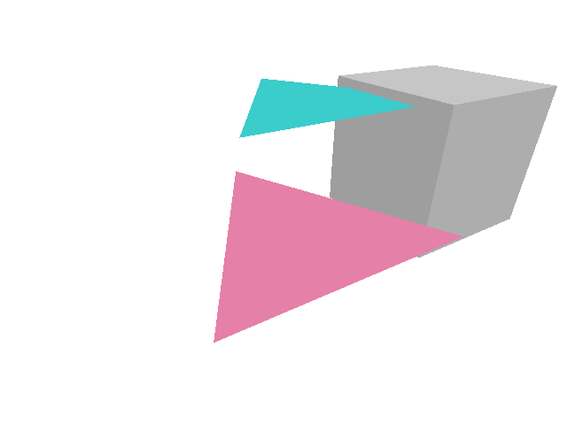
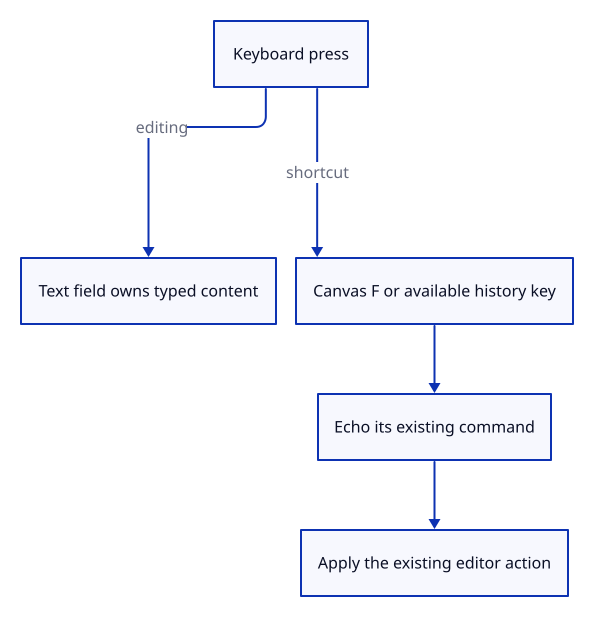

# 3.10.2 · Fit and step history from the keyboard

**Chapter 3 · Documents, editing and ownership · Section 3.10 · Object framing and keyboard history** · [Contents](contents.md)

**Typing: 19–38 minutes.** [Estimate](typing-load.md).

Classify a key before the panel can focus on its printable letter. F belongs to the unfocused canvas. History keys belong to the document when no nonempty focused text field owns them.

## Type

Continue from [Frame one object without changing its size](26-selected.md). [Save or recover your work](recovery.md).

### 1. `src/shortcuts.rs`

Classify canvas Fit and available history keys without owning browser or document state.

Create the file and type:

```rust
--8<-- "journey/code/26a-keys-01.rs"
```

### 2. `src/panel.rs`

Use current text focus and content to decide shortcut ownership.

<details>
<summary>Locate the existing block</summary>

```rust
    pub fn key(&mut self, event: &web_sys::KeyboardEvent) -> bool {
```

</details>

Edit the existing block to match this code; keep unchanged lines:

```rust
    pub fn shortcut(&self, event: &web_sys::KeyboardEvent) -> Option<crate::shortcuts::Shortcut> {
        if event.type_() != "keydown" || event.repeat() { return None; }
        crate::shortcuts::key(&event.key(), event.ctrl_key() || event.meta_key(), event.shift_key(),
            event.alt_key(), event.is_composing(), self.context.egui_wants_keyboard_input(), self.model.command.is_empty())
    }

    pub fn key(&mut self, event: &web_sys::KeyboardEvent) -> bool {
```

<details>
<summary>Optional patch references</summary>

Use these original edit fragments when comparing a saved checkpoint. Apply the complete blocks above.

```text
--8<-- "journey/code/26a-keys-02.rs"
```

</details>

### 3. `src/browser.rs`

Echo an accepted shortcut through the same command route before the panel consumes typing. Make canvas F fit the selection when present; otherwise fit the whole scene.

Edit these blocks from bottom to top. Keep the surrounding lines unchanged.

<details>
<summary>Locate this block</summary>

```rust
                    "view orthographic" => {
                        Action::Projection(crate::camera::Projection::Orthographic)
                    }
                    "fit" => Action::Fit,
                    "fit selected" => Action::FitSelected,
                    "view reset" => Action::ResetView,
                    _ => return,
```

</details>

Replace it with:

```rust
                    "view orthographic" => {
                        Action::Projection(crate::camera::Projection::Orthographic)
                    }
                    "fit" if shortcut.is_some() && editor.selected.is_some() => Action::FitSelected,
                    "fit" => Action::Fit,

                    "fit selected" => Action::FitSelected,
                    "view reset" => Action::ResetView,
                    _ => return,
```

<details>
<summary>Locate this block</summary>

```rust
    let mut gesture = Gesture::default();
    let request = std::rc::Rc::new(std::cell::Cell::new(0));
    let update = Closure::<dyn FnMut(web_sys::Event)>::new(move |event: web_sys::Event| {
        let line = match panel.update(Some(&event), &input_canvas) {
            Ok(line) => line,
            Err(error) => {
                report(&format!("Cannot read command: {error:?}"));
                return;
            }
        };
        let action = if event.type_() == "change" {
            crate::file_input::choose(&event, std::rc::Rc::clone(&request));
            None
```

</details>

Replace it with:

```rust
    let mut gesture = Gesture::default();
    let request = std::rc::Rc::new(std::cell::Cell::new(0));
    let update = Closure::<dyn FnMut(web_sys::Event)>::new(move |event: web_sys::Event| {
        let shortcut = event.dyn_ref::<web_sys::KeyboardEvent>().and_then(|key| panel.shortcut(key));
        let line = if let Some(shortcut) = shortcut {
            event.prevent_default();
            panel.answer(shortcut.command(), "");
            Some(shortcut.command().to_ascii_lowercase())
        } else { match panel.update(Some(&event), &input_canvas) {
            Ok(line) => line,
            Err(error) => {
                report(&format!("Cannot read command: {error:?}"));
                return;
            }
        } };

        let action = if event.type_() == "change" {
            crate::file_input::choose(&event, std::rc::Rc::clone(&request));
            None
```

<details>
<summary>Complete updated block reference</summary>

```rust
use crate::background::Background;
use crate::editor::{Action, Change, Editor};
use crate::gesture::Gesture;
use crate::renderer::Renderer;
use crate::viewport::Viewport;
use wasm_bindgen::{JsCast, JsValue, closure::Closure};

pub fn report(message: &str) {
    if let Some(document) = web_sys::window().and_then(|window| window.document()) {
        if let Some(status) = document.get_element_by_id("status") {
            status.set_text_content(Some(message));
            if message.starts_with("Cannot") { let _ = status.remove_attribute("hidden"); }
        }
    }
}

pub async fn run() -> Result<(), JsValue> {
    let window = web_sys::window().ok_or("No browser window")?;
    let document = window.document().ok_or("No document")?;
    let canvas: web_sys::HtmlCanvasElement = document
        .get_element_by_id("canvas")
        .ok_or("Missing canvas")?
        .dyn_into()?;
    let instance = wgpu::Instance::new(wgpu::InstanceDescriptor {
        backends: wgpu::Backends::BROWSER_WEBGPU,
        flags: Default::default(),
        memory_budget_thresholds: Default::default(),
        backend_options: Default::default(),
        display: None,
    });
    let surface = instance
        .create_surface(wgpu::SurfaceTarget::Canvas(canvas.clone()))
        .map_err(|error| JsValue::from_str(&error.to_string()))?;
    let adapter = instance
        .request_adapter(&wgpu::RequestAdapterOptions {
            compatible_surface: Some(&surface),
            ..Default::default()
        })
        .await
        .map_err(|error| JsValue::from_str(&error.to_string()))?;
    let (device, queue) = adapter
        .request_device(&wgpu::DeviceDescriptor::default())
        .await
        .map_err(|error| JsValue::from_str(&error.to_string()))?;
    device.on_uncaptured_error(std::sync::Arc::new(|error| report(&error.to_string())));
    let limit = device.limits().max_texture_dimension_2d;
    let width = (window.inner_width()?.as_f64().ok_or("No window width")? as u32).clamp(1, limit);
    let height = (window.inner_height()?.as_f64().ok_or("No window height")? as u32).clamp(1, limit);
    canvas.set_width(width);
    canvas.set_height(height);
    let mut config = surface
        .get_default_config(&adapter, width, height)
        .ok_or("No compatible surface format")?;
    config.view_formats = vec![config.format.add_srgb_suffix()];
    surface.configure(&device, &config);
    let mut editor = Editor::default();
    let mut renderer = Renderer::new(
        device,
        queue,
        config.format.add_srgb_suffix(),
        &editor.scene,
    );
    renderer.resize(Viewport { width, height });
    let mut panel = crate::panel::Panel::new(
        &renderer,
        config.format.add_srgb_suffix(),
        &[
            "Help",
            "Open",
            "Example Box",
            "Example Triangle",
            "Select Next",
            "Delete",
            "Undo",
            "Redo",
            "Background",
            "Zoom In",
            "Zoom Out",
            "Pan Left",
            "Pan Right",
            "Orbit Right",
            "Orbit Up",
            "View Isometric",
            "View Perspective",
            "View Orthographic",
            "Fit",
            "Fit Selected",
            "View Reset",
        ],
    );
    panel.update(None, &canvas)?;
    if resize(
        &window,
        &canvas,
        &surface,
        &mut config,
        &mut renderer,
        &mut editor,
    ) {
        panel.update(None, &canvas)?;
        present(
            &surface,
            &renderer,
            &editor.background,
            &editor.camera.uniform(),
            &mut panel,
        )?;
    }
    let input_canvas = canvas.clone();
    let browser_window = window.clone();
    let pointer_canvas = canvas.clone();
    let mut gesture = Gesture::default();
    let request = std::rc::Rc::new(std::cell::Cell::new(0));
    let update = Closure::<dyn FnMut(web_sys::Event)>::new(move |event: web_sys::Event| {
        let shortcut = event.dyn_ref::<web_sys::KeyboardEvent>().and_then(|key| panel.shortcut(key));
        let line = if let Some(shortcut) = shortcut {
            event.prevent_default();
            panel.answer(shortcut.command(), "");
            Some(shortcut.command().to_ascii_lowercase())
        } else { match panel.update(Some(&event), &input_canvas) {
            Ok(line) => line,
            Err(error) => {
                report(&format!("Cannot read command: {error:?}"));
                return;
            }
        } };

        let action = if event.type_() == "change" {
            crate::file_input::choose(&event, std::rc::Rc::clone(&request));
            None
        } else if event.type_() == "viewer-file" {
            crate::file_input::bytes(&event).map(Action::Import)
        } else if let Some(line) = line {
            if line == "open" {
                if let Some(input) = web_sys::window()
                    .and_then(|window| window.document())
                    .and_then(|document| document.get_element_by_id("open"))
                    .and_then(|element| element.dyn_into::<web_sys::HtmlInputElement>().ok())
                {
                    input.click();
                }
                None
            } else {
                let action = match line.as_str() {
                    "example box" => Action::AddBox,
                    "example triangle" => Action::ToggleExtra,
                    "select next" => Action::SelectNext,
                    "delete" => Action::Delete,
                    "undo" => Action::Undo,
                    "redo" => Action::Redo,
                    "background" => Action::Background,
                    "zoom in" => Action::Zoom(2.0),
                    "zoom out" => Action::Zoom(0.5),
                    "pan left" => Action::Pan(-0.25, 0.0),
                    "pan right" => Action::Pan(0.25, 0.0),
                    "orbit right" => Action::Orbit(std::f64::consts::FRAC_PI_4, 0.0),
                    "orbit up" => Action::Orbit(0.0, std::f64::consts::FRAC_PI_6),
                    "view isometric" => Action::Isometric,
                    "view perspective" => {
                        Action::Projection(crate::camera::Projection::Perspective)
                    }
                    "view orthographic" => {
                        Action::Projection(crate::camera::Projection::Orthographic)
                    }
                    "fit" if shortcut.is_some() && editor.selected.is_some() => Action::FitSelected,
                    "fit" => Action::Fit,

                    "fit selected" => Action::FitSelected,
                    "view reset" => Action::ResetView,
                    _ => return,
                };
                Some(action)
            }
        } else if !panel.consumed {
            navigation_action(&event, &pointer_canvas, &mut gesture)
        } else {
            None
        };
        if let Some(action) = action {
            match editor.apply(action) {
                Ok(Change::Scene) => renderer.set_scene(&editor.scene, editor.selected),
                Ok(Change::View) => {}
                Err(error) => {
                    report(error);
                    return;
                }
            }
        }
        if let Err(error) = show_projection(&editor.camera) {
            report(&format!("Cannot report projection: {error:?}"));
            return;
        }
        if event.type_() == "viewer-file" {
            report("File imported. Undo removes the entire import.");
        }
        if resize(
            &browser_window,
            &pointer_canvas,
            &surface,
            &mut config,
            &mut renderer,
            &mut editor,
        ) {
            if let Err(error) = panel.update(None, &input_canvas) {
                report(&format!("Cannot lay out commands: {error:?}"));
                return;
            }
            if let Err(error) = present(
                &surface,
                &renderer,
                &editor.background,
                &editor.camera.uniform(),
                &mut panel,
            ) {
                report(&format!("Cannot redraw: {error:?}"));
            }
        }
    });
    for name in [
        "pointerdown",
        "pointermove",
        "pointerup",
        "pointercancel",
        "lostpointercapture",
        "contextmenu",
        "keydown",
        "keyup",
        "blur",
    ] {
        canvas.add_event_listener_with_callback(name, update.as_ref().unchecked_ref())?;
    }
    let options = web_sys::AddEventListenerOptions::new();
    options.set_passive(false);
    canvas.add_event_listener_with_callback_and_add_event_listener_options(
        "wheel",
        update.as_ref().unchecked_ref(),
        &options,
    )?;
    window.add_event_listener_with_callback("resize", update.as_ref().unchecked_ref())?;
    window.add_event_listener_with_callback("blur", update.as_ref().unchecked_ref())?;
    document.add_event_listener_with_callback("change", update.as_ref().unchecked_ref())?;
    window.add_event_listener_with_callback("viewer-file", update.as_ref().unchecked_ref())?;
    // Both event sources retain this one callback for the lifetime of the page.
    update.forget();
    report("Wheel zooms; type commands anywhere in the drawing. Escape cancels a drag.");
    Ok(())
}

fn show_projection(camera: &crate::camera::Camera) -> Result<(), JsValue> {
    let document = web_sys::window()
        .and_then(|window| window.document())
        .ok_or("No document")?;
    let canvas = document
        .get_element_by_id("canvas")
        .ok_or("Missing canvas")?;
    canvas.set_attribute("data-projection", &format!("{:?}", camera.projection))
}

fn navigation_action(
    event: &web_sys::Event,
    canvas: &web_sys::HtmlCanvasElement,
    gesture: &mut Gesture,
) -> Option<Action> {
    let action = match event.type_().as_str() {
        "wheel" => {
            let wheel = event.dyn_ref::<web_sys::WheelEvent>()?;
            let mode = wheel.delta_mode();
            crate::navigation::wheel(
                wheel.delta_y(),
                mode,
                canvas.get_bounding_client_rect().height(),
            )
        }
        "keydown" => {
            let key = event.dyn_ref::<web_sys::KeyboardEvent>()?;
            if key.is_composing() || key.alt_key() {
                return None;
            }
            if key.key() == "Escape" {
                gesture.cancel();
                event.prevent_default();
                return None;
            }
            return None;
        }
        _ => return pointer_action(event, canvas, gesture),
    }?;
    event.prevent_default();
    Some(action)
}

fn pointer_action(
    event: &web_sys::Event,
    canvas: &web_sys::HtmlCanvasElement,
    gesture: &mut Gesture,
) -> Option<Action> {
    match event.type_().as_str() {
        "contextmenu" => {
            event.prevent_default();
            return None;
        }
        "blur" | "resize" => {
            gesture.cancel();
            return None;
        }
        _ => {}
    }
    let pointer = event.dyn_ref::<web_sys::PointerEvent>()?;
    let id = pointer.pointer_id();
    let position = [pointer.client_x() as f64, pointer.client_y() as f64];
    let motion = match event.type_().as_str() {
        "pointerdown" => {
            if pointer.is_primary() && gesture.press(id, pointer.button(), position) {
                event.prevent_default();
                let options = web_sys::FocusOptions::new();
                options.set_prevent_scroll(true);
                if canvas.focus_with_options(&options).is_err()
                    || canvas.set_pointer_capture(id).is_err()
                {
                    gesture.cancel();
                }
            }
            None
        }
        "pointermove" => gesture.move_to(id, position),
        "pointerup" => {
            let motion = gesture.release(id, position);
            let _ = canvas.release_pointer_capture(id);
            motion
        }
        "pointercancel" | "lostpointercapture" => {
            gesture.cancel_pointer(id);
            None
        }
        _ => None,
    }?;
    let rect = canvas.get_bounding_client_rect();
    motion.action([rect.left(), rect.top(), rect.width(), rect.height()])
}

fn resize(
    window: &web_sys::Window,
    canvas: &web_sys::HtmlCanvasElement,
    surface: &wgpu::Surface<'_>,
    config: &mut wgpu::SurfaceConfiguration,
    renderer: &mut Renderer,
    editor: &mut Editor,
) -> bool {
    let rect = canvas.get_bounding_client_rect();
    let limit = renderer.device.limits().max_texture_dimension_2d;
    let Some(size) = Viewport::from_css(
        rect.width(),
        rect.height(),
        window.device_pixel_ratio(),
        limit,
    ) else {
        return false;
    };
    if size.width != config.width || size.height != config.height {
        canvas.set_width(size.width);
        canvas.set_height(size.height);
        config.width = size.width;
        config.height = size.height;
        surface.configure(&renderer.device, config);
        renderer.resize(size);
    }
    editor.camera.aspect = size.aspect();
    true
}

fn present(
    surface: &wgpu::Surface<'_>,
    renderer: &Renderer,
    background: &Background,
    transform: &[f32; 16],
    panel: &mut crate::panel::Panel,
) -> Result<(), JsValue> {
    let frame = match surface.get_current_texture() {
        wgpu::CurrentSurfaceTexture::Success(frame)
        | wgpu::CurrentSurfaceTexture::Suboptimal(frame) => frame,
        other => {
            return Err(JsValue::from_str(&format!(
                "Surface unavailable: {other:?}"
            )));
        }
    };
    let view = frame.texture.create_view(&wgpu::TextureViewDescriptor {
        format: Some(frame.texture.format().add_srgb_suffix()),
        ..Default::default()
    });
    renderer.draw(&view, background, transform);
    panel.draw(renderer, &view);
    frame.present();
    Ok(())
}
```

</details>

<details>
<summary>Optional patch references</summary>

Use these original edit fragments when comparing a saved checkpoint. Apply the complete blocks above.

```text
--8<-- "journey/code/26a-keys-03.rs"
```

```text
--8<-- "journey/code/26a-keys-04.rs"
```

</details>

### 4. `src/lib.rs`

Register the shared shortcut policy.

<details>
<summary>Locate the existing block</summary>

```rust
pub mod navigation;
```

</details>

Edit the existing block to match this code; keep unchanged lines:

```rust
pub mod shortcuts;
pub mod navigation;
```

<details>
<summary>Optional patch references</summary>

Use these original edit fragments when comparing a saved checkpoint. Apply the complete blocks above.

```text
--8<-- "journey/code/26a-keys-05.rs"
```

</details>

<details>
<summary>Supplied validation fixture</summary>

Copy this supplied authoring fixture once. Continue with the browser build below; the course does not require running native tests.

### 5. `src/shortcuts_tests.rs`

Copy the modifier and text-ownership checks.

Copy this supplied file:

```text
--8<-- "journey/code/26a-keys-tests.rs"
```

</details>

### 6. `src/lib.rs`

Register the native checks.

<details>
<summary>Locate the existing block</summary>

```rust
pub mod shortcuts;
```

</details>

After that block, type:

```rust
#[cfg(test)]
mod shortcuts_tests;
```

<details>
<summary>Optional patch references</summary>

Use these original edit fragments when comparing a saved checkpoint. Apply the complete blocks above.

```text
--8<-- "journey/code/26a-keys-06.rs"
```

</details>

## Run and check

In your project:

```sh
cd workspace/journey
REGEN_PROTO=0 cargo build --lib --locked --target wasm32-unknown-unknown -j1
REGEN_PROTO=0 CARGO_BUILD_JOBS=1 trunk serve --port 8780
```

Open `http://127.0.0.1:8780/`. Keep an existing Trunk server running; saving rebuilds it.

Select an object, click the canvas, then press F. Ctrl+Z undoes a document edit; Ctrl+Y or Ctrl+Shift+Z redoes it. Use Cmd on macOS.

### Recorded visual result

**Previous native render — current verification pending.**



*This recorded image predates a source or checker change. Rebuild this checkpoint before using it as current evidence; browser controls require separate acceptance.*

This reference image is shared with [3.10.1 · Frame one object without changing its size](26-selected.md). It does not demonstrate a new feature by itself.

<details>
<summary>Code explanation and diagram</summary>

Both Ctrl and Cmd use the same policy. Ignore repeated, composing and Alt-modified events. Echo the existing command and reuse the normal action route, preserving one history transaction.

keyboard press → text ownership → existing command → editor action → redraw.



Why must Ctrl+Z stay with a nonempty focused command field?

It edits the text being typed. Document history must change only when that text does not own the shortcut.

Study estimate, including typing and experiments: 0.5–1 hours.

</details>

<details>
<summary>Optional experiment</summary>

Focus the command field and type F. It remains text. Type a word, then press Ctrl+Z: document history must stay unchanged.

</details>

<details>
<summary>Check and save your work</summary>

Restore experimental edits, then run from `session_viewer`:

```sh
npm --prefix ../session_tests run course -- check 3.10.2
npm --prefix ../session_tests run course -- save 3.10.2
```

Source comparison leaves your project untouched. [Save and recovery instructions](recovery.md).

</details>

<details>
<summary>Viewer coverage and verification</summary>

This carries the October 4 F and history shortcuts into the course. H/S hide and show arrive with visibility policies in chapter 53. Existing named commands and mouse navigation remain available.

Native key policy checks and Chrome exercise actual keys, text editing, camera-only Fit and exact document history round trips.

Actual keyboard input checks selected and whole-scene fitting, Undo/Redo, platform modifiers and command-text ownership.

[Full validation scope](release.md).

To reproduce the scripted acceptance of the reference checkpoint, run from `session_viewer` with the [course bundle server](release.md#reproduce) running on port 8781:

```sh
npm --prefix ../session_tests run course -- capture 3.10.2
```

This uses the verified reference bundle; it does not check or change your typed project.

</details>
