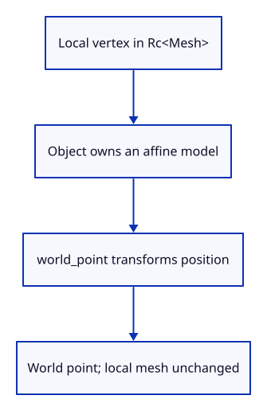

# 3.11.1 · Give each object a placement

**Chapter 3 · Documents, editing and ownership · Section 3.11 · Object placement and transforms** · [Contents](contents.md)

**Typing: 10–19 minutes.** [Estimate](typing-load.md).

A mesh describes a shape. A placement describes where one use of that shape belongs. Keeping both in Object lets history retain the same shared mesh while remembering a different placement.

## Type

Continue from [Fit and step history from the keyboard](26a-keys.md). [Save or recover your work](recovery.md).

### 1. `src/scene.rs`

Store one placement beside the shared local mesh. Transform position only; return world coordinates without changing the mesh. Identity preserves the behavior of all existing objects. Check the placement before mutating the object found by its stable ID.

Edit these blocks from bottom to top. Keep the surrounding lines unchanged.

<details>
<summary>Locate this block</summary>

```rust
        Ok(())
    }

    pub fn remove(&mut self, id: ObjectId) -> bool {
        let Some(index) = self.objects.iter().position(|object| object.id == id) else { return false; };
        self.objects.remove(index);
```

</details>

Replace it with:

```rust
        Ok(())
    }

    pub fn place(&mut self, id: ObjectId, model: session_rust::Xform) -> Result<(), &'static str> {
        if !model.m.iter().all(|v| v.is_finite())
            || [model.m[3], model.m[7], model.m[11], model.m[15]] != [0.0, 0.0, 0.0, 1.0]
        {
            return Err("Placement must be finite and affine");
        }
        let object = self.objects.iter_mut().find(|o| o.id == id).ok_or("Object not found")?;
        object.model = model;
        Ok(())
    }

    pub fn remove(&mut self, id: ObjectId) -> bool {
        let Some(index) = self.objects.iter().position(|object| object.id == id) else { return false; };
        self.objects.remove(index);
```

<details>
<summary>Locate this block</summary>

```rust
        let next = self.next_id.checked_add(1).ok_or("Object IDs exhausted")?;
        let id = ObjectId(self.next_id);
        self.next_id = next;
        self.objects.push(Object { id, mesh: Rc::new(mesh), source: None });
        Ok(id)
    }
```

</details>

Replace it with:

```rust
        let next = self.next_id.checked_add(1).ok_or("Object IDs exhausted")?;
        let id = ObjectId(self.next_id);
        self.next_id = next;
        self.objects.push(Object { id, mesh: Rc::new(mesh), model: session_rust::Xform::identity(), source: None });
        Ok(id)
    }
```

<details>
<summary>Locate this block</summary>

```rust
pub struct Object {
    pub id: ObjectId,
    pub mesh: Rc<Mesh>,
    pub source: Option<crate::document::Source>,
}

#[derive(Clone)]
pub struct Scene {
    objects: Vec<Object>,
```

</details>

Replace it with:

```rust
pub struct Object {
    pub id: ObjectId,
    pub mesh: Rc<Mesh>,
    pub model: session_rust::Xform,
    pub source: Option<crate::document::Source>,
}

impl Object {
    pub fn world_point(&self, vertex: [f32; 6]) -> [f64; 3] {
        let local = session_rust::Point::new(vertex[0] as f64, vertex[1] as f64, vertex[2] as f64);
        let world = self.model.transform_point(&local);
        [world[0], world[1], world[2]]
    }
}

#[derive(Clone)]
pub struct Scene {
    objects: Vec<Object>,
```

<details>
<summary>Complete updated block reference</summary>

```rust
use crate::mesh::Mesh;
use std::rc::Rc;

#[derive(Clone, Copy, Debug, PartialEq, Eq)]
pub struct ObjectId(u32);

#[derive(Clone)]
pub struct Object {
    pub id: ObjectId,
    pub mesh: Rc<Mesh>,
    pub model: session_rust::Xform,
    pub source: Option<crate::document::Source>,
}

impl Object {
    pub fn world_point(&self, vertex: [f32; 6]) -> [f64; 3] {
        let local = session_rust::Point::new(vertex[0] as f64, vertex[1] as f64, vertex[2] as f64);
        let world = self.model.transform_point(&local);
        [world[0], world[1], world[2]]
    }
}

#[derive(Clone)]
pub struct Scene {
    objects: Vec<Object>,
    next_id: u32,
    extra: Option<ObjectId>,
}

impl Scene {
    pub fn demo() -> Self {
        let pink = Mesh::new(vec![
            [-0.7, -0.6, 0.25, 0.9, 0.25, 0.45],
            [ 0.5, -0.6, 0.25, 0.9, 0.25, 0.45],
            [-0.1,  0.6, 0.25, 0.9, 0.25, 0.45],
        ], vec![0, 1, 2]).expect("Valid pink triangle");
        let turquoise = Mesh::new(vec![
            [-0.4, -0.2, 0.75, 0.05, 0.7, 0.7],
            [ 0.8, -0.2, 0.75, 0.05, 0.7, 0.7],
            [ 0.2,  0.8, 0.75, 0.05, 0.7, 0.7],
        ], vec![0, 1, 2]).expect("Valid turquoise triangle");
        let mut scene = Self { objects: Vec::new(), next_id: 1, extra: None };
        scene.insert(pink).expect("ID available");
        scene.insert(turquoise).expect("ID available");
        scene
    }

    pub fn restore(&mut self, mut saved: Self) {
        saved.next_id = saved.next_id.max(self.next_id);
        *self = saved;
    }

    pub fn bounds(&self) -> Option<crate::bounds::Bounds> {
        let mut bounds: Option<crate::bounds::Bounds> = None;
        for object in &self.objects {
            for vertex in object.mesh.vertices() {
                let point = [vertex[0] as f64, vertex[1] as f64, vertex[2] as f64];
                match &mut bounds {
                    Some(bounds) => bounds.include(point),
                    None => bounds = Some(crate::bounds::Bounds::point(point)),
                }
            }
        }
        bounds
    }

    pub fn selected_bounds(&self, id: ObjectId) -> Option<crate::bounds::Bounds> {
        let object = self.objects.iter().find(|object| object.id == id)?;
        let mut vertices = object.mesh.vertices().iter();
        let first = vertices.next()?;
        let mut bounds = crate::bounds::Bounds::point([
            first[0] as f64, first[1] as f64, first[2] as f64,
        ]);
        for vertex in vertices {
            bounds.include([vertex[0] as f64, vertex[1] as f64, vertex[2] as f64]);
        }
        Some(bounds)
    }

    pub fn objects(&self) -> &[Object] {
        &self.objects
    }

    pub fn insert(&mut self, mesh: Mesh) -> Result<ObjectId, &'static str> {
        let next = self.next_id.checked_add(1).ok_or("Object IDs exhausted")?;
        let id = ObjectId(self.next_id);
        self.next_id = next;
        self.objects.push(Object { id, mesh: Rc::new(mesh), model: session_rust::Xform::identity(), source: None });
        Ok(id)
    }

    pub fn import(&mut self, loaded: crate::document::Loaded) -> Result<(), &'static str> {
        for (guid, mesh) in loaded.meshes {
            self.insert(mesh)?;
            self.objects.last_mut().unwrap().source = Some(crate::document::Source {
                document: Rc::clone(&loaded.document), guid,
            });
        }
        Ok(())
    }

    pub fn place(&mut self, id: ObjectId, model: session_rust::Xform) -> Result<(), &'static str> {
        if !model.m.iter().all(|v| v.is_finite())
            || [model.m[3], model.m[7], model.m[11], model.m[15]] != [0.0, 0.0, 0.0, 1.0]
        {
            return Err("Placement must be finite and affine");
        }
        let object = self.objects.iter_mut().find(|o| o.id == id).ok_or("Object not found")?;
        object.model = model;
        Ok(())
    }

    pub fn remove(&mut self, id: ObjectId) -> bool {
        let Some(index) = self.objects.iter().position(|object| object.id == id) else { return false; };
        self.objects.remove(index);
        if self.extra == Some(id) {
            self.extra = None;
        }
        true
    }

    pub fn contains(&self, id: ObjectId) -> bool {
        self.objects.iter().any(|object| object.id == id)
    }

    pub fn next(&self, current: Option<ObjectId>) -> Option<ObjectId> {
        if self.objects.is_empty() {
            return None;
        }
        let index = self.objects.iter().position(|object| Some(object.id) == current)
            .map_or(0, |index| index + 1);
        Some(self.objects[index % self.objects.len()].id)
    }

    pub fn add_box(&mut self) -> Result<ObjectId, &'static str> {
        let mut source = session_rust::Mesh::create_box(0.8, 0.8, 0.8);
        source.transform(&session_rust::Xform::translation(0.9, 0.0, 0.4));
        source.set_objectcolor(session_rust::Color::new(0.65, 0.65, 0.65, 1.0));
        self.insert(Mesh::from_kernel(&source)?)
    }

    pub fn toggle_extra(&mut self) {
        if let Some(id) = self.extra.take() {
            self.remove(id);
        } else {
            let extra = Mesh::new(vec![
                [-0.9, 0.3, 0.5, 0.2, 0.8, 0.3],
                [-0.4, 0.3, 0.5, 0.2, 0.8, 0.3],
                [-0.65, 0.9, 0.5, 0.2, 0.8, 0.3],
            ], vec![0, 1, 2]).expect("Valid extra triangle");
            self.extra = Some(self.insert(extra).expect("ID available"));
        }
    }
}

#[cfg(test)]
mod tests {
    use super::*;

    #[test]
    fn removal_moves_a_row_without_changing_its_identity() {
        let mut scene = Scene::demo();
        let first = scene.objects()[0].id;
        let second = scene.objects()[1].id;
        assert!(scene.remove(first));
        assert_eq!(scene.objects()[0].id, second);
        assert_eq!(scene.next(None), Some(second));
        assert!(!scene.contains(first));
        scene.toggle_extra();
        assert_ne!(scene.objects()[1].id, first);
        assert_ne!(scene.objects()[1].id, second);
    }

    #[test]
    fn toggling_the_extra_object_uses_its_id_after_other_removals() {
        let mut scene = Scene::demo();
        scene.toggle_extra();
        let extra = scene.objects()[2].id;
        scene.remove(scene.objects()[0].id);
        scene.toggle_extra();
        assert!(!scene.contains(extra));
        assert_eq!(scene.objects().len(), 1);
    }
}
```

</details>

<details>
<summary>Optional patch references</summary>

Use these original edit fragments when comparing a saved checkpoint. Apply the complete blocks above.

```text
--8<-- "journey/code/27-placement-01.rs"
```

```text
--8<-- "journey/code/27-placement-02.rs"
```

```text
--8<-- "journey/code/27-placement-03.rs"
```

```text
--8<-- "journey/code/27-placement-04.rs"
```

</details>

### 2. `src/lib.rs`

Register the placement checks.

<details>
<summary>Locate the existing block</summary>

```rust
#[cfg(test)]
mod selected_fit_tests;
```

</details>

Edit the existing block to match this code; keep unchanged lines:

```rust
--8<-- "journey/code/27-placement-05.rs"
```

<details>
<summary>Supplied validation fixture</summary>

Copy this supplied authoring fixture once. Continue with the browser build below; the course does not require running native tests.

### 3. `src/placement_tests.rs`

Optional authoring fixture. Prove mesh identity and local coordinates survive placement, and failed updates leave it unchanged.

Copy this supplied file:

```text
--8<-- "journey/code/27-placement-06.rs"
```

</details>

## Run and check

In your project:

```sh
cd workspace/journey
REGEN_PROTO=0 cargo build --lib --locked --target wasm32-unknown-unknown -j1
REGEN_PROTO=0 CARGO_BUILD_JOBS=1 trunk serve --port 8780
```

Open `http://127.0.0.1:8780/`. Keep an existing Trunk server running; saving rebuilds it.

Run the Rust checks below. A translation changes the tested world point while retaining its local vertex. Placement is not connected to drawing yet, so the browser picture stays unchanged.

### Recorded visual result

**Previous native render — current verification pending.**

The native helper runs the same Editor actions, uses the selected display color, projects a known world point and checks its picking ID and rendered pixels.


*This recorded image predates a source or checker change. Rebuild this checkpoint before using it as current evidence; browser controls require separate acceptance.*

<details>
<summary>Code explanation and diagram</summary>

Add an identity matrix to every newly inserted object. Identity leaves coordinates unchanged, so this checkpoint preserves the working picture. Object::world_point borrows a six-float vertex, uses its first three values as a position, and returns a double-precision world point. Its color is not a coordinate and never enters the transform.

Scene::place finds the stable ID before replacing its matrix. It rejects a non-finite matrix and a projective last row. Object placements are affine: they can translate, rotate, scale or shear a shape, but perspective belongs to Camera. Returning Result makes a missing object or invalid placement visible to the caller.

The two checks deliberately use the same Rc<Mesh> before and after a placement. Clone on Rc creates another owner of the allocation. It does not duplicate or rewrite the vertex array. Bounds, picking and GPU presentation will adopt this placement in the next two small lessons; no Move command is exposed yet.

Local vertex → Object::world_point → placement matrix → world point.



Which value changes when an object moves without changing shape?

Its placement matrix changes. The shared mesh keeps local coordinates. Multiplying a local point by the placement produces its world position; multiplying that world point by the camera later produces its screen position.

Study estimate, including typing and experiments: 1–2 hours.

</details>

<details>
<summary>Optional experiment</summary>

In the state check, change translation from (2, −1, 0.5) to (−3, 4, 0). Predict the resulting world point before running the check, then restore it. Explain why the local vertex and Rc allocation stay unchanged.

</details>

<details>
<summary>Check and save your work</summary>

Restore experimental edits, then run from `session_viewer`:

```sh
npm --prefix ../session_tests run course -- check 3.11.1
npm --prefix ../session_tests run course -- save 3.11.1
```

Source comparison leaves your project untouched. [Save and recovery instructions](recovery.md).

</details>

<details>
<summary>Viewer coverage and verification</summary>

The maintained viewer stores placement separately from source geometry and composes placements for instances. This checkpoint establishes the document value. World-space queries and GPU model matrices come next.

Give each object a placement. The actual command dock drives this checkpoint; the selected object is highlighted.

[Full validation scope](release.md).

</details>
