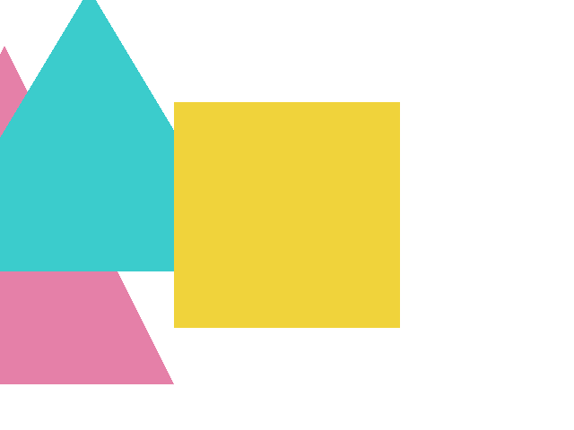
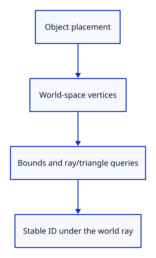

# 3.11.2 · Ask geometry questions in world coordinates

**Chapter 3 · Documents, editing and ownership · Section 3.11 · Object placement and transforms** · [Contents](contents.md)

**Typing: 7–14 minutes.** [Estimate](typing-load.md).

A local vertex is useful for sharing a shape, but the camera does not live in every object’s local coordinate system. Bounds and ray tests must agree on where that object is.

## Type

Continue from [Give each object a placement](27-placement.md). [Save or recover your work](recovery.md).

### 1. `src/scene.rs`

Whole-scene bounds include placed points. Use the same placed coordinates for fitting the selected object.

Edit these blocks from bottom to top. Keep the surrounding lines unchanged.

<details>
<summary>Locate this block</summary>

```rust
        let object = self.objects.iter().find(|object| object.id == id)?;
        let mut vertices = object.mesh.vertices().iter();
        let first = vertices.next()?;
        let mut bounds = crate::bounds::Bounds::point([
            first[0] as f64, first[1] as f64, first[2] as f64,
        ]);
        for vertex in vertices {
            bounds.include([vertex[0] as f64, vertex[1] as f64, vertex[2] as f64]);
        }
        Some(bounds)
    }
```

</details>

Replace it with:

```rust
        let object = self.objects.iter().find(|object| object.id == id)?;
        let mut vertices = object.mesh.vertices().iter();
        let first = vertices.next()?;
        let mut bounds = crate::bounds::Bounds::point(object.world_point(*first));
        for vertex in vertices {
            bounds.include(object.world_point(*vertex));
        }
        Some(bounds)
    }
```

<details>
<summary>Locate this block</summary>

```rust
        let mut bounds: Option<crate::bounds::Bounds> = None;
        for object in &self.objects {
            for vertex in object.mesh.vertices() {
                let point = [vertex[0] as f64, vertex[1] as f64, vertex[2] as f64];
                match &mut bounds {
                    Some(bounds) => bounds.include(point),
                    None => bounds = Some(crate::bounds::Bounds::point(point)),
```

</details>

Replace it with:

```rust
        let mut bounds: Option<crate::bounds::Bounds> = None;
        for object in &self.objects {
            for vertex in object.mesh.vertices() {
                let point = object.world_point(*vertex);
                match &mut bounds {
                    Some(bounds) => bounds.include(point),
                    None => bounds = Some(crate::bounds::Bounds::point(point)),
```

<details>
<summary>Complete updated block reference</summary>

```rust
use crate::mesh::Mesh;
use std::rc::Rc;

#[derive(Clone, Copy, Debug, PartialEq, Eq)]
pub struct ObjectId(u32);

#[derive(Clone)]
pub struct Object {
    pub id: ObjectId,
    pub mesh: Rc<Mesh>,
    pub model: session_rust::Xform,
    pub source: Option<crate::document::Source>,
}

impl Object {
    pub fn world_point(&self, vertex: [f32; 6]) -> [f64; 3] {
        let local = session_rust::Point::new(vertex[0] as f64, vertex[1] as f64, vertex[2] as f64);
        let world = self.model.transform_point(&local);
        [world[0], world[1], world[2]]
    }
}

#[derive(Clone)]
pub struct Scene {
    objects: Vec<Object>,
    next_id: u32,
    extra: Option<ObjectId>,
}

impl Scene {
    pub fn demo() -> Self {
        let pink = Mesh::new(vec![
            [-0.7, -0.6, 0.25, 0.9, 0.25, 0.45],
            [ 0.5, -0.6, 0.25, 0.9, 0.25, 0.45],
            [-0.1,  0.6, 0.25, 0.9, 0.25, 0.45],
        ], vec![0, 1, 2]).expect("Valid pink triangle");
        let turquoise = Mesh::new(vec![
            [-0.4, -0.2, 0.75, 0.05, 0.7, 0.7],
            [ 0.8, -0.2, 0.75, 0.05, 0.7, 0.7],
            [ 0.2,  0.8, 0.75, 0.05, 0.7, 0.7],
        ], vec![0, 1, 2]).expect("Valid turquoise triangle");
        let mut scene = Self { objects: Vec::new(), next_id: 1, extra: None };
        scene.insert(pink).expect("ID available");
        scene.insert(turquoise).expect("ID available");
        scene
    }

    pub fn restore(&mut self, mut saved: Self) {
        saved.next_id = saved.next_id.max(self.next_id);
        *self = saved;
    }

    pub fn bounds(&self) -> Option<crate::bounds::Bounds> {
        let mut bounds: Option<crate::bounds::Bounds> = None;
        for object in &self.objects {
            for vertex in object.mesh.vertices() {
                let point = object.world_point(*vertex);
                match &mut bounds {
                    Some(bounds) => bounds.include(point),
                    None => bounds = Some(crate::bounds::Bounds::point(point)),
                }
            }
        }
        bounds
    }

    pub fn selected_bounds(&self, id: ObjectId) -> Option<crate::bounds::Bounds> {
        let object = self.objects.iter().find(|object| object.id == id)?;
        let mut vertices = object.mesh.vertices().iter();
        let first = vertices.next()?;
        let mut bounds = crate::bounds::Bounds::point(object.world_point(*first));
        for vertex in vertices {
            bounds.include(object.world_point(*vertex));
        }
        Some(bounds)
    }

    pub fn objects(&self) -> &[Object] {
        &self.objects
    }

    pub fn insert(&mut self, mesh: Mesh) -> Result<ObjectId, &'static str> {
        let next = self.next_id.checked_add(1).ok_or("Object IDs exhausted")?;
        let id = ObjectId(self.next_id);
        self.next_id = next;
        self.objects.push(Object { id, mesh: Rc::new(mesh), model: session_rust::Xform::identity(), source: None });
        Ok(id)
    }

    pub fn import(&mut self, loaded: crate::document::Loaded) -> Result<(), &'static str> {
        for (guid, mesh) in loaded.meshes {
            self.insert(mesh)?;
            self.objects.last_mut().unwrap().source = Some(crate::document::Source {
                document: Rc::clone(&loaded.document), guid,
            });
        }
        Ok(())
    }

    pub fn place(&mut self, id: ObjectId, model: session_rust::Xform) -> Result<(), &'static str> {
        if !model.m.iter().all(|v| v.is_finite())
            || [model.m[3], model.m[7], model.m[11], model.m[15]] != [0.0, 0.0, 0.0, 1.0]
        {
            return Err("Placement must be finite and affine");
        }
        let object = self.objects.iter_mut().find(|o| o.id == id).ok_or("Object not found")?;
        object.model = model;
        Ok(())
    }

    pub fn remove(&mut self, id: ObjectId) -> bool {
        let Some(index) = self.objects.iter().position(|object| object.id == id) else { return false; };
        self.objects.remove(index);
        if self.extra == Some(id) {
            self.extra = None;
        }
        true
    }

    pub fn contains(&self, id: ObjectId) -> bool {
        self.objects.iter().any(|object| object.id == id)
    }

    pub fn next(&self, current: Option<ObjectId>) -> Option<ObjectId> {
        if self.objects.is_empty() {
            return None;
        }
        let index = self.objects.iter().position(|object| Some(object.id) == current)
            .map_or(0, |index| index + 1);
        Some(self.objects[index % self.objects.len()].id)
    }

    pub fn add_box(&mut self) -> Result<ObjectId, &'static str> {
        let mut source = session_rust::Mesh::create_box(0.8, 0.8, 0.8);
        source.transform(&session_rust::Xform::translation(0.9, 0.0, 0.4));
        source.set_objectcolor(session_rust::Color::new(0.65, 0.65, 0.65, 1.0));
        self.insert(Mesh::from_kernel(&source)?)
    }

    pub fn toggle_extra(&mut self) {
        if let Some(id) = self.extra.take() {
            self.remove(id);
        } else {
            let extra = Mesh::new(vec![
                [-0.9, 0.3, 0.5, 0.2, 0.8, 0.3],
                [-0.4, 0.3, 0.5, 0.2, 0.8, 0.3],
                [-0.65, 0.9, 0.5, 0.2, 0.8, 0.3],
            ], vec![0, 1, 2]).expect("Valid extra triangle");
            self.extra = Some(self.insert(extra).expect("ID available"));
        }
    }
}

#[cfg(test)]
mod tests {
    use super::*;

    #[test]
    fn removal_moves_a_row_without_changing_its_identity() {
        let mut scene = Scene::demo();
        let first = scene.objects()[0].id;
        let second = scene.objects()[1].id;
        assert!(scene.remove(first));
        assert_eq!(scene.objects()[0].id, second);
        assert_eq!(scene.next(None), Some(second));
        assert!(!scene.contains(first));
        scene.toggle_extra();
        assert_ne!(scene.objects()[1].id, first);
        assert_ne!(scene.objects()[1].id, second);
    }

    #[test]
    fn toggling_the_extra_object_uses_its_id_after_other_removals() {
        let mut scene = Scene::demo();
        scene.toggle_extra();
        let extra = scene.objects()[2].id;
        scene.remove(scene.objects()[0].id);
        scene.toggle_extra();
        assert!(!scene.contains(extra));
        assert_eq!(scene.objects().len(), 1);
    }
}
```

</details>

<details>
<summary>Optional patch references</summary>

Use these original edit fragments when comparing a saved checkpoint. Apply the complete blocks above.

```text
--8<-- "journey/code/27a-world-01.rs"
```

```text
--8<-- "journey/code/27a-world-02.rs"
```

</details>

### 2. `src/picking.rs`

Ask whether the world ray hits the placed triangle. Compute differences in the double-precision coordinates supplied by placement. Build the triangle origin from the same world point.

Edit these blocks from bottom to top. Keep the surrounding lines unchanged.

<details>
<summary>Locate this block</summary>

```rust
    hit
}

fn triangle_distance(ray: &Ray, a: [f32; 6], b: [f32; 6], c: [f32; 6]) -> Option<f64> {
    let edge1 = Vector::new((b[0] - a[0]) as f64, (b[1] - a[1]) as f64, (b[2] - a[2]) as f64);
    let edge2 = Vector::new((c[0] - a[0]) as f64, (c[1] - a[1]) as f64, (c[2] - a[2]) as f64);
    let p = ray.direction.cross(&edge2);
    let determinant = edge1.dot(&p);
    if determinant.abs() < 1.0e-10 {
        return None;
    }
    let origin = &ray.origin - &Point::new(a[0] as f64, a[1] as f64, a[2] as f64);
    let u = origin.dot(&p) / determinant;
    let q = origin.cross(&edge1);
    let v = ray.direction.dot(&q) / determinant;
```

</details>

Replace it with:

```rust
    hit
}

fn triangle_distance(ray: &Ray, a: [f64; 3], b: [f64; 3], c: [f64; 3]) -> Option<f64> {
    let edge1 = Vector::new(b[0] - a[0], b[1] - a[1], b[2] - a[2]);
    let edge2 = Vector::new(c[0] - a[0], c[1] - a[1], c[2] - a[2]);
    let p = ray.direction.cross(&edge2);
    let determinant = edge1.dot(&p);
    if determinant.abs() < 1.0e-10 {
        return None;
    }
    let origin = &ray.origin - &Point::new(a[0], a[1], a[2]);
    let u = origin.dot(&p) / determinant;
    let q = origin.cross(&edge1);
    let v = ray.direction.dot(&q) / determinant;
```

<details>
<summary>Locate this block</summary>

```rust
    for object in scene.objects() {
        let vertices = object.mesh.vertices();
        for triangle in object.mesh.indices().chunks_exact(3) {
            let a = vertices[triangle[0] as usize];
            let b = vertices[triangle[1] as usize];
            let c = vertices[triangle[2] as usize];
            if let Some(distance) = triangle_distance(ray, a, b, c) {
                if distance >= 0.0 && distance < nearest {
                    nearest = distance;
```

</details>

Replace it with:

```rust
    for object in scene.objects() {
        let vertices = object.mesh.vertices();
        for triangle in object.mesh.indices().chunks_exact(3) {
            let a = object.world_point(vertices[triangle[0] as usize]);
            let b = object.world_point(vertices[triangle[1] as usize]);
            let c = object.world_point(vertices[triangle[2] as usize]);
            if let Some(distance) = triangle_distance(ray, a, b, c) {
                if distance >= 0.0 && distance < nearest {
                    nearest = distance;
```

<details>
<summary>Complete updated block reference</summary>

```rust
use crate::{camera::Ray, scene::{ObjectId, Scene}};
use session_rust::{Point, Vector};

pub fn pick(scene: &Scene, ray: &Ray) -> Option<ObjectId> {
    let mut nearest = ray.max_distance;
    let mut hit = None;
    for object in scene.objects() {
        let vertices = object.mesh.vertices();
        for triangle in object.mesh.indices().chunks_exact(3) {
            let a = object.world_point(vertices[triangle[0] as usize]);
            let b = object.world_point(vertices[triangle[1] as usize]);
            let c = object.world_point(vertices[triangle[2] as usize]);
            if let Some(distance) = triangle_distance(ray, a, b, c) {
                if distance >= 0.0 && distance < nearest {
                    nearest = distance;
                    hit = Some(object.id);
                }
            }
        }
    }
    hit
}

fn triangle_distance(ray: &Ray, a: [f64; 3], b: [f64; 3], c: [f64; 3]) -> Option<f64> {
    let edge1 = Vector::new(b[0] - a[0], b[1] - a[1], b[2] - a[2]);
    let edge2 = Vector::new(c[0] - a[0], c[1] - a[1], c[2] - a[2]);
    let p = ray.direction.cross(&edge2);
    let determinant = edge1.dot(&p);
    if determinant.abs() < 1.0e-10 {
        return None;
    }
    let origin = &ray.origin - &Point::new(a[0], a[1], a[2]);
    let u = origin.dot(&p) / determinant;
    let q = origin.cross(&edge1);
    let v = ray.direction.dot(&q) / determinant;
    if u >= 0.0 && v >= 0.0 && u + v <= 1.0 {
        Some(edge2.dot(&q) / determinant)
    } else {
        None
    }
}

#[cfg(test)]
mod tests {
    use super::*;
    use crate::camera::Camera;

    #[test]
    fn perspective_picking_chooses_the_nearest_visible_surface() {
        let mut scene = Scene::demo();
        let camera = Camera::default();
        let ray = camera.ray([0.0, 0.0]).unwrap();
        let pink = scene.objects()[0].id;
        let turquoise = scene.objects()[1].id;
        assert_eq!(pick(&scene, &ray), Some(turquoise));
        scene.remove(turquoise);
        assert_eq!(pick(&scene, &ray), Some(pink));
        let short = Ray { max_distance: 0.1, ..ray };
        assert_eq!(pick(&scene, &short), None);
    }

    #[test]
    fn picking_follows_the_camera_and_ignores_triangles_behind_the_ray() {
        let scene = Scene::demo();
        let mut camera = Camera::default();
        camera.pan(0.1, -0.2);
        camera.rotate(0.7);
        camera.zoom(0.5);
        let screen = camera.view_projection().transform_point(&Point::new(0.4, 0.0, 0.75));
        let ray = camera.ray([screen[0] as f32, screen[1] as f32]).unwrap();
        assert_eq!(pick(&scene, &ray), Some(scene.objects()[1].id));
        let away = Ray { origin: Point::new(0.0, 0.0, 2.0), direction: Vector::z_axis(), max_distance: 10.0 };
        assert_eq!(pick(&scene, &away), None);
    }
}
```

</details>

<details>
<summary>Optional patch references</summary>

Use these original edit fragments when comparing a saved checkpoint. Apply the complete blocks above.

```text
--8<-- "journey/code/27a-world-03.rs"
```

```text
--8<-- "journey/code/27a-world-04.rs"
```

```text
--8<-- "journey/code/27a-world-05.rs"
```

</details>

<details>
<summary>Supplied validation fixture</summary>

Copy this supplied authoring fixture once. Continue with the browser build below; the course does not require running native tests.

### 3. `src/placement_tests.rs`

Optional authoring fixture. Connect placement, both bounds and camera-ray picking in one state check.

<details>
<summary>Locate the existing block</summary>

```text
use session_rust::Xform;
```

</details>

After that block, append this supplied code:

```text
--8<-- "journey/code/27a-world-06.rs" skip=25
```

</details>

## Run and check

In your project:

```sh
cd workspace/journey
REGEN_PROTO=0 cargo build --lib --locked --target wasm32-unknown-unknown -j1
REGEN_PROTO=0 CARGO_BUILD_JOBS=1 trunk serve --port 8780
```

Open `http://127.0.0.1:8780/`. Keep an existing Trunk server running; saving rebuilds it.

Run the Rust checks below. Bounds and ray picking must use placed world coordinates, while the stored local mesh remains unchanged. GPU placement follows next.

### Recorded visual result

**Previous native render — current verification pending.**

The native helper runs the same Editor actions, uses the selected display color, projects a known world point and checks its picking ID and rendered pixels.



*This recorded image predates a source or checker change. Rebuild this checkpoint before using it as current evidence; browser controls require separate acceptance.*

<details>
<summary>Code explanation and diagram</summary>

Reuse world_point in the whole-scene bounds loop, the selected-object bounds loop and the picking loop. Each loop borrows the original mesh. The returned points are temporary query values, not replacement geometry.

Picking now receives three doubles per position. Colors are irrelevant to intersection. Keep the triangle calculation in doubles instead of subtracting floats and converting only the already-rounded result.

The new state check places a triangle, asks for its bounds, projects its centroid and casts the camera ray back through that pixel. These are connected observations: the same stable ID must be found at its new world location. The live commands still use identity placements until the next lesson connects model matrices to the GPU.

Object placement → world vertices → bounds or ray/triangle query.



Why must picking and fitting use the same placement as drawing?

A camera ray and a fitted camera target are expressed in world coordinates. Comparing them with unplaced local vertices asks about a different location. Apply Object::world_point at each query boundary so both questions refer to the placed object.

Study estimate, including typing and experiments: 1–2 hours.

</details>

<details>
<summary>Optional experiment</summary>

Change the world-query test’s translation to (4, 2, −0.25). Predict the new bounds and camera target, then restore it. Explain why querying colors would not help identify the triangle’s position.

</details>

<details>
<summary>Check and save your work</summary>

Restore experimental edits, then run from `session_viewer`:

```sh
npm --prefix ../session_tests run course -- check 3.11.2
npm --prefix ../session_tests run course -- save 3.11.2
```

Source comparison leaves your project untouched. [Save and recovery instructions](recovery.md).

</details>

<details>
<summary>Viewer coverage and verification</summary>

The production viewer combines source bounds and world placements, including inherited instance transforms. These loops establish one coordinate convention before adding hierarchy and shared GPU storage.

Ask geometry questions in world coordinates. The actual command dock drives this checkpoint; the selected object is highlighted.

[Full validation scope](release.md).

</details>
