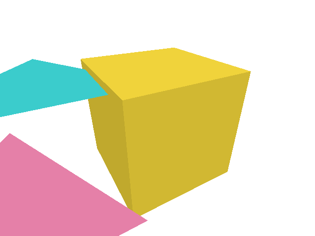
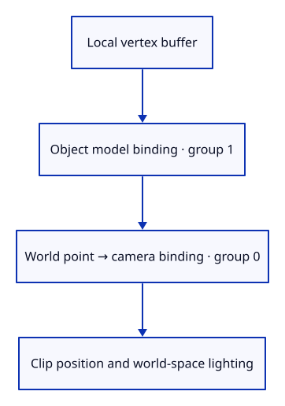

# 3.11.3 · Apply object placement on the GPU

**Chapter 3 · Documents, editing and ownership · Section 3.11 · Object placement and transforms** · [Contents](contents.md)

**Typing: 17–33 minutes.** [Estimate](typing-load.md).

Bounds and picking now understand placement. Drawing must apply that same matrix, or the visible object and the selectable object would disagree.

## Type

Continue from [Ask geometry questions in world coordinates](27a-world.md). [Save or recover your work](recovery.md).

### 1. `src/triangle.wgsl`

Keep camera and object placement in separate uniform groups. Place the vertex before projecting it; use world position for lighting.

<details>
<summary>Locate the existing block</summary>

```wgsl
@group(0) @binding(0) var<uniform> transform: mat4x4<f32>;

struct VertexOutput {
    @builtin(position) position: vec4<f32>,
    @location(0) colour: vec3<f32>,
    @location(1) world: vec3<f32>,
}

@vertex
fn vertex(@location(0) position: vec3<f32>, @location(1) colour: vec3<f32>) -> VertexOutput {
    var output: VertexOutput;
    output.position = transform * vec4<f32>(position, 1.0);
    output.colour = colour;
    output.world = position;
    return output;
}

@fragment
fn fragment(input: VertexOutput) -> @location(0) vec4<f32> {
    // Neighbouring fragments give two directions along this triangle's surface.
    let normal = normalize(cross(dpdx(input.world), dpdy(input.world)));
    let light = normalize(vec3<f32>(0.4, -0.6, 1.0));
    // abs lights both sides of an open face; 0.3 keeps unlit faces readable.
    let brightness = 0.3 + 0.7 * abs(dot(normal, light));
    return vec4<f32>(input.colour * brightness, 1.0);
}
```

</details>

Edit the existing block to match this code; keep unchanged lines:

```wgsl
@group(0) @binding(0) var<uniform> transform: mat4x4<f32>;
@group(1) @binding(0) var<uniform> model: mat4x4<f32>;

struct VertexOutput {
    @builtin(position) position: vec4<f32>,
    @location(0) colour: vec3<f32>,
    @location(1) world: vec3<f32>,
}

@vertex
fn vertex(@location(0) position: vec3<f32>, @location(1) colour: vec3<f32>) -> VertexOutput {
    var output: VertexOutput;
    let world = model * vec4<f32>(position, 1.0);
    output.position = transform * world;
    output.colour = colour;
    output.world = world.xyz;
    return output;
}

@fragment
fn fragment(input: VertexOutput) -> @location(0) vec4<f32> {
    // Neighbouring fragments give two directions along this triangle's surface.
    let normal = normalize(cross(dpdx(input.world), dpdy(input.world)));
    let light = normalize(vec3<f32>(0.4, -0.6, 1.0));
    // abs lights both sides of an open face; 0.3 keeps unlit faces readable.
    let brightness = 0.3 + 0.7 * abs(dot(normal, light));
    return vec4<f32>(input.colour * brightness, 1.0);
}
```

<details>
<summary>Optional patch references</summary>

Use these original edit fragments when comparing a saved checkpoint. Apply the complete blocks above.

```text
--8<-- "journey/code/27b-model-01.wgsl"
```

```text
--8<-- "journey/code/27b-model-02.wgsl"
```

</details>

### 2. `src/gpu_mesh.rs`

Upload an object’s mesh and placement together. Retain the object bind group alongside its vertex/index buffers. Borrow local mesh coordinates and the model from the same Object. Encode the model’s column-major values and bind the uniform buffer. Choose this object’s placement before its indexed draw.

<details>
<summary>Locate the existing block</summary>

```rust
use crate::mesh::Mesh;
use wgpu::util::DeviceExt;

pub struct GpuMesh {
    vertices: wgpu::Buffer,
    indices: wgpu::Buffer,
    index_count: u32,
}

impl GpuMesh {
    pub fn upload(device: &wgpu::Device, mesh: &Mesh, selected: bool) -> Self {
        let mut bytes = Vec::with_capacity(mesh.vertices().len() * 24);
        for vertex in mesh.vertices() {
            let mut display = *vertex;
            if selected {
                display[3..].copy_from_slice(&[1.0, 0.75, 0.05]);
            }
            for value in display {
                bytes.extend_from_slice(&value.to_ne_bytes());
            }
        }
        let vertices = device.create_buffer_init(&wgpu::util::BufferInitDescriptor {
            label: Some("mesh vertices"),
            contents: &bytes,
            usage: wgpu::BufferUsages::VERTEX,
        });
        let bytes: Vec<u8> = mesh.indices().iter().flat_map(|index| index.to_ne_bytes()).collect();
        let indices = device.create_buffer_init(&wgpu::util::BufferInitDescriptor {
            label: Some("mesh indices"),
            contents: &bytes,
            usage: wgpu::BufferUsages::INDEX,
        });
        Self { vertices, indices, index_count: mesh.indices().len() as u32 }
    }

    pub fn draw(&self, pass: &mut wgpu::RenderPass<'_>) {
        pass.set_vertex_buffer(0, self.vertices.slice(..));
        pass.set_index_buffer(self.indices.slice(..), wgpu::IndexFormat::Uint16);
        pass.draw_indexed(0..self.index_count, 0, 0..1);
    }
}
```

</details>

Edit the existing block to match this code; keep unchanged lines:

```rust
use crate::scene::Object;
use wgpu::util::DeviceExt;

pub struct GpuMesh {
    vertices: wgpu::Buffer,
    indices: wgpu::Buffer,
    index_count: u32,
    model_group: wgpu::BindGroup,
}

impl GpuMesh {
    pub fn upload(device: &wgpu::Device, layout: &wgpu::BindGroupLayout, object: &Object, selected: bool) -> Self {
        let mesh = &object.mesh;
        let mut bytes = Vec::with_capacity(mesh.vertices().len() * 24);
        for vertex in mesh.vertices() {
            let mut display = *vertex;
            if selected {
                display[3..].copy_from_slice(&[1.0, 0.75, 0.05]);
            }
            for value in display {
                bytes.extend_from_slice(&value.to_ne_bytes());
            }
        }
        let vertices = device.create_buffer_init(&wgpu::util::BufferInitDescriptor {
            label: Some("mesh vertices"),
            contents: &bytes,
            usage: wgpu::BufferUsages::VERTEX,
        });
        let bytes: Vec<u8> = mesh.indices().iter().flat_map(|index| index.to_ne_bytes()).collect();
        let indices = device.create_buffer_init(&wgpu::util::BufferInitDescriptor {
            label: Some("mesh indices"),
            contents: &bytes,
            usage: wgpu::BufferUsages::INDEX,
        });
        let bytes: Vec<u8> = object.model.m.iter()
            .flat_map(|value| (*value as f32).to_ne_bytes()).collect();
        let model = device.create_buffer_init(&wgpu::util::BufferInitDescriptor {
            label: Some("object placement"),
            contents: &bytes,
            usage: wgpu::BufferUsages::UNIFORM,
        });
        let model_group = device.create_bind_group(&wgpu::BindGroupDescriptor {
            label: Some("object placement"),
            layout,
            entries: &[wgpu::BindGroupEntry { binding: 0, resource: model.as_entire_binding() }],
        });
        Self { vertices, indices, model_group, index_count: mesh.indices().len() as u32 }
    }

    pub fn draw(&self, pass: &mut wgpu::RenderPass<'_>) {
        pass.set_bind_group(1, &self.model_group, &[]);
        pass.set_vertex_buffer(0, self.vertices.slice(..));
        pass.set_index_buffer(self.indices.slice(..), wgpu::IndexFormat::Uint16);
        pass.draw_indexed(0..self.index_count, 0, 0..1);
    }
}
```

<details>
<summary>Optional patch references</summary>

Use these original edit fragments when comparing a saved checkpoint. Apply the complete blocks above.

```text
--8<-- "journey/code/27b-model-03.rs"
```

```text
--8<-- "journey/code/27b-model-04.rs"
```

```text
--8<-- "journey/code/27b-model-05.rs"
```

```text
--8<-- "journey/code/27b-model-06.rs"
```

```text
--8<-- "journey/code/27b-model-07.rs"
```

</details>

### 3. `src/renderer.rs`

Remove the upload that ran before the pipeline layout was available. Upload objects using the model layout inferred from the shader. Include each placement when a scene update rebuilds the current uploads.

Edit these blocks from bottom to top. Keep the surrounding lines unchanged.

<details>
<summary>Locate this block</summary>

```rust
    }

    pub fn set_scene(&mut self, scene: &Scene, selected: Option<ObjectId>) {
        self.meshes = scene.objects().iter().map(|object| {
            GpuMesh::upload(&self.device, &object.mesh, selected == Some(object.id))
        }).collect();
    }
```

</details>

Replace it with:

```rust
    }

    pub fn set_scene(&mut self, scene: &Scene, selected: Option<ObjectId>) {
        let layout = self.pipeline.get_bind_group_layout(1);
        self.meshes = scene.objects().iter().map(|object| {
            GpuMesh::upload(&self.device, &layout, object, selected == Some(object.id))
        }).collect();
    }
```

<details>
<summary>Locate this block</summary>

```rust
            multiview_mask: None,
            cache: None,
        });
        let uniform = device.create_buffer(&wgpu::BufferDescriptor {
            label: Some("view transform"),
            size: 64,
```

</details>

Replace it with:

```rust
            multiview_mask: None,
            cache: None,
        });
        let layout = pipeline.get_bind_group_layout(1);
        let meshes = scene.objects().iter()
            .map(|object| GpuMesh::upload(&device, &layout, object, false)).collect();
        let uniform = device.create_buffer(&wgpu::BufferDescriptor {
            label: Some("view transform"),
            size: 64,
```

<details>
<summary>Locate this block</summary>

```rust
        format: wgpu::TextureFormat,
        scene: &Scene,
    ) -> Self {
        let meshes = scene.objects().iter().map(|object| GpuMesh::upload(&device, &object.mesh, false)).collect();
        let shader = device.create_shader_module(wgpu::ShaderModuleDescriptor {
            label: Some("triangle"),
            source: wgpu::ShaderSource::Wgsl(include_str!("triangle.wgsl").into()),
```

</details>

Replace it with:

```rust
        format: wgpu::TextureFormat,
        scene: &Scene,
    ) -> Self {
        let shader = device.create_shader_module(wgpu::ShaderModuleDescriptor {
            label: Some("triangle"),
            source: wgpu::ShaderSource::Wgsl(include_str!("triangle.wgsl").into()),
```

<details>
<summary>Complete updated block reference</summary>

```rust
use crate::{gpu_mesh::GpuMesh, scene::{ObjectId, Scene}};

pub struct Renderer {
    pub device: wgpu::Device,
    pub queue: wgpu::Queue,
    pipeline: wgpu::RenderPipeline,
    meshes: Vec<GpuMesh>,
    uniform: wgpu::Buffer,
    view_group: wgpu::BindGroup,
    depth: wgpu::TextureView,
}

impl Renderer {
    pub fn new(
        device: wgpu::Device,
        queue: wgpu::Queue,
        format: wgpu::TextureFormat,
        scene: &Scene,
    ) -> Self {
        let shader = device.create_shader_module(wgpu::ShaderModuleDescriptor {
            label: Some("triangle"),
            source: wgpu::ShaderSource::Wgsl(include_str!("triangle.wgsl").into()),
        });
        let pipeline = device.create_render_pipeline(&wgpu::RenderPipelineDescriptor {
            label: Some("triangle"),
            layout: None,
            vertex: wgpu::VertexState {
                module: &shader,
                entry_point: Some("vertex"),
                compilation_options: Default::default(),
                buffers: &[wgpu::VertexBufferLayout {
                    array_stride: 24,
                    step_mode: wgpu::VertexStepMode::Vertex,
                    attributes: &wgpu::vertex_attr_array![0 => Float32x3, 1 => Float32x3],
                }],
            },
            fragment: Some(wgpu::FragmentState {
                module: &shader,
                entry_point: Some("fragment"),
                compilation_options: Default::default(),
                targets: &[Some(format.into())],
            }),
            primitive: Default::default(),
            depth_stencil: Some(wgpu::DepthStencilState {
                format: wgpu::TextureFormat::Depth32Float,
                depth_write_enabled: Some(true),
                depth_compare: Some(wgpu::CompareFunction::Less),
                stencil: Default::default(),
                bias: Default::default(),
            }),
            multisample: Default::default(),
            multiview_mask: None,
            cache: None,
        });
        let layout = pipeline.get_bind_group_layout(1);
        let meshes = scene.objects().iter()
            .map(|object| GpuMesh::upload(&device, &layout, object, false)).collect();
        let uniform = device.create_buffer(&wgpu::BufferDescriptor {
            label: Some("view transform"),
            size: 64,
            usage: wgpu::BufferUsages::UNIFORM | wgpu::BufferUsages::COPY_DST,
            mapped_at_creation: false,
        });
        let view_group = device.create_bind_group(&wgpu::BindGroupDescriptor {
            label: Some("view settings"),
            layout: &pipeline.get_bind_group_layout(0),
            entries: &[wgpu::BindGroupEntry {
                binding: 0,
                resource: uniform.as_entire_binding(),
            }],
        });
        let depth = Self::depth(&device, 640, 480);
        Self { device, queue, pipeline, meshes, uniform, view_group, depth }
    }

    fn depth(device: &wgpu::Device, width: u32, height: u32) -> wgpu::TextureView {
        let depth_texture = device.create_texture(&wgpu::TextureDescriptor {
            label: Some("opaque depth"),
            size: wgpu::Extent3d { width, height, depth_or_array_layers: 1 },
            mip_level_count: 1,
            sample_count: 1,
            dimension: wgpu::TextureDimension::D2,
            format: wgpu::TextureFormat::Depth32Float,
            usage: wgpu::TextureUsages::RENDER_ATTACHMENT,
            view_formats: &[],
        });
        depth_texture.create_view(&Default::default())
    }

    pub fn resize(&mut self, size: crate::viewport::Viewport) {
        self.depth = Self::depth(&self.device, size.width, size.height);
    }

    pub fn set_scene(&mut self, scene: &Scene, selected: Option<ObjectId>) {
        let layout = self.pipeline.get_bind_group_layout(1);
        self.meshes = scene.objects().iter().map(|object| {
            GpuMesh::upload(&self.device, &layout, object, selected == Some(object.id))
        }).collect();
    }

    pub fn draw(
        &self,
        view: &wgpu::TextureView,
        background: &crate::background::Background,
        transform: &[f32; 16],
    ) {
        let bytes: Vec<u8> = transform.iter().flat_map(|value| value.to_ne_bytes()).collect();
        self.queue.write_buffer(&self.uniform, 0, &bytes);
        let [r, g, b] = background.rgb();
        let mut encoder = self.device.create_command_encoder(&Default::default());
        {
            // The pass borrows the encoder. This scope ends that borrow before finish takes it.
            let mut pass = encoder.begin_render_pass(&wgpu::RenderPassDescriptor {
                label: Some("canvas"),
                depth_stencil_attachment: Some(wgpu::RenderPassDepthStencilAttachment {
                    view: &self.depth,
                    depth_ops: Some(wgpu::Operations {
                        load: wgpu::LoadOp::Clear(1.0),
                        store: wgpu::StoreOp::Store,
                    }),
                    stencil_ops: None,
                }),
                color_attachments: &[Some(wgpu::RenderPassColorAttachment {
                    view,
                    depth_slice: None,
                    resolve_target: None,
                    ops: wgpu::Operations {
                        load: wgpu::LoadOp::Clear(wgpu::Color {
                            r, g, b, a: 1.0,
                        }),
                        store: wgpu::StoreOp::Store,
                    },
                })],
                ..Default::default()
            });
            pass.set_pipeline(&self.pipeline);
            pass.set_bind_group(0, &self.view_group, &[]);
            for mesh in &self.meshes {
                mesh.draw(&mut pass);
            }
        }
        self.queue.submit([encoder.finish()]);
    }
}
```

</details>

<details>
<summary>Optional patch references</summary>

Use these original edit fragments when comparing a saved checkpoint. Apply the complete blocks above.

```text
--8<-- "journey/code/27b-model-09.rs"
```

```text
--8<-- "journey/code/27b-model-10.rs"
```

</details>

### 4. `src/scene.rs`

Keep the generated box centred in its local coordinates. Assign its world placement after inserting the local mesh.

Edit these blocks from bottom to top. Keep the surrounding lines unchanged.

<details>
<summary>Locate this block</summary>

```rust

    pub fn add_box(&mut self) -> Result<ObjectId, &'static str> {
        let mut source = session_rust::Mesh::create_box(0.8, 0.8, 0.8);
        source.transform(&session_rust::Xform::translation(0.9, 0.0, 0.4));
        source.set_objectcolor(session_rust::Color::new(0.65, 0.65, 0.65, 1.0));
        self.insert(Mesh::from_kernel(&source)?)
    }

    pub fn toggle_extra(&mut self) {
```

</details>

Replace it with:

```rust

    pub fn add_box(&mut self) -> Result<ObjectId, &'static str> {
        let mut source = session_rust::Mesh::create_box(0.8, 0.8, 0.8);
        source.set_objectcolor(session_rust::Color::new(0.65, 0.65, 0.65, 1.0));
        let id = self.insert(Mesh::from_kernel(&source)?)?;
        self.place(id, session_rust::Xform::translation(0.9, 0.0, 0.4))?;
        Ok(id)
    }

    pub fn toggle_extra(&mut self) {
```

<details>
<summary>Complete updated block reference</summary>

```rust
use crate::mesh::Mesh;
use std::rc::Rc;

#[derive(Clone, Copy, Debug, PartialEq, Eq)]
pub struct ObjectId(u32);

#[derive(Clone)]
pub struct Object {
    pub id: ObjectId,
    pub mesh: Rc<Mesh>,
    pub model: session_rust::Xform,
    pub source: Option<crate::document::Source>,
}

impl Object {
    pub fn world_point(&self, vertex: [f32; 6]) -> [f64; 3] {
        let local = session_rust::Point::new(vertex[0] as f64, vertex[1] as f64, vertex[2] as f64);
        let world = self.model.transform_point(&local);
        [world[0], world[1], world[2]]
    }
}

#[derive(Clone)]
pub struct Scene {
    objects: Vec<Object>,
    next_id: u32,
    extra: Option<ObjectId>,
}

impl Scene {
    pub fn demo() -> Self {
        let pink = Mesh::new(vec![
            [-0.7, -0.6, 0.25, 0.9, 0.25, 0.45],
            [ 0.5, -0.6, 0.25, 0.9, 0.25, 0.45],
            [-0.1,  0.6, 0.25, 0.9, 0.25, 0.45],
        ], vec![0, 1, 2]).expect("Valid pink triangle");
        let turquoise = Mesh::new(vec![
            [-0.4, -0.2, 0.75, 0.05, 0.7, 0.7],
            [ 0.8, -0.2, 0.75, 0.05, 0.7, 0.7],
            [ 0.2,  0.8, 0.75, 0.05, 0.7, 0.7],
        ], vec![0, 1, 2]).expect("Valid turquoise triangle");
        let mut scene = Self { objects: Vec::new(), next_id: 1, extra: None };
        scene.insert(pink).expect("ID available");
        scene.insert(turquoise).expect("ID available");
        scene
    }

    pub fn restore(&mut self, mut saved: Self) {
        saved.next_id = saved.next_id.max(self.next_id);
        *self = saved;
    }

    pub fn bounds(&self) -> Option<crate::bounds::Bounds> {
        let mut bounds: Option<crate::bounds::Bounds> = None;
        for object in &self.objects {
            for vertex in object.mesh.vertices() {
                let point = object.world_point(*vertex);
                match &mut bounds {
                    Some(bounds) => bounds.include(point),
                    None => bounds = Some(crate::bounds::Bounds::point(point)),
                }
            }
        }
        bounds
    }

    pub fn selected_bounds(&self, id: ObjectId) -> Option<crate::bounds::Bounds> {
        let object = self.objects.iter().find(|object| object.id == id)?;
        let mut vertices = object.mesh.vertices().iter();
        let first = vertices.next()?;
        let mut bounds = crate::bounds::Bounds::point(object.world_point(*first));
        for vertex in vertices {
            bounds.include(object.world_point(*vertex));
        }
        Some(bounds)
    }

    pub fn objects(&self) -> &[Object] {
        &self.objects
    }

    pub fn insert(&mut self, mesh: Mesh) -> Result<ObjectId, &'static str> {
        let next = self.next_id.checked_add(1).ok_or("Object IDs exhausted")?;
        let id = ObjectId(self.next_id);
        self.next_id = next;
        self.objects.push(Object { id, mesh: Rc::new(mesh), model: session_rust::Xform::identity(), source: None });
        Ok(id)
    }

    pub fn import(&mut self, loaded: crate::document::Loaded) -> Result<(), &'static str> {
        for (guid, mesh) in loaded.meshes {
            self.insert(mesh)?;
            self.objects.last_mut().unwrap().source = Some(crate::document::Source {
                document: Rc::clone(&loaded.document), guid,
            });
        }
        Ok(())
    }

    pub fn place(&mut self, id: ObjectId, model: session_rust::Xform) -> Result<(), &'static str> {
        if !model.m.iter().all(|v| v.is_finite())
            || [model.m[3], model.m[7], model.m[11], model.m[15]] != [0.0, 0.0, 0.0, 1.0]
        {
            return Err("Placement must be finite and affine");
        }
        let object = self.objects.iter_mut().find(|o| o.id == id).ok_or("Object not found")?;
        object.model = model;
        Ok(())
    }

    pub fn remove(&mut self, id: ObjectId) -> bool {
        let Some(index) = self.objects.iter().position(|object| object.id == id) else { return false; };
        self.objects.remove(index);
        if self.extra == Some(id) {
            self.extra = None;
        }
        true
    }

    pub fn contains(&self, id: ObjectId) -> bool {
        self.objects.iter().any(|object| object.id == id)
    }

    pub fn next(&self, current: Option<ObjectId>) -> Option<ObjectId> {
        if self.objects.is_empty() {
            return None;
        }
        let index = self.objects.iter().position(|object| Some(object.id) == current)
            .map_or(0, |index| index + 1);
        Some(self.objects[index % self.objects.len()].id)
    }

    pub fn add_box(&mut self) -> Result<ObjectId, &'static str> {
        let mut source = session_rust::Mesh::create_box(0.8, 0.8, 0.8);
        source.set_objectcolor(session_rust::Color::new(0.65, 0.65, 0.65, 1.0));
        let id = self.insert(Mesh::from_kernel(&source)?)?;
        self.place(id, session_rust::Xform::translation(0.9, 0.0, 0.4))?;
        Ok(id)
    }

    pub fn toggle_extra(&mut self) {
        if let Some(id) = self.extra.take() {
            self.remove(id);
        } else {
            let extra = Mesh::new(vec![
                [-0.9, 0.3, 0.5, 0.2, 0.8, 0.3],
                [-0.4, 0.3, 0.5, 0.2, 0.8, 0.3],
                [-0.65, 0.9, 0.5, 0.2, 0.8, 0.3],
            ], vec![0, 1, 2]).expect("Valid extra triangle");
            self.extra = Some(self.insert(extra).expect("ID available"));
        }
    }
}

#[cfg(test)]
mod tests {
    use super::*;

    #[test]
    fn removal_moves_a_row_without_changing_its_identity() {
        let mut scene = Scene::demo();
        let first = scene.objects()[0].id;
        let second = scene.objects()[1].id;
        assert!(scene.remove(first));
        assert_eq!(scene.objects()[0].id, second);
        assert_eq!(scene.next(None), Some(second));
        assert!(!scene.contains(first));
        scene.toggle_extra();
        assert_ne!(scene.objects()[1].id, first);
        assert_ne!(scene.objects()[1].id, second);
    }

    #[test]
    fn toggling_the_extra_object_uses_its_id_after_other_removals() {
        let mut scene = Scene::demo();
        scene.toggle_extra();
        let extra = scene.objects()[2].id;
        scene.remove(scene.objects()[0].id);
        scene.toggle_extra();
        assert!(!scene.contains(extra));
        assert_eq!(scene.objects().len(), 1);
    }
}
```

</details>

<details>
<summary>Optional patch references</summary>

Use these original edit fragments when comparing a saved checkpoint. Apply the complete blocks above.

```text
--8<-- "journey/code/27b-model-12.rs"
```

</details>

## Run and check

In your project:

```sh
cd workspace/journey
REGEN_PROTO=0 cargo build --lib --locked --target wasm32-unknown-unknown -j1
REGEN_PROTO=0 CARGO_BUILD_JOBS=1 trunk serve --port 8780
```

Open `http://127.0.0.1:8780/`. Keep an existing Trunk server running; saving rebuilds it.

Type `Example Box`, then `View Isometric`. The box now draws at its placed position. Click a visible face: picking must agree with the GPU placement, while local vertices stay unchanged.

### Recorded visual result

**Previous native render — current verification pending.**

The native helper runs the same Editor actions, uses the selected display color, projects a known world point and checks its picking ID and rendered pixels.



*This recorded image predates a source or checker change. Rebuild this checkpoint before using it as current evidence; browser controls require separate acceptance.*

<details>
<summary>Code explanation and diagram</summary>

Add a second uniform binding to the shader. Group 0 remains the shared camera transform. Group 1 contains one object’s model matrix. The vertex shader first produces a world position, then applies the camera. The fragment shader receives that world position so its derivative-based lighting follows the placed surface too.

GpuMesh uploads the original local vertices, encodes the sixteen model values as floats, and creates the object bind group from the pipeline’s group-1 layout. The bind group retains its referenced buffer. Bind it immediately before drawing that object’s indices.

Finally change Example Box: create its shape around the local origin, then give the Object the translation that used to be baked into its vertices. Its world appearance stays consistent. Its local box coordinates are now reusable. The current renderer still rebuilds uploads on scene changes; later shared-storage lessons will update changed ranges.

Local vertex → model uniform → world point → camera uniform → clip position.



Why do model and camera matrices need separate owners?

The object owns where its shape belongs; the camera owns how the scene is viewed. Binding the object model before each draw lets local mesh data stay unchanged while the same camera draws many placements.

Study estimate, including typing and experiments: 1–2 hours.

</details>

<details>
<summary>Optional experiment</summary>

Change Example Box’s placement translation from (0.9, 0, 0.4) to (1.4, 0, 0.4). Predict where Fit Selected will aim and verify the visible box and its pick agree. Restore the original value. Do not move the box by rewriting its mesh.

</details>

<details>
<summary>Check and save your work</summary>

Restore experimental edits, then run from `session_viewer`:

```sh
npm --prefix ../session_tests run course -- check 3.11.3
npm --prefix ../session_tests run course -- save 3.11.3
```

Source comparison leaves your project untouched. [Save and recovery instructions](recovery.md).

</details>

<details>
<summary>Viewer coverage and verification</summary>

The maintained viewer shares local geometry across instances and supplies placement data to GPU draws. This checkpoint introduces the same ownership boundary with one bind group per object; batching and resource accounting follow later.

Apply object placement on the GPU. The actual command dock drives this checkpoint; the selected object is highlighted.

[Full validation scope](release.md).

To reproduce the scripted acceptance of the reference checkpoint, run from `session_viewer` with the [course bundle server](release.md#reproduce) running on port 8781:

```sh
npm --prefix ../session_tests run course -- capture 3.11.3
```

This uses the verified reference bundle; it does not check or change your typed project.

</details>
