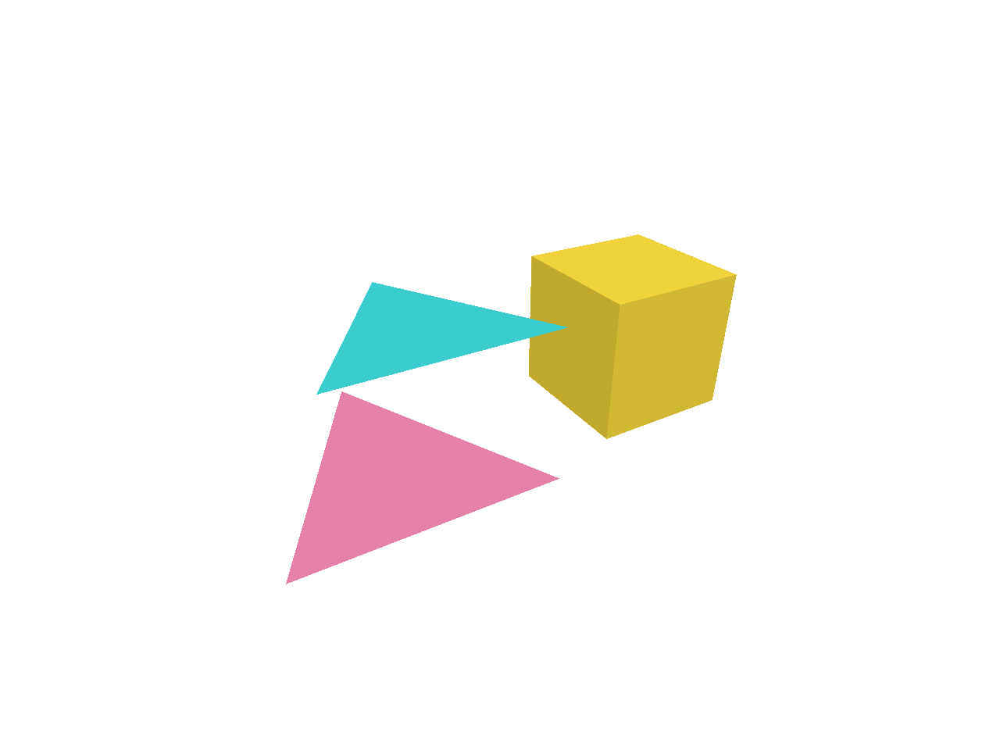
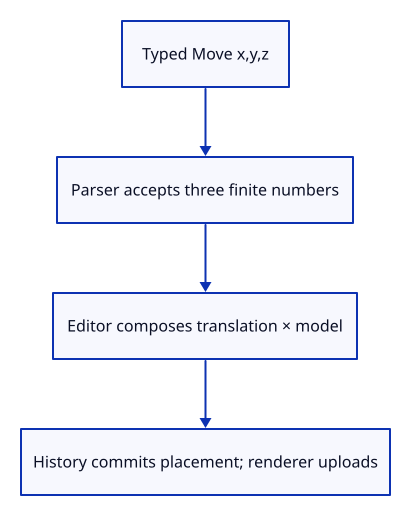

# 3.11.4 · Move a placed object with a typed offset

**Chapter 3 · Documents, editing and ownership · Section 3.11 · Object placement and transforms** · [Contents](contents.md)

**Typing: 21–42 minutes.** [Estimate](typing-load.md).

The complete path is ready for a real command: local vertices, world queries and a GPU model matrix. Add Move x,y,z without adding a second editing owner.

## Type

Continue from [Apply object placement on the GPU](27b-model.md). [Save or recover your work](recovery.md).

### 1. `src/lib.rs`

Register the small numeric parser.

<details>
<summary>Locate the existing block</summary>

```rust
pub mod editor;
```

</details>

After that block, type:

```rust
--8<-- "journey/code/27c-move-01.rs" skip=16
```

### 2. `src/offset.rs`

Validate a complete numeric offset before it reaches the document.

Create the file and type:

```rust
--8<-- "journey/code/27c-move-02.rs"
```

### 3. `src/editor.rs`

Carry the offset as data in the existing Action enum. Move along world axes and commit one placement change through document history.

Edit these blocks from bottom to top. Keep the surrounding lines unchanged.

<details>
<summary>Locate this block</summary>

```rust
            Action::AddBox => {
                self.history.try_edit(&mut self.scene, |scene| scene.add_box().map(|_| ()))?;
            }
            Action::ToggleExtra => self.history.edit(&mut self.scene, Scene::toggle_extra),
            Action::SelectNext => self.selected = self.scene.next(self.selected),
            Action::Delete => {
```

</details>

Replace it with:

```rust
            Action::AddBox => {
                self.history.try_edit(&mut self.scene, |scene| scene.add_box().map(|_| ()))?;
            }
            Action::Translate(offset) => {
                let id = self.selected.ok_or("Select an object before Move")?;
                if offset.iter().all(|&v| v == 0.0) { return Ok(Change::View); }
                let object = self.scene.objects().iter().find(|o| o.id == id).ok_or("Object not found")?;
                let shift = session_rust::Xform::translation(offset[0], offset[1], offset[2]);
                let model = &shift * &object.model;
                self.history.try_edit(&mut self.scene, |scene| scene.place(id, model))?;
            }
            Action::ToggleExtra => self.history.edit(&mut self.scene, Scene::toggle_extra),
            Action::SelectNext => self.selected = self.scene.next(self.selected),
            Action::Delete => {
```

<details>
<summary>Locate this block</summary>

```rust
    Pick([f32; 2]),
    Import(Vec<u8>),
    AddBox,
    ToggleExtra,
    SelectNext,
    Delete,
```

</details>

Replace it with:

```rust
    Pick([f32; 2]),
    Import(Vec<u8>),
    AddBox,
    Translate([f64; 3]),
    ToggleExtra,
    SelectNext,
    Delete,
```

<details>
<summary>Complete updated block reference</summary>

```rust
use crate::{background::Background, camera::Camera, history::History, scene::{ObjectId, Scene}};

pub enum Action {
    Pick([f32; 2]),
    Import(Vec<u8>),
    AddBox,
    Translate([f64; 3]),
    ToggleExtra,
    SelectNext,
    Delete,
    Undo,
    Redo,
    Background,
    Zoom(f32),
    Pan(f32, f32),
    Orbit(f64, f64),
    Isometric,
    ResetView,
    Fit,
    FitSelected,
    Projection(crate::camera::Projection),
}

#[derive(Debug, PartialEq, Eq)]
pub enum Change {
    View,
    Scene,
}

pub struct Editor {
    pub scene: Scene,
    pub selected: Option<ObjectId>,
    pub camera: Camera,
    pub background: Background,
    history: History,
}

impl Default for Editor {
    fn default() -> Self {
        Self {
            scene: Scene::demo(),
            selected: None,
            camera: Camera::default(),
            background: Background::default(),
            history: History::default(),
        }
    }
}

impl Editor {
    pub fn apply(&mut self, action: Action) -> Result<Change, &'static str> {
        match action {
            Action::Pick(screen) => {
                self.selected = self.camera.ray(screen)
                    .and_then(|ray| crate::picking::pick(&self.scene, &ray));
            }
            Action::Import(bytes) => {
                let loaded = crate::document::load(&bytes)?;
                self.history.try_edit(&mut self.scene, |scene| scene.import(loaded))?;
            }
            Action::AddBox => {
                self.history.try_edit(&mut self.scene, |scene| scene.add_box().map(|_| ()))?;
            }
            Action::Translate(offset) => {
                let id = self.selected.ok_or("Select an object before Move")?;
                if offset.iter().all(|&v| v == 0.0) { return Ok(Change::View); }
                let object = self.scene.objects().iter().find(|o| o.id == id).ok_or("Object not found")?;
                let shift = session_rust::Xform::translation(offset[0], offset[1], offset[2]);
                let model = &shift * &object.model;
                self.history.try_edit(&mut self.scene, |scene| scene.place(id, model))?;
            }
            Action::ToggleExtra => self.history.edit(&mut self.scene, Scene::toggle_extra),
            Action::SelectNext => self.selected = self.scene.next(self.selected),
            Action::Delete => {
                if let Some(id) = self.selected.take() {
                    self.history.edit(&mut self.scene, |scene| { scene.remove(id); });
                }
            }
            Action::Undo => { self.history.undo(&mut self.scene); }
            Action::Redo => { self.history.redo(&mut self.scene); }
            view => {
                match view {
                    Action::Background => self.background.toggle(),
                    Action::Zoom(factor) => self.camera.zoom(factor),
                    Action::Pan(dx, dy) => self.camera.pan(dx, dy),
                    Action::Orbit(yaw, pitch) => self.camera.orbit(yaw, pitch),
                    Action::Isometric => self.camera.isometric(),
                    Action::Projection(mode) => self.camera.projection = mode,
                    Action::Fit => {
                        if let Some(bounds) = self.scene.bounds() {
                            self.camera.fit(&bounds);
                        }
                    }
                    Action::FitSelected => {
                        if let Some(bounds) = self.selected
                            .and_then(|id| self.scene.selected_bounds(id))
                        {
                            self.camera.fit(&bounds);
                        }
                    }
                    Action::ResetView => {
                        let aspect = self.camera.aspect;
                        self.camera = Camera { aspect, ..Camera::default() };
                    }
                    _ => unreachable!("Document actions were handled above"),
                }
                return Ok(Change::View);
            }
        }
        // Deletion and history travel can invalidate selection; repair it in one place.
        self.selected = self.selected.filter(|id| self.scene.contains(*id));
        Ok(Change::Scene)
    }
}

#[cfg(test)]
mod tests {
    use super::*;

    #[test]
    fn resetting_the_view_preserves_its_current_aspect() {
        let mut editor = Editor::default();
        editor.camera.aspect = 2.0;
        editor.apply(Action::Zoom(2.0)).unwrap();
        editor.apply(Action::ResetView).unwrap();
        assert_eq!(editor.camera.aspect, 2.0);
        assert_eq!(editor.camera.distance, 3.0);
    }

    #[test]
    fn undo_changes_the_document_without_rewinding_the_view() {
        let mut editor = Editor::default();
        editor.apply(Action::AddBox).unwrap();
        editor.apply(Action::Zoom(2.0)).unwrap();
        editor.apply(Action::Background).unwrap();
        editor.apply(Action::Undo).unwrap();
        assert_eq!(editor.scene.objects().len(), 2);
        assert_eq!(editor.camera.distance, 1.5);
        assert_eq!(editor.background.rgb(), [0.9, 0.9, 0.9]);
    }

    #[test]
    fn undo_repairs_selection_and_empty_delete_preserves_redo() {
        let mut editor = Editor::default();
        editor.apply(Action::AddBox).unwrap();
        for _ in 0..3 {
            editor.apply(Action::SelectNext).unwrap();
        }
        let box_id = editor.selected.unwrap();
        editor.apply(Action::Undo).unwrap();
        assert!(editor.selected.is_none());
        editor.apply(Action::Delete).unwrap();
        editor.apply(Action::Redo).unwrap();
        assert!(editor.scene.contains(box_id));
    }

    #[test]
    fn picking_a_moved_view_uses_the_editors_current_camera() {
        let mut editor = Editor::default();
        editor.apply(Action::Pan(0.2, 0.1)).unwrap();
        let point = session_rust::Point::new(0.2, 0.3, 0.75);
        let screen = editor.camera.view_projection().transform_point(&point);
        assert_eq!(editor.apply(Action::Pick([screen[0] as f32, screen[1] as f32])).unwrap(), Change::Scene);
        assert_eq!(editor.selected, Some(editor.scene.objects()[1].id));
        assert_eq!(editor.apply(Action::Zoom(2.0)).unwrap(), Change::View);
    }
}
```

</details>

<details>
<summary>Optional patch references</summary>

Use these original edit fragments when comparing a saved checkpoint. Apply the complete blocks above.

```text
--8<-- "journey/code/27c-move-03.rs"
```

```text
--8<-- "journey/code/27c-move-04.rs"
```

</details>

### 4. `src/browser.rs`

Offer the named command in the dock vocabulary.

<details>
<summary>Locate the existing block</summary>

```rust
            "Fit Selected",
```

</details>

After that block, type:

```rust
--8<-- "journey/code/27c-move-05.rs" skip=28
```

### 5. `src/panel.rs`

Recognize Move followed by arguments; the parser validates those arguments. Replace the latest command’s answer without recording the line twice.

Edit these blocks from bottom to top. Keep the surrounding lines unchanged.

<details>
<summary>Locate this block</summary>

```rust
            return Ok(None);
        }
        if !self.commands.0.iter()
            .any(|name| name.eq_ignore_ascii_case(&line))
        {
            self.answer(&line, "Unknown command. Type Help.");
            return Ok(None);
```

</details>

Replace it with:

```rust
            return Ok(None);
        }
        if !self.commands.0.iter()
            .any(|name| name.eq_ignore_ascii_case(&line)
                || (*name == "Move" && line.to_ascii_lowercase().starts_with("move ")))
        {
            self.answer(&line, "Unknown command. Type Help.");
            return Ok(None);
```

<details>
<summary>Locate this block</summary>

```rust
        self.model.status = message.into();
    }

    pub fn update(
        &mut self,
        event: Option<&web_sys::Event>,
```

</details>

Replace it with:

```rust
        self.model.status = message.into();
    }

    pub fn result(&mut self, message: &str) {
        self.model.status = message.into();
        if let Some(last) = self.model.history.back_mut()
            && let Some(at) = last.find('\n')
        {
            last.truncate(at + 1);
            last.push_str(message);
        }
    }

    pub fn update(
        &mut self,
        event: Option<&web_sys::Event>,
```

<details>
<summary>Complete updated block reference</summary>

```rust
use crate::command_dock::{self, CommandLine, Commands as _, theme};
use crate::renderer::Renderer;

struct Commands(&'static [&'static str]);

impl command_dock::Commands for Commands {
    fn canonical(&self, line: &str) -> String {
        let line = line.split_whitespace().collect::<Vec<_>>().join(" ");
        self.0
            .iter()
            .find(|name| name.eq_ignore_ascii_case(&line))
            .map_or(line.clone(), |name| (*name).into())
    }
    fn choosing_option(&self, _: &str) -> bool {
        false
    }
    fn accept(&self, line: &str) -> (String, bool) {
        (self.canonical(line), true)
    }
    fn completions(&self, line: &str) -> Vec<&'static str> {
        crate::command_vocabulary::ranked(self.0.as_ref(), line)
    }
    fn browse(&self, line: &str) -> Vec<&'static str> {
        self.completions(line)
    }
}

pub struct Panel {
    commands: Commands,
    pub consumed: bool,
    pointer_owned: bool,
    top: f32,
    controls: Option<Vec<command_dock::Control>>,
    context: egui::Context,
    painter: egui_wgpu::Renderer,
    model: CommandLine,
    events: Vec<egui::Event>,
    output: Option<egui::FullOutput>,
    screen: egui_wgpu::ScreenDescriptor,
}

impl Panel {
    pub fn new(renderer: &Renderer, format: wgpu::TextureFormat, commands: &'static [&'static str]) -> Self {
        let context = egui::Context::default();
        context.set_fonts(theme::fonts([
            include_bytes!("../assets/text/NotoSans-Regular.subset.ttf"),
            include_bytes!("../assets/text/NotoSansSymbols2-Regular.subset.ttf"),
            include_bytes!("../assets/text/NotoSansSymbols-Regular.subset.ttf"),
        ]));
        context.set_theme(egui::Theme::Light);
        context.set_visuals(theme::visuals());
        // One layout pass prevents a future text event from being replayed.
        context.options_mut(|options| options.max_passes = 1.try_into().unwrap());
        let painter = egui_wgpu::Renderer::new(&renderer.device, format, Default::default());
        Self { commands: Commands(commands), consumed: false, pointer_owned: false, top: f32::INFINITY, controls: None, context, painter, events: Vec::new(), output: None,
            screen: egui_wgpu::ScreenDescriptor { size_in_pixels: [640, 480], pixels_per_point: 1.0 }, model: CommandLine {
            focus_command: true,
            ..Default::default()
        } }
    }

    pub fn command(&self) -> &str { &self.model.command }

    pub fn history(&self) -> &std::collections::VecDeque<String> { &self.model.history }

    pub fn shortcut(&self, event: &web_sys::KeyboardEvent) -> Option<crate::shortcuts::Shortcut> {
        if event.type_() != "keydown" || event.repeat() { return None; }
        crate::shortcuts::key(&event.key(), event.ctrl_key() || event.meta_key(), event.shift_key(),
            event.alt_key(), event.is_composing(), self.context.egui_wants_keyboard_input(), self.model.command.is_empty())
    }

    pub fn key(&mut self, event: &web_sys::KeyboardEvent) -> bool {

        if event.is_composing() { return false; }
        let modifiers = egui::Modifiers {
            alt: event.alt_key(), ctrl: event.ctrl_key(), shift: event.shift_key(),
            mac_cmd: event.meta_key(), command: event.ctrl_key() || event.meta_key(),
        };
        let text = event.type_() == "keydown" && event.key().chars().count() == 1
            && !modifiers.command && !modifiers.alt;
        if text {
            if !self.context.egui_wants_keyboard_input() { self.model.focus_command = true; }
            self.context.memory_mut(|memory| memory.request_focus(egui::Id::new("command-input")));
            self.model.command_open = true;
        }
        if !self.context.egui_wants_keyboard_input() { return false; }
        if let Some(key) = egui::Key::from_name(&event.key()) {
            self.events.push(egui::Event::Key {
                key, physical_key: None, pressed: event.type_() == "keydown",
                repeat: event.repeat(), modifiers,
            });
        }
        if text { self.events.push(egui::Event::Text(event.key())); }
        event.prevent_default();
        true
    }

    pub fn pointer(&mut self, event: &web_sys::PointerEvent, canvas: &web_sys::HtmlCanvasElement) -> bool {
        let rect = canvas.get_bounding_client_rect();
        let pos = egui::pos2((event.client_x() as f64 - rect.left()) as f32, (event.client_y() as f64 - rect.top()) as f32);
        let over = pos.y >= self.top || self.model.completion_rect.is_some_and(|r| r.contains(pos));
        let owned = over || self.pointer_owned;
        if event.type_() == "pointerdown" {
            self.pointer_owned = over;
            if !over {
                self.model.command_open = false;
                self.model.focus_command = false;
                self.context.memory_mut(|memory| memory.surrender_focus(egui::Id::new("command-input")));
            }
        }
        self.events.push(egui::Event::PointerMoved(pos));
        if matches!(event.type_().as_str(), "pointercancel" | "lostpointercapture") {
            for button in [egui::PointerButton::Primary, egui::PointerButton::Middle, egui::PointerButton::Secondary] {
                self.events.push(egui::Event::PointerButton { pos, button, pressed: false, modifiers: Default::default() });
            }
            self.events.push(egui::Event::PointerGone);
        } else if matches!(event.type_().as_str(), "pointerdown" | "pointerup") {
            let button = match event.button() { 0 => egui::PointerButton::Primary, 1 => egui::PointerButton::Middle, _ => egui::PointerButton::Secondary };
            self.events.push(egui::Event::PointerButton { pos, button, pressed: event.type_() == "pointerdown", modifiers: Default::default() });
        }
        if matches!(event.type_().as_str(), "pointerup" | "pointercancel" | "lostpointercapture") { self.pointer_owned = false; }
        if owned { event.prevent_default(); }
        owned
    }

    pub fn wheel(&mut self, event: &web_sys::WheelEvent, canvas: &web_sys::HtmlCanvasElement) -> bool {
        let rect = canvas.get_bounding_client_rect();
        let pos = egui::pos2((event.client_x() as f64 - rect.left()) as f32, (event.client_y() as f64 - rect.top()) as f32);
        self.events.push(egui::Event::PointerMoved(pos));
        self.events.push(egui::Event::MouseWheel {
            unit: match event.delta_mode() { 1 => egui::MouseWheelUnit::Line, 2 => egui::MouseWheelUnit::Page, _ => egui::MouseWheelUnit::Point },
            phase: egui::TouchPhase::Move, delta: egui::vec2(-event.delta_x() as f32, -event.delta_y() as f32), modifiers: Default::default(),
        });
        let over = pos.y >= self.top || self.model.completion_rect.is_some_and(|r| r.contains(pos));
        if over { event.prevent_default(); }
        over
    }

    pub fn inspect(&self) -> String {
        serde_json::json!({"controls": self.controls, "command": self.model.command, "history": self.model.history,
            "pointer_owned": self.pointer_owned,
            "top": self.top, "focused": self.context.egui_wants_keyboard_input(),
            "completion_rect": self.model.completion_rect.map(|r| [r.min.x, r.min.y, r.max.x, r.max.y])}).to_string()
    }

    pub fn answer(&mut self, line: &str, message: &str) {
        self.model.remember(format!("> {line}\n{message}"));
        self.model.status = message.into();
    }

    pub fn result(&mut self, message: &str) {
        self.model.status = message.into();
        if let Some(last) = self.model.history.back_mut()
            && let Some(at) = last.find('\n')
        {
            last.truncate(at + 1);
            last.push_str(message);
        }
    }

    pub fn update(
        &mut self,
        event: Option<&web_sys::Event>,
        canvas: &web_sys::HtmlCanvasElement,
    ) -> Result<Option<String>, wasm_bindgen::JsValue> {
        use wasm_bindgen::JsCast;
        let rect = canvas.get_bounding_client_rect();
        self.screen.size_in_pixels = [canvas.width(), canvas.height()];
        self.screen.pixels_per_point = canvas.width() as f32 / rect.width() as f32;
        self.consumed = false;
        if let Some(event) = event {
            if let Some(key) = event.dyn_ref::<web_sys::KeyboardEvent>() { self.consumed = self.key(key); }
            if let Some(pointer) = event.dyn_ref::<web_sys::PointerEvent>() {
                self.consumed = self.pointer(pointer, canvas);
                if event.type_() == "pointerdown" {
                    let options = web_sys::FocusOptions::new(); options.set_prevent_scroll(true);
                    canvas.focus_with_options(&options)?;
                    event.prevent_default();
                }
            }
            if let Some(wheel) = event.dyn_ref::<web_sys::WheelEvent>() { self.consumed = self.wheel(wheel, canvas); }
        }
        let line = self.prepare();
        canvas.set_attribute("data-command-ui", &self.inspect())?;
        let Some(line) = line else { return Ok(None); };
        if line == "Escape" { return Ok(None); }
        if line.eq_ignore_ascii_case("Help") {
            self.answer(&line, &self.commands.0.join(" · "));
            return Ok(None);
        }
        if !self.commands.0.iter()
            .any(|name| name.eq_ignore_ascii_case(&line)
                || (*name == "Move" && line.to_ascii_lowercase().starts_with("move ")))
        {
            self.answer(&line, "Unknown command. Type Help.");
            return Ok(None);
        }
        self.answer(&line, "Command submitted.");
        Ok(Some(line.to_ascii_lowercase()))
    }

    fn prepare(&mut self) -> Option<String> {
        let size = self.screen.size_in_pixels;
        let mut input = egui::RawInput {
            focused: true,
            events: std::mem::take(&mut self.events),
            screen_rect: Some(egui::Rect::from_min_size(
                egui::Pos2::ZERO, egui::vec2(size[0] as f32, size[1] as f32) / self.screen.pixels_per_point,
            )),
            ..Default::default()
        };
        input.viewports.get_mut(&egui::ViewportId::ROOT).unwrap().native_pixels_per_point = Some(self.screen.pixels_per_point);
        self.controls = Some(Vec::new());
        let mut line = None;
        let output = self.context.run_ui(input, |root| {
            command_dock::draw(root, &mut self.model, &mut self.controls, &mut line, &self.commands, true);
        });
        if let Some(control) = self.controls.as_ref().and_then(|items| items.iter().find(|item| item.key == "command/resize")) {
            self.top = control.rect[1];
        }
        if let Some(previous) = self.output.as_mut() { previous.append(output); }
        else { self.output = Some(output); }
        line
    }

    pub fn draw(&mut self, renderer: &Renderer, target: &wgpu::TextureView) {
        let Some(output) = self.output.take() else { return; };
        // The font atlas is a texture: upload its changed pixels before drawing the letters.
        for (id, delta) in &output.textures_delta.set {
            self.painter.update_texture(&renderer.device, &renderer.queue, *id, delta);
        }
        let jobs = self.context.tessellate(output.shapes, output.pixels_per_point);
        let mut encoder = renderer.device.create_command_encoder(&Default::default());
        let mut buffers = self.painter.update_buffers(
            &renderer.device, &renderer.queue, &mut encoder, &jobs, &self.screen,
        );
        let pass = encoder.begin_render_pass(&wgpu::RenderPassDescriptor {
            label: Some("command panel"),
            color_attachments: &[Some(wgpu::RenderPassColorAttachment {
                view: target, resolve_target: None, depth_slice: None,
                ops: wgpu::Operations { load: wgpu::LoadOp::Load, store: wgpu::StoreOp::Store },
            })],
            ..Default::default()
        });
        self.painter.render(&mut pass.forget_lifetime(), &jobs, &self.screen);
        buffers.push(encoder.finish());
        renderer.queue.submit(buffers);
        for id in output.textures_delta.free { self.painter.free_texture(&id); }
    }
}
```

</details>

<details>
<summary>Optional patch references</summary>

Use these original edit fragments when comparing a saved checkpoint. Apply the complete blocks above.

```text
--8<-- "journey/code/27c-move-06.rs"
```

```text
--8<-- "journey/code/27c-move-07.rs"
```

</details>

### 6. `src/browser.rs`

A valid offset becomes an Action; a parse error becomes a dock answer and still redraws. Display editing failures in the command dock and continue to its normal redraw.

Edit these blocks from bottom to top. Keep the surrounding lines unchanged.

<details>
<summary>Locate this block</summary>

```rust
                Ok(Change::View) => {}
                Err(error) => {
                    report(error);
                    return;
                }
            }
        }
```

</details>

Replace it with:

```rust
                Ok(Change::View) => {}
                Err(error) => {
                    report(error);
                    panel.result(error);
                }
            }
        }
```

<details>
<summary>Locate this block</summary>

```rust
                    input.click();
                }
                None
            } else {
                let action = match line.as_str() {
                    "example box" => Action::AddBox,
```

</details>

Replace it with:

```rust
                    input.click();
                }
                None
            } else if line == "move" || line.starts_with("move ") {
                match crate::offset::parse(&line) {
                    Ok(offset) => Some(Action::Translate(offset)),
                    Err(error) => { panel.result(error); None }
                }
            } else {
                let action = match line.as_str() {
                    "example box" => Action::AddBox,
```

<details>
<summary>Complete updated block reference</summary>

```rust
use crate::background::Background;
use crate::editor::{Action, Change, Editor};
use crate::gesture::Gesture;
use crate::renderer::Renderer;
use crate::viewport::Viewport;
use wasm_bindgen::{JsCast, JsValue, closure::Closure};

pub fn report(message: &str) {
    if let Some(document) = web_sys::window().and_then(|window| window.document()) {
        if let Some(status) = document.get_element_by_id("status") {
            status.set_text_content(Some(message));
            if message.starts_with("Cannot") { let _ = status.remove_attribute("hidden"); }
        }
    }
}

pub async fn run() -> Result<(), JsValue> {
    let window = web_sys::window().ok_or("No browser window")?;
    let document = window.document().ok_or("No document")?;
    let canvas: web_sys::HtmlCanvasElement = document
        .get_element_by_id("canvas")
        .ok_or("Missing canvas")?
        .dyn_into()?;
    let instance = wgpu::Instance::new(wgpu::InstanceDescriptor {
        backends: wgpu::Backends::BROWSER_WEBGPU,
        flags: Default::default(),
        memory_budget_thresholds: Default::default(),
        backend_options: Default::default(),
        display: None,
    });
    let surface = instance
        .create_surface(wgpu::SurfaceTarget::Canvas(canvas.clone()))
        .map_err(|error| JsValue::from_str(&error.to_string()))?;
    let adapter = instance
        .request_adapter(&wgpu::RequestAdapterOptions {
            compatible_surface: Some(&surface),
            ..Default::default()
        })
        .await
        .map_err(|error| JsValue::from_str(&error.to_string()))?;
    let (device, queue) = adapter
        .request_device(&wgpu::DeviceDescriptor::default())
        .await
        .map_err(|error| JsValue::from_str(&error.to_string()))?;
    device.on_uncaptured_error(std::sync::Arc::new(|error| report(&error.to_string())));
    let limit = device.limits().max_texture_dimension_2d;
    let width = (window.inner_width()?.as_f64().ok_or("No window width")? as u32).clamp(1, limit);
    let height = (window.inner_height()?.as_f64().ok_or("No window height")? as u32).clamp(1, limit);
    canvas.set_width(width);
    canvas.set_height(height);
    let mut config = surface
        .get_default_config(&adapter, width, height)
        .ok_or("No compatible surface format")?;
    config.view_formats = vec![config.format.add_srgb_suffix()];
    surface.configure(&device, &config);
    let mut editor = Editor::default();
    let mut renderer = Renderer::new(
        device,
        queue,
        config.format.add_srgb_suffix(),
        &editor.scene,
    );
    renderer.resize(Viewport { width, height });
    let mut panel = crate::panel::Panel::new(
        &renderer,
        config.format.add_srgb_suffix(),
        &[
            "Help",
            "Open",
            "Example Box",
            "Example Triangle",
            "Select Next",
            "Delete",
            "Undo",
            "Redo",
            "Background",
            "Zoom In",
            "Zoom Out",
            "Pan Left",
            "Pan Right",
            "Orbit Right",
            "Orbit Up",
            "View Isometric",
            "View Perspective",
            "View Orthographic",
            "Fit",
            "Fit Selected",
            "Move",
            "View Reset",
        ],
    );
    panel.update(None, &canvas)?;
    if resize(
        &window,
        &canvas,
        &surface,
        &mut config,
        &mut renderer,
        &mut editor,
    ) {
        panel.update(None, &canvas)?;
        present(
            &surface,
            &renderer,
            &editor.background,
            &editor.camera.uniform(),
            &mut panel,
        )?;
    }
    let input_canvas = canvas.clone();
    let browser_window = window.clone();
    let pointer_canvas = canvas.clone();
    let mut gesture = Gesture::default();
    let request = std::rc::Rc::new(std::cell::Cell::new(0));
    let update = Closure::<dyn FnMut(web_sys::Event)>::new(move |event: web_sys::Event| {
        let shortcut = event.dyn_ref::<web_sys::KeyboardEvent>().and_then(|key| panel.shortcut(key));
        let line = if let Some(shortcut) = shortcut {
            event.prevent_default();
            panel.answer(shortcut.command(), "");
            Some(shortcut.command().to_ascii_lowercase())
        } else { match panel.update(Some(&event), &input_canvas) {
            Ok(line) => line,
            Err(error) => {
                report(&format!("Cannot read command: {error:?}"));
                return;
            }
        } };

        let action = if event.type_() == "change" {
            crate::file_input::choose(&event, std::rc::Rc::clone(&request));
            None
        } else if event.type_() == "viewer-file" {
            crate::file_input::bytes(&event).map(Action::Import)
        } else if let Some(line) = line {
            if line == "open" {
                if let Some(input) = web_sys::window()
                    .and_then(|window| window.document())
                    .and_then(|document| document.get_element_by_id("open"))
                    .and_then(|element| element.dyn_into::<web_sys::HtmlInputElement>().ok())
                {
                    input.click();
                }
                None
            } else if line == "move" || line.starts_with("move ") {
                match crate::offset::parse(&line) {
                    Ok(offset) => Some(Action::Translate(offset)),
                    Err(error) => { panel.result(error); None }
                }
            } else {
                let action = match line.as_str() {
                    "example box" => Action::AddBox,
                    "example triangle" => Action::ToggleExtra,
                    "select next" => Action::SelectNext,
                    "delete" => Action::Delete,
                    "undo" => Action::Undo,
                    "redo" => Action::Redo,
                    "background" => Action::Background,
                    "zoom in" => Action::Zoom(2.0),
                    "zoom out" => Action::Zoom(0.5),
                    "pan left" => Action::Pan(-0.25, 0.0),
                    "pan right" => Action::Pan(0.25, 0.0),
                    "orbit right" => Action::Orbit(std::f64::consts::FRAC_PI_4, 0.0),
                    "orbit up" => Action::Orbit(0.0, std::f64::consts::FRAC_PI_6),
                    "view isometric" => Action::Isometric,
                    "view perspective" => {
                        Action::Projection(crate::camera::Projection::Perspective)
                    }
                    "view orthographic" => {
                        Action::Projection(crate::camera::Projection::Orthographic)
                    }
                    "fit" if shortcut.is_some() && editor.selected.is_some() => Action::FitSelected,
                    "fit" => Action::Fit,

                    "fit selected" => Action::FitSelected,
                    "view reset" => Action::ResetView,
                    _ => return,
                };
                Some(action)
            }
        } else if !panel.consumed {
            navigation_action(&event, &pointer_canvas, &mut gesture)
        } else {
            None
        };
        if let Some(action) = action {
            match editor.apply(action) {
                Ok(Change::Scene) => renderer.set_scene(&editor.scene, editor.selected),
                Ok(Change::View) => {}
                Err(error) => {
                    report(error);
                    panel.result(error);
                }
            }
        }
        if let Err(error) = show_projection(&editor.camera) {
            report(&format!("Cannot report projection: {error:?}"));
            return;
        }
        if event.type_() == "viewer-file" {
            report("File imported. Undo removes the entire import.");
        }
        if resize(
            &browser_window,
            &pointer_canvas,
            &surface,
            &mut config,
            &mut renderer,
            &mut editor,
        ) {
            if let Err(error) = panel.update(None, &input_canvas) {
                report(&format!("Cannot lay out commands: {error:?}"));
                return;
            }
            if let Err(error) = present(
                &surface,
                &renderer,
                &editor.background,
                &editor.camera.uniform(),
                &mut panel,
            ) {
                report(&format!("Cannot redraw: {error:?}"));
            }
        }
    });
    for name in [
        "pointerdown",
        "pointermove",
        "pointerup",
        "pointercancel",
        "lostpointercapture",
        "contextmenu",
        "keydown",
        "keyup",
        "blur",
    ] {
        canvas.add_event_listener_with_callback(name, update.as_ref().unchecked_ref())?;
    }
    let options = web_sys::AddEventListenerOptions::new();
    options.set_passive(false);
    canvas.add_event_listener_with_callback_and_add_event_listener_options(
        "wheel",
        update.as_ref().unchecked_ref(),
        &options,
    )?;
    window.add_event_listener_with_callback("resize", update.as_ref().unchecked_ref())?;
    window.add_event_listener_with_callback("blur", update.as_ref().unchecked_ref())?;
    document.add_event_listener_with_callback("change", update.as_ref().unchecked_ref())?;
    window.add_event_listener_with_callback("viewer-file", update.as_ref().unchecked_ref())?;
    // Both event sources retain this one callback for the lifetime of the page.
    update.forget();
    report("Wheel zooms; type commands anywhere in the drawing. Escape cancels a drag.");
    Ok(())
}

fn show_projection(camera: &crate::camera::Camera) -> Result<(), JsValue> {
    let document = web_sys::window()
        .and_then(|window| window.document())
        .ok_or("No document")?;
    let canvas = document
        .get_element_by_id("canvas")
        .ok_or("Missing canvas")?;
    canvas.set_attribute("data-projection", &format!("{:?}", camera.projection))
}

fn navigation_action(
    event: &web_sys::Event,
    canvas: &web_sys::HtmlCanvasElement,
    gesture: &mut Gesture,
) -> Option<Action> {
    let action = match event.type_().as_str() {
        "wheel" => {
            let wheel = event.dyn_ref::<web_sys::WheelEvent>()?;
            let mode = wheel.delta_mode();
            crate::navigation::wheel(
                wheel.delta_y(),
                mode,
                canvas.get_bounding_client_rect().height(),
            )
        }
        "keydown" => {
            let key = event.dyn_ref::<web_sys::KeyboardEvent>()?;
            if key.is_composing() || key.alt_key() {
                return None;
            }
            if key.key() == "Escape" {
                gesture.cancel();
                event.prevent_default();
                return None;
            }
            return None;
        }
        _ => return pointer_action(event, canvas, gesture),
    }?;
    event.prevent_default();
    Some(action)
}

fn pointer_action(
    event: &web_sys::Event,
    canvas: &web_sys::HtmlCanvasElement,
    gesture: &mut Gesture,
) -> Option<Action> {
    match event.type_().as_str() {
        "contextmenu" => {
            event.prevent_default();
            return None;
        }
        "blur" | "resize" => {
            gesture.cancel();
            return None;
        }
        _ => {}
    }
    let pointer = event.dyn_ref::<web_sys::PointerEvent>()?;
    let id = pointer.pointer_id();
    let position = [pointer.client_x() as f64, pointer.client_y() as f64];
    let motion = match event.type_().as_str() {
        "pointerdown" => {
            if pointer.is_primary() && gesture.press(id, pointer.button(), position) {
                event.prevent_default();
                let options = web_sys::FocusOptions::new();
                options.set_prevent_scroll(true);
                if canvas.focus_with_options(&options).is_err()
                    || canvas.set_pointer_capture(id).is_err()
                {
                    gesture.cancel();
                }
            }
            None
        }
        "pointermove" => gesture.move_to(id, position),
        "pointerup" => {
            let motion = gesture.release(id, position);
            let _ = canvas.release_pointer_capture(id);
            motion
        }
        "pointercancel" | "lostpointercapture" => {
            gesture.cancel_pointer(id);
            None
        }
        _ => None,
    }?;
    let rect = canvas.get_bounding_client_rect();
    motion.action([rect.left(), rect.top(), rect.width(), rect.height()])
}

fn resize(
    window: &web_sys::Window,
    canvas: &web_sys::HtmlCanvasElement,
    surface: &wgpu::Surface<'_>,
    config: &mut wgpu::SurfaceConfiguration,
    renderer: &mut Renderer,
    editor: &mut Editor,
) -> bool {
    let rect = canvas.get_bounding_client_rect();
    let limit = renderer.device.limits().max_texture_dimension_2d;
    let Some(size) = Viewport::from_css(
        rect.width(),
        rect.height(),
        window.device_pixel_ratio(),
        limit,
    ) else {
        return false;
    };
    if size.width != config.width || size.height != config.height {
        canvas.set_width(size.width);
        canvas.set_height(size.height);
        config.width = size.width;
        config.height = size.height;
        surface.configure(&renderer.device, config);
        renderer.resize(size);
    }
    editor.camera.aspect = size.aspect();
    true
}

fn present(
    surface: &wgpu::Surface<'_>,
    renderer: &Renderer,
    background: &Background,
    transform: &[f32; 16],
    panel: &mut crate::panel::Panel,
) -> Result<(), JsValue> {
    let frame = match surface.get_current_texture() {
        wgpu::CurrentSurfaceTexture::Success(frame)
        | wgpu::CurrentSurfaceTexture::Suboptimal(frame) => frame,
        other => {
            return Err(JsValue::from_str(&format!(
                "Surface unavailable: {other:?}"
            )));
        }
    };
    let view = frame.texture.create_view(&wgpu::TextureViewDescriptor {
        format: Some(frame.texture.format().add_srgb_suffix()),
        ..Default::default()
    });
    renderer.draw(&view, background, transform);
    panel.draw(renderer, &view);
    frame.present();
    Ok(())
}
```

</details>

<details>
<summary>Optional patch references</summary>

Use these original edit fragments when comparing a saved checkpoint. Apply the complete blocks above.

```text
--8<-- "journey/code/27c-move-08.rs"
```

```text
--8<-- "journey/code/27c-move-09.rs"
```

</details>

## Run and check

In your project:

```sh
cd workspace/journey
REGEN_PROTO=0 cargo build --lib --locked --target wasm32-unknown-unknown -j1
REGEN_PROTO=0 CARGO_BUILD_JOBS=1 trunk serve --port 8780
```

Open `http://127.0.0.1:8780/`. Keep an existing Trunk server running; saving rebuilds it.

Type `Select Next`, `Move 0.5,0,0`, then `Undo`. The selected object moves along world X and returns in one Undo step.

### Recorded visual result

**Previous native render — current verification pending.**

The native helper runs the same Editor actions, uses the selected display color, projects a known world point and checks its picking ID and rendered pixels.



*This recorded image predates a source or checker change. Rebuild this checkpoint before using it as current evidence; browser controls require separate acceptance.*

<details>
<summary>Code explanation and diagram</summary>

The offset parser accepts exactly three comma-separated finite numbers. Spaces around those numbers are harmless. A missing coordinate, extra coordinate, NaN or infinity is an error. Result separates a valid offset from a useful explanation.

Editor asks for the selected stable ID, composes a world translation with its existing model, and submits Scene::place through History::try_edit. The local mesh is still shared. A zero offset changes nothing and does not create an undo entry.

The dock recognizes Move with arguments. It records the submitted line once; result replaces that line’s preliminary answer when parsing or editing fails. The browser still redraws the dock on an error, so an explanation is visible immediately. Later tool lessons will add Move with picked base/target points and command repetition. Today Move needs its complete offset on the line.

Move x,y,z → finite offset → Editor → history transaction → new placement → GPU upload.



Why is a world translation multiplied on the left of the existing placement?

The existing placement first takes a local point into world coordinates. The new translation then shifts that world point. Translation times existing placement moves along world axes; reversing their order can move along scaled or rotated local axes instead.

Study estimate, including typing and experiments: 1–2 hours.

</details>

<details>
<summary>Optional experiment</summary>

Run Move 0,0,0 followed by Undo. Explain why the zero offset creates no history entry. Try Move 1,2 and Move NaN,0,0: both must report an error without moving geometry. Restore the checkpoint before saving.

</details>

<details>
<summary>Check and save your work</summary>

Restore experimental edits, then run from `session_viewer`:

```sh
npm --prefix ../session_tests run course -- check 3.11.4
npm --prefix ../session_tests run course -- save 3.11.4
```

Source comparison leaves your project untouched. [Save and recovery instructions](recovery.md).

</details>

<details>
<summary>Viewer coverage and verification</summary>

The maintained viewer’s Move accepts a typed offset or starts a tool that collects points. This lesson completes the direct typed-offset route using the shared placement/history boundary. Interactive Move and repeating tools will extend it in the tool chapters.

Move a placed object with a typed offset. The actual command dock drives this checkpoint; the selected object is highlighted.

[Full validation scope](release.md).

To reproduce the scripted acceptance of the reference checkpoint, run from `session_viewer` with the [course bundle server](release.md#reproduce) running on port 8781:

```sh
npm --prefix ../session_tests run course -- capture 3.11.4
```

This uses the verified reference bundle; it does not check or change your typed project.

</details>
