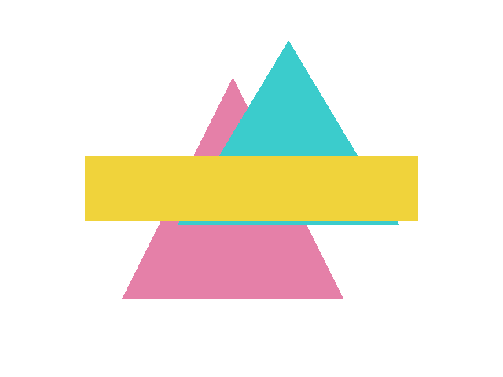
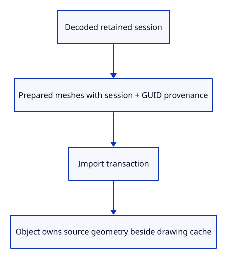

# 3.12.2 · Retain the imported mesh behind each row

**Chapter 3 · Documents, editing and ownership · Section 3.12 · Owned source meshes** · [Contents](contents.md)

**Typing: 8–16 minutes.** [Estimate](typing-load.md).

Make `Loaded` carry `PreparedMesh` values and retain the source geometry behind each imported row. Preparation still finishes before the scene changes.

## Type

Continue from [Prepare a display from an owned source mesh](28-record.md). [Save or recover your work](recovery.md).

### 1. `src/document.rs`

Load source/display pairs rather than display arrays alone. Retain the prepared geometry alongside its display. Share the session’s existing kernel mesh owner, then attach retained file provenance.

Edit these blocks from bottom to top. Keep the surrounding lines unchanged.

<details>
<summary>Locate this block</summary>

```rust
    let document = Rc::new(Session::from_proto(message).map_err(|_| "Cannot construct session")?);
    let mut meshes = Vec::new();
    for mesh in document.objects.meshes.iter() {
        meshes.push((mesh.guid().to_owned(), Mesh::from_kernel(mesh)?));
    }
    Ok(Loaded { document, meshes })
}
```

</details>

Replace it with:

```rust
    let document = Rc::new(Session::from_proto(message).map_err(|_| "Cannot construct session")?);
    let mut meshes = Vec::new();
    for mesh in document.objects.meshes.iter() {
        let mut prepared = PreparedMesh::from_shared(Rc::clone(mesh))?;
        prepared.source = Some(Source {
            document: Rc::clone(&document), guid: mesh.guid().to_owned(),
        });
        meshes.push(prepared);
    }
    Ok(Loaded { document, meshes })
}
```

<details>
<summary>Locate this block</summary>

```rust

pub struct Loaded {
    pub document: Rc<Session>,
    pub meshes: Vec<(String, Mesh)>,
}

pub fn load(bytes: &[u8]) -> Result<Loaded, &'static str> {
```

</details>

Replace it with:

```rust

pub struct Loaded {
    pub document: Rc<Session>,
    pub meshes: Vec<PreparedMesh>,
}

pub fn load(bytes: &[u8]) -> Result<Loaded, &'static str> {
```

<details>
<summary>Locate this block</summary>

```rust
use crate::mesh::Mesh;
use prost::Message;
use session_rust::{proto, Session};
use std::{collections::HashSet, rc::Rc};
```

</details>

Replace it with:

```rust
use crate::prepared::PreparedMesh;
use prost::Message;
use session_rust::{proto, Session};
use std::{collections::HashSet, rc::Rc};
```

<details>
<summary>Complete updated block reference</summary>

```rust
use crate::prepared::PreparedMesh;
use prost::Message;
use session_rust::{proto, Session};
use std::{collections::HashSet, rc::Rc};

pub const MAX_BYTES: usize = 4 * 1024 * 1024;

#[derive(Clone)]
pub struct Source {
    pub document: Rc<Session>,
    pub guid: String,
}

pub struct Loaded {
    pub document: Rc<Session>,
    pub meshes: Vec<PreparedMesh>,
}

pub fn load(bytes: &[u8]) -> Result<Loaded, &'static str> {
    if bytes.len() > MAX_BYTES { return Err("This checkpoint accepts files up to 4 MiB"); }
    let message = proto::Session::decode(bytes).map_err(|_| "Invalid session protobuf")?;
    validate(&message)?;
    let document = Rc::new(Session::from_proto(message).map_err(|_| "Cannot construct session")?);
    let mut meshes = Vec::new();
    for mesh in document.objects.meshes.iter() {
        let mut prepared = PreparedMesh::from_shared(Rc::clone(mesh))?;
        prepared.source = Some(Source {
            document: Rc::clone(&document), guid: mesh.guid().to_owned(),
        });
        meshes.push(prepared);
    }
    Ok(Loaded { document, meshes })
}

fn validate(message: &proto::Session) -> Result<(), &'static str> {
    let objects = message.objects.as_ref().ok_or("Session has no objects")?;
    if !message.xforms.is_empty() || message.definitions.is_some() || !message.interactions.is_empty() {
        return Err("Placements, definitions and interactions arrive in later checkpoints");
    }
    let other = objects.points.len() + objects.lines.len() + objects.planes.len()
        + objects.bboxes.len() + objects.polylines.len() + objects.pointclouds.len()
        + objects.nurbscurves.len() + objects.nurbssurfaces.len() + objects.breps.len()
        + objects.elements.len() + objects.components.len() + objects.sheets.len() + objects.instances.len();
    if other != 0 || objects.meshes.is_empty() || objects.meshes.len() > 64 {
        return Err("This checkpoint accepts 1–64 meshes and no other geometry types");
    }
    let mut guids = HashSet::new();
    for mesh in &objects.meshes {
        if mesh.guid.is_empty() || !guids.insert(mesh.guid.as_str()) {
            return Err("Every mesh needs a distinct source GUID");
        }
        validate_mesh(mesh)?;
    }
    if let Some(root) = message.tree.as_ref().and_then(|tree| tree.root.as_ref()) {
        let names: HashSet<_> = root.children.iter().map(|node| node.name.as_str()).collect();
        if names != guids || root.children.len() != guids.len()
            || root.children.iter().any(|node| !node.children.is_empty()) {
            return Err("This checkpoint needs one flat tree row per mesh");
        }
    }
    Ok(())
}

fn validate_mesh(mesh: &proto::Mesh) -> Result<(), &'static str> {
    if mesh.vertices.len() > 10_000 || mesh.faces.is_empty() || mesh.faces.len() > 10_000 {
        return Err("A mesh needs faces and at most 10,000 vertices and faces");
    }
    if mesh.color_mode != 0 { return Err("Per-face and per-vertex colours arrive later"); }
    for (&key, vertex) in &mesh.vertices {
        if key > u32::MAX as u64 || [vertex.x, vertex.y, vertex.z].iter().any(|v| !v.is_finite()) {
            return Err("Invalid vertex key or coordinate");
        }
    }
    for (&key, face) in &mesh.faces {
        if key > u32::MAX as u64 || !(3..=4).contains(&face.vertices.len()) || !face.holes.is_empty()
            || face.vertices.iter().any(|key| !mesh.vertices.contains_key(key)) {
            return Err("This checkpoint needs triangles or quads with existing vertices and no holes");
        }
    }
    for (key, triangles) in &mesh.triangulation {
        if !mesh.faces.contains_key(key) || triangles.vertices.len() % 3 != 0
            || triangles.vertices.iter().any(|key| !mesh.vertices.contains_key(key)) {
            return Err("Invalid stored triangulation");
        }
    }
    Ok(())
}
```

</details>

<details>
<summary>Optional patch references</summary>

Use these original edit fragments when comparing a saved checkpoint. Apply the complete blocks above.

```text
--8<-- "journey/code/28a-imported-01.rs"
```

```text
--8<-- "journey/code/28a-imported-02.rs"
```

```text
--8<-- "journey/code/28a-imported-03.rs"
```

</details>

### 2. `src/scene.rs`

During migration, distinguish rows with source geometry from older demo rows. Keep the existing insertion path while imported rows begin retaining source geometry. Keep each prepared display and source on the same stable object record.

Edit these blocks from bottom to top. Keep the surrounding lines unchanged.

<details>
<summary>Locate this block</summary>

```rust
        let next = self.next_id.checked_add(1).ok_or("Object IDs exhausted")?;
        let id = ObjectId(self.next_id);
        self.next_id = next;
        self.objects.push(Object { id, mesh: Rc::new(mesh), model: session_rust::Xform::identity(), source: None });
        Ok(id)
    }

    pub fn import(&mut self, loaded: crate::document::Loaded) -> Result<(), &'static str> {
        for (guid, mesh) in loaded.meshes {
            self.insert(mesh)?;
            self.objects.last_mut().unwrap().source = Some(crate::document::Source {
                document: Rc::clone(&loaded.document), guid,
            });
        }
        Ok(())
    }
```

</details>

Replace it with:

```rust
        let next = self.next_id.checked_add(1).ok_or("Object IDs exhausted")?;
        let id = ObjectId(self.next_id);
        self.next_id = next;
        self.objects.push(Object { id, mesh: Rc::new(mesh), geometry: None, model: session_rust::Xform::identity(), source: None });
        Ok(id)
    }

    pub fn import(&mut self, loaded: crate::document::Loaded) -> Result<(), &'static str> {
        for prepared in loaded.meshes {
            self.insert(prepared.display)?;
            let object = self.objects.last_mut().unwrap();
            object.geometry = Some(prepared.geometry);
            object.source = prepared.source;
        }
        Ok(())
    }
```

<details>
<summary>Locate this block</summary>

```rust
pub struct Object {
    pub id: ObjectId,
    pub mesh: Rc<Mesh>,
    pub model: session_rust::Xform,
    pub source: Option<crate::document::Source>,
}
```

</details>

Replace it with:

```rust
pub struct Object {
    pub id: ObjectId,
    pub mesh: Rc<Mesh>,
    pub geometry: Option<Rc<session_rust::Mesh>>,
    pub model: session_rust::Xform,
    pub source: Option<crate::document::Source>,
}
```

<details>
<summary>Complete updated block reference</summary>

```rust
use crate::mesh::Mesh;
use std::rc::Rc;

#[derive(Clone, Copy, Debug, PartialEq, Eq)]
pub struct ObjectId(u32);

#[derive(Clone)]
pub struct Object {
    pub id: ObjectId,
    pub mesh: Rc<Mesh>,
    pub geometry: Option<Rc<session_rust::Mesh>>,
    pub model: session_rust::Xform,
    pub source: Option<crate::document::Source>,
}

impl Object {
    pub fn world_point(&self, vertex: [f32; 6]) -> [f64; 3] {
        let local = session_rust::Point::new(vertex[0] as f64, vertex[1] as f64, vertex[2] as f64);
        let world = self.model.transform_point(&local);
        [world[0], world[1], world[2]]
    }
}

#[derive(Clone)]
pub struct Scene {
    objects: Vec<Object>,
    next_id: u32,
    extra: Option<ObjectId>,
}

impl Scene {
    pub fn demo() -> Self {
        let pink = Mesh::new(vec![
            [-0.7, -0.6, 0.25, 0.9, 0.25, 0.45],
            [ 0.5, -0.6, 0.25, 0.9, 0.25, 0.45],
            [-0.1,  0.6, 0.25, 0.9, 0.25, 0.45],
        ], vec![0, 1, 2]).expect("Valid pink triangle");
        let turquoise = Mesh::new(vec![
            [-0.4, -0.2, 0.75, 0.05, 0.7, 0.7],
            [ 0.8, -0.2, 0.75, 0.05, 0.7, 0.7],
            [ 0.2,  0.8, 0.75, 0.05, 0.7, 0.7],
        ], vec![0, 1, 2]).expect("Valid turquoise triangle");
        let mut scene = Self { objects: Vec::new(), next_id: 1, extra: None };
        scene.insert(pink).expect("ID available");
        scene.insert(turquoise).expect("ID available");
        scene
    }

    pub fn restore(&mut self, mut saved: Self) {
        saved.next_id = saved.next_id.max(self.next_id);
        *self = saved;
    }

    pub fn bounds(&self) -> Option<crate::bounds::Bounds> {
        let mut bounds: Option<crate::bounds::Bounds> = None;
        for object in &self.objects {
            for vertex in object.mesh.vertices() {
                let point = object.world_point(*vertex);
                match &mut bounds {
                    Some(bounds) => bounds.include(point),
                    None => bounds = Some(crate::bounds::Bounds::point(point)),
                }
            }
        }
        bounds
    }

    pub fn selected_bounds(&self, id: ObjectId) -> Option<crate::bounds::Bounds> {
        let object = self.objects.iter().find(|object| object.id == id)?;
        let mut vertices = object.mesh.vertices().iter();
        let first = vertices.next()?;
        let mut bounds = crate::bounds::Bounds::point(object.world_point(*first));
        for vertex in vertices {
            bounds.include(object.world_point(*vertex));
        }
        Some(bounds)
    }

    pub fn objects(&self) -> &[Object] {
        &self.objects
    }

    pub fn insert(&mut self, mesh: Mesh) -> Result<ObjectId, &'static str> {
        let next = self.next_id.checked_add(1).ok_or("Object IDs exhausted")?;
        let id = ObjectId(self.next_id);
        self.next_id = next;
        self.objects.push(Object { id, mesh: Rc::new(mesh), geometry: None, model: session_rust::Xform::identity(), source: None });
        Ok(id)
    }

    pub fn import(&mut self, loaded: crate::document::Loaded) -> Result<(), &'static str> {
        for prepared in loaded.meshes {
            self.insert(prepared.display)?;
            let object = self.objects.last_mut().unwrap();
            object.geometry = Some(prepared.geometry);
            object.source = prepared.source;
        }
        Ok(())
    }

    pub fn place(&mut self, id: ObjectId, model: session_rust::Xform) -> Result<(), &'static str> {
        if !model.m.iter().all(|v| v.is_finite())
            || [model.m[3], model.m[7], model.m[11], model.m[15]] != [0.0, 0.0, 0.0, 1.0]
        {
            return Err("Placement must be finite and affine");
        }
        let object = self.objects.iter_mut().find(|o| o.id == id).ok_or("Object not found")?;
        object.model = model;
        Ok(())
    }

    pub fn remove(&mut self, id: ObjectId) -> bool {
        let Some(index) = self.objects.iter().position(|object| object.id == id) else { return false; };
        self.objects.remove(index);
        if self.extra == Some(id) {
            self.extra = None;
        }
        true
    }

    pub fn contains(&self, id: ObjectId) -> bool {
        self.objects.iter().any(|object| object.id == id)
    }

    pub fn next(&self, current: Option<ObjectId>) -> Option<ObjectId> {
        if self.objects.is_empty() {
            return None;
        }
        let index = self.objects.iter().position(|object| Some(object.id) == current)
            .map_or(0, |index| index + 1);
        Some(self.objects[index % self.objects.len()].id)
    }

    pub fn add_box(&mut self) -> Result<ObjectId, &'static str> {
        let mut source = session_rust::Mesh::create_box(0.8, 0.8, 0.8);
        source.set_objectcolor(session_rust::Color::new(0.65, 0.65, 0.65, 1.0));
        let id = self.insert(Mesh::from_kernel(&source)?)?;
        self.place(id, session_rust::Xform::translation(0.9, 0.0, 0.4))?;
        Ok(id)
    }

    pub fn toggle_extra(&mut self) {
        if let Some(id) = self.extra.take() {
            self.remove(id);
        } else {
            let extra = Mesh::new(vec![
                [-0.9, 0.3, 0.5, 0.2, 0.8, 0.3],
                [-0.4, 0.3, 0.5, 0.2, 0.8, 0.3],
                [-0.65, 0.9, 0.5, 0.2, 0.8, 0.3],
            ], vec![0, 1, 2]).expect("Valid extra triangle");
            self.extra = Some(self.insert(extra).expect("ID available"));
        }
    }
}

#[cfg(test)]
mod tests {
    use super::*;

    #[test]
    fn removal_moves_a_row_without_changing_its_identity() {
        let mut scene = Scene::demo();
        let first = scene.objects()[0].id;
        let second = scene.objects()[1].id;
        assert!(scene.remove(first));
        assert_eq!(scene.objects()[0].id, second);
        assert_eq!(scene.next(None), Some(second));
        assert!(!scene.contains(first));
        scene.toggle_extra();
        assert_ne!(scene.objects()[1].id, first);
        assert_ne!(scene.objects()[1].id, second);
    }

    #[test]
    fn toggling_the_extra_object_uses_its_id_after_other_removals() {
        let mut scene = Scene::demo();
        scene.toggle_extra();
        let extra = scene.objects()[2].id;
        scene.remove(scene.objects()[0].id);
        scene.toggle_extra();
        assert!(!scene.contains(extra));
        assert_eq!(scene.objects().len(), 1);
    }
}
```

</details>

<details>
<summary>Optional patch references</summary>

Use these original edit fragments when comparing a saved checkpoint. Apply the complete blocks above.

```text
--8<-- "journey/code/28a-imported-04.rs"
```

```text
--8<-- "journey/code/28a-imported-05.rs"
```

```text
--8<-- "journey/code/28a-imported-06.rs"
```

</details>

<details>
<summary>Supplied validation fixture</summary>

Copy this supplied authoring fixture once. Continue with the browser build below; the course does not require running native tests.

### 3. `src/imported_source_tests.rs`

Optional authoring fixture. Prove import shares the session’s existing source allocation even when earlier display rows disappear.

Copy this supplied file:

```text
--8<-- "journey/code/28a-imported-07.rs"
```

</details>

### 4. `src/lib.rs`

Run the source allocation check at this intermediate checkpoint.

<details>
<summary>Locate the existing block</summary>

```rust
#[cfg(test)]
mod prepared_tests;
```

</details>

After that block, type:

```rust
--8<-- "journey/code/28a-imported-08.rs" skip=33
```

## Run and check

In your project:

```sh
cd workspace/journey
REGEN_PROTO=0 cargo build --lib --locked --target wasm32-unknown-unknown -j1
REGEN_PROTO=0 CARGO_BUILD_JOBS=1 trunk serve --port 8780
```

Open `http://127.0.0.1:8780/`. Keep an existing Trunk server running; saving rebuilds it.

Open `sample.pb`. Run the import checks below: every imported row must retain both its original source mesh and its prepared display. Failed preparation must add no rows.

### Recorded visual result

**Previous native render — current verification pending.**

The native renderer runs the same Editor actions and checks world picking, visible selection pixels and object area.



*This recorded image predates a source or checker change. Rebuild this checkpoint before using it as current evidence; browser controls require separate acceptance.*

<details>
<summary>Code explanation and diagram</summary>

The kernel session already owns meshes through `Rc`; clone those handles rather than copying geometry. Keep the session too, because it owns file context such as tree and document name.

During insertion, moving `prepared.display` transfers that field while leaving the other fields available for transfer. History wraps the whole import in one transaction.

Imported rows now have `Some` source geometry. Older demos and generated boxes temporarily have `None`; the next lesson closes that migration gap.

Decoded session → prepared source/display pair → Object source geometry → history snapshot.



If rows move after deletion, how can the object still find its source?

Source identity uses a retained session and GUID, not the row index. The object also directly owns the original kernel mesh through Rc. Its display can move to another row without changing either source owner.

Study estimate, including typing and experiments: 1–2 hours.

</details>

<details>
<summary>Optional experiment</summary>

In the import test, remove both original demo IDs before inspecting the imported object. Its row number changes while its ObjectId, source GUID and geometry allocation remain stable. Restore the test before checking your files.

</details>

<details>
<summary>Check and save your work</summary>

Restore experimental edits, then run from `session_viewer`:

```sh
npm --prefix ../session_tests run course -- check 3.12.2
npm --prefix ../session_tests run course -- save 3.12.2
```

Source comparison leaves your project untouched. [Save and recovery instructions](recovery.md).

</details>

<details>
<summary>Viewer coverage and verification</summary>

The production scene keeps source identity through row replacement and compaction. This lesson connects source ownership to our smaller row table; generated objects adopt the same path next.

Retain the imported mesh behind each row. These commands run in the actual dock; kernel ownership is checked separately in Rust.

[Full validation scope](release.md).

</details>
