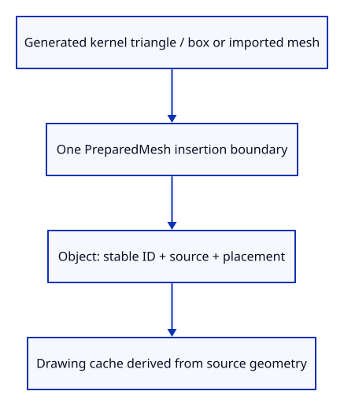

# 3.12.3 · Give generated objects the same source owner

**Chapter 3 · Documents, editing and ownership · Section 3.12 · Owned source meshes** · [Contents](contents.md)

**Typing: 15–29 minutes.** [Estimate](typing-load.md).

Close the migration. Demo triangles and the optional extra triangle are small kernel meshes; Example Box retains the kernel mesh it already creates. All enter through PreparedMesh. Every Object can now keep its source geometry, placement and optional file provenance independently of the drawing cache.

## Type

Continue from [Retain the imported mesh behind each row](28a-imported.md). [Save or recover your work](recovery.md).

### 1. `src/prepared.rs`

Create demo source geometry before deriving the drawing representation.

<details>
<summary>Locate the existing block</summary>

```rust
impl PreparedMesh {
```

</details>

After that block, type:

```rust
--8<-- "journey/code/28b-generated-01.rs" skip=20
```

### 2. `src/scene.rs`

All insertion callers now supply prepared source geometry. Every current object has source geometry; only imported-file provenance stays optional. Describe the same two triangles as source points and an object colour. Consume one prepared value into one source-owning document record. Import uses the same complete record insertion as generated geometry. Retain the kernel box instead of keeping only its display. Keep source geometry for the optional triangle too.

Edit these blocks from bottom to top. Keep the surrounding lines unchanged.

<details>
<summary>Locate this block</summary>

```rust
        if let Some(id) = self.extra.take() {
            self.remove(id);
        } else {
            let extra = Mesh::new(vec![
                [-0.9, 0.3, 0.5, 0.2, 0.8, 0.3],
                [-0.4, 0.3, 0.5, 0.2, 0.8, 0.3],
                [-0.65, 0.9, 0.5, 0.2, 0.8, 0.3],
            ], vec![0, 1, 2]).expect("Valid extra triangle");
            self.extra = Some(self.insert(extra).expect("ID available"));
        }
    }
```

</details>

Replace it with:

```rust
        if let Some(id) = self.extra.take() {
            self.remove(id);
        } else {
            let extra = PreparedMesh::triangle([
                [-0.9, 0.3, 0.5], [-0.4, 0.3, 0.5], [-0.65, 0.9, 0.5],
            ], [0.2, 0.8, 0.3]).expect("Valid extra triangle");
            self.extra = Some(self.insert(extra).expect("ID available"));
        }
    }
```

<details>
<summary>Locate this block</summary>

```rust
    pub fn add_box(&mut self) -> Result<ObjectId, &'static str> {
        let mut source = session_rust::Mesh::create_box(0.8, 0.8, 0.8);
        source.set_objectcolor(session_rust::Color::new(0.65, 0.65, 0.65, 1.0));
        let id = self.insert(Mesh::from_kernel(&source)?)?;
        self.place(id, session_rust::Xform::translation(0.9, 0.0, 0.4))?;
        Ok(id)
    }
```

</details>

Replace it with:

```rust
    pub fn add_box(&mut self) -> Result<ObjectId, &'static str> {
        let mut source = session_rust::Mesh::create_box(0.8, 0.8, 0.8);
        source.set_objectcolor(session_rust::Color::new(0.65, 0.65, 0.65, 1.0));
        let id = self.insert(PreparedMesh::new(source)?)?;
        self.place(id, session_rust::Xform::translation(0.9, 0.0, 0.4))?;
        Ok(id)
    }
```

<details>
<summary>Locate this block</summary>

```rust
        &self.objects
    }

    pub fn insert(&mut self, mesh: Mesh) -> Result<ObjectId, &'static str> {
        let next = self.next_id.checked_add(1).ok_or("Object IDs exhausted")?;
        let id = ObjectId(self.next_id);
        self.next_id = next;
        self.objects.push(Object { id, mesh: Rc::new(mesh), geometry: None, model: session_rust::Xform::identity(), source: None });
        Ok(id)
    }

    pub fn import(&mut self, loaded: crate::document::Loaded) -> Result<(), &'static str> {
        for prepared in loaded.meshes {
            self.insert(prepared.display)?;
            let object = self.objects.last_mut().unwrap();
            object.geometry = Some(prepared.geometry);
            object.source = prepared.source;
        }
        Ok(())
    }
```

</details>

Replace it with:

```rust
        &self.objects
    }

    pub fn insert(&mut self, prepared: PreparedMesh) -> Result<ObjectId, &'static str> {
        let next = self.next_id.checked_add(1).ok_or("Object IDs exhausted")?;
        let id = ObjectId(self.next_id);
        self.next_id = next;
        self.objects.push(Object { id, mesh: Rc::new(prepared.display), geometry: prepared.geometry,
            model: session_rust::Xform::identity(), source: prepared.source });
        Ok(id)
    }

    pub fn import(&mut self, loaded: crate::document::Loaded) -> Result<(), &'static str> {
        for prepared in loaded.meshes {
            self.insert(prepared)?;
        }
        Ok(())
    }
```

<details>
<summary>Locate this block</summary>

```rust

impl Scene {
    pub fn demo() -> Self {
        let pink = Mesh::new(vec![
            [-0.7, -0.6, 0.25, 0.9, 0.25, 0.45],
            [ 0.5, -0.6, 0.25, 0.9, 0.25, 0.45],
            [-0.1,  0.6, 0.25, 0.9, 0.25, 0.45],
        ], vec![0, 1, 2]).expect("Valid pink triangle");
        let turquoise = Mesh::new(vec![
            [-0.4, -0.2, 0.75, 0.05, 0.7, 0.7],
            [ 0.8, -0.2, 0.75, 0.05, 0.7, 0.7],
            [ 0.2,  0.8, 0.75, 0.05, 0.7, 0.7],
        ], vec![0, 1, 2]).expect("Valid turquoise triangle");
        let mut scene = Self { objects: Vec::new(), next_id: 1, extra: None };
        scene.insert(pink).expect("ID available");
        scene.insert(turquoise).expect("ID available");
```

</details>

Replace it with:

```rust

impl Scene {
    pub fn demo() -> Self {
        let pink = PreparedMesh::triangle([
            [-0.7, -0.6, 0.25], [0.5, -0.6, 0.25], [-0.1, 0.6, 0.25],
        ], [0.9, 0.25, 0.45]).expect("Valid pink triangle");
        let turquoise = PreparedMesh::triangle([
            [-0.4, -0.2, 0.75], [0.8, -0.2, 0.75], [0.2, 0.8, 0.75],
        ], [0.05, 0.7, 0.7]).expect("Valid turquoise triangle");
        let mut scene = Self { objects: Vec::new(), next_id: 1, extra: None };
        scene.insert(pink).expect("ID available");
        scene.insert(turquoise).expect("ID available");
```

<details>
<summary>Locate this block</summary>

```rust
pub struct Object {
    pub id: ObjectId,
    pub mesh: Rc<Mesh>,
    pub geometry: Option<Rc<session_rust::Mesh>>,
    pub model: session_rust::Xform,
    pub source: Option<crate::document::Source>,
}
```

</details>

Replace it with:

```rust
pub struct Object {
    pub id: ObjectId,
    pub mesh: Rc<Mesh>,
    pub geometry: Rc<session_rust::Mesh>,
    pub model: session_rust::Xform,
    pub source: Option<crate::document::Source>,
}
```

<details>
<summary>Locate this block</summary>

```rust
use crate::mesh::Mesh;
use std::rc::Rc;

#[derive(Clone, Copy, Debug, PartialEq, Eq)]
```

</details>

Replace it with:

```rust
use crate::{mesh::Mesh, prepared::PreparedMesh};
use std::rc::Rc;

#[derive(Clone, Copy, Debug, PartialEq, Eq)]
```

<details>
<summary>Complete updated block reference</summary>

```rust
use crate::{mesh::Mesh, prepared::PreparedMesh};
use std::rc::Rc;

#[derive(Clone, Copy, Debug, PartialEq, Eq)]
pub struct ObjectId(u32);

#[derive(Clone)]
pub struct Object {
    pub id: ObjectId,
    pub mesh: Rc<Mesh>,
    pub geometry: Rc<session_rust::Mesh>,
    pub model: session_rust::Xform,
    pub source: Option<crate::document::Source>,
}

impl Object {
    pub fn world_point(&self, vertex: [f32; 6]) -> [f64; 3] {
        let local = session_rust::Point::new(vertex[0] as f64, vertex[1] as f64, vertex[2] as f64);
        let world = self.model.transform_point(&local);
        [world[0], world[1], world[2]]
    }
}

#[derive(Clone)]
pub struct Scene {
    objects: Vec<Object>,
    next_id: u32,
    extra: Option<ObjectId>,
}

impl Scene {
    pub fn demo() -> Self {
        let pink = PreparedMesh::triangle([
            [-0.7, -0.6, 0.25], [0.5, -0.6, 0.25], [-0.1, 0.6, 0.25],
        ], [0.9, 0.25, 0.45]).expect("Valid pink triangle");
        let turquoise = PreparedMesh::triangle([
            [-0.4, -0.2, 0.75], [0.8, -0.2, 0.75], [0.2, 0.8, 0.75],
        ], [0.05, 0.7, 0.7]).expect("Valid turquoise triangle");
        let mut scene = Self { objects: Vec::new(), next_id: 1, extra: None };
        scene.insert(pink).expect("ID available");
        scene.insert(turquoise).expect("ID available");
        scene
    }

    pub fn restore(&mut self, mut saved: Self) {
        saved.next_id = saved.next_id.max(self.next_id);
        *self = saved;
    }

    pub fn bounds(&self) -> Option<crate::bounds::Bounds> {
        let mut bounds: Option<crate::bounds::Bounds> = None;
        for object in &self.objects {
            for vertex in object.mesh.vertices() {
                let point = object.world_point(*vertex);
                match &mut bounds {
                    Some(bounds) => bounds.include(point),
                    None => bounds = Some(crate::bounds::Bounds::point(point)),
                }
            }
        }
        bounds
    }

    pub fn selected_bounds(&self, id: ObjectId) -> Option<crate::bounds::Bounds> {
        let object = self.objects.iter().find(|object| object.id == id)?;
        let mut vertices = object.mesh.vertices().iter();
        let first = vertices.next()?;
        let mut bounds = crate::bounds::Bounds::point(object.world_point(*first));
        for vertex in vertices {
            bounds.include(object.world_point(*vertex));
        }
        Some(bounds)
    }

    pub fn objects(&self) -> &[Object] {
        &self.objects
    }

    pub fn insert(&mut self, prepared: PreparedMesh) -> Result<ObjectId, &'static str> {
        let next = self.next_id.checked_add(1).ok_or("Object IDs exhausted")?;
        let id = ObjectId(self.next_id);
        self.next_id = next;
        self.objects.push(Object { id, mesh: Rc::new(prepared.display), geometry: prepared.geometry,
            model: session_rust::Xform::identity(), source: prepared.source });
        Ok(id)
    }

    pub fn import(&mut self, loaded: crate::document::Loaded) -> Result<(), &'static str> {
        for prepared in loaded.meshes {
            self.insert(prepared)?;
        }
        Ok(())
    }

    pub fn place(&mut self, id: ObjectId, model: session_rust::Xform) -> Result<(), &'static str> {
        if !model.m.iter().all(|v| v.is_finite())
            || [model.m[3], model.m[7], model.m[11], model.m[15]] != [0.0, 0.0, 0.0, 1.0]
        {
            return Err("Placement must be finite and affine");
        }
        let object = self.objects.iter_mut().find(|o| o.id == id).ok_or("Object not found")?;
        object.model = model;
        Ok(())
    }

    pub fn remove(&mut self, id: ObjectId) -> bool {
        let Some(index) = self.objects.iter().position(|object| object.id == id) else { return false; };
        self.objects.remove(index);
        if self.extra == Some(id) {
            self.extra = None;
        }
        true
    }

    pub fn contains(&self, id: ObjectId) -> bool {
        self.objects.iter().any(|object| object.id == id)
    }

    pub fn next(&self, current: Option<ObjectId>) -> Option<ObjectId> {
        if self.objects.is_empty() {
            return None;
        }
        let index = self.objects.iter().position(|object| Some(object.id) == current)
            .map_or(0, |index| index + 1);
        Some(self.objects[index % self.objects.len()].id)
    }

    pub fn add_box(&mut self) -> Result<ObjectId, &'static str> {
        let mut source = session_rust::Mesh::create_box(0.8, 0.8, 0.8);
        source.set_objectcolor(session_rust::Color::new(0.65, 0.65, 0.65, 1.0));
        let id = self.insert(PreparedMesh::new(source)?)?;
        self.place(id, session_rust::Xform::translation(0.9, 0.0, 0.4))?;
        Ok(id)
    }

    pub fn toggle_extra(&mut self) {
        if let Some(id) = self.extra.take() {
            self.remove(id);
        } else {
            let extra = PreparedMesh::triangle([
                [-0.9, 0.3, 0.5], [-0.4, 0.3, 0.5], [-0.65, 0.9, 0.5],
            ], [0.2, 0.8, 0.3]).expect("Valid extra triangle");
            self.extra = Some(self.insert(extra).expect("ID available"));
        }
    }
}

#[cfg(test)]
mod tests {
    use super::*;

    #[test]
    fn removal_moves_a_row_without_changing_its_identity() {
        let mut scene = Scene::demo();
        let first = scene.objects()[0].id;
        let second = scene.objects()[1].id;
        assert!(scene.remove(first));
        assert_eq!(scene.objects()[0].id, second);
        assert_eq!(scene.next(None), Some(second));
        assert!(!scene.contains(first));
        scene.toggle_extra();
        assert_ne!(scene.objects()[1].id, first);
        assert_ne!(scene.objects()[1].id, second);
    }

    #[test]
    fn toggling_the_extra_object_uses_its_id_after_other_removals() {
        let mut scene = Scene::demo();
        scene.toggle_extra();
        let extra = scene.objects()[2].id;
        scene.remove(scene.objects()[0].id);
        scene.toggle_extra();
        assert!(!scene.contains(extra));
        assert_eq!(scene.objects().len(), 1);
    }
}
```

</details>

<details>
<summary>Optional patch references</summary>

Use these original edit fragments when comparing a saved checkpoint. Apply the complete blocks above.

```text
--8<-- "journey/code/28b-generated-02.rs"
```

```text
--8<-- "journey/code/28b-generated-03.rs"
```

```text
--8<-- "journey/code/28b-generated-04.rs"
```

```text
--8<-- "journey/code/28b-generated-05.rs"
```

```text
--8<-- "journey/code/28b-generated-06.rs"
```

```text
--8<-- "journey/code/28b-generated-07.rs"
```

```text
--8<-- "journey/code/28b-generated-08.rs"
```

</details>

<details>
<summary>Supplied validation fixture</summary>

Copy this supplied authoring fixture once. Continue with the browser build below; the course does not require running native tests.

### 3. `src/imported_source_tests.rs`

Optional authoring fixture. The source is now required, so remove the temporary Option unwrap in the check.

<details>
<summary>Locate the existing block</summary>

```text
    let geometry = Rc::clone(imported.geometry.as_ref().unwrap());
```

</details>

Update the existing block with this supplied code; keep unchanged lines:

```text
--8<-- "journey/code/28b-generated-09.rs"
```

</details>

<details>
<summary>Supplied validation fixture</summary>

Copy this supplied authoring fixture once. Continue with the browser build below; the course does not require running native tests.

### 4. `src/imported_source_tests.rs`

Optional authoring fixture. Compare the required shared owner after its display row changes.

<details>
<summary>Locate the existing block</summary>

```text
    assert!(Rc::ptr_eq(moved_row.geometry.as_ref().unwrap(), &geometry));
```

</details>

Update the existing block with this supplied code; keep unchanged lines:

```text
--8<-- "journey/code/28b-generated-10.rs"
```

</details>

## Run and check

In your project:

```sh
cd workspace/journey
REGEN_PROTO=0 cargo build --lib --locked --target wasm32-unknown-unknown -j1
REGEN_PROTO=0 CARGO_BUILD_JOBS=1 trunk serve --port 8780
```

Open `http://127.0.0.1:8780/`. Keep an existing Trunk server running; saving rebuilds it.

Type `Example Box`, then `Undo`. The generated box now uses the same source/display ownership as imported geometry and remains one reversible object.

### Recorded visual result

**Previous native render — current verification pending.**

The native renderer runs the same Editor actions and checks world picking, visible selection pixels and object area.


*This recorded image predates a source or checker change. Rebuild this checkpoint before using it as current evidence; browser controls require separate acceptance.*

<details>
<summary>Code explanation and diagram</summary>

PreparedMesh::triangle creates three kernel Points and one triangular face. Color is an object attribute. The kernel stores its colour channels in bytes, so these demo colours are quantized before the display adapter reads them; a slight shade change is expected. This does not change the source/drawing ownership rule.

Change Scene::insert to consume a prepared value. The geometry goes to Object::geometry, display goes into the Rc drawing cache, and provenance goes to Object::source. Remove Option from geometry because every call now supplies it. Identity still initializes placement.

Example Box stops discarding its kernel mesh after conversion. Imported objects use the same insertion function, so import no longer patches source fields on the last inserted row. Bounds, picking, GPU matrices and Move keep the ownership conventions already established.

Kernel triangle or box → PreparedMesh → source-owning Object → derived display.



What does None provenance mean after every object owns kernel geometry?

It means the object was made here instead of imported from a file. It no longer means geometry is missing: Object::geometry is now a required shared source mesh. The display is derived from that source on the same insertion path.

Study estimate, including typing and experiments: 1–2 hours.

</details>

<details>
<summary>Optional experiment</summary>

Change PreparedMesh::triangle’s object colour, then compare its kernel colour with the uploaded display colour. Explain why the conversion may quantize channels and why changing the camera does not rewrite either geometry representation. Restore the original code.

</details>

<details>
<summary>Check and save your work</summary>

Restore experimental edits, then run from `session_viewer`:

```sh
npm --prefix ../session_tests run course -- check 3.12.3
npm --prefix ../session_tests run course -- save 3.12.3
```

Source comparison leaves your project untouched. [Save and recovery instructions](recovery.md).

</details>

<details>
<summary>Viewer coverage and verification</summary>

The maintained viewer creates and edits source geometry first, then synchronizes display tables. This checkpoint establishes that direction for every current mesh object. Later geometry families extend it without making GPU data the editable document.

Give generated objects the same source owner. These commands run in the actual dock; kernel ownership is checked separately in Rust.

[Full validation scope](release.md).

To reproduce the scripted acceptance of the reference checkpoint, run from `session_viewer` with the [course bundle server](release.md#reproduce) running on port 8781:

```sh
npm --prefix ../session_tests run course -- capture 3.12.3
```

This uses the verified reference bundle; it does not check or change your typed project.

</details>
