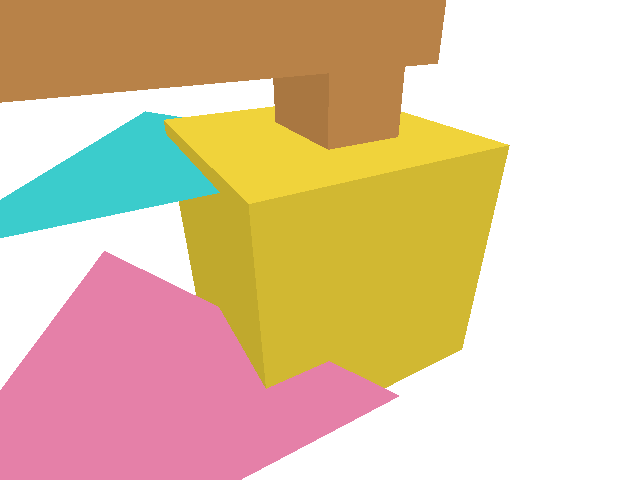
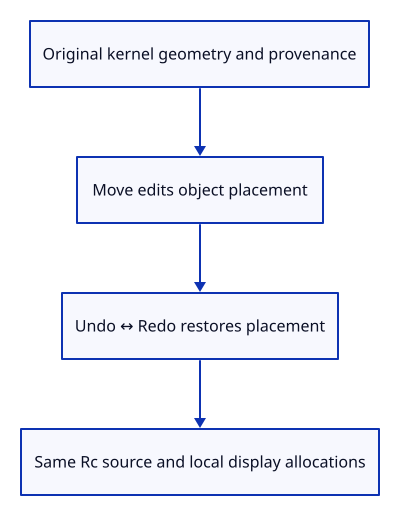

# 3.12.4 · Prove source ownership survives editing

**Chapter 3 · Documents, editing and ownership · Section 3.12 · Owned source meshes** · [Contents](contents.md)

**Typing: 1–1 minutes.** [Estimate](typing-load.md).

Now test the complete boundary rather than only the constructor. A moved object is still the same source shape. Its placement changes, but editing must not bake that placement into either the kernel vertices or drawing arrays.

## Type

Continue from [Give generated objects the same source owner](28b-generated.md). [Save or recover your work](recovery.md).

<details>
<summary>Supplied validation fixture</summary>

Copy this supplied authoring fixture once. Continue with the browser build below; the course does not require running native tests.

### 1. `src/source_tests.rs`

Optional authoring fixture. Check source and display allocations, original vertices, placement history and retained file provenance.

Copy this supplied file:

```text
--8<-- "journey/code/28c-ownership-01.rs"
```

</details>

### 2. `src/lib.rs`

Compile the connected ownership checks with the current scene.

<details>
<summary>Locate the existing block</summary>

```rust
#[cfg(test)]
mod prepared_tests;
```

</details>

After that block, type:

```rust
--8<-- "journey/code/28c-ownership-02.rs" skip=33
```

## Run and check

In your project:

```sh
cd workspace/journey
REGEN_PROTO=0 cargo build --lib --locked --target wasm32-unknown-unknown -j1
REGEN_PROTO=0 CARGO_BUILD_JOBS=1 trunk serve --port 8780
```

Open `http://127.0.0.1:8780/`. Keep an existing Trunk server running; saving rebuilds it.

Run the ownership checks below. Move, Undo and Redo must retain the same source and display allocations; only placement and history change.

### Recorded visual result

**Previous native render — current verification pending.**

The native renderer runs the same Editor actions and checks world picking, visible selection pixels and object area.



*This recorded image predates a source or checker change. Rebuild this checkpoint before using it as current evidence; browser controls require separate acceptance.*

<details>
<summary>Code explanation and diagram</summary>

The first check uses a generated box. It clones the Rc owners, records a source vertex and GUID, moves the box, then travels through history. Pointer equality proves we did not silently replace a source allocation with an equivalent copy.

The second check imports a file, removes the two original demo rows and asks again about the imported object by stable ID. The display row changes, but the owned source mesh still matches the source GUID and retained session.

Together with the preparation and import checks, these checks cover generated and imported source owners. Generated objects have geometry even without file provenance. Imported objects have both. These are the owners Save can use next; it must never rebuild source geometry from the float drawing cache.

Source mesh plus placement → Move → Undo/Redo → same source allocation and identity.



Which data must stay unchanged when Move edits only placement?

The original kernel vertices and attributes, the Rc source allocation, source GUID, imported session and local display arrays must remain unchanged. Undo and Redo change the placement stored in the document, while the camera stays where the user put it.

Study estimate, including typing and experiments: 1–2 hours.

</details>

<details>
<summary>Optional experiment</summary>

In the generated-box check, add a second Move with a different offset and another Undo. Predict which placement is restored and why both Rc pointers stay identical. Restore the original checks afterward.

</details>

<details>
<summary>Check and save your work</summary>

Restore experimental edits, then run from `session_viewer`:

```sh
npm --prefix ../session_tests run course -- check 3.12.4
npm --prefix ../session_tests run course -- save 3.12.4
```

Source comparison leaves your project untouched. [Save and recovery instructions](recovery.md).

</details>

<details>
<summary>Viewer coverage and verification</summary>

The production source transaction and display synchronization paths preserve document identity through moves, undo and row compaction. These checks establish the source owner for our current mesh subset; later save/load and additional geometry types extend it.

Prove source ownership survives editing. These commands run in the actual dock; kernel ownership is checked separately in Rust.

[Full validation scope](release.md).

To reproduce the scripted acceptance of the reference checkpoint, run from `session_viewer` with the [course bundle server](release.md#reproduce) running on port 8781:

```sh
npm --prefix ../session_tests run course -- capture 3.12.4
```

This uses the verified reference bundle; it does not check or change your typed project.

</details>
