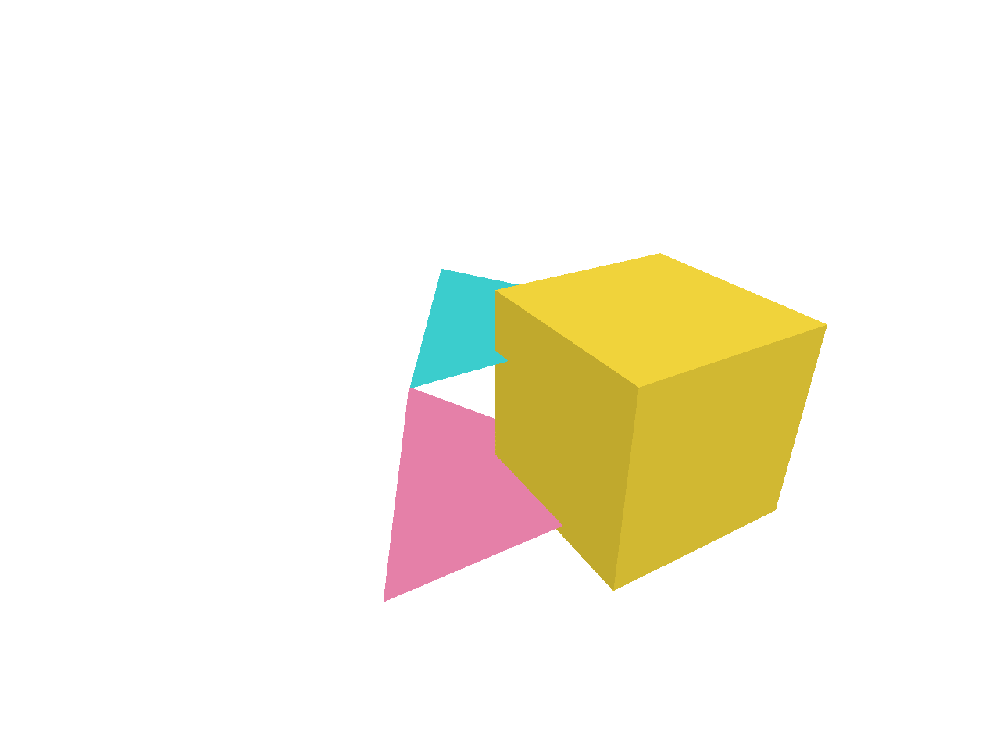
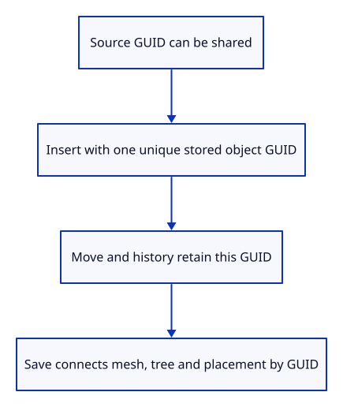

# 3.13.1 · Give each saved object a stable identity

**Chapter 3 · Documents, editing and ownership · Section 3.13 · Stable identity and saving** · [Contents](contents.md)

**Typing: 5–9 minutes.** [Estimate](typing-load.md).

Give each inserted object a stored GUID for saving. Local `ObjectId` still identifies the editor object; imported source GUID still identifies its original geometry.

## Type

Continue from [Prove source ownership survives editing](28c-ownership.md). [Save or recover your work](recovery.md).

### 1. `Cargo.toml`

Declare the UUID generator explicitly; browser randomness uses its js feature.

<details>
<summary>Locate the existing block</summary>

```toml
prost = "=0.14.4"
```

</details>

After that block, type:

```toml
--8<-- "journey/code/29-identity-01.toml" skip=18
```

### 2. `src/scene.rs`

Store the inserted object identity separately from kernel source identity and the local counter. Keep the source GUID when available; assign and check a fresh stored GUID for a duplicate import.

Edit these blocks from bottom to top. Keep the surrounding lines unchanged.

<details>
<summary>Locate this block</summary>

```rust
        let next = self.next_id.checked_add(1).ok_or("Object IDs exhausted")?;
        let id = ObjectId(self.next_id);
        self.next_id = next;
        self.objects.push(Object { id, mesh: Rc::new(prepared.display), geometry: prepared.geometry,
            model: session_rust::Xform::identity(), source: prepared.source });
        Ok(id)
    }
```

</details>

Replace it with:

```rust
        let next = self.next_id.checked_add(1).ok_or("Object IDs exhausted")?;
        let id = ObjectId(self.next_id);
        self.next_id = next;
        let mut guid = prepared.geometry.guid().to_owned();
        while self.objects.iter().any(|object| object.guid == guid) {
            guid = uuid::Uuid::new_v4().to_string();
        }
        self.objects.push(Object { id, guid, mesh: Rc::new(prepared.display), geometry: prepared.geometry,
            model: session_rust::Xform::identity(), source: prepared.source });
        Ok(id)
    }
```

<details>
<summary>Locate this block</summary>

```rust
#[derive(Clone)]
pub struct Object {
    pub id: ObjectId,
    pub mesh: Rc<Mesh>,
    pub geometry: Rc<session_rust::Mesh>,
    pub model: session_rust::Xform,
```

</details>

Replace it with:

```rust
#[derive(Clone)]
pub struct Object {
    pub id: ObjectId,
    pub guid: String,
    pub mesh: Rc<Mesh>,
    pub geometry: Rc<session_rust::Mesh>,
    pub model: session_rust::Xform,
```

<details>
<summary>Complete updated block reference</summary>

```rust
use crate::{mesh::Mesh, prepared::PreparedMesh};
use std::rc::Rc;

#[derive(Clone, Copy, Debug, PartialEq, Eq)]
pub struct ObjectId(u32);

#[derive(Clone)]
pub struct Object {
    pub id: ObjectId,
    pub guid: String,
    pub mesh: Rc<Mesh>,
    pub geometry: Rc<session_rust::Mesh>,
    pub model: session_rust::Xform,
    pub source: Option<crate::document::Source>,
}

impl Object {
    pub fn world_point(&self, vertex: [f32; 6]) -> [f64; 3] {
        let local = session_rust::Point::new(vertex[0] as f64, vertex[1] as f64, vertex[2] as f64);
        let world = self.model.transform_point(&local);
        [world[0], world[1], world[2]]
    }
}

#[derive(Clone)]
pub struct Scene {
    objects: Vec<Object>,
    next_id: u32,
    extra: Option<ObjectId>,
}

impl Scene {
    pub fn demo() -> Self {
        let pink = PreparedMesh::triangle([
            [-0.7, -0.6, 0.25], [0.5, -0.6, 0.25], [-0.1, 0.6, 0.25],
        ], [0.9, 0.25, 0.45]).expect("Valid pink triangle");
        let turquoise = PreparedMesh::triangle([
            [-0.4, -0.2, 0.75], [0.8, -0.2, 0.75], [0.2, 0.8, 0.75],
        ], [0.05, 0.7, 0.7]).expect("Valid turquoise triangle");
        let mut scene = Self { objects: Vec::new(), next_id: 1, extra: None };
        scene.insert(pink).expect("ID available");
        scene.insert(turquoise).expect("ID available");
        scene
    }

    pub fn restore(&mut self, mut saved: Self) {
        saved.next_id = saved.next_id.max(self.next_id);
        *self = saved;
    }

    pub fn bounds(&self) -> Option<crate::bounds::Bounds> {
        let mut bounds: Option<crate::bounds::Bounds> = None;
        for object in &self.objects {
            for vertex in object.mesh.vertices() {
                let point = object.world_point(*vertex);
                match &mut bounds {
                    Some(bounds) => bounds.include(point),
                    None => bounds = Some(crate::bounds::Bounds::point(point)),
                }
            }
        }
        bounds
    }

    pub fn selected_bounds(&self, id: ObjectId) -> Option<crate::bounds::Bounds> {
        let object = self.objects.iter().find(|object| object.id == id)?;
        let mut vertices = object.mesh.vertices().iter();
        let first = vertices.next()?;
        let mut bounds = crate::bounds::Bounds::point(object.world_point(*first));
        for vertex in vertices {
            bounds.include(object.world_point(*vertex));
        }
        Some(bounds)
    }

    pub fn objects(&self) -> &[Object] {
        &self.objects
    }

    pub fn insert(&mut self, prepared: PreparedMesh) -> Result<ObjectId, &'static str> {
        let next = self.next_id.checked_add(1).ok_or("Object IDs exhausted")?;
        let id = ObjectId(self.next_id);
        self.next_id = next;
        let mut guid = prepared.geometry.guid().to_owned();
        while self.objects.iter().any(|object| object.guid == guid) {
            guid = uuid::Uuid::new_v4().to_string();
        }
        self.objects.push(Object { id, guid, mesh: Rc::new(prepared.display), geometry: prepared.geometry,
            model: session_rust::Xform::identity(), source: prepared.source });
        Ok(id)
    }

    pub fn import(&mut self, loaded: crate::document::Loaded) -> Result<(), &'static str> {
        for prepared in loaded.meshes {
            self.insert(prepared)?;
        }
        Ok(())
    }

    pub fn place(&mut self, id: ObjectId, model: session_rust::Xform) -> Result<(), &'static str> {
        if !model.m.iter().all(|v| v.is_finite())
            || [model.m[3], model.m[7], model.m[11], model.m[15]] != [0.0, 0.0, 0.0, 1.0]
        {
            return Err("Placement must be finite and affine");
        }
        let object = self.objects.iter_mut().find(|o| o.id == id).ok_or("Object not found")?;
        object.model = model;
        Ok(())
    }

    pub fn remove(&mut self, id: ObjectId) -> bool {
        let Some(index) = self.objects.iter().position(|object| object.id == id) else { return false; };
        self.objects.remove(index);
        if self.extra == Some(id) {
            self.extra = None;
        }
        true
    }

    pub fn contains(&self, id: ObjectId) -> bool {
        self.objects.iter().any(|object| object.id == id)
    }

    pub fn next(&self, current: Option<ObjectId>) -> Option<ObjectId> {
        if self.objects.is_empty() {
            return None;
        }
        let index = self.objects.iter().position(|object| Some(object.id) == current)
            .map_or(0, |index| index + 1);
        Some(self.objects[index % self.objects.len()].id)
    }

    pub fn add_box(&mut self) -> Result<ObjectId, &'static str> {
        let mut source = session_rust::Mesh::create_box(0.8, 0.8, 0.8);
        source.set_objectcolor(session_rust::Color::new(0.65, 0.65, 0.65, 1.0));
        let id = self.insert(PreparedMesh::new(source)?)?;
        self.place(id, session_rust::Xform::translation(0.9, 0.0, 0.4))?;
        Ok(id)
    }

    pub fn toggle_extra(&mut self) {
        if let Some(id) = self.extra.take() {
            self.remove(id);
        } else {
            let extra = PreparedMesh::triangle([
                [-0.9, 0.3, 0.5], [-0.4, 0.3, 0.5], [-0.65, 0.9, 0.5],
            ], [0.2, 0.8, 0.3]).expect("Valid extra triangle");
            self.extra = Some(self.insert(extra).expect("ID available"));
        }
    }
}

#[cfg(test)]
mod tests {
    use super::*;

    #[test]
    fn removal_moves_a_row_without_changing_its_identity() {
        let mut scene = Scene::demo();
        let first = scene.objects()[0].id;
        let second = scene.objects()[1].id;
        assert!(scene.remove(first));
        assert_eq!(scene.objects()[0].id, second);
        assert_eq!(scene.next(None), Some(second));
        assert!(!scene.contains(first));
        scene.toggle_extra();
        assert_ne!(scene.objects()[1].id, first);
        assert_ne!(scene.objects()[1].id, second);
    }

    #[test]
    fn toggling_the_extra_object_uses_its_id_after_other_removals() {
        let mut scene = Scene::demo();
        scene.toggle_extra();
        let extra = scene.objects()[2].id;
        scene.remove(scene.objects()[0].id);
        scene.toggle_extra();
        assert!(!scene.contains(extra));
        assert_eq!(scene.objects().len(), 1);
    }
}
```

</details>

<details>
<summary>Optional patch references</summary>

Use these original edit fragments when comparing a saved checkpoint. Apply the complete blocks above.

```text
--8<-- "journey/code/29-identity-02.rs"
```

```text
--8<-- "journey/code/29-identity-03.rs"
```

</details>

<details>
<summary>Supplied validation fixture</summary>

Copy this supplied authoring fixture once. Continue with the browser build below; the course does not require running native tests.

### 3. `src/file_identity_tests.rs`

Optional authoring fixture. Exercise duplicate imports, row removal and history without mutating original source GUIDs.

Copy this supplied file:

```text
--8<-- "journey/code/29-identity-04.rs"
```

</details>

### 4. `src/lib.rs`

Compile the file-identity regression check.

<details>
<summary>Locate the existing block</summary>

```rust
#[cfg(test)]
mod source_tests;
```

</details>

After that block, type:

```rust
--8<-- "journey/code/29-identity-05.rs" skip=31
```

## Run and check

Run this from `session_viewer` to select the fixed dependency versions and install supplied binary assets. It updates Cargo.lock and preserves the previous lock. It does not write implementation code:

```sh
npm --prefix ../session_tests run course -- dependencies 3.13.1
```

In your project:

```sh
cd workspace/journey
REGEN_PROTO=0 cargo build --lib --locked --target wasm32-unknown-unknown -j1
REGEN_PROTO=0 CARGO_BUILD_JOBS=1 trunk serve --port 8780
```

Open `http://127.0.0.1:8780/`. Keep an existing Trunk server running; saving rebuilds it.

Import `sample.pb` twice. Run the identity checks: copies may share a source GUID, but each scene object must have its own saved identity.

### Recorded visual result

**Previous native render — current verification pending.**



*This recorded image predates a source or checker change. Rebuild this checkpoint before using it as current evidence; browser controls require separate acceptance.*

<details>
<summary>Code explanation and diagram</summary>

Prefer the geometry GUID when unused. Duplicate imports receive a new UUID without changing their original source mesh or provenance. Check even generated candidates against live objects.

Assign identity once at insertion. History clones the stored `String`; Move and Save must not regenerate it.

The duplicate-import test checks distinct object GUIDs and unchanged source GUIDs, then removes an earlier row and travels through Undo/Redo. Download is connected later.

Source GUID → inserted object GUID → cloned history → stable file identity.



Why can two imports share a source GUID but need different saved GUIDs?

The source GUID identifies geometry in an original file. Two imports create two scene objects with separate placements and histories. Each needs a unique stored identity. We preserve the source GUID when available, assign a fresh UUID on collision, and store that decision in the object so saving or row changes cannot rename it.

Study estimate, including typing and experiments: 1–2 hours.

</details>

<details>
<summary>Optional experiment</summary>

Inspect both imported copies’ source GUIDs and object GUIDs in the check. Predict which pair matches. Add another Undo/Redo cycle, then restore the check.

</details>

<details>
<summary>Check and save your work</summary>

Restore experimental edits, then run from `session_viewer`:

```sh
npm --prefix ../session_tests run course -- check 3.13.1
npm --prefix ../session_tests run course -- save 3.13.1
```

Source comparison leaves your project untouched. [Save and recovery instructions](recovery.md).

</details>

<details>
<summary>Viewer coverage and verification</summary>

The production viewer keeps unique object identity in editable sessions and distinguishes it from shared definitions or source references. Our flat mesh editor establishes that boundary before serializing placements.


[Full validation scope](release.md).

To reproduce the scripted acceptance of the reference checkpoint, run from `session_viewer` with the [course bundle server](release.md#reproduce) running on port 8781:

```sh
npm --prefix ../session_tests run course -- capture 3.13.1
```

This uses the verified reference bundle; it does not check or change your typed project.

</details>
