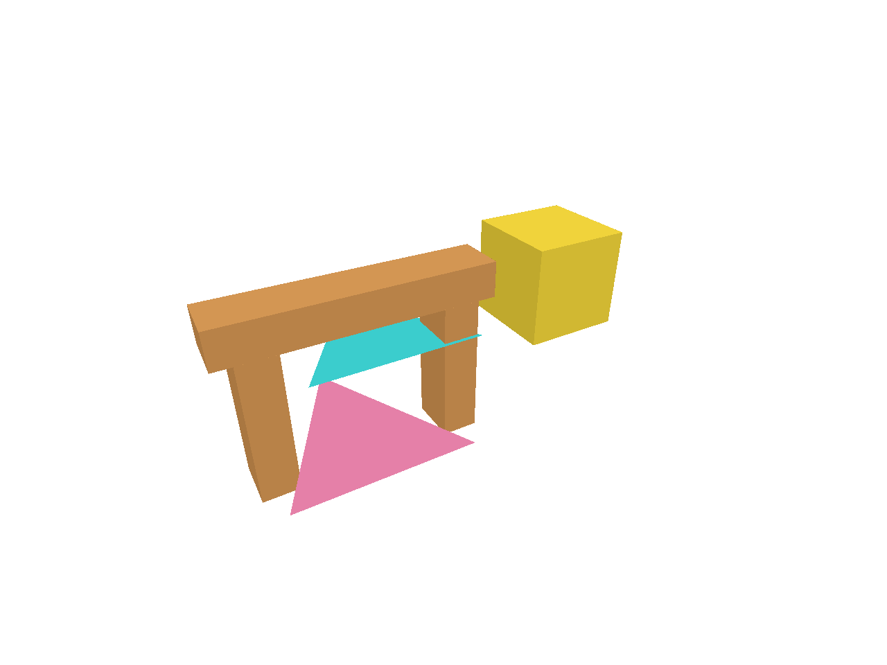
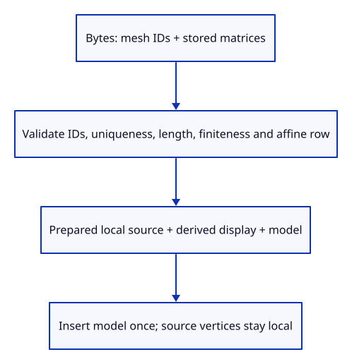

# 3.13.3 · Reopen source geometry with its placement

**Chapter 3 · Documents, editing and ownership · Section 3.13 · Stable identity and saving** · [Contents](contents.md)

**Typing: 12–24 minutes.** [Estimate](typing-load.md).

Accept the saved file's separate placement records. Each must identify an existing mesh, occur once, and contain sixteen finite values with an affine final row.

## Type

Continue from [Write a snapshot from the editable sources](29a-snapshot.md). [Save or recover your work](recovery.md).

### 1. `src/placement.rs`

Use one affine validation rule for decoded matrices and direct edits.

Create the file and type:

```rust
--8<-- "journey/code/29b-placements-01.rs"
```

### 2. `src/lib.rs`

Expose the shared matrix validator.

<details>
<summary>Locate the existing block</summary>

```rust
pub mod prepared;
```

</details>

After that block, type:

```rust
--8<-- "journey/code/29b-placements-02.rs" skip=18
```

### 3. `src/scene.rs`

Make direct placement edits use the same rule as imported files.

<details>
<summary>Locate the existing block</summary>

```rust
        if !model.m.iter().all(|v| v.is_finite())
            || [model.m[3], model.m[7], model.m[11], model.m[15]] != [0.0, 0.0, 0.0, 1.0]
```

</details>

Edit the existing block to match this code; keep unchanged lines:

```rust
--8<-- "journey/code/29b-placements-03.rs"
```

### 4. `src/prepared.rs`

Carry the validated object placement beside local source geometry. Generated geometry begins with identity placement.

<details>
<summary>Locate the existing block</summary>

```rust
use crate::{document::Source, mesh::Mesh};
use std::rc::Rc;

pub struct PreparedMesh {
    pub geometry: Rc<session_rust::Mesh>,
    pub display: Mesh,
    pub source: Option<Source>,
}

impl PreparedMesh {
    pub fn triangle(points: [[f64; 3]; 3], colour: [f32; 3]) -> Result<Self, &'static str> {
        let vertices = points.into_iter().map(|p| session_rust::Point::new(p[0], p[1], p[2])).collect();
        let mut geometry = session_rust::Mesh::from_vertices_and_faces(vertices, vec![vec![0, 1, 2]]);
        geometry.set_objectcolor(session_rust::Color::new(colour[0], colour[1], colour[2], 1.0));
        Self::new(geometry)
    }

    pub fn new(geometry: session_rust::Mesh) -> Result<Self, &'static str> {
        Self::from_shared(Rc::new(geometry))
    }

    pub fn from_shared(geometry: Rc<session_rust::Mesh>) -> Result<Self, &'static str> {
        // The kernel creates a GUID lazily; establish identity before sharing.
        let _ = geometry.guid();
        let display = Mesh::from_kernel(&geometry)?;
        Ok(Self { geometry, display, source: None })
    }
}
```

</details>

Edit the existing block to match this code; keep unchanged lines:

```rust
use crate::{document::Source, mesh::Mesh};
use std::rc::Rc;

pub struct PreparedMesh {
    pub geometry: Rc<session_rust::Mesh>,
    pub display: Mesh,
    pub source: Option<Source>,
    pub model: session_rust::Xform,
}

impl PreparedMesh {
    pub fn triangle(points: [[f64; 3]; 3], colour: [f32; 3]) -> Result<Self, &'static str> {
        let vertices = points.into_iter().map(|p| session_rust::Point::new(p[0], p[1], p[2])).collect();
        let mut geometry = session_rust::Mesh::from_vertices_and_faces(vertices, vec![vec![0, 1, 2]]);
        geometry.set_objectcolor(session_rust::Color::new(colour[0], colour[1], colour[2], 1.0));
        Self::new(geometry)
    }

    pub fn new(geometry: session_rust::Mesh) -> Result<Self, &'static str> {
        Self::from_shared(Rc::new(geometry))
    }

    pub fn from_shared(geometry: Rc<session_rust::Mesh>) -> Result<Self, &'static str> {
        // The kernel creates a GUID lazily; establish identity before sharing.
        let _ = geometry.guid();
        let display = Mesh::from_kernel(&geometry)?;
        Ok(Self { geometry, display, source: None, model: session_rust::Xform::identity() })
    }
}
```

<details>
<summary>Optional patch references</summary>

Use these original edit fragments when comparing a saved checkpoint. Apply the complete blocks above.

```text
--8<-- "journey/code/29b-placements-04.rs"
```

```text
--8<-- "journey/code/29b-placements-05.rs"
```

</details>

### 5. `src/document.rs`

Retain the validated stored placement without baking it into source vertices.

<details>
<summary>Locate the existing block</summary>

```rust
        let mut prepared = PreparedMesh::from_shared(Rc::clone(mesh))?;
```

</details>

After that block, type:

```rust
--8<-- "journey/code/29b-placements-06.rs" skip=72
```

### 6. `src/scene.rs`

Insert each prepared model exactly once.

<details>
<summary>Locate the existing block</summary>

```rust
            model: session_rust::Xform::identity(), source: prepared.source });
```

</details>

Edit the existing block to match this code; keep unchanged lines:

```rust
--8<-- "journey/code/29b-placements-07.rs"
```

### 7. `src/document.rs`

Remove the temporary source-only validation comment. Validate the complete saved message now that the loader accepts placements. Accept placements while keeping the other unsupported source families explicit. Reject unknown, duplicate, incomplete, non-finite or projective placement records before kernel construction.

Edit these blocks from bottom to top. Keep the surrounding lines unchanged.

<details>
<summary>Locate this block</summary>

```rust
        }
        validate_mesh(mesh)?;
    }
    if let Some(root) = message.tree.as_ref().and_then(|tree| tree.root.as_ref()) {
        let names: HashSet<_> = root.children.iter().map(|node| node.name.as_str()).collect();
        if names != guids || root.children.len() != guids.len()
```

</details>

Replace it with:

```rust
        }
        validate_mesh(mesh)?;
    }
    let mut placed = HashSet::new();
    for entry in &message.xforms {
        let matrix = &entry.xform.as_ref().ok_or("Missing placement matrix")?.matrix;
        if !guids.contains(entry.guid.as_str()) || !placed.insert(entry.guid.as_str())
            || !crate::placement::valid(matrix)
        {
            return Err("Invalid mesh placement");
        }
    }
    if let Some(root) = message.tree.as_ref().and_then(|tree| tree.root.as_ref()) {
        let names: HashSet<_> = root.children.iter().map(|node| node.name.as_str()).collect();
        if names != guids || root.children.len() != guids.len()
```

<details>
<summary>Locate this block</summary>

```rust

fn validate(message: &proto::Session) -> Result<(), &'static str> {
    let objects = message.objects.as_ref().ok_or("Session has no objects")?;
    if !message.xforms.is_empty() || message.definitions.is_some() || !message.interactions.is_empty() {
        return Err("Placements, definitions and interactions arrive in later checkpoints");
    }
    let other = objects.points.len() + objects.lines.len() + objects.planes.len()
        + objects.bboxes.len() + objects.polylines.len() + objects.pointclouds.len()
```

</details>

Replace it with:

```rust

fn validate(message: &proto::Session) -> Result<(), &'static str> {
    let objects = message.objects.as_ref().ok_or("Session has no objects")?;
    if message.definitions.is_some() || !message.interactions.is_empty() {
        return Err("Definitions and interactions arrive in later checkpoints");
    }
    let other = objects.points.len() + objects.lines.len() + objects.planes.len()
        + objects.bboxes.len() + objects.polylines.len() + objects.pointclouds.len()
```

<details>
<summary>Locate this block</summary>

```rust
            name: "Objects".into(), children, ..Default::default()
        }), ..Default::default() }), xforms, ..Default::default()
    };
    // Source validation; placements come next.
    let mut geometry = message.clone(); geometry.xforms.clear();
    validate(&geometry)?;
    let bytes = message.encode_to_vec();
    if bytes.len() > MAX_BYTES { return Err("The saved document exceeds 4 MiB"); }
    Ok(bytes)
```

</details>

Replace it with:

```rust
            name: "Objects".into(), children, ..Default::default()
        }), ..Default::default() }), xforms, ..Default::default()
    };
    validate(&message)?;
    let bytes = message.encode_to_vec();
    if bytes.len() > MAX_BYTES { return Err("The saved document exceeds 4 MiB"); }
    Ok(bytes)
```

<details>
<summary>Complete updated block reference</summary>

```rust
use crate::prepared::PreparedMesh;
use prost::Message;
use session_rust::{proto, Session};
use std::{collections::HashSet, rc::Rc};

pub const MAX_BYTES: usize = 4 * 1024 * 1024;

#[derive(Clone)]
pub struct Source {
    pub document: Rc<Session>,
    pub guid: String,
}

pub struct Loaded {
    pub document: Rc<Session>,
    pub meshes: Vec<PreparedMesh>,
}

pub fn load(bytes: &[u8]) -> Result<Loaded, &'static str> {
    if bytes.len() > MAX_BYTES { return Err("This checkpoint accepts files up to 4 MiB"); }
    let message = proto::Session::decode(bytes).map_err(|_| "Invalid session protobuf")?;
    validate(&message)?;
    let document = Rc::new(Session::from_proto(message).map_err(|_| "Cannot construct session")?);
    let mut meshes = Vec::new();
    for mesh in document.objects.meshes.iter() {
        let mut prepared = PreparedMesh::from_shared(Rc::clone(mesh))?;
        prepared.model = document.xforms.get(mesh.guid()).cloned().unwrap_or_else(session_rust::Xform::identity);
        prepared.source = Some(Source {
            document: Rc::clone(&document), guid: mesh.guid().to_owned(),
        });
        meshes.push(prepared);
    }
    Ok(Loaded { document, meshes })
}

pub fn snapshot(scene: &crate::scene::Scene) -> Result<Vec<u8>, &'static str> {
    let mut objects = proto::Objects::default();
    let mut children = Vec::new();
    let mut xforms = Vec::new();
    for object in scene.objects() {
        let mut mesh = object.geometry.to_proto();
        mesh.guid = object.guid.clone();
        objects.meshes.push(mesh);
        children.push(proto::TreeNode { name: object.guid.clone(), ..Default::default() });
        if object.model.m != session_rust::Xform::identity().m {
            xforms.push(proto::XformEntry {
                guid: object.guid.clone(), xform: Some(object.model.to_proto()),
            });
        }
    }
    let message = proto::Session {
        name: "Viewer document".into(), objects: Some(objects),
        tree: Some(proto::Tree { root: Some(proto::TreeNode {
            name: "Objects".into(), children, ..Default::default()
        }), ..Default::default() }), xforms, ..Default::default()
    };
    validate(&message)?;
    let bytes = message.encode_to_vec();
    if bytes.len() > MAX_BYTES { return Err("The saved document exceeds 4 MiB"); }
    Ok(bytes)
}

fn validate(message: &proto::Session) -> Result<(), &'static str> {
    let objects = message.objects.as_ref().ok_or("Session has no objects")?;
    if message.definitions.is_some() || !message.interactions.is_empty() {
        return Err("Definitions and interactions arrive in later checkpoints");
    }
    let other = objects.points.len() + objects.lines.len() + objects.planes.len()
        + objects.bboxes.len() + objects.polylines.len() + objects.pointclouds.len()
        + objects.nurbscurves.len() + objects.nurbssurfaces.len() + objects.breps.len()
        + objects.elements.len() + objects.components.len() + objects.sheets.len() + objects.instances.len();
    if other != 0 || objects.meshes.is_empty() || objects.meshes.len() > 64 {
        return Err("This checkpoint accepts 1–64 meshes and no other geometry types");
    }
    let mut guids = HashSet::new();
    for mesh in &objects.meshes {
        if mesh.guid.is_empty() || !guids.insert(mesh.guid.as_str()) {
            return Err("Every mesh needs a distinct source GUID");
        }
        validate_mesh(mesh)?;
    }
    let mut placed = HashSet::new();
    for entry in &message.xforms {
        let matrix = &entry.xform.as_ref().ok_or("Missing placement matrix")?.matrix;
        if !guids.contains(entry.guid.as_str()) || !placed.insert(entry.guid.as_str())
            || !crate::placement::valid(matrix)
        {
            return Err("Invalid mesh placement");
        }
    }
    if let Some(root) = message.tree.as_ref().and_then(|tree| tree.root.as_ref()) {
        let names: HashSet<_> = root.children.iter().map(|node| node.name.as_str()).collect();
        if names != guids || root.children.len() != guids.len()
            || root.children.iter().any(|node| !node.children.is_empty()) {
            return Err("This checkpoint needs one flat tree row per mesh");
        }
    }
    Ok(())
}

fn validate_mesh(mesh: &proto::Mesh) -> Result<(), &'static str> {
    if mesh.vertices.len() > 10_000 || mesh.faces.is_empty() || mesh.faces.len() > 10_000 {
        return Err("A mesh needs faces and at most 10,000 vertices and faces");
    }
    if mesh.color_mode != 0 { return Err("Per-face and per-vertex colours arrive later"); }
    for (&key, vertex) in &mesh.vertices {
        if key > u32::MAX as u64 || [vertex.x, vertex.y, vertex.z].iter().any(|v| !v.is_finite()) {
            return Err("Invalid vertex key or coordinate");
        }
    }
    for (&key, face) in &mesh.faces {
        if key > u32::MAX as u64 || !(3..=4).contains(&face.vertices.len()) || !face.holes.is_empty()
            || face.vertices.iter().any(|key| !mesh.vertices.contains_key(key)) {
            return Err("This checkpoint needs triangles or quads with existing vertices and no holes");
        }
    }
    for (key, triangles) in &mesh.triangulation {
        if !mesh.faces.contains_key(key) || triangles.vertices.len() % 3 != 0
            || triangles.vertices.iter().any(|key| !mesh.vertices.contains_key(key)) {
            return Err("Invalid stored triangulation");
        }
    }
    Ok(())
}
```

</details>

<details>
<summary>Optional patch references</summary>

Use these original edit fragments when comparing a saved checkpoint. Apply the complete blocks above.

```text
--8<-- "journey/code/29b-placements-09.rs"
```

```text
--8<-- "journey/code/29b-placements-10.rs"
```

```text
--8<-- "journey/code/29b-placements-11.rs"
```

</details>

<details>
<summary>Supplied validation fixture</summary>

Copy this supplied authoring fixture once. Continue with the browser build below; the course does not require running native tests.

### 8. `src/placement_load_tests.rs`

Optional authoring fixture. Reject all malformed placement families using actual encoded messages.

Copy this supplied file:

```text
--8<-- "journey/code/29b-placements-12.rs"
```

</details>

### 9. `src/lib.rs`

Compile the malformed-input checks.

<details>
<summary>Locate the existing block</summary>

```rust
#[cfg(test)]
mod snapshot_tests;
```

</details>

After that block, type:

```rust
--8<-- "journey/code/29b-placements-13.rs" skip=33
```

## Run and check

In your project:

```sh
cd workspace/journey
REGEN_PROTO=0 cargo build --lib --locked --target wasm32-unknown-unknown -j1
REGEN_PROTO=0 CARGO_BUILD_JOBS=1 trunk serve --port 8780
```

Open `http://127.0.0.1:8780/`. Keep an existing Trunk server running; saving rebuilds it.

Run the reopen checks below. Valid stored placements restore the objects; an invalid matrix must reject the document before changing live rows.

### Recorded visual result

**Previous native render — current verification pending.**



*This recorded image predates a source or checker change. Rebuild this checkpoint before using it as current evidence; browser controls require separate acceptance.*

<details>
<summary>Code explanation and diagram</summary>

Share this rule through `placement::valid` for loading and scene placement. Validate before constructing `Xform`: its defaults must not silently fill a short file matrix.

`PreparedMesh` now carries a model matrix. Generated geometry starts at identity; loading copies the validated source placement; insertion retains it.

Snapshot and load now use the same complete validator. Tests reject short, non-finite or projective matrices and orphan or duplicate placement entries before scene mutation. Exact round-trip checks come next; the browser download follows those.

Bytes → validated mesh IDs and affine matrices → prepared local sources plus placement → inserted objects.



Where must a saved transform be applied when reopening?

A saved transform belongs to the object placement. Load prepares the original local kernel mesh and attaches its validated matrix. Scene insertion uses that matrix once. It must not transform source vertices and also retain the placement, or the object moves twice.

Study estimate, including typing and experiments: 1–2 hours.

</details>

<details>
<summary>Optional experiment</summary>

Change the malformed-placement check’s projective matrix into a finite translation. Predict why validation accepts it, then restore the rejection case. Explain why a fifteen-value matrix remains invalid even if every supplied value is finite.

</details>

<details>
<summary>Check and save your work</summary>

Restore experimental edits, then run from `session_viewer`:

```sh
npm --prefix ../session_tests run course -- check 3.13.3
npm --prefix ../session_tests run course -- save 3.13.3
```

Source comparison leaves your project untouched. [Save and recovery instructions](recovery.md).

</details>

<details>
<summary>Viewer coverage and verification</summary>

The production session stores local placements keyed by object GUID and composes nested tree transforms later. This checkpoint handles one flat level and rejects unsupported definitions and interactions.


[Full validation scope](release.md).

To reproduce the scripted acceptance of the reference checkpoint, run from `session_viewer` with the [course bundle server](release.md#reproduce) running on port 8781:

```sh
npm --prefix ../session_tests run course -- capture 3.13.3
```

This uses the verified reference bundle; it does not check or change your typed project.

</details>
