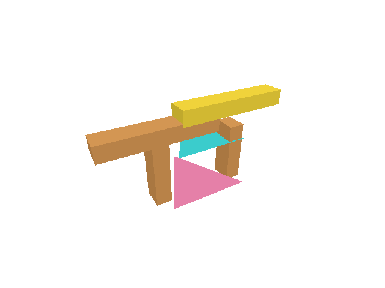
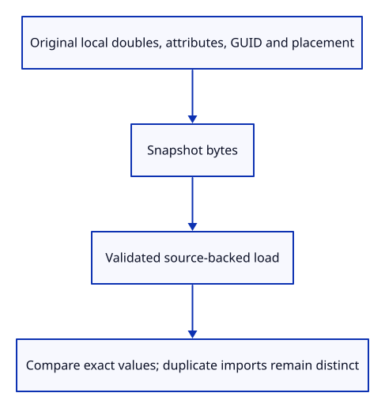

# 3.13.4 · Prove the saved document reopens faithfully

**Chapter 3 · Documents, editing and ownership · Section 3.13 · Stable identity and saving** · [Contents](contents.md)

**Typing: 1–1 minutes.** [Estimate](typing-load.md).

Prove snapshot and load preserve the editable document before adding browser downloading.

## Type

Continue from [Reopen source geometry with its placement](29b-placements.md). [Save or recover your work](recovery.md).

<details>
<summary>Supplied validation fixture</summary>

Copy this supplied authoring fixture once. Continue with the browser build below; the course does not require running native tests.

### 1. `src/save_roundtrip_tests.rs`

Optional authoring fixture. Compare exact source values, stored identities and object matrices after encoding and decoding.

Copy this supplied file:

```text
--8<-- "journey/code/29c-roundtrip-01.rs"
```

</details>

### 2. `src/lib.rs`

Compile exact document round-trip checks.

<details>
<summary>Locate the existing block</summary>

```rust
#[cfg(test)]
mod placement_load_tests;
```

</details>

After that block, type:

```rust
--8<-- "journey/code/29c-roundtrip-02.rs" skip=39
```

## Run and check

In your project:

```sh
cd workspace/journey
REGEN_PROTO=0 cargo build --lib --locked --target wasm32-unknown-unknown -j1
REGEN_PROTO=0 CARGO_BUILD_JOBS=1 trunk serve --port 8780
```

Open `http://127.0.0.1:8780/`. Keep an existing Trunk server running; saving rebuilds it.

Run the round-trip checks below. Reopened geometry must retain exact doubles, attributes, saved identities and placements. Compare the source values, not the float display.

### Recorded visual result

**Previous native render — current verification pending.**



*This recorded image predates a source or checker change. Rebuild this checkpoint before using it as current evidence; browser controls require separate acceptance.*

<details>
<summary>Code explanation and diagram</summary>

Save and reopen a triangle with a double coordinate that rounds in its display, a name, hide/lock flags and translation. Compare original source values exactly; derive display again and keep placement separate.

Then save duplicate imports. Reopened GUIDs must match their stored object GUIDs, including the duplicate's new identity; matrices must match too. Imported sources stay untouched.

Compare decoded structure rather than protobuf byte order. Pixels cannot establish source precision or identity. Flags are retained here; drawing and editing policies for hidden/locked objects come later.

Live source and placement → snapshot bytes → load → identical source values and object matrices.



What can a screenshot prove about saved precision and identity?

A screenshot proves the drawing, not exact saved doubles or identifiers. Native round-trip checks compare original vertices, names, attributes, GUIDs and matrices. Duplicate-import checks also ensure separate objects survive one saved file even when they came from the same source GUID.

Study estimate, including typing and experiments: 1–2 hours.

</details>

<details>
<summary>Optional experiment</summary>

Change the exact coordinate to 123456789.125. Predict why the reopened kernel coordinate matches exactly even though the display uses floats. Then inspect corresponding imported copies’ saved GUIDs. Restore the checks.

</details>

<details>
<summary>Check and save your work</summary>

Restore experimental edits, then run from `session_viewer`:

```sh
npm --prefix ../session_tests run course -- check 3.13.4
npm --prefix ../session_tests run course -- save 3.13.4
```

Source comparison leaves your project untouched. [Save and recovery instructions](recovery.md).

</details>

<details>
<summary>Viewer coverage and verification</summary>

The production viewer preserves editable source data through save/reopen and assigns distinct identities to inserted copies. These bounded flat-mesh tests establish that contract before browser downloading or full geometry families.


[Full validation scope](release.md).

To reproduce the scripted acceptance of the reference checkpoint, run from `session_viewer` with the [course bundle server](release.md#reproduce) running on port 8781:

```sh
npm --prefix ../session_tests run course -- capture 3.13.4
```

This uses the verified reference bundle; it does not check or change your typed project.

</details>
