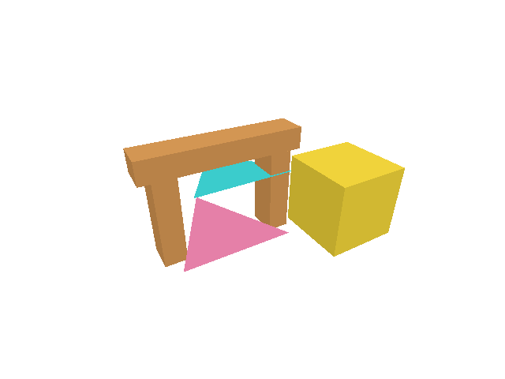
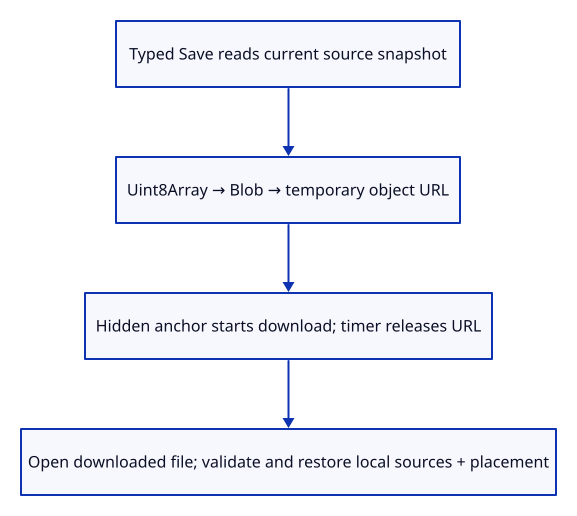

# 3.13.5 · Download the editable document from the command line

**Chapter 3 · Documents, editing and ownership · Section 3.13 · Stable identity and saving** · [Contents](contents.md)

**Typing: 24–47 minutes.** [Estimate](typing-load.md).

Connect typed `Save` to `snapshot` and a browser download. Snapshot errors go to command history and start no download.

## Type

Continue from [Prove the saved document reopens faithfully](29c-roundtrip.md). [Save or recover your work](recovery.md).

### 1. `Cargo.toml`

Enable the browser object URL and download anchor APIs. These features do not change dependency versions.

<details>
<summary>Locate the existing block</summary>

```toml
web-sys = { version = "=0.3.105", features = ["Window", "Document", "Element", "HtmlCanvasElement", "EventTarget", "AddEventListenerOptions", "Event", "MouseEvent", "PointerEvent", "DomRect", "KeyboardEvent", "WheelEvent", "AddEventListenerOptions", "HtmlElement", "HtmlInputElement", "File", "FileList", "Blob", "CustomEvent", "CustomEventInit", "FocusOptions"] }
```

</details>

Edit the existing block to match this code; keep unchanged lines:

```toml
--8<-- "journey/code/29d-save-01.toml"
```

### 2. `src/file_output.rs`

Create a temporary file owner, request a download and schedule one-shot URL cleanup.

Create the file and type:

```rust
--8<-- "journey/code/29d-save-02.rs"
```

### 3. `src/lib.rs`

Expose the browser file-output adapter.

<details>
<summary>Locate the existing block</summary>

```rust
mod file_input;
```

</details>

After that block, type:

```rust
--8<-- "journey/code/29d-save-03.rs" skip=16
```

### 4. `src/browser.rs`

Offer Save through command completion in the actual dock. Read the scene for Save without creating a document action or consuming history.

Edit these blocks from bottom to top. Keep the surrounding lines unchanged.

<details>
<summary>Locate this block</summary>

```rust
                    input.click();
                }
                None
            } else if line == "move" || line.starts_with("move ") {
                match crate::offset::parse(&line) {
                    Ok(offset) => Some(Action::Translate(offset)),
```

</details>

Replace it with:

```rust
                    input.click();
                }
                None
            } else if line == "save" {
                match crate::document::snapshot(&editor.scene) {
                    Ok(bytes) => match crate::file_output::download(&bytes) {
                        Ok(()) => panel.result(&format!("Saved editable document ({} bytes)", bytes.len())),
                        Err(error) => panel.result(&format!("Save failed: {error:?}")),
                    },
                    Err(error) => panel.result(error),
                }
                None
            } else if line == "move" || line.starts_with("move ") {
                match crate::offset::parse(&line) {
                    Ok(offset) => Some(Action::Translate(offset)),
```

<details>
<summary>Locate this block</summary>

```rust
        &[
            "Help",
            "Open",
            "Example Box",
            "Example Triangle",
            "Select Next",
```

</details>

Replace it with:

```rust
        &[
            "Help",
            "Open",
            "Save",
            "Example Box",
            "Example Triangle",
            "Select Next",
```

<details>
<summary>Complete updated block reference</summary>

```rust
use crate::background::Background;
use crate::editor::{Action, Change, Editor};
use crate::gesture::Gesture;
use crate::renderer::Renderer;
use crate::viewport::Viewport;
use wasm_bindgen::{JsCast, JsValue, closure::Closure};

pub fn report(message: &str) {
    if let Some(document) = web_sys::window().and_then(|window| window.document()) {
        if let Some(status) = document.get_element_by_id("status") {
            status.set_text_content(Some(message));
            if message.starts_with("Cannot") { let _ = status.remove_attribute("hidden"); }
        }
    }
}

pub async fn run() -> Result<(), JsValue> {
    let window = web_sys::window().ok_or("No browser window")?;
    let document = window.document().ok_or("No document")?;
    let canvas: web_sys::HtmlCanvasElement = document
        .get_element_by_id("canvas")
        .ok_or("Missing canvas")?
        .dyn_into()?;
    let instance = wgpu::Instance::new(wgpu::InstanceDescriptor {
        backends: wgpu::Backends::BROWSER_WEBGPU,
        flags: Default::default(),
        memory_budget_thresholds: Default::default(),
        backend_options: Default::default(),
        display: None,
    });
    let surface = instance
        .create_surface(wgpu::SurfaceTarget::Canvas(canvas.clone()))
        .map_err(|error| JsValue::from_str(&error.to_string()))?;
    let adapter = instance
        .request_adapter(&wgpu::RequestAdapterOptions {
            compatible_surface: Some(&surface),
            ..Default::default()
        })
        .await
        .map_err(|error| JsValue::from_str(&error.to_string()))?;
    let (device, queue) = adapter
        .request_device(&wgpu::DeviceDescriptor::default())
        .await
        .map_err(|error| JsValue::from_str(&error.to_string()))?;
    device.on_uncaptured_error(std::sync::Arc::new(|error| report(&error.to_string())));
    let limit = device.limits().max_texture_dimension_2d;
    let width = (window.inner_width()?.as_f64().ok_or("No window width")? as u32).clamp(1, limit);
    let height = (window.inner_height()?.as_f64().ok_or("No window height")? as u32).clamp(1, limit);
    canvas.set_width(width);
    canvas.set_height(height);
    let mut config = surface
        .get_default_config(&adapter, width, height)
        .ok_or("No compatible surface format")?;
    config.view_formats = vec![config.format.add_srgb_suffix()];
    surface.configure(&device, &config);
    let mut editor = Editor::default();
    let mut renderer = Renderer::new(
        device,
        queue,
        config.format.add_srgb_suffix(),
        &editor.scene,
    );
    renderer.resize(Viewport { width, height });
    let mut panel = crate::panel::Panel::new(
        &renderer,
        config.format.add_srgb_suffix(),
        &[
            "Help",
            "Open",
            "Save",
            "Example Box",
            "Example Triangle",
            "Select Next",
            "Delete",
            "Undo",
            "Redo",
            "Background",
            "Zoom In",
            "Zoom Out",
            "Pan Left",
            "Pan Right",
            "Orbit Right",
            "Orbit Up",
            "View Isometric",
            "View Perspective",
            "View Orthographic",
            "Fit",
            "Fit Selected",
            "Move",
            "View Reset",
        ],
    );
    panel.update(None, &canvas)?;
    if resize(
        &window,
        &canvas,
        &surface,
        &mut config,
        &mut renderer,
        &mut editor,
    ) {
        panel.update(None, &canvas)?;
        present(
            &surface,
            &renderer,
            &editor.background,
            &editor.camera.uniform(),
            &mut panel,
        )?;
    }
    let input_canvas = canvas.clone();
    let browser_window = window.clone();
    let pointer_canvas = canvas.clone();
    let mut gesture = Gesture::default();
    let request = std::rc::Rc::new(std::cell::Cell::new(0));
    let update = Closure::<dyn FnMut(web_sys::Event)>::new(move |event: web_sys::Event| {
        let shortcut = event.dyn_ref::<web_sys::KeyboardEvent>().and_then(|key| panel.shortcut(key));
        let line = if let Some(shortcut) = shortcut {
            event.prevent_default();
            panel.answer(shortcut.command(), "");
            Some(shortcut.command().to_ascii_lowercase())
        } else { match panel.update(Some(&event), &input_canvas) {
            Ok(line) => line,
            Err(error) => {
                report(&format!("Cannot read command: {error:?}"));
                return;
            }
        } };

        let action = if event.type_() == "change" {
            crate::file_input::choose(&event, std::rc::Rc::clone(&request));
            None
        } else if event.type_() == "viewer-file" {
            crate::file_input::bytes(&event).map(Action::Import)
        } else if let Some(line) = line {
            if line == "open" {
                if let Some(input) = web_sys::window()
                    .and_then(|window| window.document())
                    .and_then(|document| document.get_element_by_id("open"))
                    .and_then(|element| element.dyn_into::<web_sys::HtmlInputElement>().ok())
                {
                    input.click();
                }
                None
            } else if line == "save" {
                match crate::document::snapshot(&editor.scene) {
                    Ok(bytes) => match crate::file_output::download(&bytes) {
                        Ok(()) => panel.result(&format!("Saved editable document ({} bytes)", bytes.len())),
                        Err(error) => panel.result(&format!("Save failed: {error:?}")),
                    },
                    Err(error) => panel.result(error),
                }
                None
            } else if line == "move" || line.starts_with("move ") {
                match crate::offset::parse(&line) {
                    Ok(offset) => Some(Action::Translate(offset)),
                    Err(error) => { panel.result(error); None }
                }
            } else {
                let action = match line.as_str() {
                    "example box" => Action::AddBox,
                    "example triangle" => Action::ToggleExtra,
                    "select next" => Action::SelectNext,
                    "delete" => Action::Delete,
                    "undo" => Action::Undo,
                    "redo" => Action::Redo,
                    "background" => Action::Background,
                    "zoom in" => Action::Zoom(2.0),
                    "zoom out" => Action::Zoom(0.5),
                    "pan left" => Action::Pan(-0.25, 0.0),
                    "pan right" => Action::Pan(0.25, 0.0),
                    "orbit right" => Action::Orbit(std::f64::consts::FRAC_PI_4, 0.0),
                    "orbit up" => Action::Orbit(0.0, std::f64::consts::FRAC_PI_6),
                    "view isometric" => Action::Isometric,
                    "view perspective" => {
                        Action::Projection(crate::camera::Projection::Perspective)
                    }
                    "view orthographic" => {
                        Action::Projection(crate::camera::Projection::Orthographic)
                    }
                    "fit" if shortcut.is_some() && editor.selected.is_some() => Action::FitSelected,
                    "fit" => Action::Fit,

                    "fit selected" => Action::FitSelected,
                    "view reset" => Action::ResetView,
                    _ => return,
                };
                Some(action)
            }
        } else if !panel.consumed {
            navigation_action(&event, &pointer_canvas, &mut gesture)
        } else {
            None
        };
        if let Some(action) = action {
            match editor.apply(action) {
                Ok(Change::Scene) => renderer.set_scene(&editor.scene, editor.selected),
                Ok(Change::View) => {}
                Err(error) => {
                    report(error);
                    panel.result(error);
                }
            }
        }
        if let Err(error) = show_projection(&editor.camera) {
            report(&format!("Cannot report projection: {error:?}"));
            return;
        }
        if event.type_() == "viewer-file" {
            report("File imported. Undo removes the entire import.");
        }
        if resize(
            &browser_window,
            &pointer_canvas,
            &surface,
            &mut config,
            &mut renderer,
            &mut editor,
        ) {
            if let Err(error) = panel.update(None, &input_canvas) {
                report(&format!("Cannot lay out commands: {error:?}"));
                return;
            }
            if let Err(error) = present(
                &surface,
                &renderer,
                &editor.background,
                &editor.camera.uniform(),
                &mut panel,
            ) {
                report(&format!("Cannot redraw: {error:?}"));
            }
        }
    });
    for name in [
        "pointerdown",
        "pointermove",
        "pointerup",
        "pointercancel",
        "lostpointercapture",
        "contextmenu",
        "keydown",
        "keyup",
        "blur",
    ] {
        canvas.add_event_listener_with_callback(name, update.as_ref().unchecked_ref())?;
    }
    let options = web_sys::AddEventListenerOptions::new();
    options.set_passive(false);
    canvas.add_event_listener_with_callback_and_add_event_listener_options(
        "wheel",
        update.as_ref().unchecked_ref(),
        &options,
    )?;
    window.add_event_listener_with_callback("resize", update.as_ref().unchecked_ref())?;
    window.add_event_listener_with_callback("blur", update.as_ref().unchecked_ref())?;
    document.add_event_listener_with_callback("change", update.as_ref().unchecked_ref())?;
    window.add_event_listener_with_callback("viewer-file", update.as_ref().unchecked_ref())?;
    // Both event sources retain this one callback for the lifetime of the page.
    update.forget();
    report("Wheel zooms; type commands anywhere in the drawing. Escape cancels a drag.");
    Ok(())
}

fn show_projection(camera: &crate::camera::Camera) -> Result<(), JsValue> {
    let document = web_sys::window()
        .and_then(|window| window.document())
        .ok_or("No document")?;
    let canvas = document
        .get_element_by_id("canvas")
        .ok_or("Missing canvas")?;
    canvas.set_attribute("data-projection", &format!("{:?}", camera.projection))
}

fn navigation_action(
    event: &web_sys::Event,
    canvas: &web_sys::HtmlCanvasElement,
    gesture: &mut Gesture,
) -> Option<Action> {
    let action = match event.type_().as_str() {
        "wheel" => {
            let wheel = event.dyn_ref::<web_sys::WheelEvent>()?;
            let mode = wheel.delta_mode();
            crate::navigation::wheel(
                wheel.delta_y(),
                mode,
                canvas.get_bounding_client_rect().height(),
            )
        }
        "keydown" => {
            let key = event.dyn_ref::<web_sys::KeyboardEvent>()?;
            if key.is_composing() || key.alt_key() {
                return None;
            }
            if key.key() == "Escape" {
                gesture.cancel();
                event.prevent_default();
                return None;
            }
            return None;
        }
        _ => return pointer_action(event, canvas, gesture),
    }?;
    event.prevent_default();
    Some(action)
}

fn pointer_action(
    event: &web_sys::Event,
    canvas: &web_sys::HtmlCanvasElement,
    gesture: &mut Gesture,
) -> Option<Action> {
    match event.type_().as_str() {
        "contextmenu" => {
            event.prevent_default();
            return None;
        }
        "blur" | "resize" => {
            gesture.cancel();
            return None;
        }
        _ => {}
    }
    let pointer = event.dyn_ref::<web_sys::PointerEvent>()?;
    let id = pointer.pointer_id();
    let position = [pointer.client_x() as f64, pointer.client_y() as f64];
    let motion = match event.type_().as_str() {
        "pointerdown" => {
            if pointer.is_primary() && gesture.press(id, pointer.button(), position) {
                event.prevent_default();
                let options = web_sys::FocusOptions::new();
                options.set_prevent_scroll(true);
                if canvas.focus_with_options(&options).is_err()
                    || canvas.set_pointer_capture(id).is_err()
                {
                    gesture.cancel();
                }
            }
            None
        }
        "pointermove" => gesture.move_to(id, position),
        "pointerup" => {
            let motion = gesture.release(id, position);
            let _ = canvas.release_pointer_capture(id);
            motion
        }
        "pointercancel" | "lostpointercapture" => {
            gesture.cancel_pointer(id);
            None
        }
        _ => None,
    }?;
    let rect = canvas.get_bounding_client_rect();
    motion.action([rect.left(), rect.top(), rect.width(), rect.height()])
}

fn resize(
    window: &web_sys::Window,
    canvas: &web_sys::HtmlCanvasElement,
    surface: &wgpu::Surface<'_>,
    config: &mut wgpu::SurfaceConfiguration,
    renderer: &mut Renderer,
    editor: &mut Editor,
) -> bool {
    let rect = canvas.get_bounding_client_rect();
    let limit = renderer.device.limits().max_texture_dimension_2d;
    let Some(size) = Viewport::from_css(
        rect.width(),
        rect.height(),
        window.device_pixel_ratio(),
        limit,
    ) else {
        return false;
    };
    if size.width != config.width || size.height != config.height {
        canvas.set_width(size.width);
        canvas.set_height(size.height);
        config.width = size.width;
        config.height = size.height;
        surface.configure(&renderer.device, config);
        renderer.resize(size);
    }
    editor.camera.aspect = size.aspect();
    true
}

fn present(
    surface: &wgpu::Surface<'_>,
    renderer: &Renderer,
    background: &Background,
    transform: &[f32; 16],
    panel: &mut crate::panel::Panel,
) -> Result<(), JsValue> {
    let frame = match surface.get_current_texture() {
        wgpu::CurrentSurfaceTexture::Success(frame)
        | wgpu::CurrentSurfaceTexture::Suboptimal(frame) => frame,
        other => {
            return Err(JsValue::from_str(&format!(
                "Surface unavailable: {other:?}"
            )));
        }
    };
    let view = frame.texture.create_view(&wgpu::TextureViewDescriptor {
        format: Some(frame.texture.format().add_srgb_suffix()),
        ..Default::default()
    });
    renderer.draw(&view, background, transform);
    panel.draw(renderer, &view);
    frame.present();
    Ok(())
}
```

</details>

<details>
<summary>Optional patch references</summary>

Use these original edit fragments when comparing a saved checkpoint. Apply the complete blocks above.

```text
--8<-- "journey/code/29d-save-04.rs"
```

```text
--8<-- "journey/code/29d-save-05.rs"
```

</details>

### 5. `index.html`

Let the native file picker offer both original specimens and downloaded session files.

<details>
<summary>Locate the existing block</summary>

```html
  <input id="open" type="file" accept=".pb" hidden>
```

</details>

Edit the existing block to match this code; keep unchanged lines:

```html
--8<-- "journey/code/29d-save-06.html"
```

## Run and check

In your project:

```sh
cd workspace/journey
REGEN_PROTO=0 cargo build --lib --locked --target wasm32-unknown-unknown -j1
REGEN_PROTO=0 CARGO_BUILD_JOBS=1 trunk serve --port 8780
```

Open `http://127.0.0.1:8780/`. Keep an existing Trunk server running; saving rebuilds it.

Open `sample.pb`, select an object and move it. Type `Save`, then reopen the downloaded `viewer.session`. The placed scene should return; Save itself must not consume Undo.

### Recorded visual result

**Previous native render — current verification pending.**



*This recorded image predates a source or checker change. Rebuild this checkpoint before using it as current evidence; browser controls require separate acceptance.*

<details>
<summary>Code explanation and diagram</summary>

Copy bytes into `Uint8Array`, wrap them in `Blob`, and create an object URL. A temporary hidden anchor downloads `viewer.session` and is removed; it is not a viewer feature control.

Keep the URL alive for ten seconds, then revoke it with a one-shot callback owning its `String`. If timer scheduling fails, clean up immediately and report the error.

Save reads the document without creating a history edit. The Chrome check downloads and reopens that file, preserving the prior Move's Undo/Redo and the reconstructed scene picture.

Typed Save → source snapshot → Blob URL → download → Open → restored source and placement.



Why does Save belong outside document history?

Save reads the current scene and creates bytes; it does not edit geometry, placement or selection. It must not consume an Undo step. The browser owns file downloading, while the native snapshot and loader own the document contract.

Study estimate, including typing and experiments: 1–2 hours.

</details>

<details>
<summary>Optional experiment</summary>

Save after moving the box, then move it again and save to a second file. Reopen each into a cleared scene and predict which placement it restores. Saving should leave the next Undo step unchanged.

</details>

<details>
<summary>Check and save your work</summary>

Restore experimental edits, then run from `session_viewer`:

```sh
npm --prefix ../session_tests run course -- check 3.13.5
npm --prefix ../session_tests run course -- save 3.13.5
```

Source comparison leaves your project untouched. [Save and recovery instructions](recovery.md).

</details>

<details>
<summary>Viewer coverage and verification</summary>

The production Save command downloads the complete editable scene. This lesson connects a real browser download to our flat mesh serializer; complete trees and geometry families still require later chapters.


[Full validation scope](release.md).

To reproduce the scripted acceptance of the reference checkpoint, run from `session_viewer` with the [course bundle server](release.md#reproduce) running on port 8781:

```sh
npm --prefix ../session_tests run course -- capture 3.13.5
```

This uses the verified reference bundle; it does not check or change your typed project.

</details>
