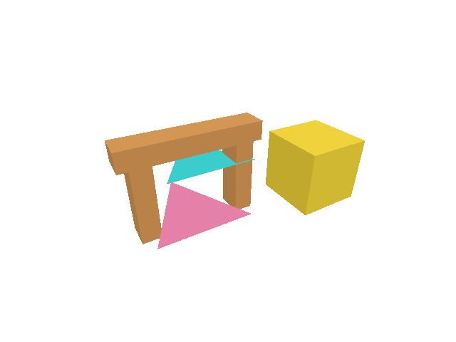
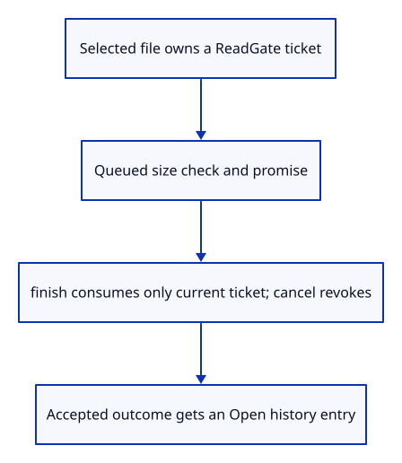

# 3.14.3 · Cancel reads without accepting their late result

**Chapter 3 · Documents, editing and ownership · Section 3.14 · Transactions and recovery** · [Contents](contents.md)

**Typing: 16–31 minutes.** [Estimate](typing-load.md).

Use `Rc<RefCell<ReadGate>>` to share a ticket gate between the command callback and read tasks. Keep mutable borrows short and release them before dispatching events.

## Type

Continue from [Give a pending read an explicit ticket](30a-tickets.md). [Save or recover your work](recovery.md).

### 1. `src/file_input.rs`

Share the native gate through short interior mutable borrows. Receive the same pending-read owner as the command callback. Issue a bounded ticket; even an exhaustion error must be delivered after the input callback returns. Avoid work for a ticket already superseded or cancelled before its queued task starts. Consume the current ticket before reporting a size refusal, releasing the RefCell borrow before dispatch. Only a current one-shot completion may deliver bytes or a read error.

<details>
<summary>Locate the existing block</summary>

```rust
use std::{cell::Cell, rc::Rc};
use wasm_bindgen::{JsCast, JsValue};

pub fn choose(event: &web_sys::Event, request: Rc<Cell<u64>>) {
    let Some(input) = event.target().and_then(|target| target.dyn_into::<web_sys::HtmlInputElement>().ok()) else { return; };
    if input.id() != "open" { return; }
    let Some(file) = input.files().and_then(|files| files.get(0)) else { return; };
    input.set_value("");
    let id = request.get() + 1;
    request.set(id);
    super::browser::report("Reading the selected file…");
    wasm_bindgen_futures::spawn_local(async move {
        if request.get() != id { return; }
        if file.size() > crate::document::MAX_BYTES as f64 {
            failure("This checkpoint accepts files up to 4 MiB");
            return;
        }
        let result = wasm_bindgen_futures::JsFuture::from(file.array_buffer()).await;
        if request.get() != id { return; }
        let result = result.and_then(deliver);
        if let Err(error) = result {
            failure(&format!("Cannot read file: {error:?}"));
        }
    });
}

fn failure(message: &str) {
    let detail = web_sys::CustomEventInit::new();
    detail.set_detail(&JsValue::from_str(message));
    let result = web_sys::CustomEvent::new_with_event_init_dict("viewer-file-error", &detail)
        .and_then(|event| web_sys::window().ok_or_else(|| JsValue::from_str("No window"))?.dispatch_event(&event));
    if result.is_err() { super::browser::report(message); }
}

fn deliver(buffer: JsValue) -> Result<(), JsValue> {
    let detail = web_sys::CustomEventInit::new();
    detail.set_detail(&js_sys::Uint8Array::new(&buffer));
    let event = web_sys::CustomEvent::new_with_event_init_dict("viewer-file", &detail)?;
    web_sys::window().ok_or("No browser window")?.dispatch_event(&event)?;
    Ok(())
}

pub fn bytes(event: &web_sys::Event) -> Option<Vec<u8>> {
    let event = event.dyn_ref::<web_sys::CustomEvent>()?;
    let array = event.detail().dyn_into::<js_sys::Uint8Array>().ok()?;
    if array.length() as usize > crate::document::MAX_BYTES { return None; }
    Some(array.to_vec())
}
```

</details>

Edit the existing block to match this code; keep unchanged lines:

```rust
use std::{cell::RefCell, rc::Rc};
use wasm_bindgen::{JsCast, JsValue};

pub fn choose(event: &web_sys::Event, request: Rc<RefCell<crate::read_gate::ReadGate>>) {
    let Some(input) = event.target().and_then(|target| target.dyn_into::<web_sys::HtmlInputElement>().ok()) else { return; };
    if input.id() != "open" { return; }
    let Some(file) = input.files().and_then(|files| files.get(0)) else { return; };
    input.set_value("");
    let id = match request.borrow_mut().begin() {
        Ok(id) => id,
        Err(error) => {
            wasm_bindgen_futures::spawn_local(async move { failure(error); });
            return;
        }
    };
    super::browser::report("Reading the selected file…");
    wasm_bindgen_futures::spawn_local(async move {
        if request.borrow().pending() != Some(id) { return; }
        if file.size() > crate::document::MAX_BYTES as f64 {
            let accepted = request.borrow_mut().finish(id);
            if accepted { failure("This checkpoint accepts files up to 4 MiB"); }
            return;
        }
        let result = wasm_bindgen_futures::JsFuture::from(file.array_buffer()).await;
        let accepted = request.borrow_mut().finish(id);
        if !accepted { return; }
        let result = result.and_then(deliver);
        if let Err(error) = result {
            failure(&format!("Cannot read file: {error:?}"));
        }
    });
}

fn failure(message: &str) {
    let detail = web_sys::CustomEventInit::new();
    detail.set_detail(&JsValue::from_str(message));
    let result = web_sys::CustomEvent::new_with_event_init_dict("viewer-file-error", &detail)
        .and_then(|event| web_sys::window().ok_or_else(|| JsValue::from_str("No window"))?.dispatch_event(&event));
    if result.is_err() { super::browser::report(message); }
}

fn deliver(buffer: JsValue) -> Result<(), JsValue> {
    let detail = web_sys::CustomEventInit::new();
    detail.set_detail(&js_sys::Uint8Array::new(&buffer));
    let event = web_sys::CustomEvent::new_with_event_init_dict("viewer-file", &detail)?;
    web_sys::window().ok_or("No browser window")?.dispatch_event(&event)?;
    Ok(())
}

pub fn bytes(event: &web_sys::Event) -> Option<Vec<u8>> {
    let event = event.dyn_ref::<web_sys::CustomEvent>()?;
    let array = event.detail().dyn_into::<js_sys::Uint8Array>().ok()?;
    if array.length() as usize > crate::document::MAX_BYTES { return None; }
    Some(array.to_vec())
}
```

<details>
<summary>Optional patch references</summary>

Use these original edit fragments when comparing a saved checkpoint. Apply the complete blocks above.

```text
--8<-- "journey/code/30b-cancel-01.rs"
```

```text
--8<-- "journey/code/30b-cancel-02.rs"
```

```text
--8<-- "journey/code/30b-cancel-03.rs"
```

```text
--8<-- "journey/code/30b-cancel-04.rs"
```

```text
--8<-- "journey/code/30b-cancel-05.rs"
```

```text
--8<-- "journey/code/30b-cancel-06.rs"
```

</details>

### 2. `src/browser.rs`

Expose the initial row count through hidden diagnostics. Offer read cancellation as a command rather than a keyboard feature shortcut. Let the input callback and queued tasks share one native gate. An asynchronous read error gets its own history entry instead of rewriting a later command. Revoke pending delivery without touching the scene or edit history. Record asynchronous success separately from subsequent typed commands. Distinguish a file result from a synchronous error on the current command. Update hidden diagnostics after every handled event. Keep scene count and projection in one diagnostic boundary. Report rows independently of overlapping drawing pixels.

Edit these blocks from bottom to top. Keep the surrounding lines unchanged.

<details>
<summary>Locate this block</summary>

```rust
    Ok(())
}

fn show_projection(camera: &crate::camera::Camera) -> Result<(), JsValue> {
    let document = web_sys::window()
        .and_then(|window| window.document())
        .ok_or("No document")?;
    let canvas = document
        .get_element_by_id("canvas")
        .ok_or("Missing canvas")?;
    canvas.set_attribute("data-projection", &format!("{:?}", camera.projection))
}

fn navigation_action(
```

</details>

Replace it with:

```rust
    Ok(())
}

fn inspect(editor: &Editor) -> Result<(), JsValue> {
    let document = web_sys::window()
        .and_then(|window| window.document())
        .ok_or("No document")?;
    let canvas = document
        .get_element_by_id("canvas")
        .ok_or("Missing canvas")?;
    canvas.set_attribute("data-object-count", &editor.scene.objects().len().to_string())?;
    canvas.set_attribute("data-projection", &format!("{:?}", editor.camera.projection))
}

fn navigation_action(
```

<details>
<summary>Locate this block</summary>

```rust
                    renderer.set_scene(&editor.scene, editor.selected);
                    if event.type_() == "viewer-file" {
                        report("File imported. Undo removes the entire import.");
                    }
                }
                Ok(Change::View) => {}
                Err(error) => {
                    report(error);
                    panel.result(error);
                }
            }
        }
        if let Err(error) = show_projection(&editor.camera) {
            report(&format!("Cannot report projection: {error:?}"));
            return;
        }
```

</details>

Replace it with:

```rust
                    renderer.set_scene(&editor.scene, editor.selected);
                    if event.type_() == "viewer-file" {
                        report("File imported. Undo removes the entire import.");
                        panel.answer("Open", "File imported. Undo removes the entire import.");
                    }
                }
                Ok(Change::View) => {}
                Err(error) => {
                    report(error);
                    if event.type_() == "viewer-file" { panel.answer("Open", error); }
                    else { panel.result(error); }
                }
            }
        }
        if let Err(error) = inspect(&editor) {
            report(&format!("Cannot report projection: {error:?}"));
            return;
        }
```

<details>
<summary>Locate this block</summary>

```rust
        } else if event.type_() == "viewer-file-error" {
            if let Some(message) = event.dyn_ref::<web_sys::CustomEvent>().and_then(|event| event.detail().as_string()) {
                report(&message);
                panel.result(&message);
            }
            None
        } else if event.type_() == "viewer-file" {
            crate::file_input::bytes(&event).map(Action::Import)
        } else if let Some(line) = line {
            if line == "open" {
                if let Some(input) = web_sys::window()
                    .and_then(|window| window.document())
                    .and_then(|document| document.get_element_by_id("open"))
```

</details>

Replace it with:

```rust
        } else if event.type_() == "viewer-file-error" {
            if let Some(message) = event.dyn_ref::<web_sys::CustomEvent>().and_then(|event| event.detail().as_string()) {
                report(&message);
                panel.answer("Open", &message);
            }
            None
        } else if event.type_() == "viewer-file" {
            crate::file_input::bytes(&event).map(Action::Import)
        } else if let Some(line) = line {
            if line == "cancel open" {
                request.borrow_mut().cancel();
                report("Open cancelled.");
                panel.result("Open cancelled.");
                None
            } else if line == "open" {
                if let Some(input) = web_sys::window()
                    .and_then(|window| window.document())
                    .and_then(|document| document.get_element_by_id("open"))
```

<details>
<summary>Locate this block</summary>

```rust
    let browser_window = window.clone();
    let pointer_canvas = canvas.clone();
    let mut gesture = Gesture::default();
    let request = std::rc::Rc::new(std::cell::Cell::new(0));
    let update = Closure::<dyn FnMut(web_sys::Event)>::new(move |event: web_sys::Event| {
        let shortcut = event.dyn_ref::<web_sys::KeyboardEvent>().and_then(|key| panel.shortcut(key));
        let line = if let Some(shortcut) = shortcut {
```

</details>

Replace it with:

```rust
    let browser_window = window.clone();
    let pointer_canvas = canvas.clone();
    let mut gesture = Gesture::default();
    let request = std::rc::Rc::new(std::cell::RefCell::new(crate::read_gate::ReadGate::default()));
    let update = Closure::<dyn FnMut(web_sys::Event)>::new(move |event: web_sys::Event| {
        let shortcut = event.dyn_ref::<web_sys::KeyboardEvent>().and_then(|key| panel.shortcut(key));
        let line = if let Some(shortcut) = shortcut {
```

<details>
<summary>Locate this block</summary>

```rust
        &[
            "Help",
            "Open",
            "Save",
            "Example Box",
            "Example Triangle",
```

</details>

Replace it with:

```rust
        &[
            "Help",
            "Open",
            "Cancel Open",
            "Save",
            "Example Box",
            "Example Triangle",
```

<details>
<summary>Locate this block</summary>

```rust
    config.view_formats = vec![config.format.add_srgb_suffix()];
    surface.configure(&device, &config);
    let mut editor = Editor::default();
    let mut renderer = Renderer::new(
        device,
        queue,
```

</details>

Replace it with:

```rust
    config.view_formats = vec![config.format.add_srgb_suffix()];
    surface.configure(&device, &config);
    let mut editor = Editor::default();
    inspect(&editor)?;
    let mut renderer = Renderer::new(
        device,
        queue,
```

<details>
<summary>Complete updated block reference</summary>

```rust
use crate::background::Background;
use crate::editor::{Action, Change, Editor};
use crate::gesture::Gesture;
use crate::renderer::Renderer;
use crate::viewport::Viewport;
use wasm_bindgen::{JsCast, JsValue, closure::Closure};

pub fn report(message: &str) {
    if let Some(document) = web_sys::window().and_then(|window| window.document()) {
        if let Some(status) = document.get_element_by_id("status") {
            status.set_text_content(Some(message));
            if message.starts_with("Cannot draw:") { let _ = status.remove_attribute("hidden"); }
        }
    }
}

pub async fn run() -> Result<(), JsValue> {
    let window = web_sys::window().ok_or("No browser window")?;
    let document = window.document().ok_or("No document")?;
    let canvas: web_sys::HtmlCanvasElement = document
        .get_element_by_id("canvas")
        .ok_or("Missing canvas")?
        .dyn_into()?;
    let instance = wgpu::Instance::new(wgpu::InstanceDescriptor {
        backends: wgpu::Backends::BROWSER_WEBGPU,
        flags: Default::default(),
        memory_budget_thresholds: Default::default(),
        backend_options: Default::default(),
        display: None,
    });
    let surface = instance
        .create_surface(wgpu::SurfaceTarget::Canvas(canvas.clone()))
        .map_err(|error| JsValue::from_str(&error.to_string()))?;
    let adapter = instance
        .request_adapter(&wgpu::RequestAdapterOptions {
            compatible_surface: Some(&surface),
            ..Default::default()
        })
        .await
        .map_err(|error| JsValue::from_str(&error.to_string()))?;
    let (device, queue) = adapter
        .request_device(&wgpu::DeviceDescriptor::default())
        .await
        .map_err(|error| JsValue::from_str(&error.to_string()))?;
    device.on_uncaptured_error(std::sync::Arc::new(|error| report(&error.to_string())));
    let limit = device.limits().max_texture_dimension_2d;
    let width = (window.inner_width()?.as_f64().ok_or("No window width")? as u32).clamp(1, limit);
    let height = (window.inner_height()?.as_f64().ok_or("No window height")? as u32).clamp(1, limit);
    canvas.set_width(width);
    canvas.set_height(height);
    let mut config = surface
        .get_default_config(&adapter, width, height)
        .ok_or("No compatible surface format")?;
    config.view_formats = vec![config.format.add_srgb_suffix()];
    surface.configure(&device, &config);
    let mut editor = Editor::default();
    inspect(&editor)?;
    let mut renderer = Renderer::new(
        device,
        queue,
        config.format.add_srgb_suffix(),
        &editor.scene,
    );
    renderer.resize(Viewport { width, height });
    let mut panel = crate::panel::Panel::new(
        &renderer,
        config.format.add_srgb_suffix(),
        &[
            "Help",
            "Open",
            "Cancel Open",
            "Save",
            "Example Box",
            "Example Triangle",
            "Select Next",
            "Delete",
            "Undo",
            "Redo",
            "Background",
            "Zoom In",
            "Zoom Out",
            "Pan Left",
            "Pan Right",
            "Orbit Right",
            "Orbit Up",
            "View Isometric",
            "View Perspective",
            "View Orthographic",
            "Fit",
            "Fit Selected",
            "Move",
            "View Reset",
        ],
    );
    panel.update(None, &canvas)?;
    if resize(
        &window,
        &canvas,
        &surface,
        &mut config,
        &mut renderer,
        &mut editor,
    ) {
        panel.update(None, &canvas)?;
        present(
            &surface,
            &renderer,
            &editor.background,
            &editor.camera.uniform(),
            &mut panel,
        )?;
    }
    let input_canvas = canvas.clone();
    let browser_window = window.clone();
    let pointer_canvas = canvas.clone();
    let mut gesture = Gesture::default();
    let request = std::rc::Rc::new(std::cell::RefCell::new(crate::read_gate::ReadGate::default()));
    let update = Closure::<dyn FnMut(web_sys::Event)>::new(move |event: web_sys::Event| {
        let shortcut = event.dyn_ref::<web_sys::KeyboardEvent>().and_then(|key| panel.shortcut(key));
        let line = if let Some(shortcut) = shortcut {
            event.prevent_default();
            panel.answer(shortcut.command(), "");
            Some(shortcut.command().to_ascii_lowercase())
        } else { match panel.update(Some(&event), &input_canvas) {
            Ok(line) => line,
            Err(error) => {
                report(&format!("Cannot read command: {error:?}"));
                return;
            }
        } };

        let action = if event.type_() == "change" {
            crate::file_input::choose(&event, std::rc::Rc::clone(&request));
            None
        } else if event.type_() == "viewer-file-error" {
            if let Some(message) = event.dyn_ref::<web_sys::CustomEvent>().and_then(|event| event.detail().as_string()) {
                report(&message);
                panel.answer("Open", &message);
            }
            None
        } else if event.type_() == "viewer-file" {
            crate::file_input::bytes(&event).map(Action::Import)
        } else if let Some(line) = line {
            if line == "cancel open" {
                request.borrow_mut().cancel();
                report("Open cancelled.");
                panel.result("Open cancelled.");
                None
            } else if line == "open" {
                if let Some(input) = web_sys::window()
                    .and_then(|window| window.document())
                    .and_then(|document| document.get_element_by_id("open"))
                    .and_then(|element| element.dyn_into::<web_sys::HtmlInputElement>().ok())
                {
                    input.click();
                }
                None
            } else if line == "save" {
                match crate::document::snapshot(&editor.scene) {
                    Ok(bytes) => match crate::file_output::download(&bytes) {
                        Ok(()) => panel.result(&format!("Saved editable document ({} bytes)", bytes.len())),
                        Err(error) => panel.result(&format!("Save failed: {error:?}")),
                    },
                    Err(error) => panel.result(error),
                }
                None
            } else if line == "move" || line.starts_with("move ") {
                match crate::offset::parse(&line) {
                    Ok(offset) => Some(Action::Translate(offset)),
                    Err(error) => { panel.result(error); None }
                }
            } else {
                let action = match line.as_str() {
                    "example box" => Action::AddBox,
                    "example triangle" => Action::ToggleExtra,
                    "select next" => Action::SelectNext,
                    "delete" => Action::Delete,
                    "undo" => Action::Undo,
                    "redo" => Action::Redo,
                    "background" => Action::Background,
                    "zoom in" => Action::Zoom(2.0),
                    "zoom out" => Action::Zoom(0.5),
                    "pan left" => Action::Pan(-0.25, 0.0),
                    "pan right" => Action::Pan(0.25, 0.0),
                    "orbit right" => Action::Orbit(std::f64::consts::FRAC_PI_4, 0.0),
                    "orbit up" => Action::Orbit(0.0, std::f64::consts::FRAC_PI_6),
                    "view isometric" => Action::Isometric,
                    "view perspective" => {
                        Action::Projection(crate::camera::Projection::Perspective)
                    }
                    "view orthographic" => {
                        Action::Projection(crate::camera::Projection::Orthographic)
                    }
                    "fit" if shortcut.is_some() && editor.selected.is_some() => Action::FitSelected,
                    "fit" => Action::Fit,

                    "fit selected" => Action::FitSelected,
                    "view reset" => Action::ResetView,
                    _ => return,
                };
                Some(action)
            }
        } else if !panel.consumed {
            navigation_action(&event, &pointer_canvas, &mut gesture)
        } else {
            None
        };
        if let Some(action) = action {
            match editor.apply(action) {
                Ok(Change::Scene) => {
                    renderer.set_scene(&editor.scene, editor.selected);
                    if event.type_() == "viewer-file" {
                        report("File imported. Undo removes the entire import.");
                        panel.answer("Open", "File imported. Undo removes the entire import.");
                    }
                }
                Ok(Change::View) => {}
                Err(error) => {
                    report(error);
                    if event.type_() == "viewer-file" { panel.answer("Open", error); }
                    else { panel.result(error); }
                }
            }
        }
        if let Err(error) = inspect(&editor) {
            report(&format!("Cannot report projection: {error:?}"));
            return;
        }
        if resize(
            &browser_window,
            &pointer_canvas,
            &surface,
            &mut config,
            &mut renderer,
            &mut editor,
        ) {
            if let Err(error) = panel.update(None, &input_canvas) {
                report(&format!("Cannot lay out commands: {error:?}"));
                return;
            }
            if let Err(error) = present(
                &surface,
                &renderer,
                &editor.background,
                &editor.camera.uniform(),
                &mut panel,
            ) {
                report(&format!("Cannot redraw: {error:?}"));
            }
        }
    });
    for name in [
        "pointerdown",
        "pointermove",
        "pointerup",
        "pointercancel",
        "lostpointercapture",
        "contextmenu",
        "keydown",
        "keyup",
        "blur",
    ] {
        canvas.add_event_listener_with_callback(name, update.as_ref().unchecked_ref())?;
    }
    let options = web_sys::AddEventListenerOptions::new();
    options.set_passive(false);
    canvas.add_event_listener_with_callback_and_add_event_listener_options(
        "wheel",
        update.as_ref().unchecked_ref(),
        &options,
    )?;
    window.add_event_listener_with_callback("resize", update.as_ref().unchecked_ref())?;
    window.add_event_listener_with_callback("blur", update.as_ref().unchecked_ref())?;
    document.add_event_listener_with_callback("change", update.as_ref().unchecked_ref())?;
    window.add_event_listener_with_callback("viewer-file", update.as_ref().unchecked_ref())?;
    window.add_event_listener_with_callback("viewer-file-error", update.as_ref().unchecked_ref())?;
    // Both event sources retain this one callback for the lifetime of the page.
    update.forget();
    report("Wheel zooms; type commands anywhere in the drawing. Escape cancels a drag.");
    Ok(())
}

fn inspect(editor: &Editor) -> Result<(), JsValue> {
    let document = web_sys::window()
        .and_then(|window| window.document())
        .ok_or("No document")?;
    let canvas = document
        .get_element_by_id("canvas")
        .ok_or("Missing canvas")?;
    canvas.set_attribute("data-object-count", &editor.scene.objects().len().to_string())?;
    canvas.set_attribute("data-projection", &format!("{:?}", editor.camera.projection))
}

fn navigation_action(
    event: &web_sys::Event,
    canvas: &web_sys::HtmlCanvasElement,
    gesture: &mut Gesture,
) -> Option<Action> {
    let action = match event.type_().as_str() {
        "wheel" => {
            let wheel = event.dyn_ref::<web_sys::WheelEvent>()?;
            let mode = wheel.delta_mode();
            crate::navigation::wheel(
                wheel.delta_y(),
                mode,
                canvas.get_bounding_client_rect().height(),
            )
        }
        "keydown" => {
            let key = event.dyn_ref::<web_sys::KeyboardEvent>()?;
            if key.is_composing() || key.alt_key() {
                return None;
            }
            if key.key() == "Escape" {
                gesture.cancel();
                event.prevent_default();
                return None;
            }
            return None;
        }
        _ => return pointer_action(event, canvas, gesture),
    }?;
    event.prevent_default();
    Some(action)
}

fn pointer_action(
    event: &web_sys::Event,
    canvas: &web_sys::HtmlCanvasElement,
    gesture: &mut Gesture,
) -> Option<Action> {
    match event.type_().as_str() {
        "contextmenu" => {
            event.prevent_default();
            return None;
        }
        "blur" | "resize" => {
            gesture.cancel();
            return None;
        }
        _ => {}
    }
    let pointer = event.dyn_ref::<web_sys::PointerEvent>()?;
    let id = pointer.pointer_id();
    let position = [pointer.client_x() as f64, pointer.client_y() as f64];
    let motion = match event.type_().as_str() {
        "pointerdown" => {
            if pointer.is_primary() && gesture.press(id, pointer.button(), position) {
                event.prevent_default();
                let options = web_sys::FocusOptions::new();
                options.set_prevent_scroll(true);
                if canvas.focus_with_options(&options).is_err()
                    || canvas.set_pointer_capture(id).is_err()
                {
                    gesture.cancel();
                }
            }
            None
        }
        "pointermove" => gesture.move_to(id, position),
        "pointerup" => {
            let motion = gesture.release(id, position);
            let _ = canvas.release_pointer_capture(id);
            motion
        }
        "pointercancel" | "lostpointercapture" => {
            gesture.cancel_pointer(id);
            None
        }
        _ => None,
    }?;
    let rect = canvas.get_bounding_client_rect();
    motion.action([rect.left(), rect.top(), rect.width(), rect.height()])
}

fn resize(
    window: &web_sys::Window,
    canvas: &web_sys::HtmlCanvasElement,
    surface: &wgpu::Surface<'_>,
    config: &mut wgpu::SurfaceConfiguration,
    renderer: &mut Renderer,
    editor: &mut Editor,
) -> bool {
    let rect = canvas.get_bounding_client_rect();
    let limit = renderer.device.limits().max_texture_dimension_2d;
    let Some(size) = Viewport::from_css(
        rect.width(),
        rect.height(),
        window.device_pixel_ratio(),
        limit,
    ) else {
        return false;
    };
    if size.width != config.width || size.height != config.height {
        canvas.set_width(size.width);
        canvas.set_height(size.height);
        config.width = size.width;
        config.height = size.height;
        surface.configure(&renderer.device, config);
        renderer.resize(size);
    }
    editor.camera.aspect = size.aspect();
    true
}

fn present(
    surface: &wgpu::Surface<'_>,
    renderer: &Renderer,
    background: &Background,
    transform: &[f32; 16],
    panel: &mut crate::panel::Panel,
) -> Result<(), JsValue> {
    let frame = match surface.get_current_texture() {
        wgpu::CurrentSurfaceTexture::Success(frame)
        | wgpu::CurrentSurfaceTexture::Suboptimal(frame) => frame,
        other => {
            return Err(JsValue::from_str(&format!(
                "Surface unavailable: {other:?}"
            )));
        }
    };
    let view = frame.texture.create_view(&wgpu::TextureViewDescriptor {
        format: Some(frame.texture.format().add_srgb_suffix()),
        ..Default::default()
    });
    renderer.draw(&view, background, transform);
    panel.draw(renderer, &view);
    frame.present();
    Ok(())
}
```

</details>

<details>
<summary>Optional patch references</summary>

Use these original edit fragments when comparing a saved checkpoint. Apply the complete blocks above.

```text
--8<-- "journey/code/30b-cancel-07.rs"
```

```text
--8<-- "journey/code/30b-cancel-08.rs"
```

```text
--8<-- "journey/code/30b-cancel-09.rs"
```

```text
--8<-- "journey/code/30b-cancel-10.rs"
```

```text
--8<-- "journey/code/30b-cancel-11.rs"
```

```text
--8<-- "journey/code/30b-cancel-12.rs"
```

```text
--8<-- "journey/code/30b-cancel-13.rs"
```

```text
--8<-- "journey/code/30b-cancel-14.rs"
```

```text
--8<-- "journey/code/30b-cancel-15.rs"
```

```text
--8<-- "journey/code/30b-cancel-16.rs"
```

</details>

## Run and check

In your project:

```sh
cd workspace/journey
REGEN_PROTO=0 cargo build --lib --locked --target wasm32-unknown-unknown -j1
REGEN_PROTO=0 CARGO_BUILD_JOBS=1 trunk serve --port 8780
```

Open `http://127.0.0.1:8780/`. Keep an existing Trunk server running; saving rebuilds it.

Start `Open`, then type `Cancel Open` before its read completes. A late result must not enter the document or replace a newer command’s history entry.

### Recorded visual result

**Previous native render — current verification pending.**



*This recorded image predates a source or checker change. Rebuild this checkpoint before using it as current evidence; browser controls require separate acceptance.*

<details>
<summary>Code explanation and diagram</summary>

A chosen file begins a ticket. Check it before reading; consume it once with `finish` after completion. Stale or cancelled tasks deliver neither bytes nor errors.

Typed `Cancel Open` revokes ownership without editing the document. It does not physically abort `File.arrayBuffer`; its eventual result is ignored.

Append asynchronous feedback as an Open history entry so it cannot overwrite a newer command's result. A hidden object-count attribute lets Chrome detect duplicate insertion even when its pixels overlap perfectly.

Selected file → ticket-owned task → consume current ticket → deliver outcome; Cancel Open revokes ownership.



Does cancelling a read mean its promise stops running?

No. File.arrayBuffer has no abort operation here. Cancellation revokes permission to deliver its result. The task may finish later, but finish rejects its ticket and neither scene nor command feedback changes. A separate result entry also prevents a read outcome from rewriting a later typed command.

Study estimate, including typing and experiments: 1–2 hours.

</details>

<details>
<summary>Optional experiment</summary>

Hold a read in a debugger, type View Isometric and Cancel Open, then let the read finish. Predict why neither the object count nor command history should change when that cancelled task returns.

</details>

<details>
<summary>Check and save your work</summary>

Restore experimental edits, then run from `session_viewer`:

```sh
npm --prefix ../session_tests run course -- check 3.14.3
npm --prefix ../session_tests run course -- save 3.14.3
```

Source comparison leaves your project untouched. [Save and recovery instructions](recovery.md).

</details>

<details>
<summary>Viewer coverage and verification</summary>

Production loader generations prevent stale work from mutating the active scene. This checkpoint expresses cancellation as delivery ownership; listener and resource lifetime cleanup remains a later lesson.

Chrome holds real File.arrayBuffer promises, types other commands, cancels reads and releases old completions. It checks both scene pixels and object count, and confirms an old failure cannot overwrite a newer request or command.

[Full validation scope](release.md).

To reproduce the scripted acceptance of the reference checkpoint, run from `session_viewer` with the [course bundle server](release.md#reproduce) running on port 8781:

```sh
npm --prefix ../session_tests run course -- capture 3.14.3
```

This uses the verified reference bundle; it does not check or change your typed project.

</details>
