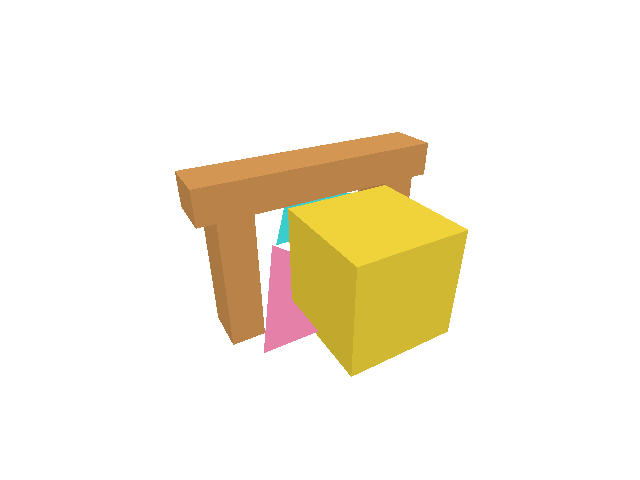
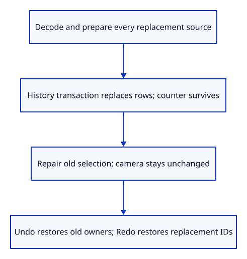

# 3.14.4 · Replace a document as one reversible change

**Chapter 3 · Documents, editing and ownership · Section 3.14 · Transactions and recovery** · [Contents](contents.md)

**Typing: 5–9 minutes.** [Estimate](typing-load.md).

Add `Action::Replace` for one reversible document replacement. First prepare the entire file with `document::load`; only then enter `History::try_edit` and replace the rows.

## Type

Continue from [Cancel reads without accepting their late result](30b-cancel.md). [Save or recover your work](recovery.md).

### 1. `src/scene.rs`

Replace rows while preserving the issued local-ID counter; the caller supplies the transaction.

<details>
<summary>Locate the existing block</summary>

```rust
    pub fn import(&mut self, loaded: crate::document::Loaded) -> Result<(), &'static str> {
```

</details>

Edit the existing block to match this code; keep unchanged lines:

```rust
--8<-- "journey/code/30c-replace-01.rs"
```

### 2. `src/editor.rs`

Name replacement explicitly instead of giving Import a hidden destructive mode. Validate every source first, then replace as one undoable transaction.

Edit these blocks from bottom to top. Keep the surrounding lines unchanged.

<details>
<summary>Locate this block</summary>

```rust
                self.selected = self.camera.ray(screen)
                    .and_then(|ray| crate::picking::pick(&self.scene, &ray));
            }
            Action::Import(bytes) => {
                let loaded = crate::document::load(&bytes)?;
                self.history.try_edit(&mut self.scene, |scene| scene.import(loaded))?;
```

</details>

Replace it with:

```rust
                self.selected = self.camera.ray(screen)
                    .and_then(|ray| crate::picking::pick(&self.scene, &ray));
            }
            Action::Replace(bytes) => {
                let loaded = crate::document::load(&bytes)?;
                self.history.try_edit(&mut self.scene, |scene| scene.replace(loaded))?;
            }
            Action::Import(bytes) => {
                let loaded = crate::document::load(&bytes)?;
                self.history.try_edit(&mut self.scene, |scene| scene.import(loaded))?;
```

<details>
<summary>Locate this block</summary>

```rust
pub enum Action {
    Pick([f32; 2]),
    Import(Vec<u8>),
    AddBox,
    Translate([f64; 3]),
    ToggleExtra,
```

</details>

Replace it with:

```rust
pub enum Action {
    Pick([f32; 2]),
    Import(Vec<u8>),
    Replace(Vec<u8>),
    AddBox,
    Translate([f64; 3]),
    ToggleExtra,
```

<details>
<summary>Complete updated block reference</summary>

```rust
use crate::{background::Background, camera::Camera, history::History, scene::{ObjectId, Scene}};

pub enum Action {
    Pick([f32; 2]),
    Import(Vec<u8>),
    Replace(Vec<u8>),
    AddBox,
    Translate([f64; 3]),
    ToggleExtra,
    SelectNext,
    Delete,
    Undo,
    Redo,
    Background,
    Zoom(f32),
    Pan(f32, f32),
    Orbit(f64, f64),
    Isometric,
    ResetView,
    Fit,
    FitSelected,
    Projection(crate::camera::Projection),
}

#[derive(Debug, PartialEq, Eq)]
pub enum Change {
    View,
    Scene,
}

pub struct Editor {
    pub scene: Scene,
    pub selected: Option<ObjectId>,
    pub camera: Camera,
    pub background: Background,
    history: History,
}

impl Default for Editor {
    fn default() -> Self {
        Self {
            scene: Scene::demo(),
            selected: None,
            camera: Camera::default(),
            background: Background::default(),
            history: History::default(),
        }
    }
}

impl Editor {
    pub fn apply(&mut self, action: Action) -> Result<Change, &'static str> {
        match action {
            Action::Pick(screen) => {
                self.selected = self.camera.ray(screen)
                    .and_then(|ray| crate::picking::pick(&self.scene, &ray));
            }
            Action::Replace(bytes) => {
                let loaded = crate::document::load(&bytes)?;
                self.history.try_edit(&mut self.scene, |scene| scene.replace(loaded))?;
            }
            Action::Import(bytes) => {
                let loaded = crate::document::load(&bytes)?;
                self.history.try_edit(&mut self.scene, |scene| scene.import(loaded))?;
            }
            Action::AddBox => {
                self.history.try_edit(&mut self.scene, |scene| scene.add_box().map(|_| ()))?;
            }
            Action::Translate(offset) => {
                let id = self.selected.ok_or("Select an object before Move")?;
                if offset.iter().all(|&v| v == 0.0) { return Ok(Change::View); }
                let object = self.scene.objects().iter().find(|o| o.id == id).ok_or("Object not found")?;
                let shift = session_rust::Xform::translation(offset[0], offset[1], offset[2]);
                let model = &shift * &object.model;
                self.history.try_edit(&mut self.scene, |scene| scene.place(id, model))?;
            }
            Action::ToggleExtra => self.history.edit(&mut self.scene, Scene::toggle_extra),
            Action::SelectNext => self.selected = self.scene.next(self.selected),
            Action::Delete => {
                if let Some(id) = self.selected.take() {
                    self.history.edit(&mut self.scene, |scene| { scene.remove(id); });
                }
            }
            Action::Undo => { self.history.undo(&mut self.scene); }
            Action::Redo => { self.history.redo(&mut self.scene); }
            view => {
                match view {
                    Action::Background => self.background.toggle(),
                    Action::Zoom(factor) => self.camera.zoom(factor),
                    Action::Pan(dx, dy) => self.camera.pan(dx, dy),
                    Action::Orbit(yaw, pitch) => self.camera.orbit(yaw, pitch),
                    Action::Isometric => self.camera.isometric(),
                    Action::Projection(mode) => self.camera.projection = mode,
                    Action::Fit => {
                        if let Some(bounds) = self.scene.bounds() {
                            self.camera.fit(&bounds);
                        }
                    }
                    Action::FitSelected => {
                        if let Some(bounds) = self.selected
                            .and_then(|id| self.scene.selected_bounds(id))
                        {
                            self.camera.fit(&bounds);
                        }
                    }
                    Action::ResetView => {
                        let aspect = self.camera.aspect;
                        self.camera = Camera { aspect, ..Camera::default() };
                    }
                    _ => unreachable!("Document actions were handled above"),
                }
                return Ok(Change::View);
            }
        }
        // Deletion and history travel can invalidate selection; repair it in one place.
        self.selected = self.selected.filter(|id| self.scene.contains(*id));
        Ok(Change::Scene)
    }
}

#[cfg(test)]
mod tests {
    use super::*;

    #[test]
    fn resetting_the_view_preserves_its_current_aspect() {
        let mut editor = Editor::default();
        editor.camera.aspect = 2.0;
        editor.apply(Action::Zoom(2.0)).unwrap();
        editor.apply(Action::ResetView).unwrap();
        assert_eq!(editor.camera.aspect, 2.0);
        assert_eq!(editor.camera.distance, 3.0);
    }

    #[test]
    fn undo_changes_the_document_without_rewinding_the_view() {
        let mut editor = Editor::default();
        editor.apply(Action::AddBox).unwrap();
        editor.apply(Action::Zoom(2.0)).unwrap();
        editor.apply(Action::Background).unwrap();
        editor.apply(Action::Undo).unwrap();
        assert_eq!(editor.scene.objects().len(), 2);
        assert_eq!(editor.camera.distance, 1.5);
        assert_eq!(editor.background.rgb(), [0.9, 0.9, 0.9]);
    }

    #[test]
    fn undo_repairs_selection_and_empty_delete_preserves_redo() {
        let mut editor = Editor::default();
        editor.apply(Action::AddBox).unwrap();
        for _ in 0..3 {
            editor.apply(Action::SelectNext).unwrap();
        }
        let box_id = editor.selected.unwrap();
        editor.apply(Action::Undo).unwrap();
        assert!(editor.selected.is_none());
        editor.apply(Action::Delete).unwrap();
        editor.apply(Action::Redo).unwrap();
        assert!(editor.scene.contains(box_id));
    }

    #[test]
    fn picking_a_moved_view_uses_the_editors_current_camera() {
        let mut editor = Editor::default();
        editor.apply(Action::Pan(0.2, 0.1)).unwrap();
        let point = session_rust::Point::new(0.2, 0.3, 0.75);
        let screen = editor.camera.view_projection().transform_point(&point);
        assert_eq!(editor.apply(Action::Pick([screen[0] as f32, screen[1] as f32])).unwrap(), Change::Scene);
        assert_eq!(editor.selected, Some(editor.scene.objects()[1].id));
        assert_eq!(editor.apply(Action::Zoom(2.0)).unwrap(), Change::View);
    }
}
```

</details>

<details>
<summary>Optional patch references</summary>

Use these original edit fragments when comparing a saved checkpoint. Apply the complete blocks above.

```text
--8<-- "journey/code/30c-replace-02.rs"
```

```text
--8<-- "journey/code/30c-replace-03.rs"
```

</details>

<details>
<summary>Supplied validation fixture</summary>

Copy this supplied authoring fixture once. Continue with the browser build below; the course does not require running native tests.

### 3. `src/replace_tests.rs`

Optional authoring fixture. Prove replacement/Undo/Redo preserve owners, camera state and non-reused local IDs.

Copy this supplied file:

```text
--8<-- "journey/code/30c-replace-04.rs"
```

</details>

### 4. `src/lib.rs`

Compile the replacement contract.

<details>
<summary>Locate the existing block</summary>

```rust
#[cfg(test)]
mod save_roundtrip_tests;
```

</details>

After that block, type:

```rust
--8<-- "journey/code/30c-replace-05.rs" skip=39
```

## Run and check

In your project:

```sh
cd workspace/journey
REGEN_PROTO=0 cargo build --lib --locked --target wasm32-unknown-unknown -j1
REGEN_PROTO=0 CARGO_BUILD_JOBS=1 trunk serve --port 8780
```

Open `http://127.0.0.1:8780/`. Keep an existing Trunk server running; saving rebuilds it.

Run the replacement checks below. A valid replacement is one Undo step; an invalid candidate must leave the existing scene unchanged. The browser command is connected next.

### Recorded visual result

**Previous native render — current verification pending.**



*This recorded image predates a source or checker change. Rebuild this checkpoint before using it as current evidence; browser controls require separate acceptance.*

<details>
<summary>Code explanation and diagram</summary>

`Scene::replace` clears objects and the demo marker, then inserts prepared objects. Keep the ID counter advancing. The transaction restores the old scene if insertion fails partway through.

Repair selection after success. Camera, projection and background remain outside document history. Undo restores the old shared owners; Redo restores the replacement objects.

This step tests the editor operation; browser Open is still append-only until the next lesson. Old objects retained by Undo remain alive and are accounted for later.

Replacement bytes → validated prepared sources → history transaction → new rows with fresh local IDs.



Why must the scene counter survive replacing all its rows?

A replacement must not reuse local IDs held by old selection or delayed work. Clearing rows leaves the increasing counter intact. History restoration also retains the highest issued value, while Undo restores the old objects and shared source allocations.

Study estimate, including typing and experiments: 1–2 hours.

</details>

<details>
<summary>Optional experiment</summary>

In the replacement check, change camera distance and aspect before replacing. Predict why Undo and Redo preserve both values. Explain why setting next_id back to one would make an old selection unsafe.

</details>

<details>
<summary>Check and save your work</summary>

Restore experimental edits, then run from `session_viewer`:

```sh
npm --prefix ../session_tests run course -- check 3.14.4
npm --prefix ../session_tests run course -- save 3.14.4
```

Source comparison leaves your project untouched. [Save and recovery instructions](recovery.md).

</details>

<details>
<summary>Viewer coverage and verification</summary>

Production replacement stages a new scene before committing and preserves the last valid scene on failure. This flat editor teaches the same atomic boundary; browser cancellation, larger sources and resource release are separate concerns.


[Full validation scope](release.md).

To reproduce the scripted acceptance of the reference checkpoint, run from `session_viewer` with the [course bundle server](release.md#reproduce) running on port 8781:

```sh
npm --prefix ../session_tests run course -- capture 3.14.4
```

This uses the verified reference bundle; it does not check or change your typed project.

</details>
