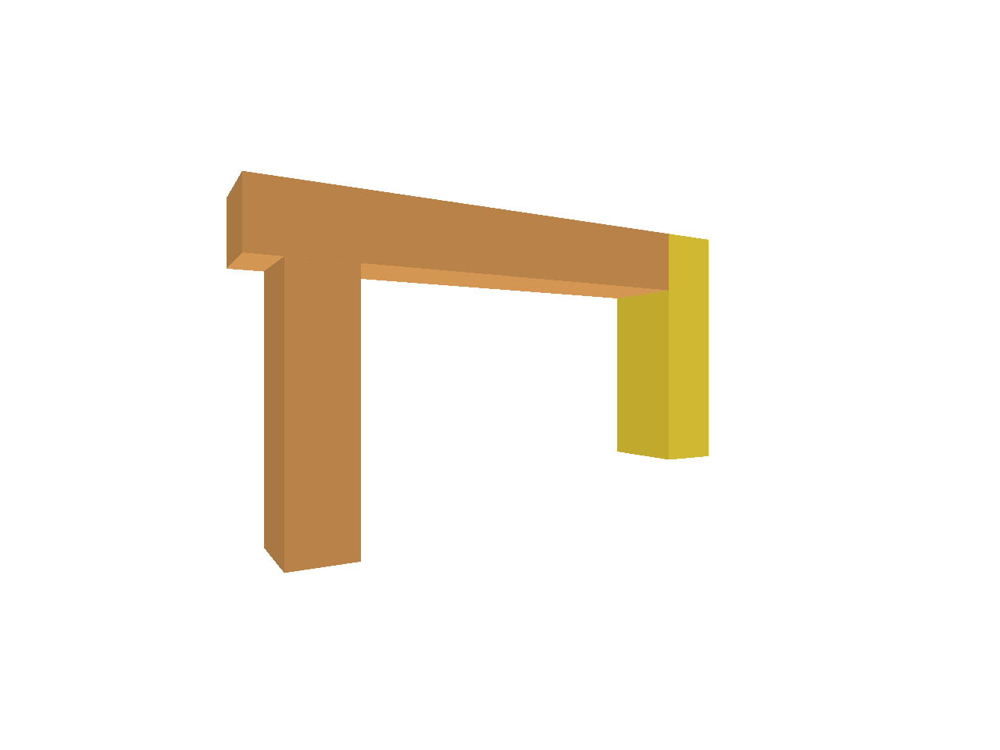
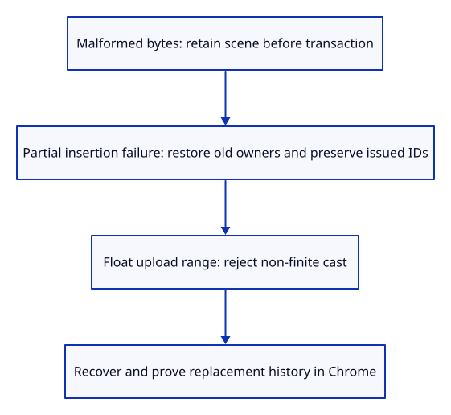

# 3.14.6 · Prove recovery at the transaction and display boundaries

**Chapter 3 · Documents, editing and ownership · Section 3.14 · Transactions and recovery** · [Contents](contents.md)

**Typing: 10–20 minutes.** [Estimate](typing-load.md).

Test a replacement failure after insertion starts, not only malformed bytes before mutation. Put the object-ID counter one below its limit: one insertion succeeds and the next fails.

## Type

Continue from [Choose append or replace before opening the picker](30d-bridge.md). [Save or recover your work](recovery.md).

### 1. `src/placement.rs`

Reject a finite double coefficient that cannot enter the current float uniform.

<details>
<summary>Locate the existing block</summary>

```rust
    matrix.len() == 16 && matrix.iter().all(|value| value.is_finite())
```

</details>

Edit the existing block to match this code; keep unchanged lines:

```rust
    matrix.len() == 16 && matrix.iter().all(|value| value.is_finite() && (*value as f32).is_finite())
```

<details>
<summary>Optional patch references</summary>

Use these original edit fragments when comparing a saved checkpoint. Apply the complete blocks above.

```text
--8<-- "journey/code/30e-recovery-01.rs"
```

</details>

### 2. `src/scene.rs`

State the full placement boundary in its error. Fail during the second insertion, then prove rollback restores the old allocations without recycling issued IDs.

Edit these blocks from bottom to top. Keep the surrounding lines unchanged.

<details>
<summary>Locate this block</summary>

```rust
    use super::*;

    #[test]
    fn removal_moves_a_row_without_changing_its_identity() {
        let mut scene = Scene::demo();
        let first = scene.objects()[0].id;
```

</details>

Replace it with:

```rust
    use super::*;

    #[test]
    fn partial_replacement_failure_restores_owners_without_reusing_ids() {
        let mut scene = Scene::demo();
        let before = scene.objects.clone();
        scene.next_id = u32::MAX - 1;
        let loaded = crate::document::load(&crate::specimen::bytes()).unwrap();
        let mut history = crate::history::History::default();
        assert!(history.try_edit(&mut scene, |scene| scene.replace(loaded)).is_err());
        assert_eq!(scene.next_id, u32::MAX);
        assert_eq!(scene.objects.len(), before.len());
        for (object, old) in scene.objects.iter().zip(&before) {
            assert_eq!(object.id, old.id);
            assert!(Rc::ptr_eq(&object.geometry, &old.geometry));
            assert!(Rc::ptr_eq(&object.mesh, &old.mesh));
        }
        assert!(!history.undo(&mut scene));
    }

    #[test]
    fn removal_moves_a_row_without_changing_its_identity() {
        let mut scene = Scene::demo();
        let first = scene.objects()[0].id;
```

<details>
<summary>Locate this block</summary>

```rust
    pub fn place(&mut self, id: ObjectId, model: session_rust::Xform) -> Result<(), &'static str> {
        if !crate::placement::valid(&model.m)
        {
            return Err("Placement must be finite and affine");
        }
        let object = self.objects.iter_mut().find(|o| o.id == id).ok_or("Object not found")?;
        object.model = model;
```

</details>

Replace it with:

```rust
    pub fn place(&mut self, id: ObjectId, model: session_rust::Xform) -> Result<(), &'static str> {
        if !crate::placement::valid(&model.m)
        {
            return Err("Placement must be finite, affine and fit the display range");
        }
        let object = self.objects.iter_mut().find(|o| o.id == id).ok_or("Object not found")?;
        object.model = model;
```

<details>
<summary>Complete updated block reference</summary>

```rust
use crate::{mesh::Mesh, prepared::PreparedMesh};
use std::rc::Rc;

#[derive(Clone, Copy, Debug, PartialEq, Eq)]
pub struct ObjectId(u32);

#[derive(Clone)]
pub struct Object {
    pub id: ObjectId,
    pub guid: String,
    pub mesh: Rc<Mesh>,
    pub geometry: Rc<session_rust::Mesh>,
    pub model: session_rust::Xform,
    pub source: Option<crate::document::Source>,
}

impl Object {
    pub fn world_point(&self, vertex: [f32; 6]) -> [f64; 3] {
        let local = session_rust::Point::new(vertex[0] as f64, vertex[1] as f64, vertex[2] as f64);
        let world = self.model.transform_point(&local);
        [world[0], world[1], world[2]]
    }
}

#[derive(Clone)]
pub struct Scene {
    objects: Vec<Object>,
    next_id: u32,
    extra: Option<ObjectId>,
}

impl Scene {
    pub fn demo() -> Self {
        let pink = PreparedMesh::triangle([
            [-0.7, -0.6, 0.25], [0.5, -0.6, 0.25], [-0.1, 0.6, 0.25],
        ], [0.9, 0.25, 0.45]).expect("Valid pink triangle");
        let turquoise = PreparedMesh::triangle([
            [-0.4, -0.2, 0.75], [0.8, -0.2, 0.75], [0.2, 0.8, 0.75],
        ], [0.05, 0.7, 0.7]).expect("Valid turquoise triangle");
        let mut scene = Self { objects: Vec::new(), next_id: 1, extra: None };
        scene.insert(pink).expect("ID available");
        scene.insert(turquoise).expect("ID available");
        scene
    }

    pub fn restore(&mut self, mut saved: Self) {
        saved.next_id = saved.next_id.max(self.next_id);
        *self = saved;
    }

    pub fn bounds(&self) -> Option<crate::bounds::Bounds> {
        let mut bounds: Option<crate::bounds::Bounds> = None;
        for object in &self.objects {
            for vertex in object.mesh.vertices() {
                let point = object.world_point(*vertex);
                match &mut bounds {
                    Some(bounds) => bounds.include(point),
                    None => bounds = Some(crate::bounds::Bounds::point(point)),
                }
            }
        }
        bounds
    }

    pub fn selected_bounds(&self, id: ObjectId) -> Option<crate::bounds::Bounds> {
        let object = self.objects.iter().find(|object| object.id == id)?;
        let mut vertices = object.mesh.vertices().iter();
        let first = vertices.next()?;
        let mut bounds = crate::bounds::Bounds::point(object.world_point(*first));
        for vertex in vertices {
            bounds.include(object.world_point(*vertex));
        }
        Some(bounds)
    }

    pub fn objects(&self) -> &[Object] {
        &self.objects
    }

    pub fn insert(&mut self, prepared: PreparedMesh) -> Result<ObjectId, &'static str> {
        let next = self.next_id.checked_add(1).ok_or("Object IDs exhausted")?;
        let id = ObjectId(self.next_id);
        self.next_id = next;
        let mut guid = prepared.geometry.guid().to_owned();
        while self.objects.iter().any(|object| object.guid == guid) {
            guid = uuid::Uuid::new_v4().to_string();
        }
        self.objects.push(Object { id, guid, mesh: Rc::new(prepared.display), geometry: prepared.geometry,
            model: prepared.model, source: prepared.source });
        Ok(id)
    }

    pub fn replace(&mut self, loaded: crate::document::Loaded) -> Result<(), &'static str> {
        self.objects.clear();
        self.extra = None;
        self.import(loaded)
    }

    pub fn import(&mut self, loaded: crate::document::Loaded) -> Result<(), &'static str> {
        for prepared in loaded.meshes {
            self.insert(prepared)?;
        }
        Ok(())
    }

    pub fn place(&mut self, id: ObjectId, model: session_rust::Xform) -> Result<(), &'static str> {
        if !crate::placement::valid(&model.m)
        {
            return Err("Placement must be finite, affine and fit the display range");
        }
        let object = self.objects.iter_mut().find(|o| o.id == id).ok_or("Object not found")?;
        object.model = model;
        Ok(())
    }

    pub fn remove(&mut self, id: ObjectId) -> bool {
        let Some(index) = self.objects.iter().position(|object| object.id == id) else { return false; };
        self.objects.remove(index);
        if self.extra == Some(id) {
            self.extra = None;
        }
        true
    }

    pub fn contains(&self, id: ObjectId) -> bool {
        self.objects.iter().any(|object| object.id == id)
    }

    pub fn next(&self, current: Option<ObjectId>) -> Option<ObjectId> {
        if self.objects.is_empty() {
            return None;
        }
        let index = self.objects.iter().position(|object| Some(object.id) == current)
            .map_or(0, |index| index + 1);
        Some(self.objects[index % self.objects.len()].id)
    }

    pub fn add_box(&mut self) -> Result<ObjectId, &'static str> {
        let mut source = session_rust::Mesh::create_box(0.8, 0.8, 0.8);
        source.set_objectcolor(session_rust::Color::new(0.65, 0.65, 0.65, 1.0));
        let id = self.insert(PreparedMesh::new(source)?)?;
        self.place(id, session_rust::Xform::translation(0.9, 0.0, 0.4))?;
        Ok(id)
    }

    pub fn toggle_extra(&mut self) {
        if let Some(id) = self.extra.take() {
            self.remove(id);
        } else {
            let extra = PreparedMesh::triangle([
                [-0.9, 0.3, 0.5], [-0.4, 0.3, 0.5], [-0.65, 0.9, 0.5],
            ], [0.2, 0.8, 0.3]).expect("Valid extra triangle");
            self.extra = Some(self.insert(extra).expect("ID available"));
        }
    }
}

#[cfg(test)]
mod tests {
    use super::*;

    #[test]
    fn partial_replacement_failure_restores_owners_without_reusing_ids() {
        let mut scene = Scene::demo();
        let before = scene.objects.clone();
        scene.next_id = u32::MAX - 1;
        let loaded = crate::document::load(&crate::specimen::bytes()).unwrap();
        let mut history = crate::history::History::default();
        assert!(history.try_edit(&mut scene, |scene| scene.replace(loaded)).is_err());
        assert_eq!(scene.next_id, u32::MAX);
        assert_eq!(scene.objects.len(), before.len());
        for (object, old) in scene.objects.iter().zip(&before) {
            assert_eq!(object.id, old.id);
            assert!(Rc::ptr_eq(&object.geometry, &old.geometry));
            assert!(Rc::ptr_eq(&object.mesh, &old.mesh));
        }
        assert!(!history.undo(&mut scene));
    }

    #[test]
    fn removal_moves_a_row_without_changing_its_identity() {
        let mut scene = Scene::demo();
        let first = scene.objects()[0].id;
        let second = scene.objects()[1].id;
        assert!(scene.remove(first));
        assert_eq!(scene.objects()[0].id, second);
        assert_eq!(scene.next(None), Some(second));
        assert!(!scene.contains(first));
        scene.toggle_extra();
        assert_ne!(scene.objects()[1].id, first);
        assert_ne!(scene.objects()[1].id, second);
    }

    #[test]
    fn toggling_the_extra_object_uses_its_id_after_other_removals() {
        let mut scene = Scene::demo();
        scene.toggle_extra();
        let extra = scene.objects()[2].id;
        scene.remove(scene.objects()[0].id);
        scene.toggle_extra();
        assert!(!scene.contains(extra));
        assert_eq!(scene.objects().len(), 1);
    }
}
```

</details>

<details>
<summary>Optional patch references</summary>

Use these original edit fragments when comparing a saved checkpoint. Apply the complete blocks above.

```text
--8<-- "journey/code/30e-recovery-02.rs"
```

```text
--8<-- "journey/code/30e-recovery-03.rs"
```

</details>

<details>
<summary>Supplied validation fixture</summary>

Copy this supplied authoring fixture once. Continue with the browser build below; the course does not require running native tests.

### 3. `src/replace_tests.rs`

Optional authoring fixture. Test refusal before mutation, selection/Redo retention and the double-to-float upload boundary.

<details>
<summary>Locate the existing block</summary>

```text
    assert_eq!((editor.camera.distance, editor.camera.aspect), (7.0, 2.0));
}
```

</details>

After that block, append this supplied code:

```text
--8<-- "journey/code/30e-recovery-04.rs" skip=78
```

</details>

## Run and check

In your project:

```sh
cd workspace/journey
REGEN_PROTO=0 cargo build --lib --locked --target wasm32-unknown-unknown -j1
REGEN_PROTO=0 CARGO_BUILD_JOBS=1 trunk serve --port 8780
```

Open `http://127.0.0.1:8780/`. Keep an existing Trunk server running; saving rebuilds it.

Run the recovery checks below. A replacement that fails on its second mesh must preserve the whole previous scene and its Redo branch.

### Recorded visual result

**Previous native render — current verification pending.**



*This recorded image predates a source or checker change. Rebuild this checkpoint before using it as current evidence; browser controls require separate acceptance.*

<details>
<summary>Code explanation and diagram</summary>

History must restore every old row and allocation while retaining the highest issued counter. IDs from failed work must not be reused. A separate malformed-replacement test preserves selection and Redo.

Also reject placement coefficients that are finite as doubles but become infinity in the current float upload. `f64::MAX` demonstrates this boundary for direct placement and encoded files. Keep the previous placement untouched. This limits the display adapter without reducing retained source precision.

Malformed source or failed insertion → retained old owners and history; double matrix → finite float upload check.



Why do we need a failure after the first new row was inserted?

Malformed decoding fails before a transaction starts. It does not test rollback after mutation. Exhausting the ID counter during the second insertion proves History::try_edit restores old rows and shared owners after a partial replacement, while retaining the highest issued counter so failed work cannot cause ID reuse.

Study estimate, including typing and experiments: 1–2 hours.

</details>

<details>
<summary>Optional experiment</summary>

Temporarily remove History::try_edit from the partial-replacement check. Predict why the old scene disappears when the second insertion fails. Restore the transaction. Then compare f64::MAX with its float cast before reading the range-check answer.

</details>

<details>
<summary>Check and save your work</summary>

Restore experimental edits, then run from `session_viewer`:

```sh
npm --prefix ../session_tests run course -- check 3.14.6
npm --prefix ../session_tests run course -- save 3.14.6
```

Source comparison leaves your project untouched. [Save and recovery instructions](recovery.md).

</details>

<details>
<summary>Viewer coverage and verification</summary>

Production recovery preserves the last valid scene and checks display representations separately from editable source data. This endpoint proves those boundaries for the current flat mesh editor; full geometry, streaming and coordinate rebasing remain later lessons.

Chrome repeats the file errors, cancelled newer picker, replacement and Undo/Redo checks against this final endpoint. It also forces adapter unavailability before startup, checks the visible failure fallback, then reloads and restores a working viewer. Its screenshot shows the replaced frame, with an independently moved right post. Native frame checks distinguish selected gold from timber brown rather than treating both as selection.

[Full validation scope](release.md).

To reproduce the scripted acceptance of the reference checkpoint, run from `session_viewer` with the [course bundle server](release.md#reproduce) running on port 8781:

```sh
npm --prefix ../session_tests run course -- capture 3.14.6
```

This uses the verified reference bundle; it does not check or change your typed project.

</details>
