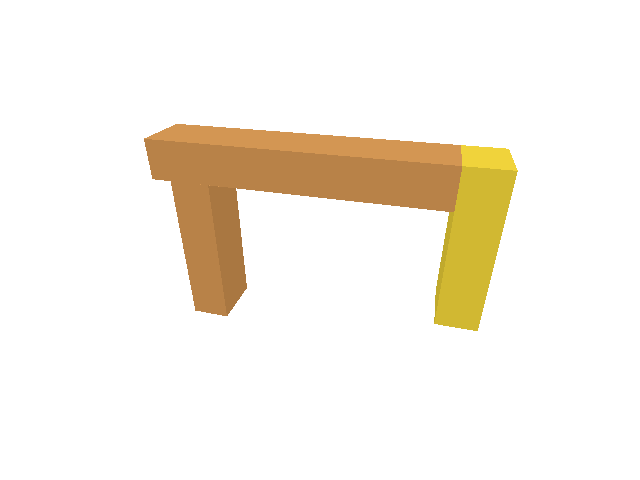
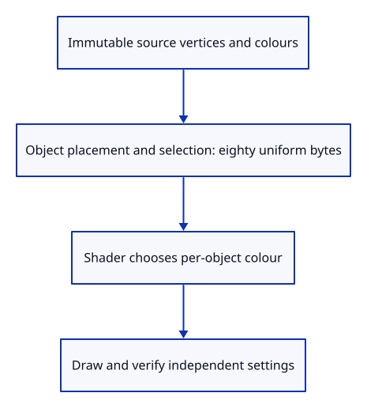

# 3.15.1 · Keep selection out of the vertex data

**Chapter 3 · Documents, editing and ownership · Section 3.15 · Incremental GPU settings** · [Contents](contents.md)

**Typing: 8–15 minutes.** [Estimate](typing-load.md).

Our renderer currently copies gold into every selected vertex during upload. That makes selection part of geometry storage. Before sharing any buffers, separate those two responsibilities.

## Type

Continue from [Prove recovery at the transaction and display boundaries](30e-recovery.md). [Save or recover your work](recovery.md).

### 1. `src/gpu_mesh.rs`

Upload original vertex colours regardless of which object is selected. Use one encoder for the complete object uniform. Encode the matrix, selection and padding at their shader offsets.

<details>
<summary>Locate the existing block</summary>

```rust
use crate::scene::Object;
use wgpu::util::DeviceExt;

pub struct GpuMesh {
    vertices: wgpu::Buffer,
    indices: wgpu::Buffer,
    index_count: u32,
    model_group: wgpu::BindGroup,
}

impl GpuMesh {
    pub fn upload(device: &wgpu::Device, layout: &wgpu::BindGroupLayout, object: &Object, selected: bool) -> Self {
        let mesh = &object.mesh;
        let mut bytes = Vec::with_capacity(mesh.vertices().len() * 24);
        for vertex in mesh.vertices() {
            let mut display = *vertex;
            if selected {
                display[3..].copy_from_slice(&[1.0, 0.75, 0.05]);
            }
            for value in display {
                bytes.extend_from_slice(&value.to_ne_bytes());
            }
        }
        let vertices = device.create_buffer_init(&wgpu::util::BufferInitDescriptor {
            label: Some("mesh vertices"),
            contents: &bytes,
            usage: wgpu::BufferUsages::VERTEX,
        });
        let bytes: Vec<u8> = mesh.indices().iter().flat_map(|index| index.to_ne_bytes()).collect();
        let indices = device.create_buffer_init(&wgpu::util::BufferInitDescriptor {
            label: Some("mesh indices"),
            contents: &bytes,
            usage: wgpu::BufferUsages::INDEX,
        });
        let bytes: Vec<u8> = object.model.m.iter()
            .flat_map(|value| (*value as f32).to_ne_bytes()).collect();
        let model = device.create_buffer_init(&wgpu::util::BufferInitDescriptor {
            label: Some("object placement"),
            contents: &bytes,
            usage: wgpu::BufferUsages::UNIFORM,
        });
        let model_group = device.create_bind_group(&wgpu::BindGroupDescriptor {
            label: Some("object placement"),
            layout,
            entries: &[wgpu::BindGroupEntry { binding: 0, resource: model.as_entire_binding() }],
        });
        Self { vertices, indices, model_group, index_count: mesh.indices().len() as u32 }
    }

    pub fn draw(&self, pass: &mut wgpu::RenderPass<'_>) {
        pass.set_bind_group(1, &self.model_group, &[]);
        pass.set_vertex_buffer(0, self.vertices.slice(..));
        pass.set_index_buffer(self.indices.slice(..), wgpu::IndexFormat::Uint16);
        pass.draw_indexed(0..self.index_count, 0, 0..1);
    }
}
```

</details>

Edit the existing block to match this code; keep unchanged lines:

```rust
use crate::scene::Object;
use wgpu::util::DeviceExt;

pub struct GpuMesh {
    vertices: wgpu::Buffer,
    indices: wgpu::Buffer,
    index_count: u32,
    model_group: wgpu::BindGroup,
}

fn settings(object: &Object, selected: bool) -> [u8; 80] {
    let mut bytes = [0; 80];
    for (index, value) in object.model.m.iter().enumerate() {
        bytes[index * 4..index * 4 + 4].copy_from_slice(&(*value as f32).to_ne_bytes());
    }
    let flag: f32 = if selected { 1.0 } else { 0.0 };
    bytes[64..68].copy_from_slice(&flag.to_ne_bytes());
    bytes
}

impl GpuMesh {
    pub fn upload(device: &wgpu::Device, layout: &wgpu::BindGroupLayout, object: &Object, selected: bool) -> Self {
        let mesh = &object.mesh;
        let mut bytes = Vec::with_capacity(mesh.vertices().len() * 24);
        for vertex in mesh.vertices() {
            for value in vertex {
                bytes.extend_from_slice(&value.to_ne_bytes());
            }
        }
        let vertices = device.create_buffer_init(&wgpu::util::BufferInitDescriptor {
            label: Some("mesh vertices"),
            contents: &bytes,
            usage: wgpu::BufferUsages::VERTEX,
        });
        let bytes: Vec<u8> = mesh.indices().iter().flat_map(|index| index.to_ne_bytes()).collect();
        let indices = device.create_buffer_init(&wgpu::util::BufferInitDescriptor {
            label: Some("mesh indices"),
            contents: &bytes,
            usage: wgpu::BufferUsages::INDEX,
        });
        let bytes = settings(object, selected);
        let model = device.create_buffer_init(&wgpu::util::BufferInitDescriptor {
            label: Some("object placement"),
            contents: &bytes,
            usage: wgpu::BufferUsages::UNIFORM,
        });
        let model_group = device.create_bind_group(&wgpu::BindGroupDescriptor {
            label: Some("object placement"),
            layout,
            entries: &[wgpu::BindGroupEntry { binding: 0, resource: model.as_entire_binding() }],
        });
        Self { vertices, indices, model_group, index_count: mesh.indices().len() as u32 }
    }

    pub fn draw(&self, pass: &mut wgpu::RenderPass<'_>) {
        pass.set_bind_group(1, &self.model_group, &[]);
        pass.set_vertex_buffer(0, self.vertices.slice(..));
        pass.set_index_buffer(self.indices.slice(..), wgpu::IndexFormat::Uint16);
        pass.draw_indexed(0..self.index_count, 0, 0..1);
    }
}
```

<details>
<summary>Optional patch references</summary>

Use these original edit fragments when comparing a saved checkpoint. Apply the complete blocks above.

```text
--8<-- "journey/code/31-settings-01.rs"
```

```text
--8<-- "journey/code/31-settings-02.rs"
```

```text
--8<-- "journey/code/31-settings-03.rs"
```

</details>

### 2. `src/triangle.wgsl`

Describe the same eighty-byte object layout in WGSL. Read placement from the object settings structure. Choose the displayed colour per object without rewriting vertices.

<details>
<summary>Locate the existing block</summary>

```wgsl
@group(0) @binding(0) var<uniform> transform: mat4x4<f32>;
@group(1) @binding(0) var<uniform> model: mat4x4<f32>;

struct VertexOutput {
    @builtin(position) position: vec4<f32>,
    @location(0) colour: vec3<f32>,
    @location(1) world: vec3<f32>,
}

@vertex
fn vertex(@location(0) position: vec3<f32>, @location(1) colour: vec3<f32>) -> VertexOutput {
    var output: VertexOutput;
    let world = model * vec4<f32>(position, 1.0);
    output.position = transform * world;
    output.colour = colour;
    output.world = world.xyz;
    return output;
}

@fragment
fn fragment(input: VertexOutput) -> @location(0) vec4<f32> {
    // Neighbouring fragments give two directions along this triangle's surface.
    let normal = normalize(cross(dpdx(input.world), dpdy(input.world)));
    let light = normalize(vec3<f32>(0.4, -0.6, 1.0));
    // abs lights both sides of an open face; 0.3 keeps unlit faces readable.
    let brightness = 0.3 + 0.7 * abs(dot(normal, light));
    return vec4<f32>(input.colour * brightness, 1.0);
}
```

</details>

Edit the existing block to match this code; keep unchanged lines:

```wgsl
@group(0) @binding(0) var<uniform> transform: mat4x4<f32>;
struct ObjectSettings {
    model: mat4x4<f32>,
    selection: vec4<f32>,
}
@group(1) @binding(0) var<uniform> object: ObjectSettings;

struct VertexOutput {
    @builtin(position) position: vec4<f32>,
    @location(0) colour: vec3<f32>,
    @location(1) world: vec3<f32>,
}

@vertex
fn vertex(@location(0) position: vec3<f32>, @location(1) colour: vec3<f32>) -> VertexOutput {
    var output: VertexOutput;
    let world = object.model * vec4<f32>(position, 1.0);
    output.position = transform * world;
    output.colour = select(colour, vec3<f32>(1.0, 0.75, 0.05), object.selection.x > 0.5);
    output.world = world.xyz;
    return output;
}

@fragment
fn fragment(input: VertexOutput) -> @location(0) vec4<f32> {
    // Neighbouring fragments give two directions along this triangle's surface.
    let normal = normalize(cross(dpdx(input.world), dpdy(input.world)));
    let light = normalize(vec3<f32>(0.4, -0.6, 1.0));
    // abs lights both sides of an open face; 0.3 keeps unlit faces readable.
    let brightness = 0.3 + 0.7 * abs(dot(normal, light));
    return vec4<f32>(input.colour * brightness, 1.0);
}
```

<details>
<summary>Optional patch references</summary>

Use these original edit fragments when comparing a saved checkpoint. Apply the complete blocks above.

```text
--8<-- "journey/code/31-settings-04.wgsl"
```

```text
--8<-- "journey/code/31-settings-05.wgsl"
```

```text
--8<-- "journey/code/31-settings-06.wgsl"
```

</details>

## Run and check

In your project:

```sh
cd workspace/journey
REGEN_PROTO=0 cargo build --lib --locked --target wasm32-unknown-unknown -j1
REGEN_PROTO=0 CARGO_BUILD_JOBS=1 trunk serve --port 8780
```

Open `http://127.0.0.1:8780/`. Keep an existing Trunk server running; saving rebuilds it.

Select an object and move it. Its colour and placement now come from an object uniform; the original vertex colours and positions stay unchanged.

### Recorded visual result

**Previous native render — current verification pending.**

The native GPU draws retained source geometry with placement and selection settings; world picking and selected pixels agree.



*This recorded image predates a source or checker change. Rebuild this checkpoint before using it as current evidence; browser controls require separate acceptance.*

<details>
<summary>Code explanation and diagram</summary>

The first sixty-four bytes still contain the placement matrix. The next sixteen bytes form a vec4 selection field: its first float is one or zero and its remaining floats are zero. We pack all eighty bytes explicitly rather than depending on the layout of a Rust struct.

The [WGSL layout rules](https://www.w3.org/TR/WGSL/#alignment-and-size) align both a matrix and a vec4 to sixteen bytes. A four-column matrix occupies sixty-four bytes, so the following field begins at byte sixty-four and the complete uniform occupies eighty.

The shader multiplies by object.model and uses object.selection.x to choose the original colour or our existing gold. Lighting still runs after that choice. Source geometry and its colour values do not change when selection changes.

This endpoint still rebuilds GPU rows after every scene change. It establishes the data boundary; the following lessons change ownership and reuse.

Object placement and selection → eighty uniform bytes → vertex shader; source colours stay unchanged.



Why must selection move before we can share one vertex buffer?

Two objects can use the same geometry while only one is selected. A gold colour written into their shared vertices would affect both. Keep immutable source colours in the vertex buffer and choose the displayed colour from each object’s uniform.

Study estimate, including typing and experiments: 1–2 hours.

</details>

<details>
<summary>Optional experiment</summary>

Temporarily put the selection flag at byte sixty-eight while leaving the shader field unchanged. Predict why the first selection component remains zero. Restore byte sixty-four before continuing.

</details>

<details>
<summary>Check and save your work</summary>

Restore experimental edits, then run from `session_viewer`:

```sh
npm --prefix ../session_tests run course -- check 3.15.1
npm --prefix ../session_tests run course -- save 3.15.1
```

Source comparison leaves your project untouched. [Save and recovery instructions](recovery.md).

</details>

<details>
<summary>Viewer coverage and verification</summary>

Object presentation must stay separate from shared geometry in the production renderer, including selection, opacity and other display flags. This uniform introduces that boundary without claiming the later rendering modes are complete.


[Full validation scope](release.md).

To reproduce the scripted acceptance of the reference checkpoint, run from `session_viewer` with the [course bundle server](release.md#reproduce) running on port 8781:

```sh
npm --prefix ../session_tests run course -- capture 3.15.1
```

This uses the verified reference bundle; it does not check or change your typed project.

</details>
