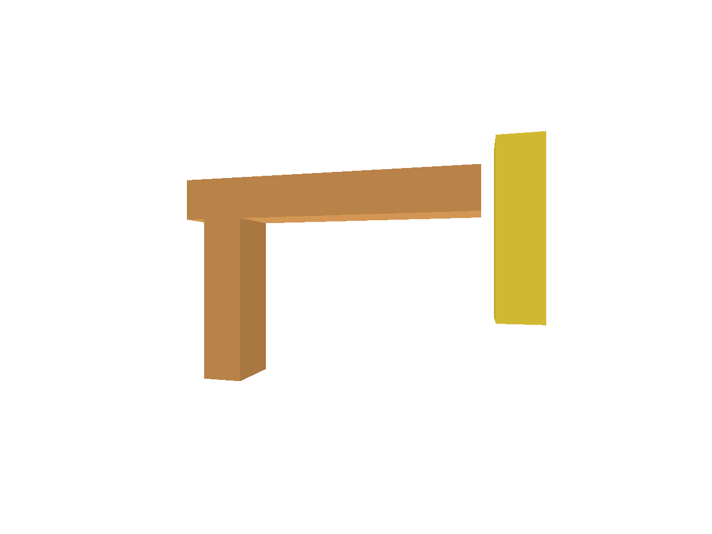
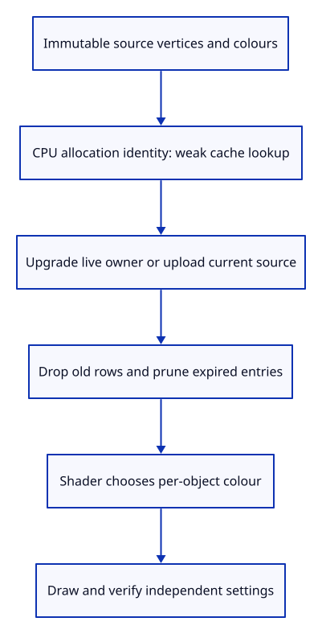

# 3.15.3 · Reuse uploads while their geometry is alive

**Chapter 3 · Documents, editing and ownership · Section 3.15 · Incremental GPU settings** · [Contents](contents.md)

**Typing: 20–40 minutes.** [Estimate](typing-load.md).

Now the renderer can ask for an existing upload before creating buffers. GeometryCache maps a CPU display address to Weak<GpuGeometry>. The pointer is an identity key only: we never dereference it.

## Type

Continue from [Give immutable GPU geometry one owner](31a-geometry.md). [Save or recover your work](recovery.md).

### 1. `src/geometry_cache.rs`

Keep weak cache entries and cumulative upload evidence without pinning unused GPU buffers.

Create the file and type:

```rust
--8<-- "journey/code/31b-cache-01.rs"
```

### 2. `src/lib.rs`

Expose the geometry cache to the renderer.

<details>
<summary>Locate the existing block</summary>

```rust
pub mod gpu_geometry;
```

</details>

Edit the existing block to match this code; keep unchanged lines:

```rust
--8<-- "journey/code/31b-cache-02.rs"
```

### 3. `src/renderer.rs`

Keep geometry reuse and object allocation counts with the renderer. Let the same scene synchronization populate startup rows. Initialize startup through the same ownership path as later edits. Reuse live geometry before replacing the old GPU rows, then prune dead weak entries. Report cumulative geometry uploads, settings allocations and the reserved write counters.

Edit these blocks from bottom to top. Keep the surrounding lines unchanged.

<details>
<summary>Locate this block</summary>

```rust

    pub fn set_scene(&mut self, scene: &Scene, selected: Option<ObjectId>) {
        let layout = self.pipeline.get_bind_group_layout(1);
        self.meshes = scene.objects().iter().map(|object| {
            GpuMesh::upload(&self.device, &layout, object, selected == Some(object.id))
        }).collect();
    }

    pub fn draw(
```

</details>

Replace it with:

```rust

    pub fn set_scene(&mut self, scene: &Scene, selected: Option<ObjectId>) {
        let layout = self.pipeline.get_bind_group_layout(1);
        let mut meshes = Vec::with_capacity(scene.objects().len());
        for object in scene.objects() {
            let geometry = self.geometry.get(&self.device, &object.mesh);
            meshes.push(GpuMesh::with_geometry(&self.device, &layout, object,
                selected == Some(object.id), geometry));
            self.settings_allocations += 1;
        }
        self.meshes = meshes;
        self.geometry.prune();
    }

    pub fn stats(&self) -> [usize; 4] {
        [self.geometry.uploads, self.settings_allocations, 0, 0]
    }

    pub fn draw(
```

<details>
<summary>Locate this block</summary>

```rust
            }],
        });
        let depth = Self::depth(&device, 640, 480);
        Self { device, queue, pipeline, meshes, uniform, view_group, depth }
    }

    fn depth(device: &wgpu::Device, width: u32, height: u32) -> wgpu::TextureView {
```

</details>

Replace it with:

```rust
            }],
        });
        let depth = Self::depth(&device, 640, 480);
        let mut renderer = Self { device, queue, pipeline, meshes: Vec::new(),
            geometry: Default::default(), settings_allocations: 0, uniform, view_group, depth };
        renderer.set_scene(scene, None);
        renderer
    }

    fn depth(device: &wgpu::Device, width: u32, height: u32) -> wgpu::TextureView {
```

<details>
<summary>Locate this block</summary>

```rust
            multiview_mask: None,
            cache: None,
        });
        let layout = pipeline.get_bind_group_layout(1);
        let meshes = scene.objects().iter()
            .map(|object| GpuMesh::upload(&device, &layout, object, false)).collect();
        let uniform = device.create_buffer(&wgpu::BufferDescriptor {
            label: Some("view transform"),
            size: 64,
```

</details>

Replace it with:

```rust
            multiview_mask: None,
            cache: None,
        });
        let uniform = device.create_buffer(&wgpu::BufferDescriptor {
            label: Some("view transform"),
            size: 64,
```

<details>
<summary>Locate this block</summary>

```rust
    pub queue: wgpu::Queue,
    pipeline: wgpu::RenderPipeline,
    meshes: Vec<GpuMesh>,
    uniform: wgpu::Buffer,
    view_group: wgpu::BindGroup,
    depth: wgpu::TextureView,
```

</details>

Replace it with:

```rust
    pub queue: wgpu::Queue,
    pipeline: wgpu::RenderPipeline,
    meshes: Vec<GpuMesh>,
    geometry: crate::geometry_cache::GeometryCache,
    settings_allocations: usize,
    uniform: wgpu::Buffer,
    view_group: wgpu::BindGroup,
    depth: wgpu::TextureView,
```

<details>
<summary>Complete updated block reference</summary>

```rust
use crate::{gpu_mesh::GpuMesh, scene::{ObjectId, Scene}};

pub struct Renderer {
    pub device: wgpu::Device,
    pub queue: wgpu::Queue,
    pipeline: wgpu::RenderPipeline,
    meshes: Vec<GpuMesh>,
    geometry: crate::geometry_cache::GeometryCache,
    settings_allocations: usize,
    uniform: wgpu::Buffer,
    view_group: wgpu::BindGroup,
    depth: wgpu::TextureView,
}

impl Renderer {
    pub fn new(
        device: wgpu::Device,
        queue: wgpu::Queue,
        format: wgpu::TextureFormat,
        scene: &Scene,
    ) -> Self {
        let shader = device.create_shader_module(wgpu::ShaderModuleDescriptor {
            label: Some("triangle"),
            source: wgpu::ShaderSource::Wgsl(include_str!("triangle.wgsl").into()),
        });
        let pipeline = device.create_render_pipeline(&wgpu::RenderPipelineDescriptor {
            label: Some("triangle"),
            layout: None,
            vertex: wgpu::VertexState {
                module: &shader,
                entry_point: Some("vertex"),
                compilation_options: Default::default(),
                buffers: &[wgpu::VertexBufferLayout {
                    array_stride: 24,
                    step_mode: wgpu::VertexStepMode::Vertex,
                    attributes: &wgpu::vertex_attr_array![0 => Float32x3, 1 => Float32x3],
                }],
            },
            fragment: Some(wgpu::FragmentState {
                module: &shader,
                entry_point: Some("fragment"),
                compilation_options: Default::default(),
                targets: &[Some(format.into())],
            }),
            primitive: Default::default(),
            depth_stencil: Some(wgpu::DepthStencilState {
                format: wgpu::TextureFormat::Depth32Float,
                depth_write_enabled: Some(true),
                depth_compare: Some(wgpu::CompareFunction::Less),
                stencil: Default::default(),
                bias: Default::default(),
            }),
            multisample: Default::default(),
            multiview_mask: None,
            cache: None,
        });
        let uniform = device.create_buffer(&wgpu::BufferDescriptor {
            label: Some("view transform"),
            size: 64,
            usage: wgpu::BufferUsages::UNIFORM | wgpu::BufferUsages::COPY_DST,
            mapped_at_creation: false,
        });
        let view_group = device.create_bind_group(&wgpu::BindGroupDescriptor {
            label: Some("view settings"),
            layout: &pipeline.get_bind_group_layout(0),
            entries: &[wgpu::BindGroupEntry {
                binding: 0,
                resource: uniform.as_entire_binding(),
            }],
        });
        let depth = Self::depth(&device, 640, 480);
        let mut renderer = Self { device, queue, pipeline, meshes: Vec::new(),
            geometry: Default::default(), settings_allocations: 0, uniform, view_group, depth };
        renderer.set_scene(scene, None);
        renderer
    }

    fn depth(device: &wgpu::Device, width: u32, height: u32) -> wgpu::TextureView {
        let depth_texture = device.create_texture(&wgpu::TextureDescriptor {
            label: Some("opaque depth"),
            size: wgpu::Extent3d { width, height, depth_or_array_layers: 1 },
            mip_level_count: 1,
            sample_count: 1,
            dimension: wgpu::TextureDimension::D2,
            format: wgpu::TextureFormat::Depth32Float,
            usage: wgpu::TextureUsages::RENDER_ATTACHMENT,
            view_formats: &[],
        });
        depth_texture.create_view(&Default::default())
    }

    pub fn resize(&mut self, size: crate::viewport::Viewport) {
        self.depth = Self::depth(&self.device, size.width, size.height);
    }

    pub fn set_scene(&mut self, scene: &Scene, selected: Option<ObjectId>) {
        let layout = self.pipeline.get_bind_group_layout(1);
        let mut meshes = Vec::with_capacity(scene.objects().len());
        for object in scene.objects() {
            let geometry = self.geometry.get(&self.device, &object.mesh);
            meshes.push(GpuMesh::with_geometry(&self.device, &layout, object,
                selected == Some(object.id), geometry));
            self.settings_allocations += 1;
        }
        self.meshes = meshes;
        self.geometry.prune();
    }

    pub fn stats(&self) -> [usize; 4] {
        [self.geometry.uploads, self.settings_allocations, 0, 0]
    }

    pub fn draw(
        &self,
        view: &wgpu::TextureView,
        background: &crate::background::Background,
        transform: &[f32; 16],
    ) {
        let bytes: Vec<u8> = transform.iter().flat_map(|value| value.to_ne_bytes()).collect();
        self.queue.write_buffer(&self.uniform, 0, &bytes);
        let [r, g, b] = background.rgb();
        let mut encoder = self.device.create_command_encoder(&Default::default());
        {
            // The pass borrows the encoder. This scope ends that borrow before finish takes it.
            let mut pass = encoder.begin_render_pass(&wgpu::RenderPassDescriptor {
                label: Some("canvas"),
                depth_stencil_attachment: Some(wgpu::RenderPassDepthStencilAttachment {
                    view: &self.depth,
                    depth_ops: Some(wgpu::Operations {
                        load: wgpu::LoadOp::Clear(1.0),
                        store: wgpu::StoreOp::Store,
                    }),
                    stencil_ops: None,
                }),
                color_attachments: &[Some(wgpu::RenderPassColorAttachment {
                    view,
                    depth_slice: None,
                    resolve_target: None,
                    ops: wgpu::Operations {
                        load: wgpu::LoadOp::Clear(wgpu::Color {
                            r, g, b, a: 1.0,
                        }),
                        store: wgpu::StoreOp::Store,
                    },
                })],
                ..Default::default()
            });
            pass.set_pipeline(&self.pipeline);
            pass.set_bind_group(0, &self.view_group, &[]);
            for mesh in &self.meshes {
                mesh.draw(&mut pass);
            }
        }
        self.queue.submit([encoder.finish()]);
    }
}
```

</details>

<details>
<summary>Optional patch references</summary>

Use these original edit fragments when comparing a saved checkpoint. Apply the complete blocks above.

```text
--8<-- "journey/code/31b-cache-03.rs"
```

```text
--8<-- "journey/code/31b-cache-05.rs"
```

```text
--8<-- "journey/code/31b-cache-06.rs"
```

```text
--8<-- "journey/code/31b-cache-07.rs"
```

</details>

### 4. `src/browser.rs`

Wait until the renderer exists before reporting GPU diagnostics. Inspect CPU and GPU state after startup synchronization. Update diagnostics after the actual committed action. Pass renderer accounting into the private diagnostics function. Expose counters through a hidden canvas attribute rather than feature controls.

Edit these blocks from bottom to top. Keep the surrounding lines unchanged.

<details>
<summary>Locate this block</summary>

```rust
        .get_element_by_id("canvas")
        .ok_or("Missing canvas")?;
    canvas.set_attribute("data-object-count", &editor.scene.objects().len().to_string())?;
    canvas.set_attribute("data-projection", &format!("{:?}", editor.camera.projection))
}
```

</details>

Replace it with:

```rust
        .get_element_by_id("canvas")
        .ok_or("Missing canvas")?;
    canvas.set_attribute("data-object-count", &editor.scene.objects().len().to_string())?;
    canvas.set_attribute("data-gpu-stats", &format!("{:?}", renderer.stats()))?;
    canvas.set_attribute("data-projection", &format!("{:?}", editor.camera.projection))
}
```

<details>
<summary>Locate this block</summary>

```rust
    Ok(())
}

fn inspect(editor: &Editor) -> Result<(), JsValue> {
    let document = web_sys::window()
        .and_then(|window| window.document())
        .ok_or("No document")?;
```

</details>

Replace it with:

```rust
    Ok(())
}

fn inspect(editor: &Editor, renderer: &Renderer) -> Result<(), JsValue> {
    let document = web_sys::window()
        .and_then(|window| window.document())
        .ok_or("No document")?;
```

<details>
<summary>Locate this block</summary>

```rust
                }
            }
        }
        if let Err(error) = inspect(&editor) {
            report(&format!("Cannot report projection: {error:?}"));
            return;
        }
```

</details>

Replace it with:

```rust
                }
            }
        }
        if let Err(error) = inspect(&editor, &renderer) {
            report(&format!("Cannot report projection: {error:?}"));
            return;
        }
```

<details>
<summary>Locate this block</summary>

```rust
        &editor.scene,
    );
    renderer.resize(Viewport { width, height });
    let mut panel = crate::panel::Panel::new(
        &renderer,
        config.format.add_srgb_suffix(),
```

</details>

Replace it with:

```rust
        &editor.scene,
    );
    renderer.resize(Viewport { width, height });
    inspect(&editor, &renderer)?;
    let mut panel = crate::panel::Panel::new(
        &renderer,
        config.format.add_srgb_suffix(),
```

<details>
<summary>Locate this block</summary>

```rust
    config.view_formats = vec![config.format.add_srgb_suffix()];
    surface.configure(&device, &config);
    let mut editor = Editor::default();
    inspect(&editor)?;
    let mut renderer = Renderer::new(
        device,
        queue,
```

</details>

Replace it with:

```rust
    config.view_formats = vec![config.format.add_srgb_suffix()];
    surface.configure(&device, &config);
    let mut editor = Editor::default();
    let mut renderer = Renderer::new(
        device,
        queue,
```

<details>
<summary>Complete updated block reference</summary>

```rust
use crate::background::Background;
use crate::editor::{Action, Change, Editor};
use crate::gesture::Gesture;
use crate::renderer::Renderer;
use crate::viewport::Viewport;
use wasm_bindgen::{JsCast, JsValue, closure::Closure};

pub fn report(message: &str) {
    if let Some(document) = web_sys::window().and_then(|window| window.document()) {
        if let Some(status) = document.get_element_by_id("status") {
            status.set_text_content(Some(message));
            if message.starts_with("Cannot draw:") { let _ = status.remove_attribute("hidden"); }
        }
    }
}

pub async fn run() -> Result<(), JsValue> {
    let window = web_sys::window().ok_or("No browser window")?;
    let document = window.document().ok_or("No document")?;
    let canvas: web_sys::HtmlCanvasElement = document
        .get_element_by_id("canvas")
        .ok_or("Missing canvas")?
        .dyn_into()?;
    let instance = wgpu::Instance::new(wgpu::InstanceDescriptor {
        backends: wgpu::Backends::BROWSER_WEBGPU,
        flags: Default::default(),
        memory_budget_thresholds: Default::default(),
        backend_options: Default::default(),
        display: None,
    });
    let surface = instance
        .create_surface(wgpu::SurfaceTarget::Canvas(canvas.clone()))
        .map_err(|error| JsValue::from_str(&error.to_string()))?;
    let adapter = instance
        .request_adapter(&wgpu::RequestAdapterOptions {
            compatible_surface: Some(&surface),
            ..Default::default()
        })
        .await
        .map_err(|error| JsValue::from_str(&error.to_string()))?;
    let (device, queue) = adapter
        .request_device(&wgpu::DeviceDescriptor::default())
        .await
        .map_err(|error| JsValue::from_str(&error.to_string()))?;
    device.on_uncaptured_error(std::sync::Arc::new(|error| report(&error.to_string())));
    let limit = device.limits().max_texture_dimension_2d;
    let width = (window.inner_width()?.as_f64().ok_or("No window width")? as u32).clamp(1, limit);
    let height = (window.inner_height()?.as_f64().ok_or("No window height")? as u32).clamp(1, limit);
    canvas.set_width(width);
    canvas.set_height(height);
    let mut config = surface
        .get_default_config(&adapter, width, height)
        .ok_or("No compatible surface format")?;
    config.view_formats = vec![config.format.add_srgb_suffix()];
    surface.configure(&device, &config);
    let mut editor = Editor::default();
    let mut renderer = Renderer::new(
        device,
        queue,
        config.format.add_srgb_suffix(),
        &editor.scene,
    );
    renderer.resize(Viewport { width, height });
    inspect(&editor, &renderer)?;
    let mut panel = crate::panel::Panel::new(
        &renderer,
        config.format.add_srgb_suffix(),
        &[
            "Help",
            "Open",
            "Open Replace",
            "Cancel Open",
            "Save",
            "Example Box",
            "Example Triangle",
            "Select Next",
            "Delete",
            "Undo",
            "Redo",
            "Background",
            "Zoom In",
            "Zoom Out",
            "Pan Left",
            "Pan Right",
            "Orbit Right",
            "Orbit Up",
            "View Isometric",
            "View Perspective",
            "View Orthographic",
            "Fit",
            "Fit Selected",
            "Move",
            "View Reset",
        ],
    );
    panel.update(None, &canvas)?;
    if resize(
        &window,
        &canvas,
        &surface,
        &mut config,
        &mut renderer,
        &mut editor,
    ) {
        panel.update(None, &canvas)?;
        present(
            &surface,
            &renderer,
            &editor.background,
            &editor.camera.uniform(),
            &mut panel,
        )?;
    }
    let input_canvas = canvas.clone();
    let browser_window = window.clone();
    let pointer_canvas = canvas.clone();
    let mut gesture = Gesture::default();
    let request = std::rc::Rc::new(std::cell::RefCell::new(crate::read_gate::ReadGate::default()));
    let read_mode = std::cell::Cell::new(crate::file_input::Mode::Append);
    let update = Closure::<dyn FnMut(web_sys::Event)>::new(move |event: web_sys::Event| {
        let shortcut = event.dyn_ref::<web_sys::KeyboardEvent>().and_then(|key| panel.shortcut(key));
        let line = if let Some(shortcut) = shortcut {
            event.prevent_default();
            panel.answer(shortcut.command(), "");
            Some(shortcut.command().to_ascii_lowercase())
        } else { match panel.update(Some(&event), &input_canvas) {
            Ok(line) => line,
            Err(error) => {
                report(&format!("Cannot read command: {error:?}"));
                return;
            }
        } };

        let action = if event.type_() == "cancel" && event.target()
            .and_then(|target| target.dyn_into::<web_sys::HtmlInputElement>().ok())
            .is_some_and(|input| input.id() == "open")
        {
            request.borrow_mut().cancel();
            report("Open cancelled.");
            panel.answer("Open", "Open cancelled.");
            None
        } else if event.type_() == "change" {
            crate::file_input::choose(&event, std::rc::Rc::clone(&request), read_mode.get());
            None
        } else if event.type_() == "viewer-file-error" {
            if let Some(message) = event.dyn_ref::<web_sys::CustomEvent>().and_then(|event| event.detail().as_string()) {
                report(&message);
                panel.answer("Open", &message);
            }
            None
        } else if event.type_() == "viewer-file" {
            crate::file_input::action(&event)
        } else if let Some(line) = line {
            if line == "cancel open" {
                request.borrow_mut().cancel();
                report("Open cancelled.");
                panel.result("Open cancelled.");
                None
            } else if line == "open" || line == "open replace" {
                let ticket = request.borrow_mut().begin();
                if let Err(error) = ticket { report(error); panel.result(error); return; }
                read_mode.set(if line == "open replace" { crate::file_input::Mode::Replace }
                    else { crate::file_input::Mode::Append });
                if let Some(input) = web_sys::window()
                    .and_then(|window| window.document())
                    .and_then(|document| document.get_element_by_id("open"))
                    .and_then(|element| element.dyn_into::<web_sys::HtmlInputElement>().ok())
                {
                    input.click();
                }
                None
            } else if line == "save" {
                match crate::document::snapshot(&editor.scene) {
                    Ok(bytes) => match crate::file_output::download(&bytes) {
                        Ok(()) => panel.result(&format!("Saved editable document ({} bytes)", bytes.len())),
                        Err(error) => panel.result(&format!("Save failed: {error:?}")),
                    },
                    Err(error) => panel.result(error),
                }
                None
            } else if line == "move" || line.starts_with("move ") {
                match crate::offset::parse(&line) {
                    Ok(offset) => Some(Action::Translate(offset)),
                    Err(error) => { panel.result(error); None }
                }
            } else {
                let action = match line.as_str() {
                    "example box" => Action::AddBox,
                    "example triangle" => Action::ToggleExtra,
                    "select next" => Action::SelectNext,
                    "delete" => Action::Delete,
                    "undo" => Action::Undo,
                    "redo" => Action::Redo,
                    "background" => Action::Background,
                    "zoom in" => Action::Zoom(2.0),
                    "zoom out" => Action::Zoom(0.5),
                    "pan left" => Action::Pan(-0.25, 0.0),
                    "pan right" => Action::Pan(0.25, 0.0),
                    "orbit right" => Action::Orbit(std::f64::consts::FRAC_PI_4, 0.0),
                    "orbit up" => Action::Orbit(0.0, std::f64::consts::FRAC_PI_6),
                    "view isometric" => Action::Isometric,
                    "view perspective" => {
                        Action::Projection(crate::camera::Projection::Perspective)
                    }
                    "view orthographic" => {
                        Action::Projection(crate::camera::Projection::Orthographic)
                    }
                    "fit" if shortcut.is_some() && editor.selected.is_some() => Action::FitSelected,
                    "fit" => Action::Fit,

                    "fit selected" => Action::FitSelected,
                    "view reset" => Action::ResetView,
                    _ => return,
                };
                Some(action)
            }
        } else if !panel.consumed {
            navigation_action(&event, &pointer_canvas, &mut gesture)
        } else {
            None
        };
        if let Some(action) = action {
            let replacement = matches!(&action, Action::Replace(_));
            match editor.apply(action) {
                Ok(Change::Scene) => {
                    renderer.set_scene(&editor.scene, editor.selected);
                    if event.type_() == "viewer-file" {
                        let message = if replacement { "Document replaced. Undo restores the previous document." }
                            else { "File imported. Undo removes the entire import." };
                        report(message);
                        panel.answer(if replacement { "Open Replace" } else { "Open" }, message);
                    }
                }
                Ok(Change::View) => {}
                Err(error) => {
                    report(error);
                    if event.type_() == "viewer-file" { panel.answer("Open", error); }
                    else { panel.result(error); }
                }
            }
        }
        if let Err(error) = inspect(&editor, &renderer) {
            report(&format!("Cannot report projection: {error:?}"));
            return;
        }
        if resize(
            &browser_window,
            &pointer_canvas,
            &surface,
            &mut config,
            &mut renderer,
            &mut editor,
        ) {
            if let Err(error) = panel.update(None, &input_canvas) {
                report(&format!("Cannot lay out commands: {error:?}"));
                return;
            }
            if let Err(error) = present(
                &surface,
                &renderer,
                &editor.background,
                &editor.camera.uniform(),
                &mut panel,
            ) {
                report(&format!("Cannot redraw: {error:?}"));
            }
        }
    });
    for name in [
        "pointerdown",
        "pointermove",
        "pointerup",
        "pointercancel",
        "lostpointercapture",
        "contextmenu",
        "keydown",
        "keyup",
        "blur",
    ] {
        canvas.add_event_listener_with_callback(name, update.as_ref().unchecked_ref())?;
    }
    let options = web_sys::AddEventListenerOptions::new();
    options.set_passive(false);
    canvas.add_event_listener_with_callback_and_add_event_listener_options(
        "wheel",
        update.as_ref().unchecked_ref(),
        &options,
    )?;
    window.add_event_listener_with_callback("resize", update.as_ref().unchecked_ref())?;
    window.add_event_listener_with_callback("blur", update.as_ref().unchecked_ref())?;
    document.add_event_listener_with_callback("change", update.as_ref().unchecked_ref())?;
    document.add_event_listener_with_callback("cancel", update.as_ref().unchecked_ref())?;
    window.add_event_listener_with_callback("viewer-file", update.as_ref().unchecked_ref())?;
    window.add_event_listener_with_callback("viewer-file-error", update.as_ref().unchecked_ref())?;
    // Both event sources retain this one callback for the lifetime of the page.
    update.forget();
    report("Wheel zooms; type commands anywhere in the drawing. Escape cancels a drag.");
    Ok(())
}

fn inspect(editor: &Editor, renderer: &Renderer) -> Result<(), JsValue> {
    let document = web_sys::window()
        .and_then(|window| window.document())
        .ok_or("No document")?;
    let canvas = document
        .get_element_by_id("canvas")
        .ok_or("Missing canvas")?;
    canvas.set_attribute("data-object-count", &editor.scene.objects().len().to_string())?;
    canvas.set_attribute("data-gpu-stats", &format!("{:?}", renderer.stats()))?;
    canvas.set_attribute("data-projection", &format!("{:?}", editor.camera.projection))
}

fn navigation_action(
    event: &web_sys::Event,
    canvas: &web_sys::HtmlCanvasElement,
    gesture: &mut Gesture,
) -> Option<Action> {
    let action = match event.type_().as_str() {
        "wheel" => {
            let wheel = event.dyn_ref::<web_sys::WheelEvent>()?;
            let mode = wheel.delta_mode();
            crate::navigation::wheel(
                wheel.delta_y(),
                mode,
                canvas.get_bounding_client_rect().height(),
            )
        }
        "keydown" => {
            let key = event.dyn_ref::<web_sys::KeyboardEvent>()?;
            if key.is_composing() || key.alt_key() {
                return None;
            }
            if key.key() == "Escape" {
                gesture.cancel();
                event.prevent_default();
                return None;
            }
            return None;
        }
        _ => return pointer_action(event, canvas, gesture),
    }?;
    event.prevent_default();
    Some(action)
}

fn pointer_action(
    event: &web_sys::Event,
    canvas: &web_sys::HtmlCanvasElement,
    gesture: &mut Gesture,
) -> Option<Action> {
    match event.type_().as_str() {
        "contextmenu" => {
            event.prevent_default();
            return None;
        }
        "blur" | "resize" => {
            gesture.cancel();
            return None;
        }
        _ => {}
    }
    let pointer = event.dyn_ref::<web_sys::PointerEvent>()?;
    let id = pointer.pointer_id();
    let position = [pointer.client_x() as f64, pointer.client_y() as f64];
    let motion = match event.type_().as_str() {
        "pointerdown" => {
            if pointer.is_primary() && gesture.press(id, pointer.button(), position) {
                event.prevent_default();
                let options = web_sys::FocusOptions::new();
                options.set_prevent_scroll(true);
                if canvas.focus_with_options(&options).is_err()
                    || canvas.set_pointer_capture(id).is_err()
                {
                    gesture.cancel();
                }
            }
            None
        }
        "pointermove" => gesture.move_to(id, position),
        "pointerup" => {
            let motion = gesture.release(id, position);
            let _ = canvas.release_pointer_capture(id);
            motion
        }
        "pointercancel" | "lostpointercapture" => {
            gesture.cancel_pointer(id);
            None
        }
        _ => None,
    }?;
    let rect = canvas.get_bounding_client_rect();
    motion.action([rect.left(), rect.top(), rect.width(), rect.height()])
}

fn resize(
    window: &web_sys::Window,
    canvas: &web_sys::HtmlCanvasElement,
    surface: &wgpu::Surface<'_>,
    config: &mut wgpu::SurfaceConfiguration,
    renderer: &mut Renderer,
    editor: &mut Editor,
) -> bool {
    let rect = canvas.get_bounding_client_rect();
    let limit = renderer.device.limits().max_texture_dimension_2d;
    let Some(size) = Viewport::from_css(
        rect.width(),
        rect.height(),
        window.device_pixel_ratio(),
        limit,
    ) else {
        return false;
    };
    if size.width != config.width || size.height != config.height {
        canvas.set_width(size.width);
        canvas.set_height(size.height);
        config.width = size.width;
        config.height = size.height;
        surface.configure(&renderer.device, config);
        renderer.resize(size);
    }
    editor.camera.aspect = size.aspect();
    true
}

fn present(
    surface: &wgpu::Surface<'_>,
    renderer: &Renderer,
    background: &Background,
    transform: &[f32; 16],
    panel: &mut crate::panel::Panel,
) -> Result<(), JsValue> {
    let frame = match surface.get_current_texture() {
        wgpu::CurrentSurfaceTexture::Success(frame)
        | wgpu::CurrentSurfaceTexture::Suboptimal(frame) => frame,
        other => {
            return Err(JsValue::from_str(&format!(
                "Surface unavailable: {other:?}"
            )));
        }
    };
    let view = frame.texture.create_view(&wgpu::TextureViewDescriptor {
        format: Some(frame.texture.format().add_srgb_suffix()),
        ..Default::default()
    });
    renderer.draw(&view, background, transform);
    panel.draw(renderer, &view);
    frame.present();
    Ok(())
}
```

</details>

<details>
<summary>Optional patch references</summary>

Use these original edit fragments when comparing a saved checkpoint. Apply the complete blocks above.

```text
--8<-- "journey/code/31b-cache-09.rs"
```

```text
--8<-- "journey/code/31b-cache-10.rs"
```

```text
--8<-- "journey/code/31b-cache-11.rs"
```

```text
--8<-- "journey/code/31b-cache-12.rs"
```

</details>

## Run and check

In your project:

```sh
cd workspace/journey
REGEN_PROTO=0 cargo build --lib --locked --target wasm32-unknown-unknown -j1
REGEN_PROTO=0 CARGO_BUILD_JOBS=1 trunk serve --port 8780
```

Open `http://127.0.0.1:8780/`. Keep an existing Trunk server running; saving rebuilds it.

Run the cache checks below. A second live owner must reuse the same upload; after the final owner drops, the weak cache must not retain it.

### Recorded visual result

**Previous native render — current verification pending.**

The native GPU draws retained source geometry with placement and selection settings; world picking and selected pixels agree.



*This recorded image predates a source or checker change. Rebuild this checkpoint before using it as current evidence; browser controls require separate acceptance.*

<details>
<summary>Code explanation and diagram</summary>

A live GpuGeometry owns its source Rc. Therefore a successful Weak::upgrade cannot accidentally refer to another allocation that reused that address. An expired entry has no reusable buffers; get uploads the current source and replaces it. prune removes expired entries after old GPU rows are dropped. Equal vertex values in different CPU allocations deliberately remain separate keys.

Renderer constructs itself with an empty row list and then synchronizes the initial scene through the same path used for later changes. This avoids a separate startup cache policy. Each scene synchronization still creates new object uniforms, but retained geometry no longer needs another vertex/index upload.

Scene row → source allocation identity → weak cache lookup → shared GPU geometry → object settings.



Why must the cache store Weak owners and retain the CPU source inside GpuGeometry?

Weak entries do not keep unused GPU geometry alive. A successful upgrade yields a geometry owner that still retains the exact CPU allocation used as the key, so that address cannot have been reused for another live source. If upgrade fails, upload the current source and replace the dead entry.

Study estimate, including typing and experiments: 1–2 hours.

</details>

<details>
<summary>Optional experiment</summary>

Explain why cloning Rc<Mesh> finds the same upload while constructing a new Mesh with equal vertices does not. Then drop every GPU row and prune; the weak cache must not keep a geometry owner alive.

</details>

<details>
<summary>Check and save your work</summary>

Restore experimental edits, then run from `session_viewer`:

```sh
npm --prefix ../session_tests run course -- check 3.15.3
npm --prefix ../session_tests run course -- save 3.15.3
```

Source comparison leaves your project untouched. [Save and recovery instructions](recovery.md).

</details>

<details>
<summary>Viewer coverage and verification</summary>

This cache teaches retained geometry identity and release. The production viewer’s arenas, byte accounting and instancing still need their own later lessons and benchmarks.

Hidden canvas diagnostics record cumulative geometry uploads and object-uniform allocations. They are validation data, not visible controls or a performance claim. The native check requests the same source twice, then an equal but independent source, and verifies reuse, ownership and expiration. Chrome confirms selection and Move create no new geometry uploads. The next lesson also retains unchanged object uniforms.

[Full validation scope](release.md).

To reproduce the scripted acceptance of the reference checkpoint, run from `session_viewer` with the [course bundle server](release.md#reproduce) running on port 8781:

```sh
npm --prefix ../session_tests run course -- capture 3.15.3
```

This uses the verified reference bundle; it does not check or change your typed project.

</details>
