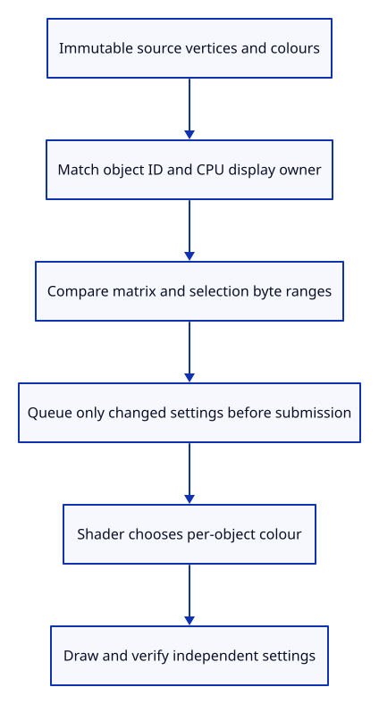

# 3.15.4 · Update only changed object settings

**Chapter 3 · Documents, editing and ownership · Section 3.15 · Incremental GPU settings** · [Contents](contents.md)

**Typing: 20–39 minutes.** [Estimate](typing-load.md).

Retain a GPU row when both its `ObjectId` and CPU display owner match. Reorder retained rows into scene order; drop unmatched rows before pruning the weak cache.

## Type

Continue from [Reuse uploads while their geometry is alive](31b-cache.md). [Save or recover your work](recovery.md).

### 1. `src/gpu_mesh.rs`

Retain row identity, its writable settings buffer and the bytes last sent. Allow queued updates to the settings buffer. Keep settings ownership beside the bind group. Queue only changed matrix or selection ranges and count their actual calls and bytes.

<details>
<summary>Locate the existing block</summary>

```rust
use crate::{gpu_geometry::GpuGeometry, scene::Object};
use std::rc::Rc;
use wgpu::util::DeviceExt;

pub struct GpuMesh {
    pub geometry: Rc<GpuGeometry>,
    model_group: wgpu::BindGroup,
}

fn settings(object: &Object, selected: bool) -> [u8; 80] {
    let mut bytes = [0; 80];
    for (index, value) in object.model.m.iter().enumerate() {
        bytes[index * 4..index * 4 + 4].copy_from_slice(&(*value as f32).to_ne_bytes());
    }
    let flag: f32 = if selected { 1.0 } else { 0.0 };
    bytes[64..68].copy_from_slice(&flag.to_ne_bytes());
    bytes
}

impl GpuMesh {
    pub fn upload(device: &wgpu::Device, layout: &wgpu::BindGroupLayout, object: &Object, selected: bool) -> Self {
        let geometry = Rc::new(GpuGeometry::upload(device, Rc::clone(&object.mesh)));
        Self::with_geometry(device, layout, object, selected, geometry)
    }

    pub fn with_geometry(device: &wgpu::Device, layout: &wgpu::BindGroupLayout,
        object: &Object, selected: bool, geometry: Rc<GpuGeometry>) -> Self
    {
        let bytes = settings(object, selected);
        let model = device.create_buffer_init(&wgpu::util::BufferInitDescriptor {
            label: Some("object placement"),
            contents: &bytes,
            usage: wgpu::BufferUsages::UNIFORM,
        });
        let model_group = device.create_bind_group(&wgpu::BindGroupDescriptor {
            label: Some("object placement"),
            layout,
            entries: &[wgpu::BindGroupEntry { binding: 0, resource: model.as_entire_binding() }],
        });
        Self { geometry, model_group }
    }

    pub fn draw(&self, pass: &mut wgpu::RenderPass<'_>) {
        pass.set_bind_group(1, &self.model_group, &[]);
        self.geometry.draw(pass);
    }
}
```

</details>

Edit the existing block to match this code; keep unchanged lines:

```rust
use crate::{gpu_geometry::GpuGeometry, scene::Object};
use std::rc::Rc;
use wgpu::util::DeviceExt;

pub struct GpuMesh {
    pub geometry: Rc<GpuGeometry>,
    model_group: wgpu::BindGroup,
    pub id: crate::scene::ObjectId,
    model: wgpu::Buffer,
    previous: [u8; 80],
}

fn settings(object: &Object, selected: bool) -> [u8; 80] {
    let mut bytes = [0; 80];
    for (index, value) in object.model.m.iter().enumerate() {
        bytes[index * 4..index * 4 + 4].copy_from_slice(&(*value as f32).to_ne_bytes());
    }
    let flag: f32 = if selected { 1.0 } else { 0.0 };
    bytes[64..68].copy_from_slice(&flag.to_ne_bytes());
    bytes
}

impl GpuMesh {
    pub fn upload(device: &wgpu::Device, layout: &wgpu::BindGroupLayout, object: &Object, selected: bool) -> Self {
        let geometry = Rc::new(GpuGeometry::upload(device, Rc::clone(&object.mesh)));
        Self::with_geometry(device, layout, object, selected, geometry)
    }

    pub fn with_geometry(device: &wgpu::Device, layout: &wgpu::BindGroupLayout,
        object: &Object, selected: bool, geometry: Rc<GpuGeometry>) -> Self
    {
        let bytes = settings(object, selected);
        let model = device.create_buffer_init(&wgpu::util::BufferInitDescriptor {
            label: Some("object placement"),
            contents: &bytes,
            usage: wgpu::BufferUsages::UNIFORM | wgpu::BufferUsages::COPY_DST,
        });
        let model_group = device.create_bind_group(&wgpu::BindGroupDescriptor {
            label: Some("object placement"),
            layout,
            entries: &[wgpu::BindGroupEntry { binding: 0, resource: model.as_entire_binding() }],
        });
        Self { geometry, model_group, id: object.id, model, previous: bytes }
    }

    pub fn update(&mut self, queue: &wgpu::Queue, object: &Object, selected: bool) -> [usize; 2] {
        let next = settings(object, selected);
        let mut writes = [0, 0];
        for (start, end) in [(0, 64), (64, 80)] {
            if next[start..end] != self.previous[start..end] {
                queue.write_buffer(&self.model, start as u64, &next[start..end]);
                writes[0] += 1;
                writes[1] += end - start;
            }
        }
        self.previous = next;
        writes
    }

    pub fn draw(&self, pass: &mut wgpu::RenderPass<'_>) {
        pass.set_bind_group(1, &self.model_group, &[]);
        self.geometry.draw(pass);
    }
}
```

<details>
<summary>Optional patch references</summary>

Use these original edit fragments when comparing a saved checkpoint. Apply the complete blocks above.

```text
--8<-- "journey/code/31c-incremental-01.rs"
```

```text
--8<-- "journey/code/31c-incremental-02.rs"
```

```text
--8<-- "journey/code/31c-incremental-03.rs"
```

```text
--8<-- "journey/code/31c-incremental-04.rs"
```

</details>

### 2. `src/renderer.rs`

Accumulate settings write evidence. Initialize the cumulative write counters. Retain matching GPU rows, preserve scene draw order and drop unused rows before cache pruning. Report actual update calls and bytes rather than reserved zeros.

Edit these blocks from bottom to top. Keep the surrounding lines unchanged.

<details>
<summary>Locate this block</summary>

```rust

    pub fn set_scene(&mut self, scene: &Scene, selected: Option<ObjectId>) {
        let layout = self.pipeline.get_bind_group_layout(1);
        let mut meshes = Vec::with_capacity(scene.objects().len());
        for object in scene.objects() {
            let geometry = self.geometry.get(&self.device, &object.mesh);
            meshes.push(GpuMesh::with_geometry(&self.device, &layout, object,
                selected == Some(object.id), geometry));
            self.settings_allocations += 1;
        }
        self.meshes = meshes;
        self.geometry.prune();
    }

    pub fn stats(&self) -> [usize; 4] {
        [self.geometry.uploads, self.settings_allocations, 0, 0]
    }

    pub fn draw(
```

</details>

Replace it with:

```rust

    pub fn set_scene(&mut self, scene: &Scene, selected: Option<ObjectId>) {
        let layout = self.pipeline.get_bind_group_layout(1);
        let mut old = std::mem::take(&mut self.meshes);
        for object in scene.objects() {
            let matching = old.iter().position(|row| row.id == object.id
                && std::rc::Rc::ptr_eq(&row.geometry.source, &object.mesh));
            let row = if let Some(index) = matching {
                let mut row = old.swap_remove(index);
                let [calls, bytes] = row.update(&self.queue, object, selected == Some(object.id));
                self.settings_writes += calls;
                self.settings_bytes += bytes;
                row
            } else {
                let geometry = self.geometry.get(&self.device, &object.mesh);
                self.settings_allocations += 1;
                GpuMesh::with_geometry(&self.device, &layout, object,
                    selected == Some(object.id), geometry)
            };
            self.meshes.push(row);
        }
        drop(old);
        self.geometry.prune();
    }

    pub fn stats(&self) -> [usize; 4] {
        [self.geometry.uploads, self.settings_allocations, self.settings_writes, self.settings_bytes]
    }

    pub fn draw(
```

<details>
<summary>Locate this block</summary>

```rust
        });
        let depth = Self::depth(&device, 640, 480);
        let mut renderer = Self { device, queue, pipeline, meshes: Vec::new(),
            geometry: Default::default(), settings_allocations: 0, uniform, view_group, depth };
        renderer.set_scene(scene, None);
        renderer
    }
```

</details>

Replace it with:

```rust
        });
        let depth = Self::depth(&device, 640, 480);
        let mut renderer = Self { device, queue, pipeline, meshes: Vec::new(),
            geometry: Default::default(), settings_allocations: 0, settings_writes: 0,
            settings_bytes: 0, uniform, view_group, depth };
        renderer.set_scene(scene, None);
        renderer
    }
```

<details>
<summary>Locate this block</summary>

```rust
    meshes: Vec<GpuMesh>,
    geometry: crate::geometry_cache::GeometryCache,
    settings_allocations: usize,
    uniform: wgpu::Buffer,
    view_group: wgpu::BindGroup,
    depth: wgpu::TextureView,
```

</details>

Replace it with:

```rust
    meshes: Vec<GpuMesh>,
    geometry: crate::geometry_cache::GeometryCache,
    settings_allocations: usize,
    settings_writes: usize,
    settings_bytes: usize,
    uniform: wgpu::Buffer,
    view_group: wgpu::BindGroup,
    depth: wgpu::TextureView,
```

<details>
<summary>Complete updated block reference</summary>

```rust
use crate::{gpu_mesh::GpuMesh, scene::{ObjectId, Scene}};

pub struct Renderer {
    pub device: wgpu::Device,
    pub queue: wgpu::Queue,
    pipeline: wgpu::RenderPipeline,
    meshes: Vec<GpuMesh>,
    geometry: crate::geometry_cache::GeometryCache,
    settings_allocations: usize,
    settings_writes: usize,
    settings_bytes: usize,
    uniform: wgpu::Buffer,
    view_group: wgpu::BindGroup,
    depth: wgpu::TextureView,
}

impl Renderer {
    pub fn new(
        device: wgpu::Device,
        queue: wgpu::Queue,
        format: wgpu::TextureFormat,
        scene: &Scene,
    ) -> Self {
        let shader = device.create_shader_module(wgpu::ShaderModuleDescriptor {
            label: Some("triangle"),
            source: wgpu::ShaderSource::Wgsl(include_str!("triangle.wgsl").into()),
        });
        let pipeline = device.create_render_pipeline(&wgpu::RenderPipelineDescriptor {
            label: Some("triangle"),
            layout: None,
            vertex: wgpu::VertexState {
                module: &shader,
                entry_point: Some("vertex"),
                compilation_options: Default::default(),
                buffers: &[wgpu::VertexBufferLayout {
                    array_stride: 24,
                    step_mode: wgpu::VertexStepMode::Vertex,
                    attributes: &wgpu::vertex_attr_array![0 => Float32x3, 1 => Float32x3],
                }],
            },
            fragment: Some(wgpu::FragmentState {
                module: &shader,
                entry_point: Some("fragment"),
                compilation_options: Default::default(),
                targets: &[Some(format.into())],
            }),
            primitive: Default::default(),
            depth_stencil: Some(wgpu::DepthStencilState {
                format: wgpu::TextureFormat::Depth32Float,
                depth_write_enabled: Some(true),
                depth_compare: Some(wgpu::CompareFunction::Less),
                stencil: Default::default(),
                bias: Default::default(),
            }),
            multisample: Default::default(),
            multiview_mask: None,
            cache: None,
        });
        let uniform = device.create_buffer(&wgpu::BufferDescriptor {
            label: Some("view transform"),
            size: 64,
            usage: wgpu::BufferUsages::UNIFORM | wgpu::BufferUsages::COPY_DST,
            mapped_at_creation: false,
        });
        let view_group = device.create_bind_group(&wgpu::BindGroupDescriptor {
            label: Some("view settings"),
            layout: &pipeline.get_bind_group_layout(0),
            entries: &[wgpu::BindGroupEntry {
                binding: 0,
                resource: uniform.as_entire_binding(),
            }],
        });
        let depth = Self::depth(&device, 640, 480);
        let mut renderer = Self { device, queue, pipeline, meshes: Vec::new(),
            geometry: Default::default(), settings_allocations: 0, settings_writes: 0,
            settings_bytes: 0, uniform, view_group, depth };
        renderer.set_scene(scene, None);
        renderer
    }

    fn depth(device: &wgpu::Device, width: u32, height: u32) -> wgpu::TextureView {
        let depth_texture = device.create_texture(&wgpu::TextureDescriptor {
            label: Some("opaque depth"),
            size: wgpu::Extent3d { width, height, depth_or_array_layers: 1 },
            mip_level_count: 1,
            sample_count: 1,
            dimension: wgpu::TextureDimension::D2,
            format: wgpu::TextureFormat::Depth32Float,
            usage: wgpu::TextureUsages::RENDER_ATTACHMENT,
            view_formats: &[],
        });
        depth_texture.create_view(&Default::default())
    }

    pub fn resize(&mut self, size: crate::viewport::Viewport) {
        self.depth = Self::depth(&self.device, size.width, size.height);
    }

    pub fn set_scene(&mut self, scene: &Scene, selected: Option<ObjectId>) {
        let layout = self.pipeline.get_bind_group_layout(1);
        let mut old = std::mem::take(&mut self.meshes);
        for object in scene.objects() {
            let matching = old.iter().position(|row| row.id == object.id
                && std::rc::Rc::ptr_eq(&row.geometry.source, &object.mesh));
            let row = if let Some(index) = matching {
                let mut row = old.swap_remove(index);
                let [calls, bytes] = row.update(&self.queue, object, selected == Some(object.id));
                self.settings_writes += calls;
                self.settings_bytes += bytes;
                row
            } else {
                let geometry = self.geometry.get(&self.device, &object.mesh);
                self.settings_allocations += 1;
                GpuMesh::with_geometry(&self.device, &layout, object,
                    selected == Some(object.id), geometry)
            };
            self.meshes.push(row);
        }
        drop(old);
        self.geometry.prune();
    }

    pub fn stats(&self) -> [usize; 4] {
        [self.geometry.uploads, self.settings_allocations, self.settings_writes, self.settings_bytes]
    }

    pub fn draw(
        &self,
        view: &wgpu::TextureView,
        background: &crate::background::Background,
        transform: &[f32; 16],
    ) {
        let bytes: Vec<u8> = transform.iter().flat_map(|value| value.to_ne_bytes()).collect();
        self.queue.write_buffer(&self.uniform, 0, &bytes);
        let [r, g, b] = background.rgb();
        let mut encoder = self.device.create_command_encoder(&Default::default());
        {
            // The pass borrows the encoder. This scope ends that borrow before finish takes it.
            let mut pass = encoder.begin_render_pass(&wgpu::RenderPassDescriptor {
                label: Some("canvas"),
                depth_stencil_attachment: Some(wgpu::RenderPassDepthStencilAttachment {
                    view: &self.depth,
                    depth_ops: Some(wgpu::Operations {
                        load: wgpu::LoadOp::Clear(1.0),
                        store: wgpu::StoreOp::Store,
                    }),
                    stencil_ops: None,
                }),
                color_attachments: &[Some(wgpu::RenderPassColorAttachment {
                    view,
                    depth_slice: None,
                    resolve_target: None,
                    ops: wgpu::Operations {
                        load: wgpu::LoadOp::Clear(wgpu::Color {
                            r, g, b, a: 1.0,
                        }),
                        store: wgpu::StoreOp::Store,
                    },
                })],
                ..Default::default()
            });
            pass.set_pipeline(&self.pipeline);
            pass.set_bind_group(0, &self.view_group, &[]);
            for mesh in &self.meshes {
                mesh.draw(&mut pass);
            }
        }
        self.queue.submit([encoder.finish()]);
    }
}
```

</details>

<details>
<summary>Optional patch references</summary>

Use these original edit fragments when comparing a saved checkpoint. Apply the complete blocks above.

```text
--8<-- "journey/code/31c-incremental-05.rs"
```

```text
--8<-- "journey/code/31c-incremental-06.rs"
```

```text
--8<-- "journey/code/31c-incremental-07.rs"
```

```text
--8<-- "journey/code/31c-incremental-08.rs"
```

</details>

## Run and check

In your project:

```sh
cd workspace/journey
REGEN_PROTO=0 cargo build --lib --locked --target wasm32-unknown-unknown -j1
REGEN_PROTO=0 CARGO_BUILD_JOBS=1 trunk serve --port 8780
```

Open `http://127.0.0.1:8780/`. Keep an existing Trunk server running; saving rebuilds it.

Move a selected object, then Undo. Run the GPU counter checks: these changes update only the matrix range, without reuploading vertex or index buffers.

### Recorded visual result

**Previous native render — current verification pending.**

The native GPU draws retained source geometry with placement and selection settings; world picking and selected pixels agree.


*This recorded image predates a source or checker change. Rebuild this checkpoint before using it as current evidence; browser controls require separate acceptance.*

<details>
<summary>Code explanation and diagram</summary>

Store the last eighty encoded uniform bytes. Compare the 64-byte matrix and 16-byte selection ranges separately: Move writes the matrix, selection writes its flag, and unchanged values write nothing. Compare encoded floats so an invisible double change causes no upload.

Add `COPY_DST`. Queue writes execute before the next draw submission; offsets 0 and 64 and lengths 64 and 16 meet four-byte alignment. Hidden counters track actual range writes and bytes. See [wgpu's write contract](https://docs.rs/wgpu/29.0.4/wgpu/struct.Queue.html#method.write_buffer).

Scene row → retained GPU row → matrix or selection byte difference → queued range write → next draw.



Why must row reuse compare both ObjectId and the geometry owner?

ObjectId identifies the document row, but a geometry edit may replace its display allocation. Reuse settings and geometry only when both identities match. Otherwise request the correct upload and construct a new GPU row. Matching rows update only changed matrix or selection bytes.

Study estimate, including typing and experiments: 1–2 hours.

</details>

<details>
<summary>Optional experiment</summary>

Select the same row again without changing placement; the browser drawing stays unchanged. Trace the supplied repeated-sync fixture and predict zero additional writes. Explain why a deleted row may need a fresh upload when Undo restores it: the cache deliberately has only weak ownership.

</details>

<details>
<summary>Check and save your work</summary>

Restore experimental edits, then run from `session_viewer`:

```sh
npm --prefix ../session_tests run course -- check 3.15.4
npm --prefix ../session_tests run course -- save 3.15.4
```

Source comparison leaves your project untouched. [Save and recovery instructions](recovery.md).

</details>

<details>
<summary>Viewer coverage and verification</summary>

Incremental ownership is a prerequisite for production arenas, resource accounting and large-scene responsiveness. Their complete packing and performance acceptance remain later lessons.

Native GPU and Chrome checks verify no allocation during selection or Move, no writes for unchanged settings, exact selection and Move/Undo pixel round trips, and release/reupload after deleting and undoing a row. Deleting clears selection, and document Undo restores the row without restoring that selection. The checks explicitly reselect the row before comparing its original gold pixels. These counters describe the calls made by this renderer; they do not claim driver memory size or frame-time performance.

[Full validation scope](release.md).

To reproduce the scripted acceptance of the reference checkpoint, run from `session_viewer` with the [course bundle server](release.md#reproduce) running on port 8781:

```sh
npm --prefix ../session_tests run course -- capture 3.15.4
```

This uses the verified reference bundle; it does not check or change your typed project.

</details>
