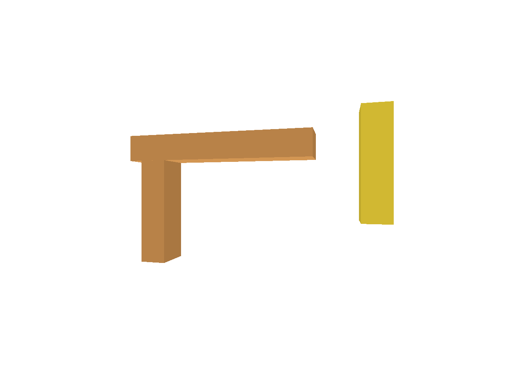
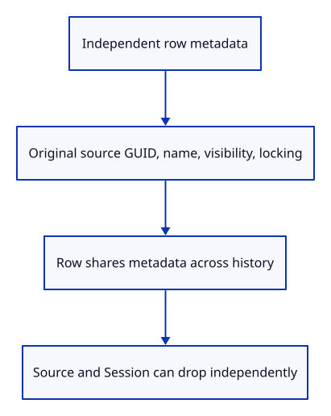

# 3.16.7 · Keep row metadata separate from editable geometry

**Chapter 3 · Documents, editing and ownership · Section 3.16 · Source ownership and restoration** · [Contents](contents.md)

**Typing: 28–56 minutes.** [Estimate](typing-load.md).

Keep each object’s name, GUID and visibility/locking flags when its editable source is unloaded. Store these small values beside the retained display mesh.

## Type

Continue from [Prove release does not retain the old document](32e-release.md). [Save or recover your work](recovery.md).

### 1. `src/lib.rs`

Give independently retained row metadata its own small module.

<details>
<summary>Locate the existing block</summary>

```rust
pub mod prepared;
```

</details>

After that block, type:

```rust
--8<-- "journey/code/32f-metadata-01.rs" skip=18
```

### 2. `src/row_metadata.rs`

Copy source identity and flags without copying or retaining kernel payload; test independent lifetime and history.

Create the file and type:

```rust
--8<-- "journey/code/32f-metadata-02.rs"
```

### 3. `src/scene.rs`

Retain descriptive values independently of the editable source. Capture metadata before transferring prepared source owners into the row.

Edit these blocks from bottom to top. Keep the surrounding lines unchanged.

<details>
<summary>Locate this block</summary>

```rust
        while self.objects.iter().any(|object| object.guid == guid) {
            guid = uuid::Uuid::new_v4().to_string();
        }
        self.objects.push(Object { id, guid, mesh: Rc::new(prepared.display), geometry: prepared.geometry,
            model: prepared.model, source: prepared.source });
        Ok(id)
    }
```

</details>

Replace it with:

```rust
        while self.objects.iter().any(|object| object.guid == guid) {
            guid = uuid::Uuid::new_v4().to_string();
        }
        let metadata = Rc::new(crate::row_metadata::RowMetadata::from_mesh(&prepared.geometry));
        self.objects.push(Object { id, guid, metadata, mesh: Rc::new(prepared.display), geometry: prepared.geometry,
            model: prepared.model, source: prepared.source });
        Ok(id)
    }
```

<details>
<summary>Locate this block</summary>

```rust
pub struct Object {
    pub id: ObjectId,
    pub guid: String,
    pub mesh: Rc<Mesh>,
    pub geometry: Rc<session_rust::Mesh>,
    pub model: session_rust::Xform,
```

</details>

Replace it with:

```rust
pub struct Object {
    pub id: ObjectId,
    pub guid: String,
    pub metadata: Rc<crate::row_metadata::RowMetadata>,
    pub mesh: Rc<Mesh>,
    pub geometry: Rc<session_rust::Mesh>,
    pub model: session_rust::Xform,
```

<details>
<summary>Complete updated block reference</summary>

```rust
use crate::{mesh::Mesh, prepared::PreparedMesh};
use std::rc::Rc;

#[derive(Clone, Copy, Debug, PartialEq, Eq)]
pub struct ObjectId(u32);

#[derive(Clone)]
pub struct Object {
    pub id: ObjectId,
    pub guid: String,
    pub metadata: Rc<crate::row_metadata::RowMetadata>,
    pub mesh: Rc<Mesh>,
    pub geometry: Rc<session_rust::Mesh>,
    pub model: session_rust::Xform,
    pub source: Option<crate::document::Source>,
}

impl Object {
    pub fn world_point(&self, vertex: [f32; 6]) -> [f64; 3] {
        let local = session_rust::Point::new(vertex[0] as f64, vertex[1] as f64, vertex[2] as f64);
        let world = self.model.transform_point(&local);
        [world[0], world[1], world[2]]
    }
}

#[derive(Clone)]
pub struct Scene {
    objects: Vec<Object>,
    next_id: u32,
    extra: Option<ObjectId>,
}

impl Scene {
    pub fn demo() -> Self {
        let pink = PreparedMesh::triangle([
            [-0.7, -0.6, 0.25], [0.5, -0.6, 0.25], [-0.1, 0.6, 0.25],
        ], [0.9, 0.25, 0.45]).expect("Valid pink triangle");
        let turquoise = PreparedMesh::triangle([
            [-0.4, -0.2, 0.75], [0.8, -0.2, 0.75], [0.2, 0.8, 0.75],
        ], [0.05, 0.7, 0.7]).expect("Valid turquoise triangle");
        let mut scene = Self { objects: Vec::new(), next_id: 1, extra: None };
        scene.insert(pink).expect("ID available");
        scene.insert(turquoise).expect("ID available");
        scene
    }

    pub fn restore(&mut self, mut saved: Self) {
        saved.next_id = saved.next_id.max(self.next_id);
        *self = saved;
    }

    pub fn bounds(&self) -> Option<crate::bounds::Bounds> {
        let mut bounds: Option<crate::bounds::Bounds> = None;
        for object in &self.objects {
            for vertex in object.mesh.vertices() {
                let point = object.world_point(*vertex);
                match &mut bounds {
                    Some(bounds) => bounds.include(point),
                    None => bounds = Some(crate::bounds::Bounds::point(point)),
                }
            }
        }
        bounds
    }

    pub fn selected_bounds(&self, id: ObjectId) -> Option<crate::bounds::Bounds> {
        let object = self.objects.iter().find(|object| object.id == id)?;
        let mut vertices = object.mesh.vertices().iter();
        let first = vertices.next()?;
        let mut bounds = crate::bounds::Bounds::point(object.world_point(*first));
        for vertex in vertices {
            bounds.include(object.world_point(*vertex));
        }
        Some(bounds)
    }

    pub fn objects(&self) -> &[Object] {
        &self.objects
    }

    pub fn insert(&mut self, prepared: PreparedMesh) -> Result<ObjectId, &'static str> {
        let next = self.next_id.checked_add(1).ok_or("Object IDs exhausted")?;
        let id = ObjectId(self.next_id);
        self.next_id = next;
        let mut guid = prepared.geometry.guid().to_owned();
        while self.objects.iter().any(|object| object.guid == guid) {
            guid = uuid::Uuid::new_v4().to_string();
        }
        let metadata = Rc::new(crate::row_metadata::RowMetadata::from_mesh(&prepared.geometry));
        self.objects.push(Object { id, guid, metadata, mesh: Rc::new(prepared.display), geometry: prepared.geometry,
            model: prepared.model, source: prepared.source });
        Ok(id)
    }

    pub fn clear(&mut self) {
        self.objects = Vec::new();
        self.extra = None;
    }

    pub fn replace(&mut self, loaded: crate::document::Loaded) -> Result<(), &'static str> {
        self.clear();
        self.import(loaded)
    }

    pub fn import(&mut self, loaded: crate::document::Loaded) -> Result<(), &'static str> {
        for prepared in loaded.meshes {
            self.insert(prepared)?;
        }
        Ok(())
    }

    pub fn place(&mut self, id: ObjectId, model: session_rust::Xform) -> Result<(), &'static str> {
        if !crate::placement::valid(&model.m)
        {
            return Err("Placement must be finite, affine and fit the display range");
        }
        let object = self.objects.iter_mut().find(|o| o.id == id).ok_or("Object not found")?;
        object.model = model;
        Ok(())
    }

    pub fn remove(&mut self, id: ObjectId) -> bool {
        let Some(index) = self.objects.iter().position(|object| object.id == id) else { return false; };
        self.objects.remove(index);
        if self.extra == Some(id) {
            self.extra = None;
        }
        true
    }

    pub fn contains(&self, id: ObjectId) -> bool {
        self.objects.iter().any(|object| object.id == id)
    }

    pub fn next(&self, current: Option<ObjectId>) -> Option<ObjectId> {
        if self.objects.is_empty() {
            return None;
        }
        let index = self.objects.iter().position(|object| Some(object.id) == current)
            .map_or(0, |index| index + 1);
        Some(self.objects[index % self.objects.len()].id)
    }

    pub fn add_box(&mut self) -> Result<ObjectId, &'static str> {
        let mut source = session_rust::Mesh::create_box(0.8, 0.8, 0.8);
        source.set_objectcolor(session_rust::Color::new(0.65, 0.65, 0.65, 1.0));
        let id = self.insert(PreparedMesh::new(source)?)?;
        self.place(id, session_rust::Xform::translation(0.9, 0.0, 0.4))?;
        Ok(id)
    }

    pub fn toggle_extra(&mut self) {
        if let Some(id) = self.extra.take() {
            self.remove(id);
        } else {
            let extra = PreparedMesh::triangle([
                [-0.9, 0.3, 0.5], [-0.4, 0.3, 0.5], [-0.65, 0.9, 0.5],
            ], [0.2, 0.8, 0.3]).expect("Valid extra triangle");
            self.extra = Some(self.insert(extra).expect("ID available"));
        }
    }
}

#[cfg(test)]
mod tests {
    use super::*;

    #[test]
    fn partial_replacement_failure_restores_owners_without_reusing_ids() {
        let mut scene = Scene::demo();
        let before = scene.objects.clone();
        scene.next_id = u32::MAX - 1;
        let loaded = crate::document::load(&crate::specimen::bytes()).unwrap();
        let mut history = crate::history::History::default();
        assert!(history.try_edit(&mut scene, |scene| scene.replace(loaded)).is_err());
        assert_eq!(scene.next_id, u32::MAX);
        assert_eq!(scene.objects.len(), before.len());
        for (object, old) in scene.objects.iter().zip(&before) {
            assert_eq!(object.id, old.id);
            assert!(Rc::ptr_eq(&object.geometry, &old.geometry));
            assert!(Rc::ptr_eq(&object.mesh, &old.mesh));
        }
        assert!(!history.undo(&mut scene));
    }

    #[test]
    fn removal_moves_a_row_without_changing_its_identity() {
        let mut scene = Scene::demo();
        let first = scene.objects()[0].id;
        let second = scene.objects()[1].id;
        assert!(scene.remove(first));
        assert_eq!(scene.objects()[0].id, second);
        assert_eq!(scene.next(None), Some(second));
        assert!(!scene.contains(first));
        scene.toggle_extra();
        assert_ne!(scene.objects()[1].id, first);
        assert_ne!(scene.objects()[1].id, second);
    }

    #[test]
    fn toggling_the_extra_object_uses_its_id_after_other_removals() {
        let mut scene = Scene::demo();
        scene.toggle_extra();
        let extra = scene.objects()[2].id;
        scene.remove(scene.objects()[0].id);
        scene.toggle_extra();
        assert!(!scene.contains(extra));
        assert_eq!(scene.objects().len(), 1);
    }
}
```

</details>

<details>
<summary>Optional patch references</summary>

Use these original edit fragments when comparing a saved checkpoint. Apply the complete blocks above.

```text
--8<-- "journey/code/32f-metadata-03.rs"
```

```text
--8<-- "journey/code/32f-metadata-04.rs"
```

</details>

### 4. `src/browser.rs`

Expose row values through hidden inspection for actual Chrome import/history checks.

<details>
<summary>Locate the existing block</summary>

```rust
    canvas.set_attribute("data-object-count", &editor.scene.objects().len().to_string())?;
```

</details>

After that block, type:

```rust
--8<-- "journey/code/32f-metadata-05.rs" skip=91
```

## Run and check

In your project:

```sh
cd workspace/journey
REGEN_PROTO=0 cargo build --lib --locked --target wasm32-unknown-unknown -j1
REGEN_PROTO=0 CARGO_BUILD_JOBS=1 trunk serve --port 8780
```

Open `http://127.0.0.1:8780/`. Keep an existing Trunk server running; saving rebuilds it.

Run the metadata checks below. Names, GUIDs and visible/locked flags survive after the editable source owner drops; metadata must not retain that source.

### Recorded visual result

**Previous native render — current verification pending.**



*This recorded image predates a source or checker change. Rebuild this checkpoint before using it as current evidence; browser controls require separate acceptance.*

<details>
<summary>Code explanation and diagram</summary>

Source unloading keeps the picture while dropping eligible editable kernel data. Before dropping any owner, give each row the small descriptive values it will still need. The display mesh, placement and local ObjectId already live on the row. Names and flags currently live inside the kernel mesh.

RowMetadata copies the original source GUID, name, is_visible and is_locked when Scene inserts a prepared mesh. These are owned strings and booleans, with no Rc to the kernel mesh or imported Session. The row shares an Rc<RowMetadata> across history snapshots: Move changes placement, so it does not need to copy or alter metadata. Later attribute edits will replace or copy this metadata deliberately.

Keep source_guid distinct from Object.guid. Repeated imports can have the same source GUID but need different saved identities. This is the distinction introduced in lesson 29; it now remains available without borrowing a kernel mesh.

This endpoint does not unload a source yet. Both source and display still exist. Visibility and locking are preserved as values; their full drawing/editing policy is taught later in the course.

Prepared source → independent row metadata → shared scene snapshots → source ownership proof.



Why is a row’s original source GUID separate from its saved object GUID?

The original source GUID locates the mesh in the imported document. The saved object GUID distinguishes duplicate imports in this viewer. Forking the saved identity must not change the original identity used to restore a released source.

Study estimate, including typing and experiments: 1–2 hours.

</details>

<details>
<summary>Optional experiment</summary>

Replace one row’s metadata Rc in a test with newly owned values. Predict why an older scene snapshot must keep the original values. Do not mutate a shared metadata allocation behind history.

</details>

<details>
<summary>Check and save your work</summary>

Restore experimental edits, then run from `session_viewer`:

```sh
npm --prefix ../session_tests run course -- check 3.16.7
npm --prefix ../session_tests run course -- save 3.16.7
```

Source comparison leaves your project untouched. [Save and recovery instructions](recovery.md).

</details>

<details>
<summary>Viewer coverage and verification</summary>

Production source release retains shape/name/tree information while its editable Session is unloaded. This row boundary prepares that same lifetime distinction; release across active/history roots and guarded rehydration remain required next steps.

The native check retains only metadata and Weak observers, closes the editor, and proves the old kernel value is gone while the name and flags remain readable. Another check follows duplicate imports, Move and Undo. Chrome inspects a hidden diagnostic attribute to compare the same metadata through import and history; no interface button or teaching panel is added.

[Full validation scope](release.md).

To reproduce the scripted acceptance of the reference checkpoint, run from `session_viewer` with the [course bundle server](release.md#reproduce) running on port 8781:

```sh
npm --prefix ../session_tests run course -- capture 3.16.7
```

This uses the verified reference bundle; it does not check or change your typed project.

</details>
