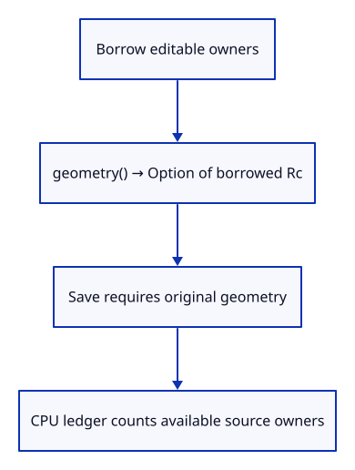

# 3.16.8 · Ask whether an editable source is available

**Chapter 3 · Documents, editing and ownership · Section 3.16 · Source ownership and restoration** · [Contents](contents.md)

**Typing: 5–10 minutes.** [Estimate](typing-load.md).

Introduce `geometry()` and `source()` before making source storage optional. Both return borrowed optional owners. At this stage every row still has geometry; generated rows have no imported-session provenance.

## Type

Continue from [Keep row metadata separate from editable geometry](32f-metadata.md). [Save or recover your work](recovery.md).

### 1. `src/scene.rs`

Borrow source owners through an API that can express later source absence.

<details>
<summary>Locate the existing block</summary>

```rust
impl Object {
    pub fn world_point(&self, vertex: [f32; 6]) -> [f64; 3] {
```

</details>

Edit the existing block to match this code; keep unchanged lines:

```rust
--8<-- "journey/code/32fa-access-01.rs"
```

### 2. `src/document.rs`

Require original editable geometry instead of silently exporting display floats.

<details>
<summary>Locate the existing block</summary>

```rust
        let mut mesh = object.geometry.to_proto();
```

</details>

Edit the existing block to match this code; keep unchanged lines:

```rust
--8<-- "journey/code/32fa-access-02.rs"
```

### 3. `src/memory.rs`

Count kernel owners only when they are available. Keep provenance absence independent of row/display accounting.

Edit these blocks from bottom to top. Keep the surrounding lines unchanged.

<details>
<summary>Locate this block</summary>

```rust
        count[5] += 1;
        for object in scene.objects() {
            count[0] += 1;
            sources.insert(Rc::as_ptr(&object.geometry));
            if displays.insert(Rc::as_ptr(&object.mesh)) { count[4] += object.mesh.payload_bytes(); }
            if let Some(source) = &object.source {
                if documents.insert(Rc::as_ptr(&source.document)) {
                    for mesh in &source.document.objects.meshes { sources.insert(Rc::as_ptr(mesh)); }
                }
```

</details>

Replace it with:

```rust
        count[5] += 1;
        for object in scene.objects() {
            count[0] += 1;
            if let Some(geometry) = object.geometry() { sources.insert(Rc::as_ptr(geometry)); }
            if displays.insert(Rc::as_ptr(&object.mesh)) { count[4] += object.mesh.payload_bytes(); }
            if let Some(source) = object.source() {
                if documents.insert(Rc::as_ptr(&source.document)) {
                    for mesh in &source.document.objects.meshes { sources.insert(Rc::as_ptr(mesh)); }
                }
```

<details>
<summary>Complete updated block reference</summary>

```rust
use crate::{mesh::Mesh, scene::Scene};
use std::{collections::HashSet, rc::Rc};

pub fn cpu<'a>(scenes: impl IntoIterator<Item = &'a Scene>,
    gpu_displays: impl IntoIterator<Item = &'a Rc<Mesh>>) -> [usize; 6]
{
    let (mut sources, mut documents, mut displays) = (HashSet::new(), HashSet::new(), HashSet::new());
    let mut count = [0; 6];
    for scene in scenes {
        count[5] += 1;
        for object in scene.objects() {
            count[0] += 1;
            if let Some(geometry) = object.geometry() { sources.insert(Rc::as_ptr(geometry)); }
            if displays.insert(Rc::as_ptr(&object.mesh)) { count[4] += object.mesh.payload_bytes(); }
            if let Some(source) = object.source() {
                if documents.insert(Rc::as_ptr(&source.document)) {
                    for mesh in &source.document.objects.meshes { sources.insert(Rc::as_ptr(mesh)); }
                }
            }
        }
    }
    for display in gpu_displays {
        if displays.insert(Rc::as_ptr(display)) { count[4] += display.payload_bytes(); }
    }
    count[1] = sources.len(); count[2] = documents.len(); count[3] = displays.len();
    count
}

pub fn gpu<'a>(rows: impl IntoIterator<Item = &'a crate::gpu_mesh::GpuMesh>) -> [u64; 4] {
    let mut geometry = HashSet::new();
    let mut count = [0; 4];
    for row in rows {
        if geometry.insert(Rc::as_ptr(&row.geometry)) {
            count[0] += 1; count[1] += row.geometry.allocated_bytes();
        }
        count[2] += 1; count[3] += row.settings_bytes();
    }
    count
}

#[cfg(test)]
mod tests {
    use super::*;

    #[test]
    fn shared_snapshots_count_spare_capacity_once() {
        let scene = Scene::demo(); let saved = scene.clone();
        let baseline = cpu([&scene], std::iter::empty());
        let shared = cpu([&scene, &saved], std::iter::empty());
        assert_eq!(shared[0], 4); assert_eq!(shared[5], 2);
        assert_eq!(&shared[1..5], &baseline[1..5]);
        let mut vertices = Vec::with_capacity(16); vertices.extend([[0.0; 6]; 3]);
        let mut indices = Vec::with_capacity(16); indices.extend([0, 1, 2]);
        let extra = Rc::new(Mesh::new(vertices, indices).unwrap());
        let retained = cpu([&scene], [&extra, &extra]);
        assert_eq!(retained[3], baseline[3] + 1);
        assert_eq!(retained[4], baseline[4] + 16 * 24 + 16 * 2);
    }

    #[test]
    fn a_document_retains_sources_whose_display_row_was_removed() {
        let mut scene = Scene::demo();
        scene.import(crate::document::load(&crate::specimen::bytes()).unwrap()).unwrap();
        let id = scene.objects()[2].id; scene.remove(id);
        let count = cpu([&scene], std::iter::empty());
        assert_eq!(&count[..4], &[4, 5, 1, 4]);
    }
}
```

</details>

<details>
<summary>Optional patch references</summary>

Use these original edit fragments when comparing a saved checkpoint. Apply the complete blocks above.

```text
--8<-- "journey/code/32fa-access-03.rs"
```

```text
--8<-- "journey/code/32fa-access-04.rs"
```

</details>

<details>
<summary>Supplied validation fixture</summary>

Copy this supplied authoring fixture once. Continue with the browser build below; the course does not require running native tests.

### 4. `src/source_tests.rs`

Optional authoring fixture. Update generated_source_and_display_survive_move_and_history through borrowed source access while preserving every existing assertion.

<details>
<summary>Locate the existing block</summary>

```text
fn generated_source_and_display_survive_move_and_history() {
    let mut editor = Editor::default();
    editor.apply(Action::AddBox).unwrap();
    for _ in 0..3 { editor.apply(Action::SelectNext).unwrap(); }
    let object = &editor.scene.objects()[2];
    let geometry = Rc::clone(&object.geometry);
    let display = Rc::clone(&object.mesh);
    let point = geometry.vertex_point(0).unwrap();
    let guid = geometry.guid().to_owned();
    let before = object.model.m;
    editor.apply(Action::Translate([2.0, -1.0, 0.5])).unwrap();
    let moved = editor.scene.objects()[2].model.m;
    editor.apply(Action::Undo).unwrap();
    assert_eq!(editor.scene.objects()[2].model.m, before);
    editor.apply(Action::Redo).unwrap();
    let restored = &editor.scene.objects()[2];
    assert_eq!(restored.model.m, moved);
    assert!(Rc::ptr_eq(&geometry, &restored.geometry));
    assert!(Rc::ptr_eq(&display, &restored.mesh));
    assert_eq!(restored.geometry.vertex_point(0).unwrap(), point);
    assert_eq!(restored.geometry.guid(), guid);
    assert!(restored.source.is_none());
}
```

</details>

Update the existing block with this supplied code; keep unchanged lines:

```text
--8<-- "journey/code/32fa-access-05.rs"
```

</details>

<details>
<summary>Supplied validation fixture</summary>

Copy this supplied authoring fixture once. Continue with the browser build below; the course does not require running native tests.

### 5. `src/source_tests.rs`

Optional authoring fixture. Update imported_source_survives_a_change_of_display_row through borrowed source access while preserving every existing assertion.

<details>
<summary>Locate the existing block</summary>

```text
fn imported_source_survives_a_change_of_display_row() {
    let mut editor = Editor::default();
    editor.apply(Action::Import(specimen::bytes())).unwrap();
    let imported = editor.scene.objects()[2].clone();
    let first = editor.scene.objects()[0].id;
    let second = editor.scene.objects()[1].id;
    editor.scene.remove(first); editor.scene.remove(second);
    let current = &editor.scene.objects()[0];
    assert_eq!(current.id, imported.id);
    assert!(Rc::ptr_eq(&current.geometry, &imported.geometry));
    let source = current.source.as_ref().unwrap();
    assert_eq!(current.geometry.guid(), source.guid);
    assert!(source.document.objects.meshes.iter().any(|m| m.guid() == source.guid));
    assert!(Rc::ptr_eq(&source.document, &imported.source.as_ref().unwrap().document));
}
```

</details>

Update the existing block with this supplied code; keep unchanged lines:

```text
--8<-- "journey/code/32fa-access-06.rs"
```

</details>

<details>
<summary>Supplied validation fixture</summary>

Copy this supplied authoring fixture once. Continue with the browser build below; the course does not require running native tests.

### 6. `src/imported_source_tests.rs`

Optional authoring fixture. Update import_shares_the_retained_sessions_source_allocation through borrowed source access while preserving every existing assertion.

<details>
<summary>Locate the existing block</summary>

```text
fn import_shares_the_retained_sessions_source_allocation() {
    let mut editor = Editor::default();
    editor.apply(Action::Import(specimen::bytes())).unwrap();
    let imported = editor.scene.objects()[2].clone();
    let geometry = Rc::clone(&imported.geometry);
    let source = imported.source.as_ref().unwrap();
    assert!(source.document.objects.meshes.iter().any(|m| Rc::ptr_eq(m, &geometry)));
    let first = editor.scene.objects()[0].id;
    let second = editor.scene.objects()[1].id;
    editor.scene.remove(first); editor.scene.remove(second);
    let moved_row = &editor.scene.objects()[0];
    assert_eq!(moved_row.id, imported.id);
    assert!(Rc::ptr_eq(&moved_row.geometry, &geometry));
}
```

</details>

Update the existing block with this supplied code; keep unchanged lines:

```text
--8<-- "journey/code/32fa-access-07.rs"
```

</details>

<details>
<summary>Supplied validation fixture</summary>

Copy this supplied authoring fixture once. Continue with the browser build below; the course does not require running native tests.

### 7. `src/snapshot_tests.rs`

Optional authoring fixture. Update snapshot_uses_live_local_sources_and_separate_placements through borrowed source access while preserving every existing assertion.

<details>
<summary>Locate the existing block</summary>

```text
fn snapshot_uses_live_local_sources_and_separate_placements() {
    let mut editor = Editor::default();
    editor.apply(Action::SelectNext).unwrap();
    editor.apply(Action::Delete).unwrap();
    editor.apply(Action::AddBox).unwrap();
    let object = editor.scene.objects().last().unwrap().clone();
    let source = object.geometry.to_proto();
    let message = proto::Session::decode(document::snapshot(&editor.scene).unwrap().as_slice()).unwrap();
    let meshes = &message.objects.as_ref().unwrap().meshes;
    assert_eq!(meshes.len(), 2);
    let saved = meshes.iter().find(|mesh| mesh.guid == object.guid).unwrap();
    assert_eq!(saved.vertices, source.vertices);
    assert_eq!(saved.faces, source.faces);
    assert_eq!(saved.objectcolor, source.objectcolor);
    assert_eq!((saved.is_visible, saved.is_locked), (source.is_visible, source.is_locked));
    let placement = message.xforms.iter().find(|entry| entry.guid == object.guid).unwrap();
    assert_eq!(placement.xform.as_ref().unwrap().matrix, object.model.m.to_vec());
    assert_eq!(message.tree.unwrap().root.unwrap().children.len(), meshes.len());
    assert_eq!(object.geometry.guid(), source.guid);
    editor.apply(Action::Undo).unwrap();
    assert_eq!(editor.scene.objects().len(), 1, "Saving must not create a history entry");
}
```

</details>

Update the existing block with this supplied code; keep unchanged lines:

```text
--8<-- "journey/code/32fa-access-08.rs"
```

</details>

## Run and check

In your project:

```sh
cd workspace/journey
REGEN_PROTO=0 cargo build --lib --locked --target wasm32-unknown-unknown -j1
REGEN_PROTO=0 CARGO_BUILD_JOBS=1 trunk serve --port 8780
```

Open `http://127.0.0.1:8780/`. Keep an existing Trunk server running; saving rebuilds it.

Run the source-access checks below. Saving and accounting borrow the available source through its accessor rather than owning another copy.

### Recorded visual result

**Previous native render — current verification pending.**


*This recorded image predates a source or checker change. Rebuild this checkpoint before using it as current evidence; browser controls require separate acceptance.*

<details>
<summary>Code explanation and diagram</summary>

Save uses `geometry().ok_or(...)` and `?` to return a clear error if geometry is missing. It never substitutes derived float display vertices for the editable source.

Accounting visits only available kernel and session owners while counting rows and displays independently. Migrate ownership checks to the same accessors; fixture `unwrap` asserts a known loaded source, while application Save returns `Result`.

Fields remain public during this migration. The next lesson completes it and prevents bypassing the access boundary.

Scene row → Option of borrowed editable geometry/provenance → checked source consumers.



Does Option<&Rc<Mesh>> add another mesh owner?

No. It borrows the Rc stored by the row. Merely asking for a source neither clones the owner nor copies the geometry. Some indicates an available editable source; the later unloaded state returns None. Saving must handle that absence rather than serializing drawing floats.

Study estimate, including typing and experiments: 1–2 hours.

</details>

<details>
<summary>Optional experiment</summary>

Compare Rc::clone(row.geometry().unwrap()) with merely calling row.geometry(). Predict which expression adds a strong owner and how that affects a later Weak release check.

</details>

<details>
<summary>Check and save your work</summary>

Restore experimental edits, then run from `session_viewer`:

```sh
npm --prefix ../session_tests run course -- check 3.16.8
npm --prefix ../session_tests run course -- save 3.16.8
```

Source comparison leaves your project untouched. [Save and recovery instructions](recovery.md).

</details>

<details>
<summary>Viewer coverage and verification</summary>

Source release needs an explicit absence state and reload ownership. These borrowed accessors prepare that state without changing renderer geometry or weakening the save format.


[Full validation scope](release.md).

To reproduce the scripted acceptance of the reference checkpoint, run from `session_viewer` with the [course bundle server](release.md#reproduce) running on port 8781:

```sh
npm --prefix ../session_tests run course -- capture 3.16.8
```

This uses the verified reference bundle; it does not check or change your typed project.

</details>
