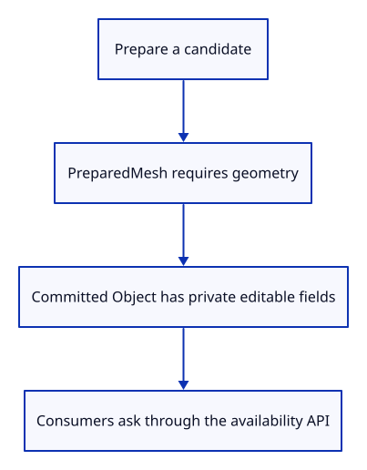

# 3.16.9 · Make editable ownership a private row boundary

**Chapter 3 · Documents, editing and ownership · Section 3.16 · Source ownership and restoration** · [Contents](contents.md)

**Typing: 5–10 minutes.** [Estimate](typing-load.md).

Finish migrating consumers to `geometry()` and `source()`, then make Object's editable-owner fields private. Direct field access outside the row now fails to compile.

## Type

Continue from [Ask whether an editable source is available](32fa-access.md). [Save or recover your work](recovery.md).

### 1. `src/editor.rs`

Update repeated_close_is_empty_and_drops_sources_without_gpu_owners through borrowed source access while preserving every existing assertion. Update close_releases_imported_history_documents_and_reopening_uses_fresh_ids through borrowed source access while preserving every existing assertion.

Edit these blocks from bottom to top. Keep the surrounding lines unchanged.

<details>
<summary>Locate this block</summary>

```rust
        let displays: Vec<_> = editor.scenes().flat_map(|scene| scene.objects().iter()
            .map(|row| Rc::downgrade(&row.mesh))).collect();
        let sources: Vec<_> = editor.scenes().flat_map(|scene| scene.objects().iter()
            .map(|row| Rc::downgrade(&row.geometry))).collect();
        let documents: Vec<_> = editor.scenes().flat_map(|scene| scene.objects().iter()
            .filter_map(|row| row.source.as_ref().map(|source| Rc::downgrade(&source.document)))).collect();
        let old: Vec<_> = editor.scenes().flat_map(|scene| scene.objects().iter().map(|row| row.id)).collect();
        assert!(!documents.is_empty());
        editor.apply(Action::Close).unwrap();
```

</details>

Replace it with:

```rust
        let displays: Vec<_> = editor.scenes().flat_map(|scene| scene.objects().iter()
            .map(|row| Rc::downgrade(&row.mesh))).collect();
        let sources: Vec<_> = editor.scenes().flat_map(|scene| scene.objects().iter()
            .map(|row| Rc::downgrade(row.geometry().unwrap()))).collect();
        let documents: Vec<_> = editor.scenes().flat_map(|scene| scene.objects().iter()
            .filter_map(|row| row.source().map(|source| Rc::downgrade(&source.document)))).collect();
        let old: Vec<_> = editor.scenes().flat_map(|scene| scene.objects().iter().map(|row| row.id)).collect();
        assert!(!documents.is_empty());
        editor.apply(Action::Close).unwrap();
```

<details>
<summary>Locate this block</summary>

```rust
    fn repeated_close_is_empty_and_drops_sources_without_gpu_owners() {
        let mut editor = Editor::default();
        let display = std::rc::Rc::downgrade(&editor.scene.objects()[0].mesh);
        let source = std::rc::Rc::downgrade(&editor.scene.objects()[0].geometry);
        editor.apply(Action::Close).unwrap(); editor.apply(Action::Close).unwrap();
        assert!(display.upgrade().is_none() && source.upgrade().is_none());
        assert_eq!(crate::memory::cpu(editor.scenes(), std::iter::empty()), [0, 0, 0, 0, 0, 1]);
```

</details>

Replace it with:

```rust
    fn repeated_close_is_empty_and_drops_sources_without_gpu_owners() {
        let mut editor = Editor::default();
        let display = std::rc::Rc::downgrade(&editor.scene.objects()[0].mesh);
        let source = std::rc::Rc::downgrade(editor.scene.objects()[0].geometry().unwrap());
        editor.apply(Action::Close).unwrap(); editor.apply(Action::Close).unwrap();
        assert!(display.upgrade().is_none() && source.upgrade().is_none());
        assert_eq!(crate::memory::cpu(editor.scenes(), std::iter::empty()), [0, 0, 0, 0, 0, 1]);
```

<details>
<summary>Complete updated block reference</summary>

```rust
use crate::{background::Background, camera::Camera, history::History, scene::{ObjectId, Scene}};

pub enum Action {
    Pick([f32; 2]),
    Import(Vec<u8>),
    Replace(Vec<u8>),
    Close,
    AddBox,
    Translate([f64; 3]),
    ToggleExtra,
    SelectNext,
    Delete,
    Undo,
    Redo,
    Background,
    Zoom(f32),
    Pan(f32, f32),
    Orbit(f64, f64),
    Isometric,
    ResetView,
    Fit,
    FitSelected,
    Projection(crate::camera::Projection),
}

#[derive(Debug, PartialEq, Eq)]
pub enum Change {
    View,
    Scene,
}

pub struct Editor {
    pub scene: Scene,
    pub selected: Option<ObjectId>,
    pub camera: Camera,
    pub background: Background,
    history: History,
}

impl Default for Editor {
    fn default() -> Self {
        Self {
            scene: Scene::demo(),
            selected: None,
            camera: Camera::default(),
            background: Background::default(),
            history: History::default(),
        }
    }
}

impl Editor {
    pub fn scenes(&self) -> impl Iterator<Item = &Scene> {
        std::iter::once(&self.scene).chain(self.history.scenes())
    }

    pub fn apply(&mut self, action: Action) -> Result<Change, &'static str> {
        match action {
            Action::Pick(screen) => {
                self.selected = self.camera.ray(screen)
                    .and_then(|ray| crate::picking::pick(&self.scene, &ray));
            }
            Action::Close => {
                self.scene.clear();
                self.history.clear();
                self.selected = None;
            }
            Action::Replace(bytes) => {
                let loaded = crate::document::load(&bytes)?;
                self.history.try_edit(&mut self.scene, |scene| scene.replace(loaded))?;
            }
            Action::Import(bytes) => {
                let loaded = crate::document::load(&bytes)?;
                self.history.try_edit(&mut self.scene, |scene| scene.import(loaded))?;
            }
            Action::AddBox => {
                self.history.try_edit(&mut self.scene, |scene| scene.add_box().map(|_| ()))?;
            }
            Action::Translate(offset) => {
                let id = self.selected.ok_or("Select an object before Move")?;
                if offset.iter().all(|&v| v == 0.0) { return Ok(Change::View); }
                let object = self.scene.objects().iter().find(|o| o.id == id).ok_or("Object not found")?;
                let shift = session_rust::Xform::translation(offset[0], offset[1], offset[2]);
                let model = &shift * &object.model;
                self.history.try_edit(&mut self.scene, |scene| scene.place(id, model))?;
            }
            Action::ToggleExtra => self.history.edit(&mut self.scene, Scene::toggle_extra),
            Action::SelectNext => self.selected = self.scene.next(self.selected),
            Action::Delete => {
                if let Some(id) = self.selected.take() {
                    self.history.edit(&mut self.scene, |scene| { scene.remove(id); });
                }
            }
            Action::Undo => { self.history.undo(&mut self.scene); }
            Action::Redo => { self.history.redo(&mut self.scene); }
            view => {
                match view {
                    Action::Background => self.background.toggle(),
                    Action::Zoom(factor) => self.camera.zoom(factor),
                    Action::Pan(dx, dy) => self.camera.pan(dx, dy),
                    Action::Orbit(yaw, pitch) => self.camera.orbit(yaw, pitch),
                    Action::Isometric => self.camera.isometric(),
                    Action::Projection(mode) => self.camera.projection = mode,
                    Action::Fit => {
                        if let Some(bounds) = self.scene.bounds() {
                            self.camera.fit(&bounds);
                        }
                    }
                    Action::FitSelected => {
                        if let Some(bounds) = self.selected
                            .and_then(|id| self.scene.selected_bounds(id))
                        {
                            self.camera.fit(&bounds);
                        }
                    }
                    Action::ResetView => {
                        let aspect = self.camera.aspect;
                        self.camera = Camera { aspect, ..Camera::default() };
                    }
                    _ => unreachable!("Document actions were handled above"),
                }
                return Ok(Change::View);
            }
        }
        // Deletion and history travel can invalidate selection; repair it in one place.
        self.selected = self.selected.filter(|id| self.scene.contains(*id));
        Ok(Change::Scene)
    }
}

#[cfg(test)]
mod tests {
    use super::*;

    #[test]
    fn close_ends_history_and_keeps_issued_ids_and_view_settings() {
        let mut editor = Editor::default();
        editor.apply(Action::Import(crate::specimen::bytes())).unwrap();
        editor.apply(Action::AddBox).unwrap(); editor.apply(Action::Undo).unwrap();
        let old: Vec<_> = editor.scenes().flat_map(|scene| scene.objects().iter().map(|row| row.id)).collect();
        editor.apply(Action::SelectNext).unwrap();
        editor.apply(Action::Pan(0.2, 0.1)).unwrap(); editor.apply(Action::Background).unwrap();
        let view = editor.camera.uniform(); let background = editor.background.rgb();
        editor.apply(Action::Close).unwrap();
        assert!(editor.scene.objects().is_empty() && editor.selected.is_none());
        assert_eq!(editor.scenes().count(), 1);
        editor.apply(Action::Undo).unwrap(); editor.apply(Action::Redo).unwrap();
        assert!(editor.scene.objects().is_empty());
        assert_eq!(editor.camera.uniform(), view); assert_eq!(editor.background.rgb(), background);
        editor.apply(Action::AddBox).unwrap();
        assert!(!old.contains(&editor.scene.objects()[0].id));
    }

    #[test]
    fn repeated_close_is_empty_and_drops_sources_without_gpu_owners() {
        let mut editor = Editor::default();
        let display = std::rc::Rc::downgrade(&editor.scene.objects()[0].mesh);
        let source = std::rc::Rc::downgrade(editor.scene.objects()[0].geometry().unwrap());
        editor.apply(Action::Close).unwrap(); editor.apply(Action::Close).unwrap();
        assert!(display.upgrade().is_none() && source.upgrade().is_none());
        assert_eq!(crate::memory::cpu(editor.scenes(), std::iter::empty()), [0, 0, 0, 0, 0, 1]);
    }

    #[test]
    fn close_releases_imported_history_documents_and_reopening_uses_fresh_ids() {
        use std::rc::Rc;
        let mut editor = Editor::default();
        let bytes = crate::specimen::bytes();
        editor.apply(Action::Import(bytes.clone())).unwrap();
        editor.apply(Action::Replace(bytes.clone())).unwrap();
        let displays: Vec<_> = editor.scenes().flat_map(|scene| scene.objects().iter()
            .map(|row| Rc::downgrade(&row.mesh))).collect();
        let sources: Vec<_> = editor.scenes().flat_map(|scene| scene.objects().iter()
            .map(|row| Rc::downgrade(row.geometry().unwrap()))).collect();
        let documents: Vec<_> = editor.scenes().flat_map(|scene| scene.objects().iter()
            .filter_map(|row| row.source().map(|source| Rc::downgrade(&source.document)))).collect();
        let old: Vec<_> = editor.scenes().flat_map(|scene| scene.objects().iter().map(|row| row.id)).collect();
        assert!(!documents.is_empty());
        editor.apply(Action::Close).unwrap();
        assert!(displays.iter().all(|owner| owner.upgrade().is_none()));
        assert!(sources.iter().all(|owner| owner.upgrade().is_none()));
        assert!(documents.iter().all(|owner| owner.upgrade().is_none()));
        editor.apply(Action::Import(bytes)).unwrap();
        assert!(editor.scene.objects().iter().all(|row| !old.contains(&row.id)));
    }

    #[test]
    fn resetting_the_view_preserves_its_current_aspect() {
        let mut editor = Editor::default();
        editor.camera.aspect = 2.0;
        editor.apply(Action::Zoom(2.0)).unwrap();
        editor.apply(Action::ResetView).unwrap();
        assert_eq!(editor.camera.aspect, 2.0);
        assert_eq!(editor.camera.distance, 3.0);
    }

    #[test]
    fn undo_changes_the_document_without_rewinding_the_view() {
        let mut editor = Editor::default();
        editor.apply(Action::AddBox).unwrap();
        editor.apply(Action::Zoom(2.0)).unwrap();
        editor.apply(Action::Background).unwrap();
        editor.apply(Action::Undo).unwrap();
        assert_eq!(editor.scene.objects().len(), 2);
        assert_eq!(editor.camera.distance, 1.5);
        assert_eq!(editor.background.rgb(), [0.9, 0.9, 0.9]);
    }

    #[test]
    fn undo_repairs_selection_and_empty_delete_preserves_redo() {
        let mut editor = Editor::default();
        editor.apply(Action::AddBox).unwrap();
        for _ in 0..3 {
            editor.apply(Action::SelectNext).unwrap();
        }
        let box_id = editor.selected.unwrap();
        editor.apply(Action::Undo).unwrap();
        assert!(editor.selected.is_none());
        editor.apply(Action::Delete).unwrap();
        editor.apply(Action::Redo).unwrap();
        assert!(editor.scene.contains(box_id));
    }

    #[test]
    fn picking_a_moved_view_uses_the_editors_current_camera() {
        let mut editor = Editor::default();
        editor.apply(Action::Pan(0.2, 0.1)).unwrap();
        let point = session_rust::Point::new(0.2, 0.3, 0.75);
        let screen = editor.camera.view_projection().transform_point(&point);
        assert_eq!(editor.apply(Action::Pick([screen[0] as f32, screen[1] as f32])).unwrap(), Change::Scene);
        assert_eq!(editor.selected, Some(editor.scene.objects()[1].id));
        assert_eq!(editor.apply(Action::Zoom(2.0)).unwrap(), Change::View);
    }
}
```

</details>

<details>
<summary>Optional patch references</summary>

Use these original edit fragments when comparing a saved checkpoint. Apply the complete blocks above.

```text
--8<-- "journey/code/32fb-boundary-01.rs"
```

```text
--8<-- "journey/code/32fb-boundary-02.rs"
```

</details>

### 2. `src/history.rs`

Update cleared_history_releases_a_deleted_source_and_display through borrowed source access while preserving every existing assertion.

<details>
<summary>Locate the existing block</summary>

```rust
    fn cleared_history_releases_a_deleted_source_and_display() {
        let mut scene = Scene::demo();
        let mut history = History::default();
        let id = scene.objects()[0].id;
        let display = Rc::downgrade(&scene.objects()[0].mesh);
        let source = Rc::downgrade(&scene.objects()[0].geometry);
        history.edit(&mut scene, |scene| { scene.remove(id); });
        assert!(display.upgrade().is_some() && source.upgrade().is_some());
        assert_eq!(history.scenes().count(), 1);
        history.clear();
        assert!(display.upgrade().is_none() && source.upgrade().is_none());
        assert!(!history.undo(&mut scene) && !history.redo(&mut scene));
        assert_eq!(scene.objects().len(), 1);
    }
```

</details>

Edit the existing block to match this code; keep unchanged lines:

```rust
--8<-- "journey/code/32fb-boundary-03.rs"
```

<details>
<summary>Supplied validation fixture</summary>

Copy this supplied authoring fixture once. Continue with the browser build below; the course does not require running native tests.

### 3. `src/file_identity_tests.rs`

Optional authoring fixture. Update duplicate_imports_keep_distinct_stored_identity_through_history through borrowed source access while preserving every existing assertion.

<details>
<summary>Locate the existing block</summary>

```text
fn duplicate_imports_keep_distinct_stored_identity_through_history() {
    let mut editor = Editor::default();
    let bytes = specimen::bytes();
    editor.apply(Action::Import(bytes.clone())).unwrap();
    editor.apply(Action::Import(bytes)).unwrap();
    let objects = editor.scene.objects();
    assert_eq!(objects.len(), 8);
    let distinct: HashSet<_> = objects.iter().map(|object| object.guid.as_str()).collect();
    assert_eq!(distinct.len(), objects.len());
    assert_eq!(objects[2].guid, objects[2].geometry.guid());
    assert_eq!(objects[2].geometry.guid(), objects[5].geometry.guid());
    assert_eq!(objects[2].source.as_ref().unwrap().guid, objects[5].source.as_ref().unwrap().guid);
    assert_ne!(objects[2].guid, objects[5].guid);
    assert!(uuid::Uuid::parse_str(&objects[5].guid).is_ok());
    let copy = objects[5].clone();
    editor.apply(Action::SelectNext).unwrap();
    editor.apply(Action::Delete).unwrap();
    let current = editor.scene.objects().iter().find(|object| object.id == copy.id).unwrap();
    assert_eq!(current.guid, copy.guid);
    editor.apply(Action::Undo).unwrap();
    editor.apply(Action::Redo).unwrap();
    let current = editor.scene.objects().iter().find(|object| object.id == copy.id).unwrap();
    assert_eq!(current.guid, copy.guid);
    assert_eq!(current.geometry.guid(), copy.geometry.guid());
}
```

</details>

Update the existing block with this supplied code; keep unchanged lines:

```text
--8<-- "journey/code/32fb-boundary-04.rs"
```

</details>

<details>
<summary>Supplied validation fixture</summary>

Copy this supplied authoring fixture once. Continue with the browser build below; the course does not require running native tests.

### 4. `src/document_tests.rs`

Optional authoring fixture. Update import_retains_source_and_undo_removes_the_whole_file through borrowed source access while preserving every existing assertion.

<details>
<summary>Locate the existing block</summary>

```text
fn import_retains_source_and_undo_removes_the_whole_file() {
    let mut editor = Editor::default();
    editor.apply(Action::Import(specimen::bytes())).unwrap();
    assert_eq!(editor.scene.objects().len(), 5);
    let source = editor.scene.objects()[2].source.as_ref().unwrap();
    let document = Rc::clone(&source.document);
    let guid = source.guid.clone();
    let id = editor.scene.objects()[2].id;
    assert_eq!(document.name, "Three-piece frame");
    assert!(document.objects.meshes.iter().any(|mesh| mesh.guid() == guid));
    editor.apply(Action::Undo).unwrap();
    assert_eq!(editor.scene.objects().len(), 2);
    editor.apply(Action::Redo).unwrap();
    let restored = &editor.scene.objects()[2];
    assert_eq!(restored.id, id);
    assert!(Rc::ptr_eq(&restored.source.as_ref().unwrap().document, &document));
}
```

</details>

Update the existing block with this supplied code; keep unchanged lines:

```text
--8<-- "journey/code/32fb-boundary-05.rs"
```

</details>

<details>
<summary>Supplied validation fixture</summary>

Copy this supplied authoring fixture once. Continue with the browser build below; the course does not require running native tests.

### 5. `src/document_tests.rs`

Optional authoring fixture. Update repeated_imports_keep_distinct_viewer_ids_and_original_source_guids through borrowed source access while preserving every existing assertion.

<details>
<summary>Locate the existing block</summary>

```text
fn repeated_imports_keep_distinct_viewer_ids_and_original_source_guids() {
    let bytes = specimen::bytes();
    let mut editor = Editor::default();
    editor.apply(Action::Import(bytes.clone())).unwrap();
    editor.apply(Action::Import(bytes)).unwrap();
    let objects = editor.scene.objects();
    assert_ne!(objects[2].id, objects[5].id);
    assert_eq!(objects[2].source.as_ref().unwrap().guid, objects[5].source.as_ref().unwrap().guid);
    assert!(!Rc::ptr_eq(&objects[2].source.as_ref().unwrap().document, &objects[5].source.as_ref().unwrap().document));
}
```

</details>

Update the existing block with this supplied code; keep unchanged lines:

```text
--8<-- "journey/code/32fb-boundary-06.rs"
```

</details>

<details>
<summary>Supplied validation fixture</summary>

Copy this supplied authoring fixture once. Continue with the browser build below; the course does not require running native tests.

### 6. `src/replace_tests.rs`

Optional authoring fixture. Update replacement_history_retains_camera_and_distinct_local_identity through borrowed source access while preserving every existing assertion.

<details>
<summary>Locate the existing block</summary>

```text
fn replacement_history_retains_camera_and_distinct_local_identity() {
    let mut editor = Editor::default();
    editor.apply(Action::SelectNext).unwrap();
    let old = editor.scene.objects()[0].clone();
    editor.camera.distance = 7.0; editor.camera.aspect = 2.0;
    editor.apply(Action::Replace(specimen::bytes())).unwrap();
    let ids: Vec<_> = editor.scene.objects().iter().map(|object| object.id).collect();
    assert_eq!(ids.len(), 3);
    assert!(!editor.scene.contains(old.id));
    assert!(editor.selected.is_none());
    editor.apply(Action::Undo).unwrap();
    assert_eq!(editor.scene.objects().len(), 2);
    assert_eq!(editor.scene.objects()[0].id, old.id);
    assert!(Rc::ptr_eq(&editor.scene.objects()[0].geometry, &old.geometry));
    assert!(Rc::ptr_eq(&editor.scene.objects()[0].mesh, &old.mesh));
    editor.apply(Action::Redo).unwrap();
    assert_eq!(editor.scene.objects().iter().map(|object| object.id).collect::<Vec<_>>(), ids);
    assert_eq!((editor.camera.distance, editor.camera.aspect), (7.0, 2.0));
}
```

</details>

Update the existing block with this supplied code; keep unchanged lines:

```text
--8<-- "journey/code/32fb-boundary-07.rs"
```

</details>

<details>
<summary>Supplied validation fixture</summary>

Copy this supplied authoring fixture once. Continue with the browser build below; the course does not require running native tests.

### 7. `src/replace_tests.rs`

Optional authoring fixture. Update refused_replacement_preserves_selection_source_owners_and_redo through borrowed source access while preserving every existing assertion.

<details>
<summary>Locate the existing block</summary>

```text
fn refused_replacement_preserves_selection_source_owners_and_redo() {
    let mut editor = Editor::default();
    editor.apply(Action::AddBox).unwrap(); editor.apply(Action::Undo).unwrap();
    editor.apply(Action::SelectNext).unwrap();
    let selected = editor.selected;
    let old = editor.scene.objects()[0].clone();
    assert!(editor.apply(Action::Replace(vec![255])).is_err());
    assert_eq!(editor.selected, selected);
    assert_eq!(editor.scene.objects().len(), 2);
    assert!(Rc::ptr_eq(&editor.scene.objects()[0].geometry, &old.geometry));
    editor.apply(Action::Redo).unwrap();
    assert_eq!(editor.scene.objects().len(), 3);
}
```

</details>

Update the existing block with this supplied code; keep unchanged lines:

```text
--8<-- "journey/code/32fb-boundary-08.rs"
```

</details>

<details>
<summary>Supplied validation fixture</summary>

Copy this supplied authoring fixture once. Continue with the browser build below; the course does not require running native tests.

### 8. `src/save_roundtrip_tests.rs`

Optional authoring fixture. Update both_imported_copies_reopen_with_their_stored_identity through borrowed source access while preserving every existing assertion.

<details>
<summary>Locate the existing block</summary>

```text
fn both_imported_copies_reopen_with_their_stored_identity() {
    let mut editor = Editor::default();
    let bytes = specimen::bytes();
    editor.apply(Action::Import(bytes.clone())).unwrap();
    editor.apply(Action::Import(bytes)).unwrap();
    let saved = document::snapshot(&editor.scene).unwrap();
    let reopened = document::load(&saved).unwrap();
    assert_eq!(reopened.meshes.len(), editor.scene.objects().len());
    for object in editor.scene.objects() {
        let prepared = reopened.meshes.iter().find(|mesh| mesh.geometry.guid() == object.guid).unwrap();
        assert_eq!(prepared.model.m, object.model.m);
        assert_eq!(prepared.geometry.name, object.geometry.name);
    }
    assert_eq!(editor.scene.objects()[2].geometry.guid(), editor.scene.objects()[5].geometry.guid());
    assert_ne!(editor.scene.objects()[2].guid, editor.scene.objects()[5].guid);
}
```

</details>

Update the existing block with this supplied code; keep unchanged lines:

```text
--8<-- "journey/code/32fb-boundary-09.rs"
```

</details>

### 9. `src/row_metadata.rs`

Update metadata_does_not_keep_a_closed_kernel_source_alive through borrowed source access while preserving every existing assertion.

<details>
<summary>Locate the existing block</summary>

```rust
    fn metadata_does_not_keep_a_closed_kernel_source_alive() {
        let mut editor = Editor::default();
        let mut mesh = session_rust::Mesh::create_box(1.0, 1.0, 1.0);
        mesh.name = "Released beam".into(); mesh.is_visible = false; mesh.is_locked = true;
        let id = editor.scene.insert(crate::prepared::PreparedMesh::new(mesh).unwrap()).unwrap();
        let row = editor.scene.objects().iter().find(|row| row.id == id).unwrap();
        let weak = Rc::downgrade(&row.geometry);
        let metadata = Rc::clone(&row.metadata);
        editor.apply(Action::Close).unwrap();
        assert!(weak.upgrade().is_none());
        assert_eq!(metadata.name, "Released beam");
        assert!(!metadata.is_visible && metadata.is_locked);
        assert!(!metadata.source_guid.is_empty());
    }
```

</details>

Edit the existing block to match this code; keep unchanged lines:

```rust
--8<-- "journey/code/32fb-boundary-10.rs"
```

### 10. `src/scene.rs`

Confine editable kernel storage to the scene row implementation. Prevent other modules from bypassing imported-source availability.

Edit these blocks from bottom to top. Keep the surrounding lines unchanged.

<details>
<summary>Locate this block</summary>

```rust
    pub guid: String,
    pub metadata: Rc<crate::row_metadata::RowMetadata>,
    pub mesh: Rc<Mesh>,
    pub geometry: Rc<session_rust::Mesh>,
    pub model: session_rust::Xform,
    pub source: Option<crate::document::Source>,
}

impl Object {
```

</details>

Replace it with:

```rust
    pub guid: String,
    pub metadata: Rc<crate::row_metadata::RowMetadata>,
    pub mesh: Rc<Mesh>,
    geometry: Rc<session_rust::Mesh>,
    pub model: session_rust::Xform,
    source: Option<crate::document::Source>,
}

impl Object {
```

<details>
<summary>Complete updated block reference</summary>

```rust
use crate::{mesh::Mesh, prepared::PreparedMesh};
use std::rc::Rc;

#[derive(Clone, Copy, Debug, PartialEq, Eq)]
pub struct ObjectId(u32);

#[derive(Clone)]
pub struct Object {
    pub id: ObjectId,
    pub guid: String,
    pub metadata: Rc<crate::row_metadata::RowMetadata>,
    pub mesh: Rc<Mesh>,
    geometry: Rc<session_rust::Mesh>,
    pub model: session_rust::Xform,
    source: Option<crate::document::Source>,
}

impl Object {
    pub fn geometry(&self) -> Option<&Rc<session_rust::Mesh>> { Some(&self.geometry) }

    pub fn source(&self) -> Option<&crate::document::Source> { self.source.as_ref() }

    pub fn world_point(&self, vertex: [f32; 6]) -> [f64; 3] {
        let local = session_rust::Point::new(vertex[0] as f64, vertex[1] as f64, vertex[2] as f64);
        let world = self.model.transform_point(&local);
        [world[0], world[1], world[2]]
    }
}

#[derive(Clone)]
pub struct Scene {
    objects: Vec<Object>,
    next_id: u32,
    extra: Option<ObjectId>,
}

impl Scene {
    pub fn demo() -> Self {
        let pink = PreparedMesh::triangle([
            [-0.7, -0.6, 0.25], [0.5, -0.6, 0.25], [-0.1, 0.6, 0.25],
        ], [0.9, 0.25, 0.45]).expect("Valid pink triangle");
        let turquoise = PreparedMesh::triangle([
            [-0.4, -0.2, 0.75], [0.8, -0.2, 0.75], [0.2, 0.8, 0.75],
        ], [0.05, 0.7, 0.7]).expect("Valid turquoise triangle");
        let mut scene = Self { objects: Vec::new(), next_id: 1, extra: None };
        scene.insert(pink).expect("ID available");
        scene.insert(turquoise).expect("ID available");
        scene
    }

    pub fn restore(&mut self, mut saved: Self) {
        saved.next_id = saved.next_id.max(self.next_id);
        *self = saved;
    }

    pub fn bounds(&self) -> Option<crate::bounds::Bounds> {
        let mut bounds: Option<crate::bounds::Bounds> = None;
        for object in &self.objects {
            for vertex in object.mesh.vertices() {
                let point = object.world_point(*vertex);
                match &mut bounds {
                    Some(bounds) => bounds.include(point),
                    None => bounds = Some(crate::bounds::Bounds::point(point)),
                }
            }
        }
        bounds
    }

    pub fn selected_bounds(&self, id: ObjectId) -> Option<crate::bounds::Bounds> {
        let object = self.objects.iter().find(|object| object.id == id)?;
        let mut vertices = object.mesh.vertices().iter();
        let first = vertices.next()?;
        let mut bounds = crate::bounds::Bounds::point(object.world_point(*first));
        for vertex in vertices {
            bounds.include(object.world_point(*vertex));
        }
        Some(bounds)
    }

    pub fn objects(&self) -> &[Object] {
        &self.objects
    }

    pub fn insert(&mut self, prepared: PreparedMesh) -> Result<ObjectId, &'static str> {
        let next = self.next_id.checked_add(1).ok_or("Object IDs exhausted")?;
        let id = ObjectId(self.next_id);
        self.next_id = next;
        let mut guid = prepared.geometry.guid().to_owned();
        while self.objects.iter().any(|object| object.guid == guid) {
            guid = uuid::Uuid::new_v4().to_string();
        }
        let metadata = Rc::new(crate::row_metadata::RowMetadata::from_mesh(&prepared.geometry));
        self.objects.push(Object { id, guid, metadata, mesh: Rc::new(prepared.display), geometry: prepared.geometry,
            model: prepared.model, source: prepared.source });
        Ok(id)
    }

    pub fn clear(&mut self) {
        self.objects = Vec::new();
        self.extra = None;
    }

    pub fn replace(&mut self, loaded: crate::document::Loaded) -> Result<(), &'static str> {
        self.clear();
        self.import(loaded)
    }

    pub fn import(&mut self, loaded: crate::document::Loaded) -> Result<(), &'static str> {
        for prepared in loaded.meshes {
            self.insert(prepared)?;
        }
        Ok(())
    }

    pub fn place(&mut self, id: ObjectId, model: session_rust::Xform) -> Result<(), &'static str> {
        if !crate::placement::valid(&model.m)
        {
            return Err("Placement must be finite, affine and fit the display range");
        }
        let object = self.objects.iter_mut().find(|o| o.id == id).ok_or("Object not found")?;
        object.model = model;
        Ok(())
    }

    pub fn remove(&mut self, id: ObjectId) -> bool {
        let Some(index) = self.objects.iter().position(|object| object.id == id) else { return false; };
        self.objects.remove(index);
        if self.extra == Some(id) {
            self.extra = None;
        }
        true
    }

    pub fn contains(&self, id: ObjectId) -> bool {
        self.objects.iter().any(|object| object.id == id)
    }

    pub fn next(&self, current: Option<ObjectId>) -> Option<ObjectId> {
        if self.objects.is_empty() {
            return None;
        }
        let index = self.objects.iter().position(|object| Some(object.id) == current)
            .map_or(0, |index| index + 1);
        Some(self.objects[index % self.objects.len()].id)
    }

    pub fn add_box(&mut self) -> Result<ObjectId, &'static str> {
        let mut source = session_rust::Mesh::create_box(0.8, 0.8, 0.8);
        source.set_objectcolor(session_rust::Color::new(0.65, 0.65, 0.65, 1.0));
        let id = self.insert(PreparedMesh::new(source)?)?;
        self.place(id, session_rust::Xform::translation(0.9, 0.0, 0.4))?;
        Ok(id)
    }

    pub fn toggle_extra(&mut self) {
        if let Some(id) = self.extra.take() {
            self.remove(id);
        } else {
            let extra = PreparedMesh::triangle([
                [-0.9, 0.3, 0.5], [-0.4, 0.3, 0.5], [-0.65, 0.9, 0.5],
            ], [0.2, 0.8, 0.3]).expect("Valid extra triangle");
            self.extra = Some(self.insert(extra).expect("ID available"));
        }
    }
}

#[cfg(test)]
mod tests {
    use super::*;

    #[test]
    fn partial_replacement_failure_restores_owners_without_reusing_ids() {
        let mut scene = Scene::demo();
        let before = scene.objects.clone();
        scene.next_id = u32::MAX - 1;
        let loaded = crate::document::load(&crate::specimen::bytes()).unwrap();
        let mut history = crate::history::History::default();
        assert!(history.try_edit(&mut scene, |scene| scene.replace(loaded)).is_err());
        assert_eq!(scene.next_id, u32::MAX);
        assert_eq!(scene.objects.len(), before.len());
        for (object, old) in scene.objects.iter().zip(&before) {
            assert_eq!(object.id, old.id);
            assert!(Rc::ptr_eq(&object.geometry, &old.geometry));
            assert!(Rc::ptr_eq(&object.mesh, &old.mesh));
        }
        assert!(!history.undo(&mut scene));
    }

    #[test]
    fn removal_moves_a_row_without_changing_its_identity() {
        let mut scene = Scene::demo();
        let first = scene.objects()[0].id;
        let second = scene.objects()[1].id;
        assert!(scene.remove(first));
        assert_eq!(scene.objects()[0].id, second);
        assert_eq!(scene.next(None), Some(second));
        assert!(!scene.contains(first));
        scene.toggle_extra();
        assert_ne!(scene.objects()[1].id, first);
        assert_ne!(scene.objects()[1].id, second);
    }

    #[test]
    fn toggling_the_extra_object_uses_its_id_after_other_removals() {
        let mut scene = Scene::demo();
        scene.toggle_extra();
        let extra = scene.objects()[2].id;
        scene.remove(scene.objects()[0].id);
        scene.toggle_extra();
        assert!(!scene.contains(extra));
        assert_eq!(scene.objects().len(), 1);
    }
}
```

</details>

<details>
<summary>Optional patch references</summary>

Use these original edit fragments when comparing a saved checkpoint. Apply the complete blocks above.

```text
--8<-- "journey/code/32fb-boundary-11.rs"
```

```text
--8<-- "journey/code/32fb-boundary-12.rs"
```

</details>

## Run and check

In your project:

```sh
cd workspace/journey
REGEN_PROTO=0 cargo build --lib --locked --target wasm32-unknown-unknown -j1
REGEN_PROTO=0 CARGO_BUILD_JOBS=1 trunk serve --port 8780
```

Open `http://127.0.0.1:8780/`. Keep an existing Trunk server running; saving rebuilds it.

Build and run the checks below. Other modules must use the source accessor; the private row field prevents bypassing source availability.

### Recorded visual result

**Previous native render — current verification pending.**


*This recorded image predates a source or checker change. Rebuild this checkpoint before using it as current evidence; browser controls require separate acceptance.*

<details>
<summary>Code explanation and diagram</summary>

Keep `PreparedMesh.geometry` mandatory: a prepared insertion requires valid geometry. Keep `GpuMesh.geometry` unchanged: it owns display buffers, not editable kernel data.

Rows retain public identity, saved GUID, metadata, model and derived mesh. Source storage can next become Loaded or Released behind its borrowed accessors without changing drawing or history placements. No source unload happens in this step.

Remaining native ownership proofs → borrowed accessors → private source fields.



Why keep PreparedMesh geometry mandatory when Object geometry is accessed optionally?

PreparedMesh is a validated candidate ready to insert, so its original geometry must exist. A committed Object has a longer lifetime: its display can remain after editable geometry is unloaded. The preparation boundary and residency boundary have different contracts.

Study estimate, including typing and experiments: 1–2 hours.

</details>

<details>
<summary>Optional experiment</summary>

Try reading object.geometry directly from document.rs and predict the compiler error. Explain why a renderer’s row.geometry or a prepared candidate’s geometry can remain valid even after this row source field becomes private.

</details>

<details>
<summary>Check and save your work</summary>

Restore experimental edits, then run from `session_viewer`:

```sh
npm --prefix ../session_tests run course -- check 3.16.9
npm --prefix ../session_tests run course -- save 3.16.9
```

Source comparison leaves your project untouched. [Save and recovery instructions](recovery.md).

</details>

<details>
<summary>Viewer coverage and verification</summary>

Next add reload origin/version information, release eligible imported owners across active and history roots, and restore them atomically. A source-only unload must not masquerade as Close.

Existing allocation identity, exact source coordinates, history and Weak-expiration checks retain their assertions while adopting the borrowed interface.

[Full validation scope](release.md).

To reproduce the scripted acceptance of the reference checkpoint, run from `session_viewer` with the [course bundle server](release.md#reproduce) running on port 8781:

```sh
npm --prefix ../session_tests run course -- capture 3.16.9
```

This uses the verified reference bundle; it does not check or change your typed project.

</details>
