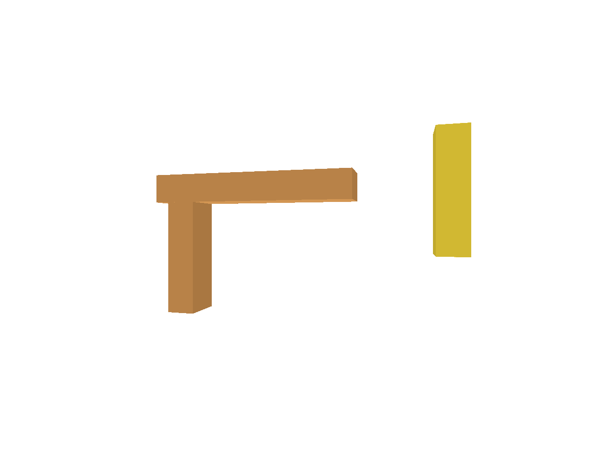
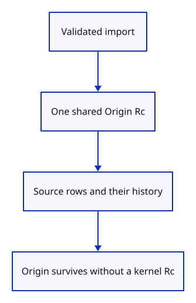

# 3.16.11 · Attach one origin to an imported document

**Chapter 3 · Documents, editing and ownership · Section 3.16 · Source ownership and restoration** · [Contents](contents.md)

**Typing: 6–12 minutes.** [Estimate](typing-load.md).

Construct an Origin after decoding and validation, before moving the protobuf into the kernel Session. Every prepared row shares the same Rc<Origin> through its Source. A second import gets a different Origin even when its file bytes are identical.

## Type

Continue from [Record a reload version without retaining geometry](32fc-version.md). [Save or recover your work](recovery.md).

### 1. `src/document.rs`

Retain reload metadata separately from the kernel Session. Record accepted original bytes and a geometry-free header before kernel construction. Share one import origin among all its source rows.

Edit these blocks from bottom to top. Keep the surrounding lines unchanged.

<details>
<summary>Locate this block</summary>

```rust
    if bytes.len() > MAX_BYTES { return Err("This checkpoint accepts files up to 4 MiB"); }
    let message = proto::Session::decode(bytes).map_err(|_| "Invalid session protobuf")?;
    validate(&message)?;
    let document = Rc::new(Session::from_proto(message).map_err(|_| "Cannot construct session")?);
    let mut meshes = Vec::new();
    for mesh in document.objects.meshes.iter() {
        let mut prepared = PreparedMesh::from_shared(Rc::clone(mesh))?;
        prepared.model = document.xforms.get(mesh.guid()).cloned().unwrap_or_else(session_rust::Xform::identity);
        prepared.source = Some(Source {
            document: Rc::clone(&document), guid: mesh.guid().to_owned(),
        });
        meshes.push(prepared);
    }
```

</details>

Replace it with:

```rust
    if bytes.len() > MAX_BYTES { return Err("This checkpoint accepts files up to 4 MiB"); }
    let message = proto::Session::decode(bytes).map_err(|_| "Invalid session protobuf")?;
    validate(&message)?;
    let origin = Rc::new(crate::origin::Origin::new(&message, bytes));
    let document = Rc::new(Session::from_proto(message).map_err(|_| "Cannot construct session")?);
    let mut meshes = Vec::new();
    for mesh in document.objects.meshes.iter() {
        let mut prepared = PreparedMesh::from_shared(Rc::clone(mesh))?;
        prepared.model = document.xforms.get(mesh.guid()).cloned().unwrap_or_else(session_rust::Xform::identity);
        prepared.source = Some(Source {
            document: Rc::clone(&document), guid: mesh.guid().to_owned(), origin: Rc::clone(&origin),
        });
        meshes.push(prepared);
    }
```

<details>
<summary>Locate this block</summary>

```rust
pub struct Source {
    pub document: Rc<Session>,
    pub guid: String,
}

pub struct Loaded {
```

</details>

Replace it with:

```rust
pub struct Source {
    pub document: Rc<Session>,
    pub guid: String,
    pub origin: Rc<crate::origin::Origin>,
}

pub struct Loaded {
```

<details>
<summary>Complete updated block reference</summary>

```rust
use crate::prepared::PreparedMesh;
use prost::Message;
use session_rust::{proto, Session};
use std::{collections::HashSet, rc::Rc};

pub const MAX_BYTES: usize = 4 * 1024 * 1024;

#[derive(Clone)]
pub struct Source {
    pub document: Rc<Session>,
    pub guid: String,
    pub origin: Rc<crate::origin::Origin>,
}

pub struct Loaded {
    pub document: Rc<Session>,
    pub meshes: Vec<PreparedMesh>,
}

pub fn load(bytes: &[u8]) -> Result<Loaded, &'static str> {
    if bytes.len() > MAX_BYTES { return Err("This checkpoint accepts files up to 4 MiB"); }
    let message = proto::Session::decode(bytes).map_err(|_| "Invalid session protobuf")?;
    validate(&message)?;
    let origin = Rc::new(crate::origin::Origin::new(&message, bytes));
    let document = Rc::new(Session::from_proto(message).map_err(|_| "Cannot construct session")?);
    let mut meshes = Vec::new();
    for mesh in document.objects.meshes.iter() {
        let mut prepared = PreparedMesh::from_shared(Rc::clone(mesh))?;
        prepared.model = document.xforms.get(mesh.guid()).cloned().unwrap_or_else(session_rust::Xform::identity);
        prepared.source = Some(Source {
            document: Rc::clone(&document), guid: mesh.guid().to_owned(), origin: Rc::clone(&origin),
        });
        meshes.push(prepared);
    }
    Ok(Loaded { document, meshes })
}

pub fn snapshot(scene: &crate::scene::Scene) -> Result<Vec<u8>, &'static str> {
    let mut objects = proto::Objects::default();
    let mut children = Vec::new();
    let mut xforms = Vec::new();
    for object in scene.objects() {
        let geometry = object.geometry().ok_or("Reload editable sources before saving")?;
        let mut mesh = geometry.to_proto();
        mesh.guid = object.guid.clone();
        objects.meshes.push(mesh);
        children.push(proto::TreeNode { name: object.guid.clone(), ..Default::default() });
        if object.model.m != session_rust::Xform::identity().m {
            xforms.push(proto::XformEntry {
                guid: object.guid.clone(), xform: Some(object.model.to_proto()),
            });
        }
    }
    let message = proto::Session {
        name: "Viewer document".into(), objects: Some(objects),
        tree: Some(proto::Tree { root: Some(proto::TreeNode {
            name: "Objects".into(), children, ..Default::default()
        }), ..Default::default() }), xforms, ..Default::default()
    };
    validate(&message)?;
    let bytes = message.encode_to_vec();
    if bytes.len() > MAX_BYTES { return Err("The saved document exceeds 4 MiB"); }
    Ok(bytes)
}

fn validate(message: &proto::Session) -> Result<(), &'static str> {
    let objects = message.objects.as_ref().ok_or("Session has no objects")?;
    if message.definitions.is_some() || !message.interactions.is_empty() {
        return Err("Definitions and interactions arrive in later checkpoints");
    }
    let other = objects.points.len() + objects.lines.len() + objects.planes.len()
        + objects.bboxes.len() + objects.polylines.len() + objects.pointclouds.len()
        + objects.nurbscurves.len() + objects.nurbssurfaces.len() + objects.breps.len()
        + objects.elements.len() + objects.components.len() + objects.sheets.len() + objects.instances.len();
    if other != 0 || objects.meshes.is_empty() || objects.meshes.len() > 64 {
        return Err("This checkpoint accepts 1–64 meshes and no other geometry types");
    }
    let mut guids = HashSet::new();
    for mesh in &objects.meshes {
        if mesh.guid.is_empty() || !guids.insert(mesh.guid.as_str()) {
            return Err("Every mesh needs a distinct source GUID");
        }
        validate_mesh(mesh)?;
    }
    let mut placed = HashSet::new();
    for entry in &message.xforms {
        let matrix = &entry.xform.as_ref().ok_or("Missing placement matrix")?.matrix;
        if !guids.contains(entry.guid.as_str()) || !placed.insert(entry.guid.as_str())
            || !crate::placement::valid(matrix)
        {
            return Err("Invalid mesh placement");
        }
    }
    if let Some(root) = message.tree.as_ref().and_then(|tree| tree.root.as_ref()) {
        let names: HashSet<_> = root.children.iter().map(|node| node.name.as_str()).collect();
        if names != guids || root.children.len() != guids.len()
            || root.children.iter().any(|node| !node.children.is_empty()) {
            return Err("This checkpoint needs one flat tree row per mesh");
        }
    }
    Ok(())
}

fn validate_mesh(mesh: &proto::Mesh) -> Result<(), &'static str> {
    if mesh.vertices.len() > 10_000 || mesh.faces.is_empty() || mesh.faces.len() > 10_000 {
        return Err("A mesh needs faces and at most 10,000 vertices and faces");
    }
    if mesh.color_mode != 0 { return Err("Per-face and per-vertex colours arrive later"); }
    for (&key, vertex) in &mesh.vertices {
        if key > u32::MAX as u64 || [vertex.x, vertex.y, vertex.z].iter().any(|v| !v.is_finite()) {
            return Err("Invalid vertex key or coordinate");
        }
    }
    for (&key, face) in &mesh.faces {
        if key > u32::MAX as u64 || !(3..=4).contains(&face.vertices.len()) || !face.holes.is_empty()
            || face.vertices.iter().any(|key| !mesh.vertices.contains_key(key)) {
            return Err("This checkpoint needs triangles or quads with existing vertices and no holes");
        }
    }
    for (key, triangles) in &mesh.triangulation {
        if !mesh.faces.contains_key(key) || triangles.vertices.len() % 3 != 0
            || triangles.vertices.iter().any(|key| !mesh.vertices.contains_key(key)) {
            return Err("Invalid stored triangulation");
        }
    }
    Ok(())
}
```

</details>

<details>
<summary>Optional patch references</summary>

Use these original edit fragments when comparing a saved checkpoint. Apply the complete blocks above.

```text
--8<-- "journey/code/32fd-origin-01.rs"
```

```text
--8<-- "journey/code/32fd-origin-02.rs"
```

```text
--8<-- "journey/code/32fd-origin-03.rs"
```

</details>

### 2. `src/lib.rs`

Check source ownership independently of drawing.

<details>
<summary>Locate the existing block</summary>

```rust
pub mod origin;
```

</details>

After that block, type:

```rust
--8<-- "journey/code/32fd-origin-04.rs" skip=16
```

<details>
<summary>Supplied validation fixture</summary>

Copy this supplied authoring fixture once. Continue with the browser build below; the course does not require running native tests.

### 3. `src/origin_tests.rs`

Optional authoring fixture. Observe true kernel expiration while retaining only header/version metadata.

Copy this supplied file:

```text
--8<-- "journey/code/32fd-origin-05.rs"
```

</details>

### 4. `src/browser.rs`

Inspect shared import identity and exact versions without adding controls.

<details>
<summary>Locate the existing block</summary>

```rust
    canvas.set_attribute("data-row-metadata", &serde_json::to_string(&metadata)
```

</details>

Edit the existing block to match this code; keep unchanged lines:

```rust
--8<-- "journey/code/32fd-origin-06.rs"
```

## Run and check

In your project:

```sh
cd workspace/journey
REGEN_PROTO=0 cargo build --lib --locked --target wasm32-unknown-unknown -j1
REGEN_PROTO=0 CARGO_BUILD_JOBS=1 trunk serve --port 8780
```

Open `http://127.0.0.1:8780/`. Keep an existing Trunk server running; saving rebuilds it.

Run the origin checks below. Rows from one import share its small origin header through history without retaining the original document.

### Recorded visual result

**Previous native render — current verification pending.**



*This recorded image predates a source or checker change. Rebuild this checkpoint before using it as current evidence; browser controls require separate acceptance.*

<details>
<summary>Code explanation and diagram</summary>

The native check records Weak observers, retains only the Origin, and closes the editor. The Session and kernel value must disappear while the original header remains readable. Another check follows one shared origin through Move and Undo.

Share one geometry-free origin across imported rows and history..



Does retaining an Origin after Close keep the imported Session alive?

No. It owns copied header values and a version, not the Session Rc or any kernel mesh Rc. Weak checks can prove the Session and its meshes are dropped while the retained origin remains readable.

Study estimate, including typing and experiments: 1–2 hours.

</details>

<details>
<summary>Optional experiment</summary>

Clone Source instead of only Origin in the ownership check and predict which Weak observations remain alive.

</details>

<details>
<summary>Check and save your work</summary>

Restore experimental edits, then run from `session_viewer`:

```sh
npm --prefix ../session_tests run course -- check 3.16.11
npm --prefix ../session_tests run course -- save 3.16.11
```

Source comparison leaves your project untouched. [Save and recovery instructions](recovery.md).

</details>

<details>
<summary>Viewer coverage and verification</summary>

Origin identity is separate from saved row GUID and original source GUID. This prevents a later completion for one duplicate import from being adopted by another.

Chrome exposes origin identity and the byte fingerprint in a hidden attribute. It checks that three rows of one import share an origin, duplicate imports have different origins but the same version, and history preserves them. No reload location or unload command exists yet.

[Full validation scope](release.md).

To reproduce the scripted acceptance of the reference checkpoint, run from `session_viewer` with the [course bundle server](release.md#reproduce) running on port 8781:

```sh
npm --prefix ../session_tests run course -- capture 3.16.11
```

This uses the verified reference bundle; it does not check or change your typed project.

</details>
