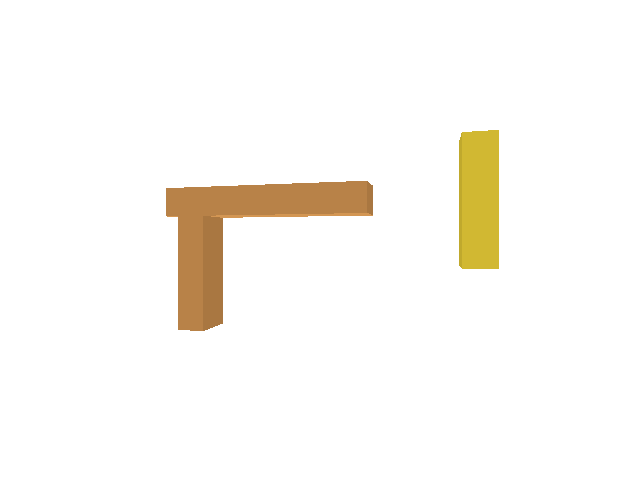
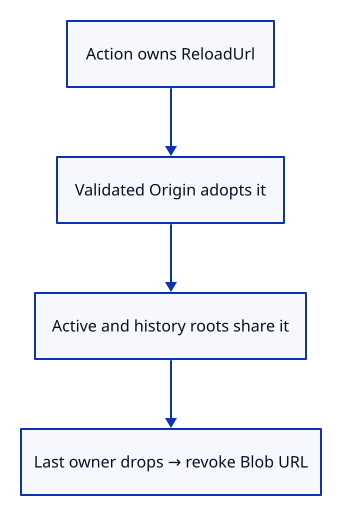

# 3.16.12 · Give a reload URL an explicit owner

**Chapter 3 · Documents, editing and ownership · Section 3.16 · Source ownership and restoration** · [Contents](contents.md)

**Typing: 17–33 minutes.** [Estimate](typing-load.md).

Keep a reload URL alive while its source is needed. Release the browser Blob URL when its last owner drops.

## Type

Continue from [Attach one origin to an imported document](32fd-origin.md). [Save or recover your work](recovery.md).

### 1. `src/lib.rs`

Keep browser URL lifetime explicit and independent of kernel ownership.

<details>
<summary>Locate the existing block</summary>

```rust
pub mod origin;
```

</details>

After that block, type:

```rust
--8<-- "journey/code/32fe-location-01.rs" skip=16
```

### 2. `src/reload_url.rs`

Revoke a viewer-created Blob URL when its actual resource owner drops.

Create the file and type:

```rust
--8<-- "journey/code/32fe-location-02.rs"
```

### 3. `src/origin.rs`

Retain an optional reload location without retaining geometry. Ordinary native loads start without an owned browser location.

<details>
<summary>Locate the existing block</summary>

```rust
use session_rust::proto;
use sha2::{Digest, Sha256};

#[derive(Clone, Copy, Debug, PartialEq, Eq)]
pub struct FileVersion([u8; 32]);

impl FileVersion {
    pub fn of(bytes: &[u8]) -> Self { Self(Sha256::digest(bytes).into()) }

    pub fn hex(&self) -> String { self.0.iter().map(|b| format!("{b:02x}")).collect() }
}

pub struct Origin {
    pub id: uuid::Uuid,
    pub header: proto::Session,
    pub version: FileVersion,
}

impl Origin {
    pub fn new(message: &proto::Session, bytes: &[u8]) -> Self {
        let header = proto::Session { name: message.name.clone(), guid: message.guid.clone(),
            tree: message.tree.clone(), graph: message.graph.clone(),
            bvh_boxes: message.bvh_boxes.clone(), xforms: message.xforms.clone(), ..Default::default() };
        Self { id: uuid::Uuid::new_v4(), header, version: FileVersion::of(bytes) }
    }
}

#[cfg(test)]
mod tests {
    use super::*;

    #[test]
    fn file_version_matches_a_known_vector_and_changed_bytes_differ() {
        assert_eq!(FileVersion::of(b"abc").hex(),
            "ba7816bf8f01cfea414140de5dae2223b00361a396177a9cb410ff61f20015ad");
        assert_eq!(FileVersion::of(b"abc"), FileVersion::of(b"abc"));
        assert_ne!(FileVersion::of(b"abc"), FileVersion::of(b"abd"));
    }

    #[test]
    fn identical_files_have_distinct_origins_and_geometry_free_headers() {
        use prost::Message;
        let bytes = crate::specimen::bytes(); let message = proto::Session::decode(bytes.as_slice()).unwrap();
        let first = Origin::new(&message, &bytes); let second = Origin::new(&message, &bytes);
        assert_ne!(first.id, second.id); assert_eq!(first.version, second.version);
        assert_eq!(first.header.name, message.name); assert_eq!(first.header.guid, message.guid);
        assert_eq!(first.header.tree, message.tree); assert_eq!(first.header.xforms, message.xforms);
        assert!(first.header.objects.is_none() && first.header.definitions.is_none());
    }
}
```

</details>

Edit the existing block to match this code; keep unchanged lines:

```rust
use session_rust::proto;
use sha2::{Digest, Sha256};

#[derive(Clone, Copy, Debug, PartialEq, Eq)]
pub struct FileVersion([u8; 32]);

impl FileVersion {
    pub fn of(bytes: &[u8]) -> Self { Self(Sha256::digest(bytes).into()) }

    pub fn hex(&self) -> String { self.0.iter().map(|b| format!("{b:02x}")).collect() }
}

pub struct Origin {
    pub id: uuid::Uuid,
    pub header: proto::Session,
    pub version: FileVersion,
    pub location: Option<std::rc::Rc<crate::reload_url::ReloadUrl>>,
}

impl Origin {
    pub fn new(message: &proto::Session, bytes: &[u8]) -> Self {
        let header = proto::Session { name: message.name.clone(), guid: message.guid.clone(),
            tree: message.tree.clone(), graph: message.graph.clone(),
            bvh_boxes: message.bvh_boxes.clone(), xforms: message.xforms.clone(), ..Default::default() };
        Self { id: uuid::Uuid::new_v4(), header, version: FileVersion::of(bytes), location: None }
    }
}

#[cfg(test)]
mod tests {
    use super::*;

    #[test]
    fn file_version_matches_a_known_vector_and_changed_bytes_differ() {
        assert_eq!(FileVersion::of(b"abc").hex(),
            "ba7816bf8f01cfea414140de5dae2223b00361a396177a9cb410ff61f20015ad");
        assert_eq!(FileVersion::of(b"abc"), FileVersion::of(b"abc"));
        assert_ne!(FileVersion::of(b"abc"), FileVersion::of(b"abd"));
    }

    #[test]
    fn identical_files_have_distinct_origins_and_geometry_free_headers() {
        use prost::Message;
        let bytes = crate::specimen::bytes(); let message = proto::Session::decode(bytes.as_slice()).unwrap();
        let first = Origin::new(&message, &bytes); let second = Origin::new(&message, &bytes);
        assert_ne!(first.id, second.id); assert_eq!(first.version, second.version);
        assert_eq!(first.header.name, message.name); assert_eq!(first.header.guid, message.guid);
        assert_eq!(first.header.tree, message.tree); assert_eq!(first.header.xforms, message.xforms);
        assert!(first.header.objects.is_none() && first.header.definitions.is_none());
    }
}
```

<details>
<summary>Optional patch references</summary>

Use these original edit fragments when comparing a saved checkpoint. Apply the complete blocks above.

```text
--8<-- "journey/code/32fe-location-03.rs"
```

```text
--8<-- "journey/code/32fe-location-04.rs"
```

</details>

### 4. `src/document.rs`

Accept location ownership before a read/validation error can occur. Adopt the already owned URL only into validated source metadata.

Edit these blocks from bottom to top. Keep the surrounding lines unchanged.

<details>
<summary>Locate this block</summary>

```rust
    pub meshes: Vec<PreparedMesh>,
}

pub fn load(bytes: &[u8]) -> Result<Loaded, &'static str> {
    if bytes.len() > MAX_BYTES { return Err("This checkpoint accepts files up to 4 MiB"); }
    let message = proto::Session::decode(bytes).map_err(|_| "Invalid session protobuf")?;
    validate(&message)?;
    let origin = Rc::new(crate::origin::Origin::new(&message, bytes));
    let document = Rc::new(Session::from_proto(message).map_err(|_| "Cannot construct session")?);
    let mut meshes = Vec::new();
    for mesh in document.objects.meshes.iter() {
```

</details>

Replace it with:

```rust
    pub meshes: Vec<PreparedMesh>,
}

pub fn load(bytes: &[u8]) -> Result<Loaded, &'static str> { load_at(bytes, None) }

pub fn load_at(bytes: &[u8], location: Option<Rc<crate::reload_url::ReloadUrl>>) -> Result<Loaded, &'static str> {
    if bytes.len() > MAX_BYTES { return Err("This checkpoint accepts files up to 4 MiB"); }
    let message = proto::Session::decode(bytes).map_err(|_| "Invalid session protobuf")?;
    validate(&message)?;
    let mut origin = crate::origin::Origin::new(&message, bytes); origin.location = location;
    let origin = Rc::new(origin);
    let document = Rc::new(Session::from_proto(message).map_err(|_| "Cannot construct session")?);
    let mut meshes = Vec::new();
    for mesh in document.objects.meshes.iter() {
```

<details>
<summary>Complete updated block reference</summary>

```rust
use crate::prepared::PreparedMesh;
use prost::Message;
use session_rust::{proto, Session};
use std::{collections::HashSet, rc::Rc};

pub const MAX_BYTES: usize = 4 * 1024 * 1024;

#[derive(Clone)]
pub struct Source {
    pub document: Rc<Session>,
    pub guid: String,
    pub origin: Rc<crate::origin::Origin>,
}

pub struct Loaded {
    pub document: Rc<Session>,
    pub meshes: Vec<PreparedMesh>,
}

pub fn load(bytes: &[u8]) -> Result<Loaded, &'static str> { load_at(bytes, None) }

pub fn load_at(bytes: &[u8], location: Option<Rc<crate::reload_url::ReloadUrl>>) -> Result<Loaded, &'static str> {
    if bytes.len() > MAX_BYTES { return Err("This checkpoint accepts files up to 4 MiB"); }
    let message = proto::Session::decode(bytes).map_err(|_| "Invalid session protobuf")?;
    validate(&message)?;
    let mut origin = crate::origin::Origin::new(&message, bytes); origin.location = location;
    let origin = Rc::new(origin);
    let document = Rc::new(Session::from_proto(message).map_err(|_| "Cannot construct session")?);
    let mut meshes = Vec::new();
    for mesh in document.objects.meshes.iter() {
        let mut prepared = PreparedMesh::from_shared(Rc::clone(mesh))?;
        prepared.model = document.xforms.get(mesh.guid()).cloned().unwrap_or_else(session_rust::Xform::identity);
        prepared.source = Some(Source {
            document: Rc::clone(&document), guid: mesh.guid().to_owned(), origin: Rc::clone(&origin),
        });
        meshes.push(prepared);
    }
    Ok(Loaded { document, meshes })
}

pub fn snapshot(scene: &crate::scene::Scene) -> Result<Vec<u8>, &'static str> {
    let mut objects = proto::Objects::default();
    let mut children = Vec::new();
    let mut xforms = Vec::new();
    for object in scene.objects() {
        let geometry = object.geometry().ok_or("Reload editable sources before saving")?;
        let mut mesh = geometry.to_proto();
        mesh.guid = object.guid.clone();
        objects.meshes.push(mesh);
        children.push(proto::TreeNode { name: object.guid.clone(), ..Default::default() });
        if object.model.m != session_rust::Xform::identity().m {
            xforms.push(proto::XformEntry {
                guid: object.guid.clone(), xform: Some(object.model.to_proto()),
            });
        }
    }
    let message = proto::Session {
        name: "Viewer document".into(), objects: Some(objects),
        tree: Some(proto::Tree { root: Some(proto::TreeNode {
            name: "Objects".into(), children, ..Default::default()
        }), ..Default::default() }), xforms, ..Default::default()
    };
    validate(&message)?;
    let bytes = message.encode_to_vec();
    if bytes.len() > MAX_BYTES { return Err("The saved document exceeds 4 MiB"); }
    Ok(bytes)
}

fn validate(message: &proto::Session) -> Result<(), &'static str> {
    let objects = message.objects.as_ref().ok_or("Session has no objects")?;
    if message.definitions.is_some() || !message.interactions.is_empty() {
        return Err("Definitions and interactions arrive in later checkpoints");
    }
    let other = objects.points.len() + objects.lines.len() + objects.planes.len()
        + objects.bboxes.len() + objects.polylines.len() + objects.pointclouds.len()
        + objects.nurbscurves.len() + objects.nurbssurfaces.len() + objects.breps.len()
        + objects.elements.len() + objects.components.len() + objects.sheets.len() + objects.instances.len();
    if other != 0 || objects.meshes.is_empty() || objects.meshes.len() > 64 {
        return Err("This checkpoint accepts 1–64 meshes and no other geometry types");
    }
    let mut guids = HashSet::new();
    for mesh in &objects.meshes {
        if mesh.guid.is_empty() || !guids.insert(mesh.guid.as_str()) {
            return Err("Every mesh needs a distinct source GUID");
        }
        validate_mesh(mesh)?;
    }
    let mut placed = HashSet::new();
    for entry in &message.xforms {
        let matrix = &entry.xform.as_ref().ok_or("Missing placement matrix")?.matrix;
        if !guids.contains(entry.guid.as_str()) || !placed.insert(entry.guid.as_str())
            || !crate::placement::valid(matrix)
        {
            return Err("Invalid mesh placement");
        }
    }
    if let Some(root) = message.tree.as_ref().and_then(|tree| tree.root.as_ref()) {
        let names: HashSet<_> = root.children.iter().map(|node| node.name.as_str()).collect();
        if names != guids || root.children.len() != guids.len()
            || root.children.iter().any(|node| !node.children.is_empty()) {
            return Err("This checkpoint needs one flat tree row per mesh");
        }
    }
    Ok(())
}

fn validate_mesh(mesh: &proto::Mesh) -> Result<(), &'static str> {
    if mesh.vertices.len() > 10_000 || mesh.faces.is_empty() || mesh.faces.len() > 10_000 {
        return Err("A mesh needs faces and at most 10,000 vertices and faces");
    }
    if mesh.color_mode != 0 { return Err("Per-face and per-vertex colours arrive later"); }
    for (&key, vertex) in &mesh.vertices {
        if key > u32::MAX as u64 || [vertex.x, vertex.y, vertex.z].iter().any(|v| !v.is_finite()) {
            return Err("Invalid vertex key or coordinate");
        }
    }
    for (&key, face) in &mesh.faces {
        if key > u32::MAX as u64 || !(3..=4).contains(&face.vertices.len()) || !face.holes.is_empty()
            || face.vertices.iter().any(|key| !mesh.vertices.contains_key(key)) {
            return Err("This checkpoint needs triangles or quads with existing vertices and no holes");
        }
    }
    for (key, triangles) in &mesh.triangulation {
        if !mesh.faces.contains_key(key) || triangles.vertices.len() % 3 != 0
            || triangles.vertices.iter().any(|key| !mesh.vertices.contains_key(key)) {
            return Err("Invalid stored triangulation");
        }
    }
    Ok(())
}
```

</details>

<details>
<summary>Optional patch references</summary>

Use these original edit fragments when comparing a saved checkpoint. Apply the complete blocks above.

```text
--8<-- "journey/code/32fe-location-05.rs"
```

```text
--8<-- "journey/code/32fe-location-06.rs"
```

</details>

### 5. `src/editor.rs`

Keep a URL owner alive until an import commits or fails. Preserve the same atomic insertion and replacement policy for located files.

Edit these blocks from bottom to top. Keep the surrounding lines unchanged.

<details>
<summary>Locate this block</summary>

```rust
                let loaded = crate::document::load(&bytes)?;
                self.history.try_edit(&mut self.scene, |scene| scene.import(loaded))?;
            }
            Action::AddBox => {
                self.history.try_edit(&mut self.scene, |scene| scene.add_box().map(|_| ()))?;
            }
```

</details>

Replace it with:

```rust
                let loaded = crate::document::load(&bytes)?;
                self.history.try_edit(&mut self.scene, |scene| scene.import(loaded))?;
            }
            Action::ImportAt(bytes, location) => {
                let loaded = crate::document::load_at(&bytes, Some(location))?;
                self.history.try_edit(&mut self.scene, |scene| scene.import(loaded))?;
            }
            Action::ReplaceAt(bytes, location) => {
                let loaded = crate::document::load_at(&bytes, Some(location))?;
                self.history.try_edit(&mut self.scene, |scene| scene.replace(loaded))?;
            }
            Action::AddBox => {
                self.history.try_edit(&mut self.scene, |scene| scene.add_box().map(|_| ()))?;
            }
```

<details>
<summary>Locate this block</summary>

```rust
    Pick([f32; 2]),
    Import(Vec<u8>),
    Replace(Vec<u8>),
    Close,
    AddBox,
    Translate([f64; 3]),
```

</details>

Replace it with:

```rust
    Pick([f32; 2]),
    Import(Vec<u8>),
    Replace(Vec<u8>),
    ImportAt(Vec<u8>, std::rc::Rc<crate::reload_url::ReloadUrl>),
    ReplaceAt(Vec<u8>, std::rc::Rc<crate::reload_url::ReloadUrl>),
    Close,
    AddBox,
    Translate([f64; 3]),
```

<details>
<summary>Complete updated block reference</summary>

```rust
use crate::{background::Background, camera::Camera, history::History, scene::{ObjectId, Scene}};

pub enum Action {
    Pick([f32; 2]),
    Import(Vec<u8>),
    Replace(Vec<u8>),
    ImportAt(Vec<u8>, std::rc::Rc<crate::reload_url::ReloadUrl>),
    ReplaceAt(Vec<u8>, std::rc::Rc<crate::reload_url::ReloadUrl>),
    Close,
    AddBox,
    Translate([f64; 3]),
    ToggleExtra,
    SelectNext,
    Delete,
    Undo,
    Redo,
    Background,
    Zoom(f32),
    Pan(f32, f32),
    Orbit(f64, f64),
    Isometric,
    ResetView,
    Fit,
    FitSelected,
    Projection(crate::camera::Projection),
}

#[derive(Debug, PartialEq, Eq)]
pub enum Change {
    View,
    Scene,
}

pub struct Editor {
    pub scene: Scene,
    pub selected: Option<ObjectId>,
    pub camera: Camera,
    pub background: Background,
    history: History,
}

impl Default for Editor {
    fn default() -> Self {
        Self {
            scene: Scene::demo(),
            selected: None,
            camera: Camera::default(),
            background: Background::default(),
            history: History::default(),
        }
    }
}

impl Editor {
    pub fn scenes(&self) -> impl Iterator<Item = &Scene> {
        std::iter::once(&self.scene).chain(self.history.scenes())
    }

    pub fn apply(&mut self, action: Action) -> Result<Change, &'static str> {
        match action {
            Action::Pick(screen) => {
                self.selected = self.camera.ray(screen)
                    .and_then(|ray| crate::picking::pick(&self.scene, &ray));
            }
            Action::Close => {
                self.scene.clear();
                self.history.clear();
                self.selected = None;
            }
            Action::Replace(bytes) => {
                let loaded = crate::document::load(&bytes)?;
                self.history.try_edit(&mut self.scene, |scene| scene.replace(loaded))?;
            }
            Action::Import(bytes) => {
                let loaded = crate::document::load(&bytes)?;
                self.history.try_edit(&mut self.scene, |scene| scene.import(loaded))?;
            }
            Action::ImportAt(bytes, location) => {
                let loaded = crate::document::load_at(&bytes, Some(location))?;
                self.history.try_edit(&mut self.scene, |scene| scene.import(loaded))?;
            }
            Action::ReplaceAt(bytes, location) => {
                let loaded = crate::document::load_at(&bytes, Some(location))?;
                self.history.try_edit(&mut self.scene, |scene| scene.replace(loaded))?;
            }
            Action::AddBox => {
                self.history.try_edit(&mut self.scene, |scene| scene.add_box().map(|_| ()))?;
            }
            Action::Translate(offset) => {
                let id = self.selected.ok_or("Select an object before Move")?;
                if offset.iter().all(|&v| v == 0.0) { return Ok(Change::View); }
                let object = self.scene.objects().iter().find(|o| o.id == id).ok_or("Object not found")?;
                let shift = session_rust::Xform::translation(offset[0], offset[1], offset[2]);
                let model = &shift * &object.model;
                self.history.try_edit(&mut self.scene, |scene| scene.place(id, model))?;
            }
            Action::ToggleExtra => self.history.edit(&mut self.scene, Scene::toggle_extra),
            Action::SelectNext => self.selected = self.scene.next(self.selected),
            Action::Delete => {
                if let Some(id) = self.selected.take() {
                    self.history.edit(&mut self.scene, |scene| { scene.remove(id); });
                }
            }
            Action::Undo => { self.history.undo(&mut self.scene); }
            Action::Redo => { self.history.redo(&mut self.scene); }
            view => {
                match view {
                    Action::Background => self.background.toggle(),
                    Action::Zoom(factor) => self.camera.zoom(factor),
                    Action::Pan(dx, dy) => self.camera.pan(dx, dy),
                    Action::Orbit(yaw, pitch) => self.camera.orbit(yaw, pitch),
                    Action::Isometric => self.camera.isometric(),
                    Action::Projection(mode) => self.camera.projection = mode,
                    Action::Fit => {
                        if let Some(bounds) = self.scene.bounds() {
                            self.camera.fit(&bounds);
                        }
                    }
                    Action::FitSelected => {
                        if let Some(bounds) = self.selected
                            .and_then(|id| self.scene.selected_bounds(id))
                        {
                            self.camera.fit(&bounds);
                        }
                    }
                    Action::ResetView => {
                        let aspect = self.camera.aspect;
                        self.camera = Camera { aspect, ..Camera::default() };
                    }
                    _ => unreachable!("Document actions were handled above"),
                }
                return Ok(Change::View);
            }
        }
        // Deletion and history travel can invalidate selection; repair it in one place.
        self.selected = self.selected.filter(|id| self.scene.contains(*id));
        Ok(Change::Scene)
    }
}

#[cfg(test)]
mod tests {
    use super::*;

    #[test]
    fn close_ends_history_and_keeps_issued_ids_and_view_settings() {
        let mut editor = Editor::default();
        editor.apply(Action::Import(crate::specimen::bytes())).unwrap();
        editor.apply(Action::AddBox).unwrap(); editor.apply(Action::Undo).unwrap();
        let old: Vec<_> = editor.scenes().flat_map(|scene| scene.objects().iter().map(|row| row.id)).collect();
        editor.apply(Action::SelectNext).unwrap();
        editor.apply(Action::Pan(0.2, 0.1)).unwrap(); editor.apply(Action::Background).unwrap();
        let view = editor.camera.uniform(); let background = editor.background.rgb();
        editor.apply(Action::Close).unwrap();
        assert!(editor.scene.objects().is_empty() && editor.selected.is_none());
        assert_eq!(editor.scenes().count(), 1);
        editor.apply(Action::Undo).unwrap(); editor.apply(Action::Redo).unwrap();
        assert!(editor.scene.objects().is_empty());
        assert_eq!(editor.camera.uniform(), view); assert_eq!(editor.background.rgb(), background);
        editor.apply(Action::AddBox).unwrap();
        assert!(!old.contains(&editor.scene.objects()[0].id));
    }

    #[test]
    fn repeated_close_is_empty_and_drops_sources_without_gpu_owners() {
        let mut editor = Editor::default();
        let display = std::rc::Rc::downgrade(&editor.scene.objects()[0].mesh);
        let source = std::rc::Rc::downgrade(editor.scene.objects()[0].geometry().unwrap());
        editor.apply(Action::Close).unwrap(); editor.apply(Action::Close).unwrap();
        assert!(display.upgrade().is_none() && source.upgrade().is_none());
        assert_eq!(crate::memory::cpu(editor.scenes(), std::iter::empty()), [0, 0, 0, 0, 0, 1]);
    }

    #[test]
    fn close_releases_imported_history_documents_and_reopening_uses_fresh_ids() {
        use std::rc::Rc;
        let mut editor = Editor::default();
        let bytes = crate::specimen::bytes();
        editor.apply(Action::Import(bytes.clone())).unwrap();
        editor.apply(Action::Replace(bytes.clone())).unwrap();
        let displays: Vec<_> = editor.scenes().flat_map(|scene| scene.objects().iter()
            .map(|row| Rc::downgrade(&row.mesh))).collect();
        let sources: Vec<_> = editor.scenes().flat_map(|scene| scene.objects().iter()
            .map(|row| Rc::downgrade(row.geometry().unwrap()))).collect();
        let documents: Vec<_> = editor.scenes().flat_map(|scene| scene.objects().iter()
            .filter_map(|row| row.source().map(|source| Rc::downgrade(&source.document)))).collect();
        let old: Vec<_> = editor.scenes().flat_map(|scene| scene.objects().iter().map(|row| row.id)).collect();
        assert!(!documents.is_empty());
        editor.apply(Action::Close).unwrap();
        assert!(displays.iter().all(|owner| owner.upgrade().is_none()));
        assert!(sources.iter().all(|owner| owner.upgrade().is_none()));
        assert!(documents.iter().all(|owner| owner.upgrade().is_none()));
        editor.apply(Action::Import(bytes)).unwrap();
        assert!(editor.scene.objects().iter().all(|row| !old.contains(&row.id)));
    }

    #[test]
    fn resetting_the_view_preserves_its_current_aspect() {
        let mut editor = Editor::default();
        editor.camera.aspect = 2.0;
        editor.apply(Action::Zoom(2.0)).unwrap();
        editor.apply(Action::ResetView).unwrap();
        assert_eq!(editor.camera.aspect, 2.0);
        assert_eq!(editor.camera.distance, 3.0);
    }

    #[test]
    fn undo_changes_the_document_without_rewinding_the_view() {
        let mut editor = Editor::default();
        editor.apply(Action::AddBox).unwrap();
        editor.apply(Action::Zoom(2.0)).unwrap();
        editor.apply(Action::Background).unwrap();
        editor.apply(Action::Undo).unwrap();
        assert_eq!(editor.scene.objects().len(), 2);
        assert_eq!(editor.camera.distance, 1.5);
        assert_eq!(editor.background.rgb(), [0.9, 0.9, 0.9]);
    }

    #[test]
    fn undo_repairs_selection_and_empty_delete_preserves_redo() {
        let mut editor = Editor::default();
        editor.apply(Action::AddBox).unwrap();
        for _ in 0..3 {
            editor.apply(Action::SelectNext).unwrap();
        }
        let box_id = editor.selected.unwrap();
        editor.apply(Action::Undo).unwrap();
        assert!(editor.selected.is_none());
        editor.apply(Action::Delete).unwrap();
        editor.apply(Action::Redo).unwrap();
        assert!(editor.scene.contains(box_id));
    }

    #[test]
    fn picking_a_moved_view_uses_the_editors_current_camera() {
        let mut editor = Editor::default();
        editor.apply(Action::Pan(0.2, 0.1)).unwrap();
        let point = session_rust::Point::new(0.2, 0.3, 0.75);
        let screen = editor.camera.view_projection().transform_point(&point);
        assert_eq!(editor.apply(Action::Pick([screen[0] as f32, screen[1] as f32])).unwrap(), Change::Scene);
        assert_eq!(editor.selected, Some(editor.scene.objects()[1].id));
        assert_eq!(editor.apply(Action::Zoom(2.0)).unwrap(), Change::View);
    }
}
```

</details>

<details>
<summary>Optional patch references</summary>

Use these original edit fragments when comparing a saved checkpoint. Apply the complete blocks above.

```text
--8<-- "journey/code/32fe-location-07.rs"
```

```text
--8<-- "journey/code/32fe-location-08.rs"
```

</details>

<details>
<summary>Supplied validation fixture</summary>

Copy this supplied authoring fixture once. Continue with the browser build below; the course does not require running native tests.

### 6. `src/origin_tests.rs`

Optional authoring fixture. Prove successful/history and failed-import URL lifetimes with Weak observers.

<details>
<summary>Locate the existing block</summary>

```text
use crate::editor::{Action, Editor};
use std::rc::Rc;

#[test]
fn origin_does_not_pin_a_closed_source_document() {
    let mut editor = Editor::default(); editor.apply(Action::Replace(crate::specimen::bytes())).unwrap();
    let row = &editor.scene.objects()[0]; let source = row.source().unwrap();
    let origin = Rc::clone(&source.origin);
    let document = Rc::downgrade(&source.document); let mesh = Rc::downgrade(row.geometry().unwrap());
    assert!(editor.scene.objects().iter().all(|row| Rc::ptr_eq(&row.source().unwrap().origin, &origin)));
    editor.apply(Action::Close).unwrap();
    assert!(document.upgrade().is_none() && mesh.upgrade().is_none());
    assert_eq!(origin.header.name, "Three-piece frame"); assert!(origin.header.objects.is_none());
}

#[test]
fn duplicate_imports_and_history_keep_their_own_origins() {
    let mut editor = Editor::default(); let bytes = crate::specimen::bytes();
    editor.apply(Action::Replace(bytes.clone())).unwrap(); editor.apply(Action::Import(bytes)).unwrap();
    let first = Rc::clone(&editor.scene.objects()[0].source().unwrap().origin);
    let second = Rc::clone(&editor.scene.objects()[3].source().unwrap().origin);
    assert_ne!(first.id, second.id); assert_eq!(first.version, second.version);
    editor.apply(Action::SelectNext).unwrap(); editor.apply(Action::Translate([0.25, 0.0, 0.0])).unwrap();
    editor.apply(Action::Undo).unwrap();
    assert!(Rc::ptr_eq(&first, &editor.scene.objects()[0].source().unwrap().origin));
    assert!(Rc::ptr_eq(&second, &editor.scene.objects()[3].source().unwrap().origin));
}
```

</details>

After that block, append this supplied code:

```text
--8<-- "journey/code/32fe-location-09.rs" skip=1582
```

</details>

## Run and check

In your project:

```sh
cd workspace/journey
REGEN_PROTO=0 cargo build --lib --locked --target wasm32-unknown-unknown -j1
REGEN_PROTO=0 CARGO_BUILD_JOBS=1 trunk serve --port 8780
```

Open `http://127.0.0.1:8780/`. Keep an existing Trunk server running; saving rebuilds it.

Run the location checks below. The reload location stays alive while owned and is released once after its final owner drops. File adoption is connected next.

### Recorded visual result

**Previous native render — current verification pending.**



*This recorded image predates a source or checker change. Rebuild this checkpoint before using it as current evidence; browser controls require separate acceptance.*

<details>
<summary>Code explanation and diagram</summary>

A version says which bytes a row expects; it does not provide a way to read them again. Add ReloadUrl, an owner of one URL created by this viewer. Its Drop implementation revokes the browser Blob URL. Native checks observe its Rc lifetime through Weak; actual browser revocation is tested after the next adapter endpoint.

Origin can retain an optional Rc<ReloadUrl>. Generated data and ordinary native load calls have no reload location and will be protected from unload. load_at accepts an already owned URL; it validates the file and adopts the location into the same Origin shared by all rows.

Add ImportAt and ReplaceAt to the editor while keeping the existing Import/Replace fixtures. The new actions hold the URL before loading, so failure drops their owner normally. History shares the Origin, keeping the reload location alive until the last relevant snapshot is gone. The browser still uses its old file adapter at this checkpoint.

Retain an owned Blob URL through imports and history, then release it with its last owner..



Why must URL ownership exist before validation can fail?

Creating a Blob URL allocates a browser resource. If decoding or insertion fails, an action-local owner must still revoke it. A successful import shares that owner through its Origin; Close releases it only after active and history roots are gone.

Study estimate, including typing and experiments: 1–2 hours.

</details>

<details>
<summary>Optional experiment</summary>

Retain a separate Rc<ReloadUrl> in a caller scope and explain why closing the editor cannot revoke that caller’s resource yet.

</details>

<details>
<summary>Check and save your work</summary>

Restore experimental edits, then run from `session_viewer`:

```sh
npm --prefix ../session_tests run course -- check 3.16.12
npm --prefix ../session_tests run course -- save 3.16.12
```

Source comparison leaves your project untouched. [Save and recovery instructions](recovery.md).

</details>

<details>
<summary>Viewer coverage and verification</summary>

This owner is for viewer-created Blob URLs. The later published HTTP locations have different ownership and caching rules; they must not be treated as owned Blob resources.


[Full validation scope](release.md).

To reproduce the scripted acceptance of the reference checkpoint, run from `session_viewer` with the [course bundle server](release.md#reproduce) running on port 8781:

```sh
npm --prefix ../session_tests run course -- capture 3.16.12
```

This uses the verified reference bundle; it does not check or change your typed project.

</details>
