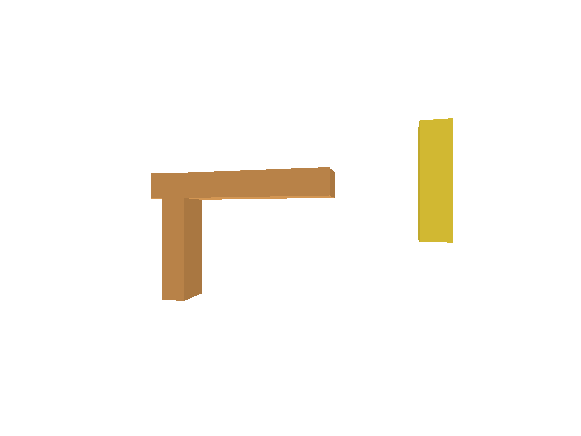
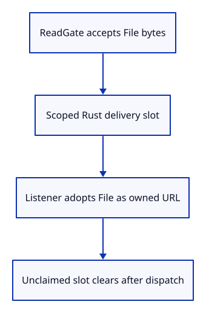

# 3.16.13 · Adopt the selected file as a reloadable source

**Chapter 3 · Documents, editing and ownership · Section 3.16 · Source ownership and restoration** · [Contents](contents.md)

**Typing: 24–47 minutes.** [Estimate](typing-load.md).

Pass the accepted File through one temporary delivery slot. Clear the slot after dispatch so cancelled or unclaimed files are released.

## Type

Continue from [Give a reload URL an explicit owner](32fe-location.md). [Save or recover your work](recovery.md).

### 1. `src/file_input.rs`

Hold an accepted File only across one synchronous editor delivery. Give the accepted read access to its scoped handoff slot. Transfer the File only after request ownership has been accepted. Pair bytes with their retained immutable File during dispatch. Always drop an unclaimed File after synchronous delivery, including dispatch failure. Adopt URL ownership only for a validated event with an accepted File.

<details>
<summary>Locate the existing block</summary>

```rust
use std::{cell::RefCell, rc::Rc};
use wasm_bindgen::{JsCast, JsValue};

#[derive(Clone, Copy, PartialEq, Eq)]
pub enum Mode { Append, Replace }

pub fn choose(event: &web_sys::Event, request: Rc<RefCell<crate::read_gate::ReadGate>>, mode: Mode) {
    let Some(input) = event.target().and_then(|target| target.dyn_into::<web_sys::HtmlInputElement>().ok()) else { return; };
    if input.id() != "open" { return; }
    let Some(file) = input.files().and_then(|files| files.get(0)) else { request.borrow_mut().cancel(); return; };
    input.set_value("");
    let Some(id) = request.borrow().pending() else { return; };
    super::browser::report("Reading the selected file…");
    wasm_bindgen_futures::spawn_local(async move {
        if request.borrow().pending() != Some(id) { return; }
        if file.size() > crate::document::MAX_BYTES as f64 {
            let accepted = request.borrow_mut().finish(id);
            if accepted { failure("This checkpoint accepts files up to 4 MiB"); }
            return;
        }
        let result = wasm_bindgen_futures::JsFuture::from(file.array_buffer()).await;
        let accepted = request.borrow_mut().finish(id);
        if !accepted { return; }
        let result = result.and_then(|buffer| deliver(buffer, mode));
        if let Err(error) = result {
            failure(&format!("Cannot read file: {error:?}"));
        }
    });
}

fn failure(message: &str) {
    let detail = web_sys::CustomEventInit::new();
    detail.set_detail(&JsValue::from_str(message));
    let result = web_sys::CustomEvent::new_with_event_init_dict("viewer-file-error", &detail)
        .and_then(|event| web_sys::window().ok_or_else(|| JsValue::from_str("No window"))?.dispatch_event(&event));
    if result.is_err() { super::browser::report(message); }
}

fn deliver(buffer: JsValue, mode: Mode) -> Result<(), JsValue> {
    let detail = web_sys::CustomEventInit::new();
    let payload = js_sys::Array::new();
    payload.push(&JsValue::from_bool(mode == Mode::Replace));
    payload.push(&js_sys::Uint8Array::new(&buffer));
    detail.set_detail(&payload);
    let event = web_sys::CustomEvent::new_with_event_init_dict("viewer-file", &detail)?;
    web_sys::window().ok_or("No browser window")?.dispatch_event(&event)?;
    Ok(())
}

pub fn action(event: &web_sys::Event) -> Option<crate::editor::Action> {
    let event = event.dyn_ref::<web_sys::CustomEvent>()?;
    let payload = event.detail().dyn_into::<js_sys::Array>().ok()?;
    if payload.length() != 2 { return None; }
    let replace = payload.get(0).as_bool()?;
    let array = payload.get(1).dyn_into::<js_sys::Uint8Array>().ok()?;
    if array.length() as usize > crate::document::MAX_BYTES { return None; }
    Some(if replace { crate::editor::Action::Replace(array.to_vec()) }
        else { crate::editor::Action::Import(array.to_vec()) })
}
```

</details>

Edit the existing block to match this code; keep unchanged lines:

```rust
use std::{cell::RefCell, rc::Rc};
use wasm_bindgen::{JsCast, JsValue};

#[derive(Clone, Copy, PartialEq, Eq)]
pub enum Mode { Append, Replace }

pub type Delivery = Rc<RefCell<Option<web_sys::File>>>;

pub fn choose(event: &web_sys::Event, request: Rc<RefCell<crate::read_gate::ReadGate>>, mode: Mode, delivery: Delivery) {
    let Some(input) = event.target().and_then(|target| target.dyn_into::<web_sys::HtmlInputElement>().ok()) else { return; };
    if input.id() != "open" { return; }
    let Some(file) = input.files().and_then(|files| files.get(0)) else { request.borrow_mut().cancel(); return; };
    input.set_value("");
    let Some(id) = request.borrow().pending() else { return; };
    super::browser::report("Reading the selected file…");
    wasm_bindgen_futures::spawn_local(async move {
        if request.borrow().pending() != Some(id) { return; }
        if file.size() > crate::document::MAX_BYTES as f64 {
            let accepted = request.borrow_mut().finish(id);
            if accepted { failure("This checkpoint accepts files up to 4 MiB"); }
            return;
        }
        let result = wasm_bindgen_futures::JsFuture::from(file.array_buffer()).await;
        let accepted = request.borrow_mut().finish(id);
        if !accepted { return; }
        let result = result.and_then(|buffer| deliver(buffer, mode, file, &delivery));
        if let Err(error) = result {
            failure(&format!("Cannot read file: {error:?}"));
        }
    });
}

fn failure(message: &str) {
    let detail = web_sys::CustomEventInit::new();
    detail.set_detail(&JsValue::from_str(message));
    let result = web_sys::CustomEvent::new_with_event_init_dict("viewer-file-error", &detail)
        .and_then(|event| web_sys::window().ok_or_else(|| JsValue::from_str("No window"))?.dispatch_event(&event));
    if result.is_err() { super::browser::report(message); }
}

fn deliver(buffer: JsValue, mode: Mode, file: web_sys::File, delivery: &Delivery) -> Result<(), JsValue> {
    let detail = web_sys::CustomEventInit::new();
    let payload = js_sys::Array::new();
    payload.push(&JsValue::from_bool(mode == Mode::Replace));
    payload.push(&js_sys::Uint8Array::new(&buffer));
    detail.set_detail(&payload);
    let event = web_sys::CustomEvent::new_with_event_init_dict("viewer-file", &detail)?;
    *delivery.borrow_mut() = Some(file);
    let result = web_sys::window().ok_or_else(|| JsValue::from_str("No browser window"))
        .and_then(|window| window.dispatch_event(&event));
    delivery.borrow_mut().take();
    result.map(|_| ())
}

pub fn action(event: &web_sys::Event, delivery: &Delivery) -> Result<Option<crate::editor::Action>, JsValue> {
    let Some(event) = event.dyn_ref::<web_sys::CustomEvent>() else { return Ok(None); };
    let Ok(payload) = event.detail().dyn_into::<js_sys::Array>() else { return Ok(None); };
    if payload.length() != 2 { return Ok(None); }
    let Some(replace) = payload.get(0).as_bool() else { return Ok(None); };
    let Ok(array) = payload.get(1).dyn_into::<js_sys::Uint8Array>() else { return Ok(None); };
    if array.length() as usize > crate::document::MAX_BYTES { return Ok(None); }
    let Some(file) = delivery.borrow_mut().take() else { return Ok(None); };
    let location = Rc::new(crate::reload_url::ReloadUrl::from_file(&file)?);
    Ok(Some(if replace { crate::editor::Action::ReplaceAt(array.to_vec(), location) }
        else { crate::editor::Action::ImportAt(array.to_vec(), location) }))
}
```

<details>
<summary>Optional patch references</summary>

Use these original edit fragments when comparing a saved checkpoint. Apply the complete blocks above.

```text
--8<-- "journey/code/32ff-bridge-01.rs"
```

```text
--8<-- "journey/code/32ff-bridge-02.rs"
```

```text
--8<-- "journey/code/32ff-bridge-03.rs"
```

```text
--8<-- "journey/code/32ff-bridge-04.rs"
```

```text
--8<-- "journey/code/32ff-bridge-05.rs"
```

```text
--8<-- "journey/code/32ff-bridge-06.rs"
```

</details>

### 2. `src/browser.rs`

Share one scoped delivery slot between reader and editor callback. Keep request tickets and File adoption in the same delivery path. Report adoption failure without claiming an import committed. Keep Replace success reporting accurate for the located action. Expose only hidden origin URL inspection for actual lifetime checks.

Edit these blocks from bottom to top. Keep the surrounding lines unchanged.

<details>
<summary>Locate this block</summary>

```rust
        (&row.guid, &m.source_guid, &m.name, m.is_visible, m.is_locked)
    }).collect();
    let origins: Vec<_> = editor.scene.objects().iter().filter_map(|row| row.source().map(|source|
        (&row.guid, source.origin.id.to_string(), source.origin.version.hex()))).collect();
    canvas.set_attribute("data-source-origins", &serde_json::to_string(&origins)
        .map_err(|error| JsValue::from_str(&error.to_string()))?)?;
    canvas.set_attribute("data-row-metadata", &serde_json::to_string(&metadata)
```

</details>

Replace it with:

```rust
        (&row.guid, &m.source_guid, &m.name, m.is_visible, m.is_locked)
    }).collect();
    let origins: Vec<_> = editor.scene.objects().iter().filter_map(|row| row.source().map(|source|
        (&row.guid, source.origin.id.to_string(), source.origin.version.hex(),
            source.origin.location.as_ref().map(|location| location.value())))).collect();
    canvas.set_attribute("data-source-origins", &serde_json::to_string(&origins)
        .map_err(|error| JsValue::from_str(&error.to_string()))?)?;
    canvas.set_attribute("data-row-metadata", &serde_json::to_string(&metadata)
```

<details>
<summary>Locate this block</summary>

```rust
            None
        };
        if let Some(action) = action {
            let replacement = matches!(&action, Action::Replace(_));
            let closing = matches!(&action, Action::Close);
            match editor.apply(action) {
                Ok(Change::Scene) => {
```

</details>

Replace it with:

```rust
            None
        };
        if let Some(action) = action {
            let replacement = matches!(&action, Action::Replace(_) | Action::ReplaceAt(_, _));
            let closing = matches!(&action, Action::Close);
            match editor.apply(action) {
                Ok(Change::Scene) => {
```

<details>
<summary>Locate this block</summary>

```rust
            }
            None
        } else if event.type_() == "viewer-file" {
            crate::file_input::action(&event)
        } else if let Some(line) = line {
            if line == "close" {
                request.borrow_mut().cancel();
```

</details>

Replace it with:

```rust
            }
            None
        } else if event.type_() == "viewer-file" {
            match crate::file_input::action(&event, &delivery) {
                Ok(action) => action,
                Err(error) => { let message = format!("Cannot retain reload file: {error:?}");
                    report(&message); panel.answer("Open", &message); None }
            }
        } else if let Some(line) = line {
            if line == "close" {
                request.borrow_mut().cancel();
```

<details>
<summary>Locate this block</summary>

```rust
            panel.answer("Open", "Open cancelled.");
            None
        } else if event.type_() == "change" {
            crate::file_input::choose(&event, std::rc::Rc::clone(&request), read_mode.get());
            None
        } else if event.type_() == "viewer-file-error" {
            if let Some(message) = event.dyn_ref::<web_sys::CustomEvent>().and_then(|event| event.detail().as_string()) {
```

</details>

Replace it with:

```rust
            panel.answer("Open", "Open cancelled.");
            None
        } else if event.type_() == "change" {
            crate::file_input::choose(&event, std::rc::Rc::clone(&request), read_mode.get(), std::rc::Rc::clone(&delivery));
            None
        } else if event.type_() == "viewer-file-error" {
            if let Some(message) = event.dyn_ref::<web_sys::CustomEvent>().and_then(|event| event.detail().as_string()) {
```

<details>
<summary>Locate this block</summary>

```rust
    let mut gesture = Gesture::default();
    let request = std::rc::Rc::new(std::cell::RefCell::new(crate::read_gate::ReadGate::default()));
    let read_mode = std::cell::Cell::new(crate::file_input::Mode::Append);
    let update = Closure::<dyn FnMut(web_sys::Event)>::new(move |event: web_sys::Event| {
        let shortcut = event.dyn_ref::<web_sys::KeyboardEvent>().and_then(|key| panel.shortcut(key));
        let line = if let Some(shortcut) = shortcut {
```

</details>

Replace it with:

```rust
    let mut gesture = Gesture::default();
    let request = std::rc::Rc::new(std::cell::RefCell::new(crate::read_gate::ReadGate::default()));
    let read_mode = std::cell::Cell::new(crate::file_input::Mode::Append);
    let delivery: crate::file_input::Delivery = std::rc::Rc::new(std::cell::RefCell::new(None));
    let update = Closure::<dyn FnMut(web_sys::Event)>::new(move |event: web_sys::Event| {
        let shortcut = event.dyn_ref::<web_sys::KeyboardEvent>().and_then(|key| panel.shortcut(key));
        let line = if let Some(shortcut) = shortcut {
```

<details>
<summary>Complete updated block reference</summary>

```rust
use crate::background::Background;
use crate::editor::{Action, Change, Editor};
use crate::gesture::Gesture;
use crate::renderer::Renderer;
use crate::viewport::Viewport;
use wasm_bindgen::{JsCast, JsValue, closure::Closure};

pub fn report(message: &str) {
    if let Some(document) = web_sys::window().and_then(|window| window.document()) {
        if let Some(status) = document.get_element_by_id("status") {
            status.set_text_content(Some(message));
            if message.starts_with("Cannot draw:") { let _ = status.remove_attribute("hidden"); }
        }
    }
}

pub async fn run() -> Result<(), JsValue> {
    let window = web_sys::window().ok_or("No browser window")?;
    let document = window.document().ok_or("No document")?;
    let canvas: web_sys::HtmlCanvasElement = document
        .get_element_by_id("canvas")
        .ok_or("Missing canvas")?
        .dyn_into()?;
    let instance = wgpu::Instance::new(wgpu::InstanceDescriptor {
        backends: wgpu::Backends::BROWSER_WEBGPU,
        flags: Default::default(),
        memory_budget_thresholds: Default::default(),
        backend_options: Default::default(),
        display: None,
    });
    let surface = instance
        .create_surface(wgpu::SurfaceTarget::Canvas(canvas.clone()))
        .map_err(|error| JsValue::from_str(&error.to_string()))?;
    let adapter = instance
        .request_adapter(&wgpu::RequestAdapterOptions {
            compatible_surface: Some(&surface),
            ..Default::default()
        })
        .await
        .map_err(|error| JsValue::from_str(&error.to_string()))?;
    let (device, queue) = adapter
        .request_device(&wgpu::DeviceDescriptor::default())
        .await
        .map_err(|error| JsValue::from_str(&error.to_string()))?;
    device.on_uncaptured_error(std::sync::Arc::new(|error| report(&error.to_string())));
    let limit = device.limits().max_texture_dimension_2d;
    let width = (window.inner_width()?.as_f64().ok_or("No window width")? as u32).clamp(1, limit);
    let height = (window.inner_height()?.as_f64().ok_or("No window height")? as u32).clamp(1, limit);
    canvas.set_width(width);
    canvas.set_height(height);
    let mut config = surface
        .get_default_config(&adapter, width, height)
        .ok_or("No compatible surface format")?;
    config.view_formats = vec![config.format.add_srgb_suffix()];
    surface.configure(&device, &config);
    let mut editor = Editor::default();
    let mut renderer = Renderer::new(
        device,
        queue,
        config.format.add_srgb_suffix(),
        &editor.scene,
    );
    renderer.resize(Viewport { width, height });
    inspect(&editor, &renderer)?;
    let mut panel = crate::panel::Panel::new(
        &renderer,
        config.format.add_srgb_suffix(),
        &[
            "Help",
            "Open",
            "Open Replace",
            "Cancel Open",
            "Close",
            "Save",
            "Example Box",
            "Example Triangle",
            "Select Next",
            "Delete",
            "Undo",
            "Redo",
            "Background",
            "Zoom In",
            "Zoom Out",
            "Pan Left",
            "Pan Right",
            "Orbit Right",
            "Orbit Up",
            "View Isometric",
            "View Perspective",
            "View Orthographic",
            "Fit",
            "Fit Selected",
            "Move",
            "View Reset",
        ],
    );
    panel.update(None, &canvas)?;
    if resize(
        &window,
        &canvas,
        &surface,
        &mut config,
        &mut renderer,
        &mut editor,
    ) {
        panel.update(None, &canvas)?;
        present(
            &surface,
            &renderer,
            &editor.background,
            &editor.camera.uniform(),
            &mut panel,
        )?;
    }
    let input_canvas = canvas.clone();
    let browser_window = window.clone();
    let pointer_canvas = canvas.clone();
    let mut gesture = Gesture::default();
    let request = std::rc::Rc::new(std::cell::RefCell::new(crate::read_gate::ReadGate::default()));
    let read_mode = std::cell::Cell::new(crate::file_input::Mode::Append);
    let delivery: crate::file_input::Delivery = std::rc::Rc::new(std::cell::RefCell::new(None));
    let update = Closure::<dyn FnMut(web_sys::Event)>::new(move |event: web_sys::Event| {
        let shortcut = event.dyn_ref::<web_sys::KeyboardEvent>().and_then(|key| panel.shortcut(key));
        let line = if let Some(shortcut) = shortcut {
            event.prevent_default();
            panel.answer(shortcut.command(), "");
            Some(shortcut.command().to_ascii_lowercase())
        } else { match panel.update(Some(&event), &input_canvas) {
            Ok(line) => line,
            Err(error) => {
                report(&format!("Cannot read command: {error:?}"));
                return;
            }
        } };

        let action = if event.type_() == "cancel" && event.target()
            .and_then(|target| target.dyn_into::<web_sys::HtmlInputElement>().ok())
            .is_some_and(|input| input.id() == "open")
        {
            request.borrow_mut().cancel();
            report("Open cancelled.");
            panel.answer("Open", "Open cancelled.");
            None
        } else if event.type_() == "change" {
            crate::file_input::choose(&event, std::rc::Rc::clone(&request), read_mode.get(), std::rc::Rc::clone(&delivery));
            None
        } else if event.type_() == "viewer-file-error" {
            if let Some(message) = event.dyn_ref::<web_sys::CustomEvent>().and_then(|event| event.detail().as_string()) {
                report(&message);
                panel.answer("Open", &message);
            }
            None
        } else if event.type_() == "viewer-file" {
            match crate::file_input::action(&event, &delivery) {
                Ok(action) => action,
                Err(error) => { let message = format!("Cannot retain reload file: {error:?}");
                    report(&message); panel.answer("Open", &message); None }
            }
        } else if let Some(line) = line {
            if line == "close" {
                request.borrow_mut().cancel();
                Some(Action::Close)
            } else if line == "cancel open" {
                request.borrow_mut().cancel();
                report("Open cancelled.");
                panel.result("Open cancelled.");
                None
            } else if line == "open" || line == "open replace" {
                let ticket = request.borrow_mut().begin();
                if let Err(error) = ticket { report(error); panel.result(error); return; }
                read_mode.set(if line == "open replace" { crate::file_input::Mode::Replace }
                    else { crate::file_input::Mode::Append });
                if let Some(input) = web_sys::window()
                    .and_then(|window| window.document())
                    .and_then(|document| document.get_element_by_id("open"))
                    .and_then(|element| element.dyn_into::<web_sys::HtmlInputElement>().ok())
                {
                    input.click();
                }
                None
            } else if line == "save" {
                match crate::document::snapshot(&editor.scene) {
                    Ok(bytes) => match crate::file_output::download(&bytes) {
                        Ok(()) => panel.result(&format!("Saved editable document ({} bytes)", bytes.len())),
                        Err(error) => panel.result(&format!("Save failed: {error:?}")),
                    },
                    Err(error) => panel.result(error),
                }
                None
            } else if line == "move" || line.starts_with("move ") {
                match crate::offset::parse(&line) {
                    Ok(offset) => Some(Action::Translate(offset)),
                    Err(error) => { panel.result(error); None }
                }
            } else {
                let action = match line.as_str() {
                    "example box" => Action::AddBox,
                    "example triangle" => Action::ToggleExtra,
                    "select next" => Action::SelectNext,
                    "delete" => Action::Delete,
                    "undo" => Action::Undo,
                    "redo" => Action::Redo,
                    "background" => Action::Background,
                    "zoom in" => Action::Zoom(2.0),
                    "zoom out" => Action::Zoom(0.5),
                    "pan left" => Action::Pan(-0.25, 0.0),
                    "pan right" => Action::Pan(0.25, 0.0),
                    "orbit right" => Action::Orbit(std::f64::consts::FRAC_PI_4, 0.0),
                    "orbit up" => Action::Orbit(0.0, std::f64::consts::FRAC_PI_6),
                    "view isometric" => Action::Isometric,
                    "view perspective" => {
                        Action::Projection(crate::camera::Projection::Perspective)
                    }
                    "view orthographic" => {
                        Action::Projection(crate::camera::Projection::Orthographic)
                    }
                    "fit" if shortcut.is_some() && editor.selected.is_some() => Action::FitSelected,
                    "fit" => Action::Fit,

                    "fit selected" => Action::FitSelected,
                    "view reset" => Action::ResetView,
                    _ => return,
                };
                Some(action)
            }
        } else if !panel.consumed {
            navigation_action(&event, &pointer_canvas, &mut gesture)
        } else {
            None
        };
        if let Some(action) = action {
            let replacement = matches!(&action, Action::Replace(_) | Action::ReplaceAt(_, _));
            let closing = matches!(&action, Action::Close);
            match editor.apply(action) {
                Ok(Change::Scene) => {
                    renderer.set_scene(&editor.scene, editor.selected);
                    if closing {
                        report("Document closed.");
                        panel.result("Document closed.");
                    } else if event.type_() == "viewer-file" {
                        let message = if replacement { "Document replaced. Undo restores the previous document." }
                            else { "File imported. Undo removes the entire import." };
                        report(message);
                        panel.answer(if replacement { "Open Replace" } else { "Open" }, message);
                    }
                }
                Ok(Change::View) => {}
                Err(error) => {
                    report(error);
                    if event.type_() == "viewer-file" { panel.answer("Open", error); }
                    else { panel.result(error); }
                }
            }
        }
        if let Err(error) = inspect(&editor, &renderer) {
            report(&format!("Cannot report projection: {error:?}"));
            return;
        }
        if resize(
            &browser_window,
            &pointer_canvas,
            &surface,
            &mut config,
            &mut renderer,
            &mut editor,
        ) {
            if let Err(error) = panel.update(None, &input_canvas) {
                report(&format!("Cannot lay out commands: {error:?}"));
                return;
            }
            if let Err(error) = present(
                &surface,
                &renderer,
                &editor.background,
                &editor.camera.uniform(),
                &mut panel,
            ) {
                report(&format!("Cannot redraw: {error:?}"));
            }
        }
    });
    for name in [
        "pointerdown",
        "pointermove",
        "pointerup",
        "pointercancel",
        "lostpointercapture",
        "contextmenu",
        "keydown",
        "keyup",
        "blur",
    ] {
        canvas.add_event_listener_with_callback(name, update.as_ref().unchecked_ref())?;
    }
    let options = web_sys::AddEventListenerOptions::new();
    options.set_passive(false);
    canvas.add_event_listener_with_callback_and_add_event_listener_options(
        "wheel",
        update.as_ref().unchecked_ref(),
        &options,
    )?;
    window.add_event_listener_with_callback("resize", update.as_ref().unchecked_ref())?;
    window.add_event_listener_with_callback("blur", update.as_ref().unchecked_ref())?;
    document.add_event_listener_with_callback("change", update.as_ref().unchecked_ref())?;
    document.add_event_listener_with_callback("cancel", update.as_ref().unchecked_ref())?;
    window.add_event_listener_with_callback("viewer-file", update.as_ref().unchecked_ref())?;
    window.add_event_listener_with_callback("viewer-file-error", update.as_ref().unchecked_ref())?;
    // Both event sources retain this one callback for the lifetime of the page.
    update.forget();
    report("Wheel zooms; type commands anywhere in the drawing. Escape cancels a drag.");
    Ok(())
}

fn inspect(editor: &Editor, renderer: &Renderer) -> Result<(), JsValue> {
    let document = web_sys::window()
        .and_then(|window| window.document())
        .ok_or("No document")?;
    let canvas = document
        .get_element_by_id("canvas")
        .ok_or("Missing canvas")?;
    canvas.set_attribute("data-object-count", &editor.scene.objects().len().to_string())?;
    let metadata: Vec<_> = editor.scene.objects().iter().map(|row| {
        let m = &row.metadata;
        (&row.guid, &m.source_guid, &m.name, m.is_visible, m.is_locked)
    }).collect();
    let origins: Vec<_> = editor.scene.objects().iter().filter_map(|row| row.source().map(|source|
        (&row.guid, source.origin.id.to_string(), source.origin.version.hex(),
            source.origin.location.as_ref().map(|location| location.value())))).collect();
    canvas.set_attribute("data-source-origins", &serde_json::to_string(&origins)
        .map_err(|error| JsValue::from_str(&error.to_string()))?)?;
    canvas.set_attribute("data-row-metadata", &serde_json::to_string(&metadata)
        .map_err(|error| JsValue::from_str(&error.to_string()))?)?;
    canvas.set_attribute("data-gpu-stats", &format!("{:?}", renderer.stats()))?;
    let cpu = crate::memory::cpu(editor.scenes(), renderer.geometry_owners().map(|owner| &owner.source));
    canvas.set_attribute("data-cpu-usage", &format!("{cpu:?}"))?;
    canvas.set_attribute("data-gpu-usage", &format!("{:?}", renderer.usage()))?;
    canvas.set_attribute("data-projection", &format!("{:?}", editor.camera.projection))
}

fn navigation_action(
    event: &web_sys::Event,
    canvas: &web_sys::HtmlCanvasElement,
    gesture: &mut Gesture,
) -> Option<Action> {
    let action = match event.type_().as_str() {
        "wheel" => {
            let wheel = event.dyn_ref::<web_sys::WheelEvent>()?;
            let mode = wheel.delta_mode();
            crate::navigation::wheel(
                wheel.delta_y(),
                mode,
                canvas.get_bounding_client_rect().height(),
            )
        }
        "keydown" => {
            let key = event.dyn_ref::<web_sys::KeyboardEvent>()?;
            if key.is_composing() || key.alt_key() {
                return None;
            }
            if key.key() == "Escape" {
                gesture.cancel();
                event.prevent_default();
                return None;
            }
            return None;
        }
        _ => return pointer_action(event, canvas, gesture),
    }?;
    event.prevent_default();
    Some(action)
}

fn pointer_action(
    event: &web_sys::Event,
    canvas: &web_sys::HtmlCanvasElement,
    gesture: &mut Gesture,
) -> Option<Action> {
    match event.type_().as_str() {
        "contextmenu" => {
            event.prevent_default();
            return None;
        }
        "blur" | "resize" => {
            gesture.cancel();
            return None;
        }
        _ => {}
    }
    let pointer = event.dyn_ref::<web_sys::PointerEvent>()?;
    let id = pointer.pointer_id();
    let position = [pointer.client_x() as f64, pointer.client_y() as f64];
    let motion = match event.type_().as_str() {
        "pointerdown" => {
            if pointer.is_primary() && gesture.press(id, pointer.button(), position) {
                event.prevent_default();
                let options = web_sys::FocusOptions::new();
                options.set_prevent_scroll(true);
                if canvas.focus_with_options(&options).is_err()
                    || canvas.set_pointer_capture(id).is_err()
                {
                    gesture.cancel();
                }
            }
            None
        }
        "pointermove" => gesture.move_to(id, position),
        "pointerup" => {
            let motion = gesture.release(id, position);
            let _ = canvas.release_pointer_capture(id);
            motion
        }
        "pointercancel" | "lostpointercapture" => {
            gesture.cancel_pointer(id);
            None
        }
        _ => None,
    }?;
    let rect = canvas.get_bounding_client_rect();
    motion.action([rect.left(), rect.top(), rect.width(), rect.height()])
}

fn resize(
    window: &web_sys::Window,
    canvas: &web_sys::HtmlCanvasElement,
    surface: &wgpu::Surface<'_>,
    config: &mut wgpu::SurfaceConfiguration,
    renderer: &mut Renderer,
    editor: &mut Editor,
) -> bool {
    let rect = canvas.get_bounding_client_rect();
    let limit = renderer.device.limits().max_texture_dimension_2d;
    let Some(size) = Viewport::from_css(
        rect.width(),
        rect.height(),
        window.device_pixel_ratio(),
        limit,
    ) else {
        return false;
    };
    if size.width != config.width || size.height != config.height {
        canvas.set_width(size.width);
        canvas.set_height(size.height);
        config.width = size.width;
        config.height = size.height;
        surface.configure(&renderer.device, config);
        renderer.resize(size);
    }
    editor.camera.aspect = size.aspect();
    true
}

fn present(
    surface: &wgpu::Surface<'_>,
    renderer: &Renderer,
    background: &Background,
    transform: &[f32; 16],
    panel: &mut crate::panel::Panel,
) -> Result<(), JsValue> {
    let frame = match surface.get_current_texture() {
        wgpu::CurrentSurfaceTexture::Success(frame)
        | wgpu::CurrentSurfaceTexture::Suboptimal(frame) => frame,
        other => {
            return Err(JsValue::from_str(&format!(
                "Surface unavailable: {other:?}"
            )));
        }
    };
    let view = frame.texture.create_view(&wgpu::TextureViewDescriptor {
        format: Some(frame.texture.format().add_srgb_suffix()),
        ..Default::default()
    });
    renderer.draw(&view, background, transform);
    panel.draw(renderer, &view);
    frame.present();
    Ok(())
}
```

</details>

<details>
<summary>Optional patch references</summary>

Use these original edit fragments when comparing a saved checkpoint. Apply the complete blocks above.

```text
--8<-- "journey/code/32ff-bridge-07.rs"
```

```text
--8<-- "journey/code/32ff-bridge-08.rs"
```

```text
--8<-- "journey/code/32ff-bridge-09.rs"
```

```text
--8<-- "journey/code/32ff-bridge-10.rs"
```

```text
--8<-- "journey/code/32ff-bridge-11.rs"
```

</details>

## Run and check

In your project:

```sh
cd workspace/journey
REGEN_PROTO=0 cargo build --lib --locked --target wasm32-unknown-unknown -j1
REGEN_PROTO=0 CARGO_BUILD_JOBS=1 trunk serve --port 8780
```

Open `http://127.0.0.1:8780/`. Keep an existing Trunk server running; saving rebuilds it.

Open `sample.pb`. Run the adoption checks below: only an accepted read may acquire its Blob URL; cancelled or stale reads must not retain one.

### Recorded visual result

**Previous native render — current verification pending.**



*This recorded image predates a source or checker change. Rebuild this checkpoint before using it as current evidence; browser controls require separate acceptance.*

<details>
<summary>Code explanation and diagram</summary>

The browser already owns asynchronous file delivery through ReadGate. Add one shared delivery slot holding the accepted File only during the viewer-file dispatch. After the read finishes and its ticket is accepted, the producer places the File in this slot, dispatches, then clears any unclaimed value.

The listener validates the event payload, takes the File, creates ReloadUrl and builds ImportAt or ReplaceAt. An error creating the URL is reported through the Open history entry. A malformed file creates an owner that is dropped when editor loading fails; a stale read never creates a URL.

The slot is a Rust handoff, not a persistent cache of file bytes or kernel sources. It also prevents an unrelated external viewer-file event from manufacturing a located import without an accepted File. Later listener teardown cancels work and releases this handoff lifetime.

Transfer the accepted File through synchronous delivery and create its URL at adoption..



Why not create a Blob URL as soon as the user selects a file?

Its read may be cancelled, superseded or rejected before adoption. Keep the File while reading, finish the request ticket first, and create the URL only when the synchronous editor callback accepts delivery. Clear any unclaimed delivery slot afterwards.

Study estimate, including typing and experiments: 1–2 hours.

</details>

<details>
<summary>Optional experiment</summary>

Remove the final delivery-slot cleanup in a scratch copy and predict what happens if no listener adopts its File. Keep the production implementation unchanged after the experiment.

</details>

<details>
<summary>Check and save your work</summary>

Restore experimental edits, then run from `session_viewer`:

```sh
npm --prefix ../session_tests run course -- check 3.16.13
npm --prefix ../session_tests run course -- save 3.16.13
```

Source comparison leaves your project untouched. [Save and recovery instructions](recovery.md).

</details>

<details>
<summary>Viewer coverage and verification</summary>

Accepted immutable Files now have a reload path and exact byte version. Source residency can change next without inventing URLs from kernel geometry or drawing floats.

Chrome checks real fetches from adopted URLs, invalid-import revocation, cancelled reads with no new URLs, URL retention through Undo/Redo and revocation after Close. Recordings use the browser’s URL methods, while the resulting drawing remains the same command-only viewer.

[Full validation scope](release.md).

To reproduce the scripted acceptance of the reference checkpoint, run from `session_viewer` with the [course bundle server](release.md#reproduce) running on port 8781:

```sh
npm --prefix ../session_tests run course -- capture 3.16.13
```

This uses the verified reference bundle; it does not check or change your typed project.

</details>
