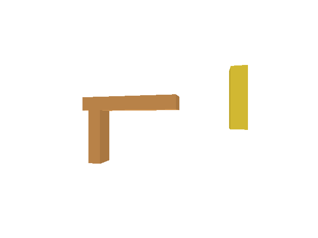
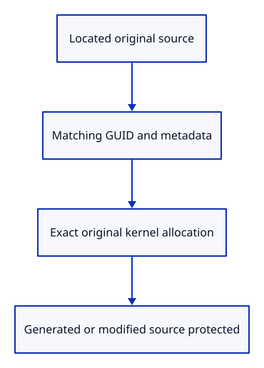

# 3.16.15 · Protect sources that cannot be unloaded faithfully

**Chapter 3 · Documents, editing and ownership · Section 3.16 · Source ownership and restoration** · [Contents](contents.md)

**Typing: 21–41 minutes.** [Estimate](typing-load.md).

A release policy must preserve data that cannot be restored. Generated rows have no imported source. Imports without a location cannot be read again. A new kernel allocation or edited source metadata must not silently revert to the original file.

## Type

Continue from [Separate loaded and released editable ownership](32fg-state.md). [Save or recover your work](recovery.md).

### 1. `src/scene.rs`

Only original, located imported sources can be restored by their original file. Apply a validated origin set without touching retained display/model/metadata owners. Prove the conditions that protect data not faithfully reloadable from the original file.

Edit these blocks from bottom to top. Keep the surrounding lines unchanged.

<details>
<summary>Locate this block</summary>

```rust
    use super::*;

    #[test]
    fn partial_replacement_failure_restores_owners_without_reusing_ids() {
        let mut scene = Scene::demo();
        let before = scene.objects.clone();
```

</details>

Replace it with:

```rust
    use super::*;

    #[test]
    fn unloading_policy_protects_generated_unlocated_and_modified_sources() {
        let mut scene = Scene::demo(); assert!(!scene.objects[0].can_unload());
        let bytes = crate::specimen::bytes();
        scene.replace(crate::document::load(&bytes).unwrap()).unwrap(); assert!(!scene.objects[0].can_unload());
        let url = Rc::new(crate::reload_url::ReloadUrl::new("test:policy".into()));
        scene.replace(crate::document::load_at(&bytes, Some(url)).unwrap()).unwrap();
        assert!(scene.objects.iter().all(Object::can_unload));
        let row = &mut scene.objects[0];
        Rc::make_mut(&mut row.metadata).is_locked = true; assert!(!row.can_unload());
        Rc::make_mut(&mut row.metadata).is_locked = row.geometry().unwrap().is_locked;
        assert!(row.can_unload());
        let source = row.source().cloned(); let geometry = Rc::new(session_rust::Mesh::create_box(1.0, 1.0, 1.0));
        row.editable = crate::edit_source::EditSource::Loaded { geometry, source }; assert!(!row.can_unload());
    }

    #[test]
    fn partial_replacement_failure_restores_owners_without_reusing_ids() {
        let mut scene = Scene::demo();
        let before = scene.objects.clone();
```

<details>
<summary>Locate this block</summary>

```rust
        &self.objects
    }

    pub fn insert(&mut self, prepared: PreparedMesh) -> Result<ObjectId, &'static str> {
        let next = self.next_id.checked_add(1).ok_or("Object IDs exhausted")?;
        let id = ObjectId(self.next_id);
```

</details>

Replace it with:

```rust
        &self.objects
    }

    pub(crate) fn objects_mut(&mut self) -> &mut [Object] { &mut self.objects }

    pub(crate) fn unload(&mut self, origins: &std::collections::HashSet<uuid::Uuid>, epoch: u64) {
        for row in &mut self.objects {
            if let Some(origin) = row.origin().filter(|origin| origins.contains(&origin.id)).cloned() {
                row.editable = crate::edit_source::EditSource::Released { origin, epoch };
            }
        }
    }

    pub fn insert(&mut self, prepared: PreparedMesh) -> Result<ObjectId, &'static str> {
        let next = self.next_id.checked_add(1).ok_or("Object IDs exhausted")?;
        let id = ObjectId(self.next_id);
```

<details>
<summary>Locate this block</summary>

```rust
        match &self.editable { crate::edit_source::EditSource::Released { epoch, .. } => Some(*epoch), _ => None }
    }

    pub fn world_point(&self, vertex: [f32; 6]) -> [f64; 3] {
        let local = session_rust::Point::new(vertex[0] as f64, vertex[1] as f64, vertex[2] as f64);
        let world = self.model.transform_point(&local);
```

</details>

Replace it with:

```rust
        match &self.editable { crate::edit_source::EditSource::Released { epoch, .. } => Some(*epoch), _ => None }
    }

    pub fn can_unload(&self) -> bool {
        let Some(source) = self.source() else { return false; };
        let Some(geometry) = self.geometry() else { return false; };
        source.origin.location.is_some() && self.metadata.source_guid == source.guid
            && geometry.guid() == source.guid && self.metadata.name == geometry.name
            && self.metadata.is_visible == geometry.is_visible && self.metadata.is_locked == geometry.is_locked
            && source.document.objects.meshes.iter().any(|mesh| Rc::ptr_eq(mesh, geometry))
    }

    pub fn world_point(&self, vertex: [f32; 6]) -> [f64; 3] {
        let local = session_rust::Point::new(vertex[0] as f64, vertex[1] as f64, vertex[2] as f64);
        let world = self.model.transform_point(&local);
```

<details>
<summary>Complete updated block reference</summary>

```rust
use crate::{mesh::Mesh, prepared::PreparedMesh};
use std::rc::Rc;

#[derive(Clone, Copy, Debug, PartialEq, Eq)]
pub struct ObjectId(u32);

#[derive(Clone)]
pub struct Object {
    pub id: ObjectId,
    pub guid: String,
    pub metadata: Rc<crate::row_metadata::RowMetadata>,
    pub mesh: Rc<Mesh>,
    pub model: session_rust::Xform,
    editable: crate::edit_source::EditSource,
}

impl Object {
    pub fn geometry(&self) -> Option<&Rc<session_rust::Mesh>> {
        match &self.editable { crate::edit_source::EditSource::Loaded { geometry, .. } => Some(geometry), _ => None }
    }

    pub fn source(&self) -> Option<&crate::document::Source> {
        match &self.editable { crate::edit_source::EditSource::Loaded { source, .. } => source.as_ref(), _ => None }
    }

    pub fn origin(&self) -> Option<&Rc<crate::origin::Origin>> {
        match &self.editable {
            crate::edit_source::EditSource::Loaded { source, .. } => source.as_ref().map(|source| &source.origin),
            crate::edit_source::EditSource::Released { origin, .. } => Some(origin),
        }
    }

    pub fn release_epoch(&self) -> Option<u64> {
        match &self.editable { crate::edit_source::EditSource::Released { epoch, .. } => Some(*epoch), _ => None }
    }

    pub fn can_unload(&self) -> bool {
        let Some(source) = self.source() else { return false; };
        let Some(geometry) = self.geometry() else { return false; };
        source.origin.location.is_some() && self.metadata.source_guid == source.guid
            && geometry.guid() == source.guid && self.metadata.name == geometry.name
            && self.metadata.is_visible == geometry.is_visible && self.metadata.is_locked == geometry.is_locked
            && source.document.objects.meshes.iter().any(|mesh| Rc::ptr_eq(mesh, geometry))
    }

    pub fn world_point(&self, vertex: [f32; 6]) -> [f64; 3] {
        let local = session_rust::Point::new(vertex[0] as f64, vertex[1] as f64, vertex[2] as f64);
        let world = self.model.transform_point(&local);
        [world[0], world[1], world[2]]
    }
}

#[derive(Clone)]
pub struct Scene {
    objects: Vec<Object>,
    next_id: u32,
    extra: Option<ObjectId>,
}

impl Scene {
    pub fn demo() -> Self {
        let pink = PreparedMesh::triangle([
            [-0.7, -0.6, 0.25], [0.5, -0.6, 0.25], [-0.1, 0.6, 0.25],
        ], [0.9, 0.25, 0.45]).expect("Valid pink triangle");
        let turquoise = PreparedMesh::triangle([
            [-0.4, -0.2, 0.75], [0.8, -0.2, 0.75], [0.2, 0.8, 0.75],
        ], [0.05, 0.7, 0.7]).expect("Valid turquoise triangle");
        let mut scene = Self { objects: Vec::new(), next_id: 1, extra: None };
        scene.insert(pink).expect("ID available");
        scene.insert(turquoise).expect("ID available");
        scene
    }

    pub fn restore(&mut self, mut saved: Self) {
        saved.next_id = saved.next_id.max(self.next_id);
        *self = saved;
    }

    pub fn bounds(&self) -> Option<crate::bounds::Bounds> {
        let mut bounds: Option<crate::bounds::Bounds> = None;
        for object in &self.objects {
            for vertex in object.mesh.vertices() {
                let point = object.world_point(*vertex);
                match &mut bounds {
                    Some(bounds) => bounds.include(point),
                    None => bounds = Some(crate::bounds::Bounds::point(point)),
                }
            }
        }
        bounds
    }

    pub fn selected_bounds(&self, id: ObjectId) -> Option<crate::bounds::Bounds> {
        let object = self.objects.iter().find(|object| object.id == id)?;
        let mut vertices = object.mesh.vertices().iter();
        let first = vertices.next()?;
        let mut bounds = crate::bounds::Bounds::point(object.world_point(*first));
        for vertex in vertices {
            bounds.include(object.world_point(*vertex));
        }
        Some(bounds)
    }

    pub fn objects(&self) -> &[Object] {
        &self.objects
    }

    pub(crate) fn objects_mut(&mut self) -> &mut [Object] { &mut self.objects }

    pub(crate) fn unload(&mut self, origins: &std::collections::HashSet<uuid::Uuid>, epoch: u64) {
        for row in &mut self.objects {
            if let Some(origin) = row.origin().filter(|origin| origins.contains(&origin.id)).cloned() {
                row.editable = crate::edit_source::EditSource::Released { origin, epoch };
            }
        }
    }

    pub fn insert(&mut self, prepared: PreparedMesh) -> Result<ObjectId, &'static str> {
        let next = self.next_id.checked_add(1).ok_or("Object IDs exhausted")?;
        let id = ObjectId(self.next_id);
        self.next_id = next;
        let mut guid = prepared.geometry.guid().to_owned();
        while self.objects.iter().any(|object| object.guid == guid) {
            guid = uuid::Uuid::new_v4().to_string();
        }
        let metadata = Rc::new(crate::row_metadata::RowMetadata::from_mesh(&prepared.geometry));
        let editable = crate::edit_source::EditSource::Loaded { geometry: prepared.geometry, source: prepared.source };
        self.objects.push(Object { id, guid, metadata, mesh: Rc::new(prepared.display), model: prepared.model, editable });
        Ok(id)
    }

    pub fn clear(&mut self) {
        self.objects = Vec::new();
        self.extra = None;
    }

    pub fn replace(&mut self, loaded: crate::document::Loaded) -> Result<(), &'static str> {
        self.clear();
        self.import(loaded)
    }

    pub fn import(&mut self, loaded: crate::document::Loaded) -> Result<(), &'static str> {
        for prepared in loaded.meshes {
            self.insert(prepared)?;
        }
        Ok(())
    }

    pub fn place(&mut self, id: ObjectId, model: session_rust::Xform) -> Result<(), &'static str> {
        if !crate::placement::valid(&model.m)
        {
            return Err("Placement must be finite, affine and fit the display range");
        }
        let object = self.objects.iter_mut().find(|o| o.id == id).ok_or("Object not found")?;
        object.model = model;
        Ok(())
    }

    pub fn remove(&mut self, id: ObjectId) -> bool {
        let Some(index) = self.objects.iter().position(|object| object.id == id) else { return false; };
        self.objects.remove(index);
        if self.extra == Some(id) {
            self.extra = None;
        }
        true
    }

    pub fn contains(&self, id: ObjectId) -> bool {
        self.objects.iter().any(|object| object.id == id)
    }

    pub fn next(&self, current: Option<ObjectId>) -> Option<ObjectId> {
        if self.objects.is_empty() {
            return None;
        }
        let index = self.objects.iter().position(|object| Some(object.id) == current)
            .map_or(0, |index| index + 1);
        Some(self.objects[index % self.objects.len()].id)
    }

    pub fn add_box(&mut self) -> Result<ObjectId, &'static str> {
        let mut source = session_rust::Mesh::create_box(0.8, 0.8, 0.8);
        source.set_objectcolor(session_rust::Color::new(0.65, 0.65, 0.65, 1.0));
        let id = self.insert(PreparedMesh::new(source)?)?;
        self.place(id, session_rust::Xform::translation(0.9, 0.0, 0.4))?;
        Ok(id)
    }

    pub fn toggle_extra(&mut self) {
        if let Some(id) = self.extra.take() {
            self.remove(id);
        } else {
            let extra = PreparedMesh::triangle([
                [-0.9, 0.3, 0.5], [-0.4, 0.3, 0.5], [-0.65, 0.9, 0.5],
            ], [0.2, 0.8, 0.3]).expect("Valid extra triangle");
            self.extra = Some(self.insert(extra).expect("ID available"));
        }
    }
}

#[cfg(test)]
mod tests {
    use super::*;

    #[test]
    fn unloading_policy_protects_generated_unlocated_and_modified_sources() {
        let mut scene = Scene::demo(); assert!(!scene.objects[0].can_unload());
        let bytes = crate::specimen::bytes();
        scene.replace(crate::document::load(&bytes).unwrap()).unwrap(); assert!(!scene.objects[0].can_unload());
        let url = Rc::new(crate::reload_url::ReloadUrl::new("test:policy".into()));
        scene.replace(crate::document::load_at(&bytes, Some(url)).unwrap()).unwrap();
        assert!(scene.objects.iter().all(Object::can_unload));
        let row = &mut scene.objects[0];
        Rc::make_mut(&mut row.metadata).is_locked = true; assert!(!row.can_unload());
        Rc::make_mut(&mut row.metadata).is_locked = row.geometry().unwrap().is_locked;
        assert!(row.can_unload());
        let source = row.source().cloned(); let geometry = Rc::new(session_rust::Mesh::create_box(1.0, 1.0, 1.0));
        row.editable = crate::edit_source::EditSource::Loaded { geometry, source }; assert!(!row.can_unload());
    }

    #[test]
    fn partial_replacement_failure_restores_owners_without_reusing_ids() {
        let mut scene = Scene::demo();
        let before = scene.objects.clone();
        scene.next_id = u32::MAX - 1;
        let loaded = crate::document::load(&crate::specimen::bytes()).unwrap();
        let mut history = crate::history::History::default();
        assert!(history.try_edit(&mut scene, |scene| scene.replace(loaded)).is_err());
        assert_eq!(scene.next_id, u32::MAX);
        assert_eq!(scene.objects.len(), before.len());
        for (object, old) in scene.objects.iter().zip(&before) {
            assert_eq!(object.id, old.id);
            assert!(Rc::ptr_eq(object.geometry().unwrap(), old.geometry().unwrap()));
            assert!(Rc::ptr_eq(&object.mesh, &old.mesh));
        }
        assert!(!history.undo(&mut scene));
    }

    #[test]
    fn removal_moves_a_row_without_changing_its_identity() {
        let mut scene = Scene::demo();
        let first = scene.objects()[0].id;
        let second = scene.objects()[1].id;
        assert!(scene.remove(first));
        assert_eq!(scene.objects()[0].id, second);
        assert_eq!(scene.next(None), Some(second));
        assert!(!scene.contains(first));
        scene.toggle_extra();
        assert_ne!(scene.objects()[1].id, first);
        assert_ne!(scene.objects()[1].id, second);
    }

    #[test]
    fn toggling_the_extra_object_uses_its_id_after_other_removals() {
        let mut scene = Scene::demo();
        scene.toggle_extra();
        let extra = scene.objects()[2].id;
        scene.remove(scene.objects()[0].id);
        scene.toggle_extra();
        assert!(!scene.contains(extra));
        assert_eq!(scene.objects().len(), 1);
    }
}
```

</details>

<details>
<summary>Optional patch references</summary>

Use these original edit fragments when comparing a saved checkpoint. Apply the complete blocks above.

```text
--8<-- "journey/code/32fh-policy-01.rs"
```

```text
--8<-- "journey/code/32fh-policy-02.rs"
```

```text
--8<-- "journey/code/32fh-policy-03.rs"
```

</details>

## Run and check

In your project:

```sh
cd workspace/journey
REGEN_PROTO=0 cargo build --lib --locked --target wasm32-unknown-unknown -j1
REGEN_PROTO=0 CARGO_BUILD_JOBS=1 trunk serve --port 8780
```

Open `http://127.0.0.1:8780/`. Keep an existing Trunk server running; saving rebuilds it.

Run the unload-policy checks below. Only unmodified rows with a usable source location are eligible; protected rows remain loaded.

### Recorded visual result

**Previous native render — current verification pending.**



*This recorded image predates a source or checker change. Rebuild this checkpoint before using it as current evidence; browser controls require separate acceptance.*

<details>
<summary>Code explanation and diagram</summary>

can_unload checks a located Loaded source, its original GUID, name/visibility/locking metadata, and the exact kernel allocation retained by its imported Session. The allocation check distinguishes original data from a modified replacement even when its values happen to compare equal. Model placement is separate row state, so Move does not make an otherwise original source ineligible.

Add borrowed mutable row access for the forthcoming residency pass, and Scene::unload as the operation on a previously validated set of origins. It changes only editable ownership to Released. The editor-wide origin validation comes next; no dock command exists yet.

Native policy tests protect generated/unlocated sources, changed flags and replacement kernel owners. The whole-origin check in the next lesson will inspect active, Undo and Redo roots before any mutation.

Require a reload location, original kernel allocation and unchanged row metadata..



Why does one modified history row protect every row of that origin?

They share one reload source. Reloading its original bytes cannot reproduce modified kernel data in that snapshot. Protect the whole origin whenever any retained row no longer matches the original source contract.

Study estimate, including typing and experiments: 1–2 hours.

</details>

<details>
<summary>Optional experiment</summary>

Change only placement in a fixture, then change a source flag. Explain why the first remains reloadable while the second must be protected at this endpoint.

</details>

<details>
<summary>Check and save your work</summary>

Restore experimental edits, then run from `session_viewer`:

```sh
npm --prefix ../session_tests run course -- check 3.16.15
npm --prefix ../session_tests run course -- save 3.16.15
```

Source comparison leaves your project untouched. [Save and recovery instructions](recovery.md).

</details>

<details>
<summary>Viewer coverage and verification</summary>

Production avoids unloading edited source documents. Our scene-snapshot history requires checking every retained origin row before releasing their shared sources.


[Full validation scope](release.md).

To reproduce the scripted acceptance of the reference checkpoint, run from `session_viewer` with the [course bundle server](release.md#reproduce) running on port 8781:

```sh
npm --prefix ../session_tests run course -- capture 3.16.15
```

This uses the verified reference bundle; it does not check or change your typed project.

</details>
