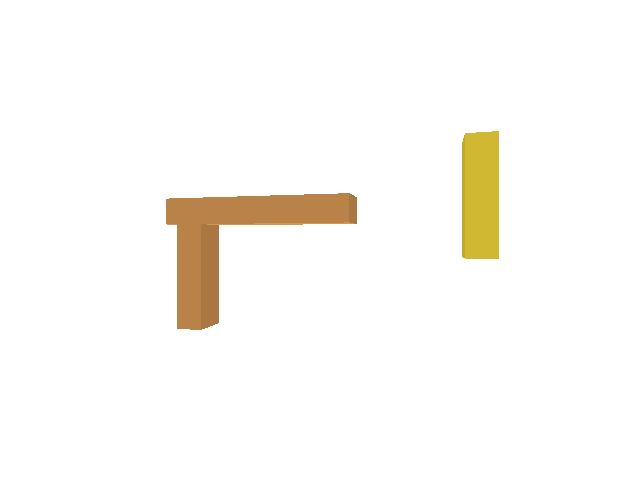
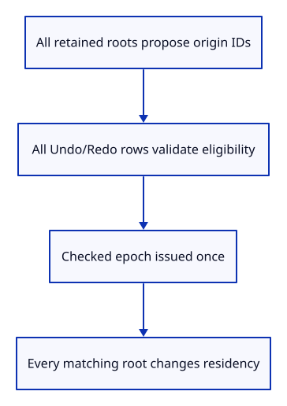

# 3.16.16 · Unload sources across active and history roots

**Chapter 3 · Documents, editing and ownership · Section 3.16 · Source ownership and restoration** · [Contents](contents.md)

**Typing: 16–32 minutes.** [Estimate](typing-load.md).

Plan source unloading before mutating. Collect eligible origins across active, Undo and Redo roots; exclude any origin with a protected row. An empty plan returns an error.

## Type

Continue from [Protect sources that cannot be unloaded faithfully](32fh-policy.md). [Save or recover your work](recovery.md).

### 1. `src/history.rs`

Visit both history branches without cloning or dropping their rows.

<details>
<summary>Locate the existing block</summary>

```rust
    pub fn clear(&mut self) {
```

</details>

Edit the existing block to match this code; keep unchanged lines:

```rust
--8<-- "journey/code/32fi-history-01.rs"
```

### 2. `src/editor.rs`

Add a residency operation distinct from document close. Issue epochs independently of document history and Close. Start the first viewer-owned release sequence without wraparound. Validate every retained origin row before issuing an epoch or changing any owner. Keep source unloading out of document Undo transactions.

Edit these blocks from bottom to top. Keep the surrounding lines unchanged.

<details>
<summary>Locate this block</summary>

```rust
        std::iter::once(&self.scene).chain(self.history.scenes())
    }

    pub fn apply(&mut self, action: Action) -> Result<Change, &'static str> {
        match action {
            Action::Pick(screen) => {
                self.selected = self.camera.ray(screen)
                    .and_then(|ray| crate::picking::pick(&self.scene, &ray));
            }
            Action::Close => {
                self.scene.clear();
                self.history.clear();
```

</details>

Replace it with:

```rust
        std::iter::once(&self.scene).chain(self.history.scenes())
    }

    fn scenes_mut(&mut self) -> impl Iterator<Item = &mut Scene> {
        std::iter::once(&mut self.scene).chain(self.history.scenes_mut())
    }

    fn unload_sources(&mut self) -> Result<(), &'static str> {
        let mut origins: std::collections::HashSet<_> = self.scenes().flat_map(|scene| scene.objects())
            .filter(|row| row.can_unload()).filter_map(|row| row.origin().map(|origin| origin.id)).collect();
        for row in self.scenes().flat_map(|scene| scene.objects()) {
            if let Some(origin) = row.origin() {
                if !row.can_unload() { origins.remove(&origin.id); }
            }
        }
        if origins.is_empty() { return Err("No eligible imported sources to unload"); }
        let epoch = self.last_release.checked_add(1).ok_or("Release epochs exhausted")?;
        for scene in self.scenes_mut() { scene.unload(&origins, epoch); }
        self.last_release = epoch;
        Ok(())
    }

    pub fn apply(&mut self, action: Action) -> Result<Change, &'static str> {
        match action {
            Action::Pick(screen) => {
                self.selected = self.camera.ray(screen)
                    .and_then(|ray| crate::picking::pick(&self.scene, &ray));
            }
            Action::UnloadSources => self.unload_sources()?,
            Action::Close => {
                self.scene.clear();
                self.history.clear();
```

<details>
<summary>Locate this block</summary>

```rust
            camera: Camera::default(),
            background: Background::default(),
            history: History::default(),
        }
    }
}
```

</details>

Replace it with:

```rust
            camera: Camera::default(),
            background: Background::default(),
            history: History::default(),
            last_release: 0,
        }
    }
}
```

<details>
<summary>Locate this block</summary>

```rust
    pub camera: Camera,
    pub background: Background,
    history: History,
}

impl Default for Editor {
```

</details>

Replace it with:

```rust
    pub camera: Camera,
    pub background: Background,
    history: History,
    last_release: u64,
}

impl Default for Editor {
```

<details>
<summary>Locate this block</summary>

```rust
    ImportAt(Vec<u8>, std::rc::Rc<crate::reload_url::ReloadUrl>),
    ReplaceAt(Vec<u8>, std::rc::Rc<crate::reload_url::ReloadUrl>),
    Close,
    AddBox,
    Translate([f64; 3]),
    ToggleExtra,
```

</details>

Replace it with:

```rust
    ImportAt(Vec<u8>, std::rc::Rc<crate::reload_url::ReloadUrl>),
    ReplaceAt(Vec<u8>, std::rc::Rc<crate::reload_url::ReloadUrl>),
    Close,
    UnloadSources,
    AddBox,
    Translate([f64; 3]),
    ToggleExtra,
```

<details>
<summary>Complete updated block reference</summary>

```rust
use crate::{background::Background, camera::Camera, history::History, scene::{ObjectId, Scene}};

pub enum Action {
    Pick([f32; 2]),
    Import(Vec<u8>),
    Replace(Vec<u8>),
    ImportAt(Vec<u8>, std::rc::Rc<crate::reload_url::ReloadUrl>),
    ReplaceAt(Vec<u8>, std::rc::Rc<crate::reload_url::ReloadUrl>),
    Close,
    UnloadSources,
    AddBox,
    Translate([f64; 3]),
    ToggleExtra,
    SelectNext,
    Delete,
    Undo,
    Redo,
    Background,
    Zoom(f32),
    Pan(f32, f32),
    Orbit(f64, f64),
    Isometric,
    ResetView,
    Fit,
    FitSelected,
    Projection(crate::camera::Projection),
}

#[derive(Debug, PartialEq, Eq)]
pub enum Change {
    View,
    Scene,
}

pub struct Editor {
    pub scene: Scene,
    pub selected: Option<ObjectId>,
    pub camera: Camera,
    pub background: Background,
    history: History,
    last_release: u64,
}

impl Default for Editor {
    fn default() -> Self {
        Self {
            scene: Scene::demo(),
            selected: None,
            camera: Camera::default(),
            background: Background::default(),
            history: History::default(),
            last_release: 0,
        }
    }
}

impl Editor {
    pub fn scenes(&self) -> impl Iterator<Item = &Scene> {
        std::iter::once(&self.scene).chain(self.history.scenes())
    }

    fn scenes_mut(&mut self) -> impl Iterator<Item = &mut Scene> {
        std::iter::once(&mut self.scene).chain(self.history.scenes_mut())
    }

    fn unload_sources(&mut self) -> Result<(), &'static str> {
        let mut origins: std::collections::HashSet<_> = self.scenes().flat_map(|scene| scene.objects())
            .filter(|row| row.can_unload()).filter_map(|row| row.origin().map(|origin| origin.id)).collect();
        for row in self.scenes().flat_map(|scene| scene.objects()) {
            if let Some(origin) = row.origin() {
                if !row.can_unload() { origins.remove(&origin.id); }
            }
        }
        if origins.is_empty() { return Err("No eligible imported sources to unload"); }
        let epoch = self.last_release.checked_add(1).ok_or("Release epochs exhausted")?;
        for scene in self.scenes_mut() { scene.unload(&origins, epoch); }
        self.last_release = epoch;
        Ok(())
    }

    pub fn apply(&mut self, action: Action) -> Result<Change, &'static str> {
        match action {
            Action::Pick(screen) => {
                self.selected = self.camera.ray(screen)
                    .and_then(|ray| crate::picking::pick(&self.scene, &ray));
            }
            Action::UnloadSources => self.unload_sources()?,
            Action::Close => {
                self.scene.clear();
                self.history.clear();
                self.selected = None;
            }
            Action::Replace(bytes) => {
                let loaded = crate::document::load(&bytes)?;
                self.history.try_edit(&mut self.scene, |scene| scene.replace(loaded))?;
            }
            Action::Import(bytes) => {
                let loaded = crate::document::load(&bytes)?;
                self.history.try_edit(&mut self.scene, |scene| scene.import(loaded))?;
            }
            Action::ImportAt(bytes, location) => {
                let loaded = crate::document::load_at(&bytes, Some(location))?;
                self.history.try_edit(&mut self.scene, |scene| scene.import(loaded))?;
            }
            Action::ReplaceAt(bytes, location) => {
                let loaded = crate::document::load_at(&bytes, Some(location))?;
                self.history.try_edit(&mut self.scene, |scene| scene.replace(loaded))?;
            }
            Action::AddBox => {
                self.history.try_edit(&mut self.scene, |scene| scene.add_box().map(|_| ()))?;
            }
            Action::Translate(offset) => {
                let id = self.selected.ok_or("Select an object before Move")?;
                if offset.iter().all(|&v| v == 0.0) { return Ok(Change::View); }
                let object = self.scene.objects().iter().find(|o| o.id == id).ok_or("Object not found")?;
                let shift = session_rust::Xform::translation(offset[0], offset[1], offset[2]);
                let model = &shift * &object.model;
                self.history.try_edit(&mut self.scene, |scene| scene.place(id, model))?;
            }
            Action::ToggleExtra => self.history.edit(&mut self.scene, Scene::toggle_extra),
            Action::SelectNext => self.selected = self.scene.next(self.selected),
            Action::Delete => {
                if let Some(id) = self.selected.take() {
                    self.history.edit(&mut self.scene, |scene| { scene.remove(id); });
                }
            }
            Action::Undo => { self.history.undo(&mut self.scene); }
            Action::Redo => { self.history.redo(&mut self.scene); }
            view => {
                match view {
                    Action::Background => self.background.toggle(),
                    Action::Zoom(factor) => self.camera.zoom(factor),
                    Action::Pan(dx, dy) => self.camera.pan(dx, dy),
                    Action::Orbit(yaw, pitch) => self.camera.orbit(yaw, pitch),
                    Action::Isometric => self.camera.isometric(),
                    Action::Projection(mode) => self.camera.projection = mode,
                    Action::Fit => {
                        if let Some(bounds) = self.scene.bounds() {
                            self.camera.fit(&bounds);
                        }
                    }
                    Action::FitSelected => {
                        if let Some(bounds) = self.selected
                            .and_then(|id| self.scene.selected_bounds(id))
                        {
                            self.camera.fit(&bounds);
                        }
                    }
                    Action::ResetView => {
                        let aspect = self.camera.aspect;
                        self.camera = Camera { aspect, ..Camera::default() };
                    }
                    _ => unreachable!("Document actions were handled above"),
                }
                return Ok(Change::View);
            }
        }
        // Deletion and history travel can invalidate selection; repair it in one place.
        self.selected = self.selected.filter(|id| self.scene.contains(*id));
        Ok(Change::Scene)
    }
}

#[cfg(test)]
mod tests {
    use super::*;

    #[test]
    fn close_ends_history_and_keeps_issued_ids_and_view_settings() {
        let mut editor = Editor::default();
        editor.apply(Action::Import(crate::specimen::bytes())).unwrap();
        editor.apply(Action::AddBox).unwrap(); editor.apply(Action::Undo).unwrap();
        let old: Vec<_> = editor.scenes().flat_map(|scene| scene.objects().iter().map(|row| row.id)).collect();
        editor.apply(Action::SelectNext).unwrap();
        editor.apply(Action::Pan(0.2, 0.1)).unwrap(); editor.apply(Action::Background).unwrap();
        let view = editor.camera.uniform(); let background = editor.background.rgb();
        editor.apply(Action::Close).unwrap();
        assert!(editor.scene.objects().is_empty() && editor.selected.is_none());
        assert_eq!(editor.scenes().count(), 1);
        editor.apply(Action::Undo).unwrap(); editor.apply(Action::Redo).unwrap();
        assert!(editor.scene.objects().is_empty());
        assert_eq!(editor.camera.uniform(), view); assert_eq!(editor.background.rgb(), background);
        editor.apply(Action::AddBox).unwrap();
        assert!(!old.contains(&editor.scene.objects()[0].id));
    }

    #[test]
    fn repeated_close_is_empty_and_drops_sources_without_gpu_owners() {
        let mut editor = Editor::default();
        let display = std::rc::Rc::downgrade(&editor.scene.objects()[0].mesh);
        let source = std::rc::Rc::downgrade(editor.scene.objects()[0].geometry().unwrap());
        editor.apply(Action::Close).unwrap(); editor.apply(Action::Close).unwrap();
        assert!(display.upgrade().is_none() && source.upgrade().is_none());
        assert_eq!(crate::memory::cpu(editor.scenes(), std::iter::empty()), [0, 0, 0, 0, 0, 1]);
    }

    #[test]
    fn close_releases_imported_history_documents_and_reopening_uses_fresh_ids() {
        use std::rc::Rc;
        let mut editor = Editor::default();
        let bytes = crate::specimen::bytes();
        editor.apply(Action::Import(bytes.clone())).unwrap();
        editor.apply(Action::Replace(bytes.clone())).unwrap();
        let displays: Vec<_> = editor.scenes().flat_map(|scene| scene.objects().iter()
            .map(|row| Rc::downgrade(&row.mesh))).collect();
        let sources: Vec<_> = editor.scenes().flat_map(|scene| scene.objects().iter()
            .map(|row| Rc::downgrade(row.geometry().unwrap()))).collect();
        let documents: Vec<_> = editor.scenes().flat_map(|scene| scene.objects().iter()
            .filter_map(|row| row.source().map(|source| Rc::downgrade(&source.document)))).collect();
        let old: Vec<_> = editor.scenes().flat_map(|scene| scene.objects().iter().map(|row| row.id)).collect();
        assert!(!documents.is_empty());
        editor.apply(Action::Close).unwrap();
        assert!(displays.iter().all(|owner| owner.upgrade().is_none()));
        assert!(sources.iter().all(|owner| owner.upgrade().is_none()));
        assert!(documents.iter().all(|owner| owner.upgrade().is_none()));
        editor.apply(Action::Import(bytes)).unwrap();
        assert!(editor.scene.objects().iter().all(|row| !old.contains(&row.id)));
    }

    #[test]
    fn resetting_the_view_preserves_its_current_aspect() {
        let mut editor = Editor::default();
        editor.camera.aspect = 2.0;
        editor.apply(Action::Zoom(2.0)).unwrap();
        editor.apply(Action::ResetView).unwrap();
        assert_eq!(editor.camera.aspect, 2.0);
        assert_eq!(editor.camera.distance, 3.0);
    }

    #[test]
    fn undo_changes_the_document_without_rewinding_the_view() {
        let mut editor = Editor::default();
        editor.apply(Action::AddBox).unwrap();
        editor.apply(Action::Zoom(2.0)).unwrap();
        editor.apply(Action::Background).unwrap();
        editor.apply(Action::Undo).unwrap();
        assert_eq!(editor.scene.objects().len(), 2);
        assert_eq!(editor.camera.distance, 1.5);
        assert_eq!(editor.background.rgb(), [0.9, 0.9, 0.9]);
    }

    #[test]
    fn undo_repairs_selection_and_empty_delete_preserves_redo() {
        let mut editor = Editor::default();
        editor.apply(Action::AddBox).unwrap();
        for _ in 0..3 {
            editor.apply(Action::SelectNext).unwrap();
        }
        let box_id = editor.selected.unwrap();
        editor.apply(Action::Undo).unwrap();
        assert!(editor.selected.is_none());
        editor.apply(Action::Delete).unwrap();
        editor.apply(Action::Redo).unwrap();
        assert!(editor.scene.contains(box_id));
    }

    #[test]
    fn picking_a_moved_view_uses_the_editors_current_camera() {
        let mut editor = Editor::default();
        editor.apply(Action::Pan(0.2, 0.1)).unwrap();
        let point = session_rust::Point::new(0.2, 0.3, 0.75);
        let screen = editor.camera.view_projection().transform_point(&point);
        assert_eq!(editor.apply(Action::Pick([screen[0] as f32, screen[1] as f32])).unwrap(), Change::Scene);
        assert_eq!(editor.selected, Some(editor.scene.objects()[1].id));
        assert_eq!(editor.apply(Action::Zoom(2.0)).unwrap(), Change::View);
    }
}
```

</details>

<details>
<summary>Optional patch references</summary>

Use these original edit fragments when comparing a saved checkpoint. Apply the complete blocks above.

```text
--8<-- "journey/code/32fi-history-02.rs"
```

```text
--8<-- "journey/code/32fi-history-03.rs"
```

```text
--8<-- "journey/code/32fi-history-04.rs"
```

```text
--8<-- "journey/code/32fi-history-05.rs"
```

```text
--8<-- "journey/code/32fi-history-06.rs"
```

</details>

### 3. `src/scene.rs`

Refuse an edit until its original editable source has been restored.

<details>
<summary>Locate the existing block</summary>

```rust
        object.model = model;
```

</details>

Edit the existing block to match this code; keep unchanged lines:

```rust
--8<-- "journey/code/32fi-history-07.rs"
```

### 4. `src/editor.rs`

Keep selection/history unchanged when a cold edit requires hydration.

<details>
<summary>Locate the existing block</summary>

```rust
            Action::Delete => {
                if let Some(id) = self.selected.take() {
```

</details>

Edit the existing block to match this code; keep unchanged lines:

```rust
--8<-- "journey/code/32fi-history-08.rs"
```

## Run and check

In your project:

```sh
cd workspace/journey
REGEN_PROTO=0 cargo build --lib --locked --target wasm32-unknown-unknown -j1
REGEN_PROTO=0 CARGO_BUILD_JOBS=1 trunk serve --port 8780
```

Open `http://127.0.0.1:8780/`. Keep an existing Trunk server running; saving rebuilds it.

Run the history-release checks below. Releasing an origin must visit matching active, Undo and Redo rows while retaining their display and placement.

### Recorded visual result

**Previous native render — current verification pending.**



*This recorded image predates a source or checker change. Rebuild this checkpoint before using it as current evidence; browser controls require separate acceptance.*

<details>
<summary>Code explanation and diagram</summary>

Issue a checked release epoch, then unload matching rows in every retained root. This changes residency, not document history, and preserves placements. Close keeps the epoch counter so reopened documents cannot reuse completion tokens.

Cold Move and Delete currently return reload-required errors; Save refuses missing geometry. Drawing, picking and camera use retained display state. Automatic restoration comes later.

The native frame checks unloaded source/document expiration and retained display/GPU owners. The next endpoint adds the dock command and moved-object history checks.

Release a validated whole-origin set without clearing Undo/Redo or changing placements..



Why is unloading only the current Scene insufficient?

Its Undo and Redo rows retain the same kernel owners. They would keep the source alive and later restore a different residency. Convert every retained row of a validated origin together while keeping its separate placement and display owner.

Study estimate, including typing and experiments: 1–2 hours.

</details>

<details>
<summary>Optional experiment</summary>

Keep an external clone of Source in a fixture and explain why the editor can release its own roots while that external owner still keeps the kernel alive.

</details>

<details>
<summary>Check and save your work</summary>

Restore experimental edits, then run from `session_viewer`:

```sh
npm --prefix ../session_tests run course -- check 3.16.16
npm --prefix ../session_tests run course -- save 3.16.16
```

Source comparison leaves your project untouched. [Save and recovery instructions](recovery.md).

</details>

<details>
<summary>Viewer coverage and verification</summary>

This models source residency across our shared Scene snapshots without clearing history. Guarded hydration and automatic edit replay remain required before claiming complete source-release parity.


[Full validation scope](release.md).

To reproduce the scripted acceptance of the reference checkpoint, run from `session_viewer` with the [course bundle server](release.md#reproduce) running on port 8781:

```sh
npm --prefix ../session_tests run course -- capture 3.16.16
```

This uses the verified reference bundle; it does not check or change your typed project.

</details>
