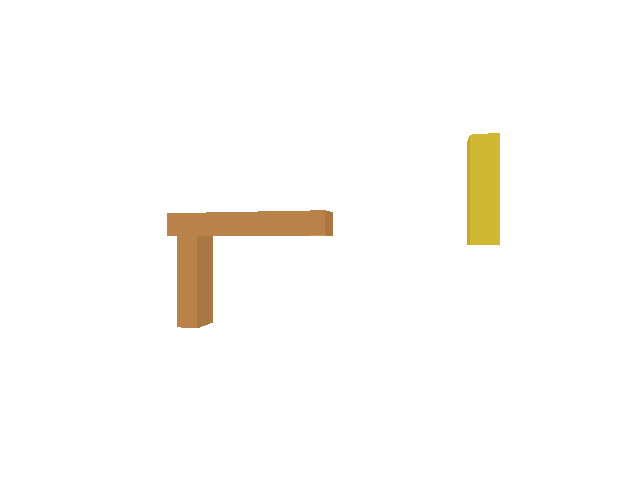
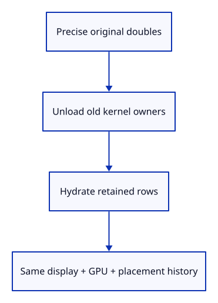

# 3.16.23 · Prove source restoration preserves display and history

**Chapter 3 · Documents, editing and ownership · Section 3.16 · Source ownership and restoration** · [Contents](contents.md)

**Typing: 1–1 minutes.** [Estimate](typing-load.md).

Add a fixture with a deliberately precise double coordinate and original flags. Import through a located source, Move, unload, then hydrate the captured key with the original bytes. The old kernel value stays expired; restored source geometry has the exact original coordinate.

## Type

Continue from [Adopt restored source owners as one residency change](32gb-adopt.md). [Save or recover your work](recovery.md).

### 1. `src/lib.rs`

Keep source restoration proofs in typed native state checks.

<details>
<summary>Locate the existing block</summary>

```rust
mod unload_tests;
```

</details>

After that block, type:

```rust
--8<-- "journey/code/32gc-roundtrip-01.rs" skip=18
```

<details>
<summary>Supplied validation fixture</summary>

Copy this supplied authoring fixture once. Continue with the browser build below; the course does not require running native tests.

### 2. `src/rehydrate_tests.rs`

Optional authoring fixture. Check exact restored coordinates and retained display/metadata/placement history.

Copy this supplied file:

```text
--8<-- "journey/code/32gc-roundtrip-02.rs"
```

</details>

## Run and check

In your project:

```sh
cd workspace/journey
REGEN_PROTO=0 cargo build --lib --locked --target wasm32-unknown-unknown -j1
REGEN_PROTO=0 CARGO_BUILD_JOBS=1 trunk serve --port 8780
```

Open `http://127.0.0.1:8780/`. Keep an existing Trunk server running; saving rebuilds it.

Run the cold-source round-trip checks below. Restoring and saving must retain the original double coordinates through Undo and Redo.

### Recorded visual result

**Previous native render — current verification pending.**



*This recorded image predates a source or checker change. Rebuild this checkpoint before using it as current evidence; browser controls require separate acceptance.*

<details>
<summary>Code explanation and diagram</summary>

The row’s display and metadata Rcs are retained, as are its IDs, placement, camera and history roots. Snapshot can again serialize the exact editable source. Undo/Redo still return the earlier and moved placements with available restored kernel owners.

The native GPU fixture adds the same boundary: source hydration must preserve the existing geometry/settings allocations and drawing. The browser still demonstrates unloading at this endpoint; actual fetch and replay come after the native rejection checks.

The protobuf field uses `Some(true)` because its representation distinguishes an explicitly stored flag from an omitted one. This test checks flag preservation, not the later selection/locking policy. `Rc::downgrade` observes a value without keeping it alive; upgrade returning None proves the old kernel allocation is gone. `Rc::ptr_eq` then distinguishes a retained display from a newly copied display with equal coordinates.

Move → Unload Sources → checked hydrate → exact Save → retained Undo/Redo and GPU owners.



How can the test distinguish rehydration from rebuilding the whole scene?

Record row IDs, saved GUIDs, metadata/display Rc identities, model matrices, camera and history-root count. After hydration these must be unchanged, while kernel geometry becomes available again from the restored original bytes.

Study estimate, including typing and experiments: 1–2 hours.

</details>

<details>
<summary>Optional experiment</summary>

Replace the restored kernel coordinate with a value reconstructed from the retained display and predict which assertion fails.

</details>

<details>
<summary>Check and save your work</summary>

Restore experimental edits, then run from `session_viewer`:

```sh
npm --prefix ../session_tests run course -- check 3.16.23
npm --prefix ../session_tests run course -- save 3.16.23
```

Source comparison leaves your project untouched. [Save and recovery instructions](recovery.md).

</details>

<details>
<summary>Viewer coverage and verification</summary>

Rehydration is separate from scene rebuild and document history. The forthcoming browser callback can adopt this checked result without silently changing drawing or targeting another selection.

The browser checks the existing command-only unload behavior and retained drawing. Source hydration at this endpoint is verified by the native state/GPU checks; browser fetch and automatic command replay are still pending.

[Full validation scope](release.md).

To reproduce the scripted acceptance of the reference checkpoint, run from `session_viewer` with the [course bundle server](release.md#reproduce) running on port 8781:

```sh
npm --prefix ../session_tests run course -- capture 3.16.23
```

This uses the verified reference bundle; it does not check or change your typed project.

</details>
