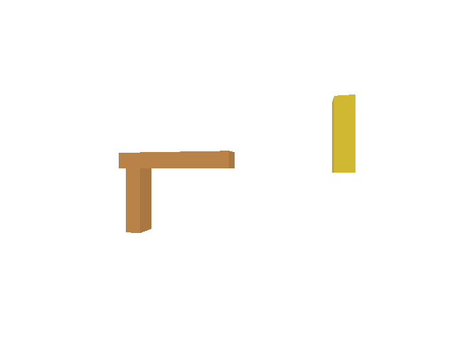
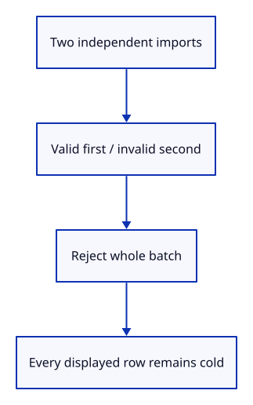

# 3.16.24 · Reject stale or inconsistent source batches atomically

**Chapter 3 · Documents, editing and ownership · Section 3.16 · Source ownership and restoration** · [Contents](contents.md)

**Typing: 0–0 minutes.** [Estimate](typing-load.md).

Test atomic source restoration across independent imported origins. Change the second source version and require both origins to remain cold. Then give a retained row the wrong original source GUID and require refusal.

## Type

Continue from [Prove source restoration preserves display and history](32gc-roundtrip.md). [Save or recover your work](recovery.md).

<details>
<summary>Supplied validation fixture</summary>

Copy this supplied authoring fixture once. Continue with the browser build below; the course does not require running native tests.

### 1. `src/rehydrate_tests.rs`

Optional authoring fixture. Reject the entire candidate batch before adopting any source and preserve displayed owners.

<details>
<summary>Locate the existing block</summary>

```text
use crate::editor::{Action, Editor};
```

</details>

After that block, append this supplied code:

```text
--8<-- "journey/code/32gd-rejections-01.rs" skip=37
```

</details>

## Run and check

In your project:

```sh
cd workspace/journey
REGEN_PROTO=0 cargo build --lib --locked --target wasm32-unknown-unknown -j1
REGEN_PROTO=0 CARGO_BUILD_JOBS=1 trunk serve --port 8780
```

Open `http://127.0.0.1:8780/`. Keep an existing Trunk server running; saving rebuilds it.

Source-restoration rejection is covered by optional fixtures. The browser still shows the existing Unload Sources behavior; automatic restoration is connected later.

### Recorded visual result

**Previous native render — current verification pending.**



*This recorded image predates a source or checker change. Rebuild this checkpoint before using it as current evidence; browser controls require separate acceptance.*

<details>
<summary>Code explanation and diagram</summary>

`Rc::make_mut` gives the test row its own metadata when history shares the original. This simulates row inconsistency without modifying the imported file.

Version mismatch and row-metadata mismatch are separate rejection boundaries. Validate all candidates and rows before adopting any source. The next lesson tests stale and duplicate delivery.

Prepare two origins → reject changed second source → no adoption → successful retry.



Should a late result after Close be decoded before deciding that it is obsolete?

No. First confirm the captured key still matches an active cold row. An obsolete result returns false before source construction or mutation, whether its payload is valid or malformed.

Study estimate, including typing and experiments: 1–2 hours.

</details>

<details>
<summary>Optional experiment</summary>

Unload an imported source and confirm its cached drawing stays visible. In the supplied two-origin example, trace why a malformed second candidate is rejected before the first origin is adopted. This is a code-reading exercise; native execution is optional.

</details>

<details>
<summary>Check and save your work</summary>

Restore experimental edits, then run from `session_viewer`:

```sh
npm --prefix ../session_tests run course -- check 3.16.24
npm --prefix ../session_tests run course -- save 3.16.24
```

Source comparison leaves your project untouched. [Save and recovery instructions](recovery.md).

</details>

<details>
<summary>Viewer coverage and verification</summary>

Late source delivery must never revive a closed or replaced import. Immutable file-version checks and origin/epoch checks address different causes of stale data.

These are native acceptance checks for the atomic API. Fetch errors, aborts and queued edits belong to the next browser request boundary.

The browser checks the existing command-only unload behavior and retained drawing. Source hydration at this endpoint is verified by the native state/GPU checks; browser fetch and automatic command replay are still pending.

[Full validation scope](release.md).

To reproduce the scripted acceptance of the reference checkpoint, run from `session_viewer` with the [course bundle server](release.md#reproduce) running on port 8781:

```sh
npm --prefix ../session_tests run course -- capture 3.16.24
```

This uses the verified reference bundle; it does not check or change your typed project.

</details>
