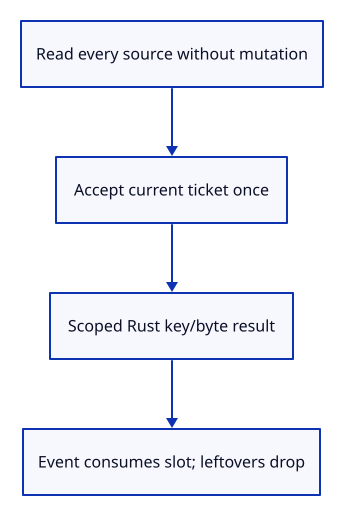

# 3.16.30 · Deliver only the current completed reload batch

**Chapter 3 · Documents, editing and ownership · Section 3.16 · Source ownership and restoration** · [Contents](contents.md)

**Typing: 14–28 minutes.** [Estimate](typing-load.md).

Add a `Delivery` slot and spawn one local asynchronous task. Fetch each requested URL with the captured signal. A failure stops the batch; successful bytes are kept in request order. No Scene changes while any read is pending.

## Type

Continue from [Pair reload ownership with a browser abort controller](32gga-flight.md). [Save or recover your work](recovery.md).

### 1. `src/browser_reload.rs`

Spawn bounded source reads and deliver only one current owned completion.

<details>
<summary>Locate the existing block</summary>

```rust
pub type Shared = Rc<RefCell<Flight>>;
```

</details>

After that block, type:

```rust
--8<-- "journey/code/32ggb-delivery-01.rs" skip=39
```

## Run and check

In your project:

```sh
cd workspace/journey
REGEN_PROTO=0 cargo build --lib --locked --target wasm32-unknown-unknown -j1
REGEN_PROTO=0 CARGO_BUILD_JOBS=1 trunk serve --port 8780
```

Open `http://127.0.0.1:8780/`. Keep an existing Trunk server running; saving rebuilds it.

Run the delivery checks below. Only the current completed batch can fill the reply slot. Stale or duplicate replies must leave that slot unchanged.

### Recorded visual result

**Previous native render — current verification pending.**


*This recorded image predates a source or checker change. Rebuild this checkpoint before using it as current evidence; browser controls require separate acceptance.*

<details>
<summary>Code explanation and diagram</summary>

After awaiting, ask the shared owner to finish this ticket. A cancelled or replaced request returns immediately, before reporting an error or dispatching a viewer event. For the current request, zip the accepted keys with its bytes and place that Result in the Rust slot for synchronous dispatch. Clear any unclaimed result after dispatch.

The asynchronous task holds the shared flight, plain strings, signal and delivery slot. Cancellation empties the flight keys, so a delayed task does not keep the old Origin alive. Event callbacks will take the accepted slot and call the atomic hydration API; the command is connected next.

Flight begin → await URL reads → finish ticket once → scoped Rust reply → viewer event.



Why is the restored source data kept in a Rust delivery slot rather than event.detail?

The slot carries the accepted release keys with their bytes. The event only wakes the viewer; an external event without accepted Rust data cannot fabricate a source completion.

Study estimate, including typing and experiments: 1–2 hours.

</details>

<details>
<summary>Optional experiment</summary>

Dispatch viewer-reload from the browser console without an accepted slot. Predict why it cannot restore any source.

</details>

<details>
<summary>Check and save your work</summary>

Restore experimental edits, then run from `session_viewer`:

```sh
npm --prefix ../session_tests run course -- check 3.16.30
npm --prefix ../session_tests run course -- save 3.16.30
```

Source comparison leaves your project untouched. [Save and recovery instructions](recovery.md).

</details>

<details>
<summary>Viewer coverage and verification</summary>

The accepted File bridge and the source-reload bridge use the same principle: retain native ownership through one accepted handoff and do not let generic browser events become source authority.

The browser checks existing command-only unloading and retained drawing. The new infrastructure is compiled here; the Reload Sources command is connected in the following command lesson.

[Full validation scope](release.md).

To reproduce the scripted acceptance of the reference checkpoint, run from `session_viewer` with the [course bundle server](release.md#reproduce) running on port 8781:

```sh
npm --prefix ../session_tests run course -- capture 3.16.30
```

This uses the verified reference bundle; it does not check or change your typed project.

</details>
