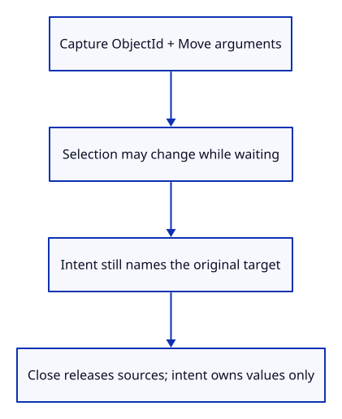

# 3.16.33 · Capture the requested edit before waiting

**Chapter 3 · Documents, editing and ownership · Section 3.16 · Source ownership and restoration** · [Contents](contents.md)

**Typing: 30–60 minutes.** [Estimate](typing-load.md).

A delayed edit needs a small record of the user’s request. Intent contains only a stable ObjectId and copied Move arguments, or Save. It owns no geometry, origin or URL. Changing selection cannot redirect that value.

## Type

Continue from [Cancel reloads when their document context changes](32gha-cancel.md). [Save or recover your work](recovery.md).

### 1. `src/lib.rs`

Register the value-only requested-edit module.

<details>
<summary>Locate the existing block</summary>

```rust
pub mod reload_job;
```

</details>

After that block, type:

```rust
--8<-- "journey/code/32gi-capture-01.rs" skip=20
```

### 2. `src/edit_intent.rs`

Capture the requested target and arguments without retaining any source owners.

Create the file and type:

```rust
--8<-- "journey/code/32gi-capture-02.rs"
```

## Run and check

In your project:

```sh
cd workspace/journey
REGEN_PROTO=0 cargo build --lib --locked --target wasm32-unknown-unknown -j1
REGEN_PROTO=0 CARGO_BUILD_JOBS=1 trunk serve --port 8780
```

Open `http://127.0.0.1:8780/`. Keep an existing Trunk server running; saving rebuilds it.

Run the intent checks below. Capture Move for one selected object, change selection, and compare the stored target and offset. Automatic browser replay comes later.

### Recorded visual result

**Previous native render — current verification pending.**


*This recorded image predates a source or checker change. Rebuild this checkpoint before using it as current evidence; browser controls require separate acceptance.*

<details>
<summary>Code explanation and diagram</summary>

Unselected Delete, zero-offset Move and ordinary view commands do not create an edit intent; invalid Move values are refused. Save is represented explicitly because it will need every active cold origin instead of one selected target. Source selection and replay are added in the following checkpoints.

Command + original selection → value-only Intent → unchanged target while waiting.



Why store ObjectId and Move offset rather than selection or a precomputed model?

Selection can change while I/O waits. The original ObjectId names the requested target; the offset expresses the requested change. A later replay must read that target’s current placement rather than replace it with a stale matrix.

Study estimate, including typing and experiments: 1–2 hours.

</details>

<details>
<summary>Optional experiment</summary>

Trace the supplied captured-Move fixture: capture one object, change selection, then inspect the retained ObjectId. Explain which origin the later request must load.

</details>

<details>
<summary>Check and save your work</summary>

Restore experimental edits, then run from `session_viewer`:

```sh
npm --prefix ../session_tests run course -- check 3.16.33
npm --prefix ../session_tests run course -- save 3.16.33
```

Source comparison leaves your project untouched. [Save and recovery instructions](recovery.md).

</details>

<details>
<summary>Viewer coverage and verification</summary>

Separate requested intent from current interaction state. Source tickets authorize the completion; the captured target determines which edit may be replayed.

This checkpoint introduces and tests the request record. It does not yet intercept browser edits or replay them. Chrome checks the existing explicit reload path and its retained drawing; native tests prove captured target identity and that Close releases sources despite a retained intent.

The existing explicit source reload preserves this checkpoint’s placed drawing. Captured-intent identity and release ownership are checked natively; automatic browser replay is introduced next.

[Full validation scope](release.md).

To reproduce the scripted acceptance of the reference checkpoint, run from `session_viewer` with the [course bundle server](release.md#reproduce) running on port 8781:

```sh
npm --prefix ../session_tests run course -- capture 3.16.33
```

This uses the verified reference bundle; it does not check or change your typed project.

</details>
