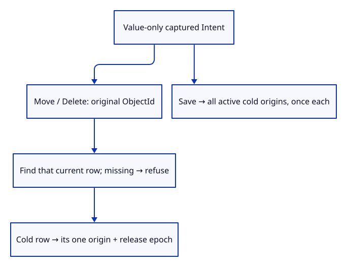

# 3.16.34 · Load only the sources the requested edit needs

**Chapter 3 · Documents, editing and ownership · Section 3.16 · Source ownership and restoration** · [Contents](contents.md)

**Typing: 6–11 minutes.** [Estimate](typing-load.md).

Move and Delete follow the captured ObjectId, even if selection now belongs to a different import. A loaded target needs no source request. A missing target fails before any fetch begins. For a cold row, ReloadKey::of returns its exact origin and release epoch.

## Type

Continue from [Capture the requested edit before waiting](32gi-capture.md). [Save or recover your work](recovery.md).

### 1. `src/edit_intent.rs`

Bring the editor and existing release-key type into this module. Resolve dependencies from the captured target or active Save scene.

Edit these blocks from bottom to top. Keep the surrounding lines unchanged.

<details>
<summary>Locate this block</summary>

```rust
}

impl Intent {
    pub fn capture(action: &Action, selected: Option<ObjectId>) -> Result<Option<Self>, &'static str> {
        Ok(match action {
            Action::Translate(offset) => {
```

</details>

Replace it with:

```rust
}

impl Intent {
    pub fn keys(&self, editor: &Editor) -> Result<Vec<ReloadKey>, &'static str> {
        match self {
            Self::Save => Ok(editor.reload_keys()),
            Self::Move { id, .. } | Self::Delete { id } => {
                let row = editor.scene.objects().iter().find(|row| row.id == *id).ok_or("Object not found")?;
                Ok(ReloadKey::of(row).into_iter().collect())
            }
        }
    }

    pub fn capture(action: &Action, selected: Option<ObjectId>) -> Result<Option<Self>, &'static str> {
        Ok(match action {
            Action::Translate(offset) => {
```

<details>
<summary>Locate this block</summary>

```rust
use crate::{editor::Action, scene::ObjectId};

#[derive(Clone, Copy, Debug, PartialEq)]
pub enum Intent {
```

</details>

Replace it with:

```rust
use crate::{editor::{Action, Editor}, rehydrate::ReloadKey, scene::ObjectId};

#[derive(Clone, Copy, Debug, PartialEq)]
pub enum Intent {
```

<details>
<summary>Complete updated block reference</summary>

```rust
use crate::{editor::{Action, Editor}, rehydrate::ReloadKey, scene::ObjectId};

#[derive(Clone, Copy, Debug, PartialEq)]
pub enum Intent {
    Move { id: ObjectId, offset: [f64; 3] },
    Delete { id: ObjectId },
    Save,
}

impl Intent {
    pub fn keys(&self, editor: &Editor) -> Result<Vec<ReloadKey>, &'static str> {
        match self {
            Self::Save => Ok(editor.reload_keys()),
            Self::Move { id, .. } | Self::Delete { id } => {
                let row = editor.scene.objects().iter().find(|row| row.id == *id).ok_or("Object not found")?;
                Ok(ReloadKey::of(row).into_iter().collect())
            }
        }
    }

    pub fn capture(action: &Action, selected: Option<ObjectId>) -> Result<Option<Self>, &'static str> {
        Ok(match action {
            Action::Translate(offset) => {
                let id = selected.ok_or("Select an object before Move")?;
                if !offset.iter().all(|value| value.is_finite()) { return Err("Move needs finite coordinates"); }
                if offset.iter().all(|&value| value == 0.0) { None }
                else { Some(Self::Move { id, offset: *offset }) }
            }
            Action::Delete => selected.map(|id| Self::Delete { id }),
            _ => None,
        })
    }


}

#[cfg(test)]
mod tests {
    use super::*;
    use crate::{editor::Editor, reload_url::ReloadUrl};
    use std::rc::Rc;

    fn cold() -> Editor {
        let mut editor = Editor::default();
        editor.apply(Action::ReplaceAt(crate::specimen::bytes(), Rc::new(ReloadUrl::new("test:intent".into())))).unwrap();
        editor.apply(Action::SelectNext).unwrap();
        editor.apply(Action::UnloadSources).unwrap();
        editor
    }

    #[test]
    fn move_keeps_original_target_and_arguments_after_selection_changes() {
        let mut editor = cold(); let id = editor.selected.unwrap();
        let origin = Rc::downgrade(editor.scene.objects()[0].origin().unwrap());
        let intent = Intent::capture(&Action::Translate([0.125, -0.25, 0.5]), editor.selected).unwrap().unwrap();
        editor.apply(Action::SelectNext).unwrap(); editor.apply(Action::Orbit(0.1, 0.2)).unwrap();
        assert_ne!(editor.selected, Some(id));
        assert_eq!(intent, Intent::Move { id, offset: [0.125, -0.25, 0.5] });
        editor.apply(Action::Close).unwrap();
        assert!(origin.upgrade().is_none(), "intent owns no source or URL");
    }

    #[test]
    fn delete_keeps_its_original_target() {
        let mut editor = cold(); let id = editor.selected.unwrap();
        let intent = Intent::capture(&Action::Delete, editor.selected).unwrap().unwrap();
        editor.apply(Action::SelectNext).unwrap();
        assert_eq!(intent, Intent::Delete { id });
        assert_ne!(editor.selected, Some(id));
    }

    #[test]
    fn empty_edits_do_not_request_io_and_invalid_moves_are_rejected() {
        assert_eq!(Intent::capture(&Action::Delete, None).unwrap(), None);
        assert!(Intent::capture(&Action::Translate([0.0; 3]), None).is_err());
        let editor = Editor::default(); let id = editor.scene.objects()[0].id;
        assert_eq!(Intent::capture(&Action::Translate([0.0; 3]), Some(id)).unwrap(), None);
        assert!(Intent::capture(&Action::Translate([f64::NAN, 0.0, 0.0]), Some(id)).is_err());
        assert_eq!(Intent::capture(&Action::Fit, Some(id)).unwrap(), None);
    }
}
```

</details>

<details>
<summary>Optional patch references</summary>

Use these original edit fragments when comparing a saved checkpoint. Apply the complete blocks above.

```text
--8<-- "journey/code/32gia-scope-01.rs"
```

```text
--8<-- "journey/code/32gia-scope-02.rs"
```

</details>

### 2. `src/lib.rs`

Register the independent source-scope tests.

<details>
<summary>Locate the existing block</summary>

```rust
pub mod edit_intent;
```

</details>

After that block, type:

```rust
--8<-- "journey/code/32gia-scope-03.rs" skip=21
```

<details>
<summary>Supplied validation fixture</summary>

Copy this supplied authoring fixture once. Continue with the browser build below; the course does not require running native tests.

### 3. `src/edit_scope_tests.rs`

Optional authoring fixture. Distinguish target imports from later selection, active Save sources from history, and missing targets from loaded ones.

Copy this supplied file:

```text
--8<-- "journey/code/32gia-scope-04.rs"
```

</details>

## Run and check

In your project:

```sh
cd workspace/journey
REGEN_PROTO=0 cargo build --lib --locked --target wasm32-unknown-unknown -j1
REGEN_PROTO=0 CARGO_BUILD_JOBS=1 trunk serve --port 8780
```

Open `http://127.0.0.1:8780/`. Keep an existing Trunk server running; saving rebuilds it.

Run the scope checks below. Move/Delete request only their captured target; Save requests active cold sources, excluding history-only rows.

### Recorded visual result

**Previous native render — current verification pending.**


*This recorded image predates a source or checker change. Rebuild this checkpoint before using it as current evidence; browser controls require separate acceptance.*

<details>
<summary>Code explanation and diagram</summary>

Save reuses Editor::reload_keys: it gathers each active cold origin once, even when several rows share it. It excludes loaded rows and sources held only by Undo/Redo history. Three native tests distinguish two imports, later selection, deduplication, history-only sources and missing or loaded targets.

The method borrows Editor only while collecting keys. The returned keys temporarily retain the origins needed by a future ReloadJob; the Intent itself still holds values only. Browser interception and replay are not connected yet.

Intent → original current row → cold origin + epoch; Save → unique active cold origins.



Why should Save ignore a released source that exists only in Undo history?

Save serializes the active scene. History-only rows are not in that file, so fetching their source delays Save without supplying any required data. Undo can request that source later when its rows become active.

Study estimate, including typing and experiments: 1–2 hours.

</details>

<details>
<summary>Optional experiment</summary>

In the first scope test, point selection at a row from the second import. Explain why Move and Delete still request the first import, while Save requests both.

</details>

<details>
<summary>Check and save your work</summary>

Restore experimental edits, then run from `session_viewer`:

```sh
npm --prefix ../session_tests run course -- check 3.16.34
npm --prefix ../session_tests run course -- save 3.16.34
```

Source comparison leaves your project untouched. [Save and recovery instructions](recovery.md).

</details>

<details>
<summary>Viewer coverage and verification</summary>

The operation determines its source dependencies. Current selection, history size and the number of displayed rows do not determine a request’s authority.

Chrome checks the inherited explicit source reload and this placed drawing. Original-target source selection, active-document Save scope and refusal cases are proved natively; automatic browser replay is still pending.

[Full validation scope](release.md).

To reproduce the scripted acceptance of the reference checkpoint, run from `session_viewer` with the [course bundle server](release.md#reproduce) running on port 8781:

```sh
npm --prefix ../session_tests run course -- capture 3.16.34
```

This uses the verified reference bundle; it does not check or change your typed project.

</details>
