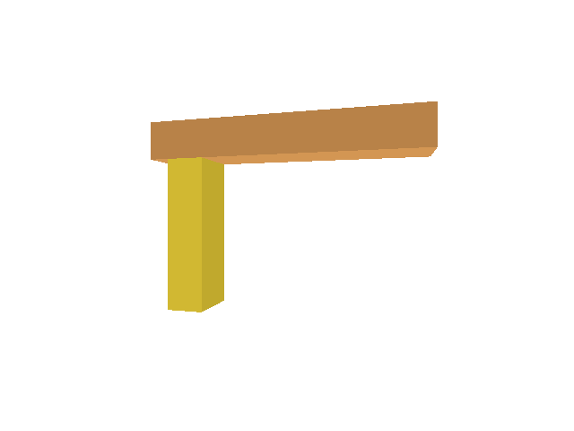
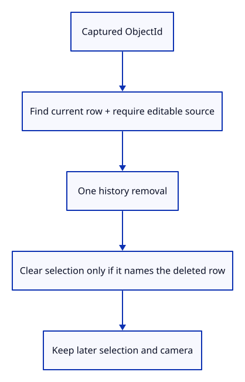

# 3.16.36 · Delete the original target while keeping later selection

**Chapter 3 · Documents, editing and ownership · Section 3.16 · Source ownership and restoration** · [Contents](contents.md)

**Typing: 7–13 minutes.** [Estimate](typing-load.md).

Extract Editor::delete_object with an explicit ObjectId. Look up the current row and require editable geometry before creating history. A missing or cold target returns an error and preserves Redo. Normal Delete with no selection changes only the view.

## Type

Continue from [Move the original target from its current placement](32gib-move.md). [Save or recover your work](recovery.md).

### 1. `src/editor.rs`

Remove the original target once and clear only its own selection. Use the same helper for ordinary Delete and preserve history when nothing is selected.

Edit these blocks from bottom to top. Keep the surrounding lines unchanged.

<details>
<summary>Locate this block</summary>

```rust
            Action::ToggleExtra => self.history.edit(&mut self.scene, Scene::toggle_extra),
            Action::SelectNext => self.selected = self.scene.next(self.selected),
            Action::Delete => {
                if let Some(id) = self.selected {
                    let row = self.scene.objects().iter().find(|row| row.id == id).ok_or("Object not found")?;
                    if row.geometry().is_none() { return Err("Reload editable sources before Delete"); }
                }
                if let Some(id) = self.selected.take() {
                    self.history.edit(&mut self.scene, |scene| { scene.remove(id); });
                }
            }
            Action::Undo => { self.history.undo(&mut self.scene); }
            Action::Redo => { self.history.redo(&mut self.scene); }
```

</details>

Replace it with:

```rust
            Action::ToggleExtra => self.history.edit(&mut self.scene, Scene::toggle_extra),
            Action::SelectNext => self.selected = self.scene.next(self.selected),
            Action::Delete => {
                return match self.selected {
                    Some(id) => self.delete_object(id),
                    None => Ok(Change::View),
                };
            }
            Action::Undo => { self.history.undo(&mut self.scene); }
            Action::Redo => { self.history.redo(&mut self.scene); }
```

<details>
<summary>Locate this block</summary>

```rust
        Ok(Change::Scene)
    }

    pub fn apply(&mut self, action: Action) -> Result<Change, &'static str> {
        match action {
            Action::Pick(screen) => {
```

</details>

Replace it with:

```rust
        Ok(Change::Scene)
    }

    pub fn delete_object(&mut self, id: ObjectId) -> Result<Change, &'static str> {
        let row = self.scene.objects().iter().find(|row| row.id == id).ok_or("Object not found")?;
        if row.geometry().is_none() { return Err("Reload editable sources before Delete"); }
        self.history.edit(&mut self.scene, |scene| { scene.remove(id); });
        if self.selected == Some(id) { self.selected = None; }
        Ok(Change::Scene)
    }

    pub fn apply(&mut self, action: Action) -> Result<Change, &'static str> {
        match action {
            Action::Pick(screen) => {
```

<details>
<summary>Complete updated block reference</summary>

```rust
use crate::{background::Background, camera::Camera, history::History, scene::{ObjectId, Scene}};

pub enum Action {
    Pick([f32; 2]),
    Import(Vec<u8>),
    Replace(Vec<u8>),
    ImportAt(Vec<u8>, std::rc::Rc<crate::reload_url::ReloadUrl>),
    ReplaceAt(Vec<u8>, std::rc::Rc<crate::reload_url::ReloadUrl>),
    Close,
    UnloadSources,
    AddBox,
    Translate([f64; 3]),
    ToggleExtra,
    SelectNext,
    Delete,
    Undo,
    Redo,
    Background,
    Zoom(f32),
    Pan(f32, f32),
    Orbit(f64, f64),
    Isometric,
    ResetView,
    Fit,
    FitSelected,
    Projection(crate::camera::Projection),
}

#[derive(Debug, PartialEq, Eq)]
pub enum Change {
    View,
    Scene,
}

pub struct Editor {
    pub scene: Scene,
    pub selected: Option<ObjectId>,
    pub camera: Camera,
    pub background: Background,
    history: History,
    last_release: u64,
}

impl Default for Editor {
    fn default() -> Self {
        Self {
            scene: Scene::demo(),
            selected: None,
            camera: Camera::default(),
            background: Background::default(),
            history: History::default(),
            last_release: 0,
        }
    }
}

impl Editor {
    pub fn scenes(&self) -> impl Iterator<Item = &Scene> {
        std::iter::once(&self.scene).chain(self.history.scenes())
    }

    pub fn reload_keys(&self) -> Vec<crate::rehydrate::ReloadKey> {
        let mut seen = std::collections::HashSet::new();
        self.scene.objects().iter().filter_map(crate::rehydrate::ReloadKey::of)
            .filter(|key| seen.insert(key.origin.id)).collect()
    }

    fn scenes_mut(&mut self) -> impl Iterator<Item = &mut Scene> {
        std::iter::once(&mut self.scene).chain(self.history.scenes_mut())
    }

    pub fn hydrate(&mut self, values: Vec<(crate::rehydrate::ReloadKey, Vec<u8>)>) -> Result<bool, &'static str> {
        if values.is_empty() { return Ok(false); }
        let mut seen = std::collections::HashSet::new();
        for (key, _) in &values {
            if !seen.insert(key.origin.id) || !self.scene.objects().iter().any(|row| key.matches(row)) {
                return Ok(false);
            }
        }
        let prepared: Vec<_> = values.into_iter().map(|(key, bytes)|
            crate::rehydrate::PreparedReload::new(key, &bytes)).collect::<Result<_, _>>()?;
        for plan in &prepared {
            if self.scenes().flat_map(|scene| scene.objects()).filter(|row| plan.key.matches(row))
                .any(|row| !plan.validates(row)) { return Err("Reloaded source GUID or metadata does not match"); }
        }
        for scene in self.scenes_mut() {
            for plan in &prepared { scene.hydrate(plan); }
        }
        Ok(true)
    }

    fn unload_sources(&mut self) -> Result<(), &'static str> {
        let mut origins: std::collections::HashSet<_> = self.scenes().flat_map(|scene| scene.objects())
            .filter(|row| row.can_unload()).filter_map(|row| row.origin().map(|origin| origin.id)).collect();
        for row in self.scenes().flat_map(|scene| scene.objects()) {
            if let Some(origin) = row.origin() {
                if !row.can_unload() { origins.remove(&origin.id); }
            }
        }
        if origins.is_empty() { return Err("No eligible imported sources to unload"); }
        let epoch = self.last_release.checked_add(1).ok_or("Release epochs exhausted")?;
        for scene in self.scenes_mut() { scene.unload(&origins, epoch); }
        self.last_release = epoch;
        Ok(())
    }

    pub fn move_object(&mut self, id: ObjectId, offset: [f64; 3]) -> Result<Change, &'static str> {
        if !offset.iter().all(|value| value.is_finite()) { return Err("Move needs finite coordinates"); }
        let object = self.scene.objects().iter().find(|row| row.id == id).ok_or("Object not found")?;
        if offset.iter().all(|&value| value == 0.0) { return Ok(Change::View); }
        let shift = session_rust::Xform::translation(offset[0], offset[1], offset[2]);
        let model = &shift * &object.model;
        self.history.try_edit(&mut self.scene, |scene| scene.place(id, model))?;
        Ok(Change::Scene)
    }

    pub fn delete_object(&mut self, id: ObjectId) -> Result<Change, &'static str> {
        let row = self.scene.objects().iter().find(|row| row.id == id).ok_or("Object not found")?;
        if row.geometry().is_none() { return Err("Reload editable sources before Delete"); }
        self.history.edit(&mut self.scene, |scene| { scene.remove(id); });
        if self.selected == Some(id) { self.selected = None; }
        Ok(Change::Scene)
    }

    pub fn apply(&mut self, action: Action) -> Result<Change, &'static str> {
        match action {
            Action::Pick(screen) => {
                self.selected = self.camera.ray(screen)
                    .and_then(|ray| crate::picking::pick(&self.scene, &ray));
            }
            Action::UnloadSources => self.unload_sources()?,
            Action::Close => {
                self.scene.clear();
                self.history.clear();
                self.selected = None;
            }
            Action::Replace(bytes) => {
                let loaded = crate::document::load(&bytes)?;
                self.history.try_edit(&mut self.scene, |scene| scene.replace(loaded))?;
            }
            Action::Import(bytes) => {
                let loaded = crate::document::load(&bytes)?;
                self.history.try_edit(&mut self.scene, |scene| scene.import(loaded))?;
            }
            Action::ImportAt(bytes, location) => {
                let loaded = crate::document::load_at(&bytes, Some(location))?;
                self.history.try_edit(&mut self.scene, |scene| scene.import(loaded))?;
            }
            Action::ReplaceAt(bytes, location) => {
                let loaded = crate::document::load_at(&bytes, Some(location))?;
                self.history.try_edit(&mut self.scene, |scene| scene.replace(loaded))?;
            }
            Action::AddBox => {
                self.history.try_edit(&mut self.scene, |scene| scene.add_box().map(|_| ()))?;
            }
            Action::Translate(offset) => {
                let id = self.selected.ok_or("Select an object before Move")?;
                return self.move_object(id, offset);
            }
            Action::ToggleExtra => self.history.edit(&mut self.scene, Scene::toggle_extra),
            Action::SelectNext => self.selected = self.scene.next(self.selected),
            Action::Delete => {
                return match self.selected {
                    Some(id) => self.delete_object(id),
                    None => Ok(Change::View),
                };
            }
            Action::Undo => { self.history.undo(&mut self.scene); }
            Action::Redo => { self.history.redo(&mut self.scene); }
            view => {
                match view {
                    Action::Background => self.background.toggle(),
                    Action::Zoom(factor) => self.camera.zoom(factor),
                    Action::Pan(dx, dy) => self.camera.pan(dx, dy),
                    Action::Orbit(yaw, pitch) => self.camera.orbit(yaw, pitch),
                    Action::Isometric => self.camera.isometric(),
                    Action::Projection(mode) => self.camera.projection = mode,
                    Action::Fit => {
                        if let Some(bounds) = self.scene.bounds() {
                            self.camera.fit(&bounds);
                        }
                    }
                    Action::FitSelected => {
                        if let Some(bounds) = self.selected
                            .and_then(|id| self.scene.selected_bounds(id))
                        {
                            self.camera.fit(&bounds);
                        }
                    }
                    Action::ResetView => {
                        let aspect = self.camera.aspect;
                        self.camera = Camera { aspect, ..Camera::default() };
                    }
                    _ => unreachable!("Document actions were handled above"),
                }
                return Ok(Change::View);
            }
        }
        // Deletion and history travel can invalidate selection; repair it in one place.
        self.selected = self.selected.filter(|id| self.scene.contains(*id));
        Ok(Change::Scene)
    }
}

#[cfg(test)]
mod tests {
    use super::*;

    #[test]
    fn a_modified_history_row_protects_only_its_own_import_origin() {
        use std::rc::Rc;
        let mut editor = Editor::default(); let bytes = crate::specimen::bytes();
        let first = Rc::new(crate::reload_url::ReloadUrl::new("test:first".into()));
        editor.apply(Action::ReplaceAt(bytes.clone(), first)).unwrap();
        let origin = editor.scene.objects()[0].origin().unwrap().id;
        let original = Rc::downgrade(editor.scene.objects()[0].geometry().unwrap());
        let second = Rc::new(crate::reload_url::ReloadUrl::new("test:second".into()));
        editor.apply(Action::ImportAt(bytes, second)).unwrap();
        let copy = Rc::downgrade(editor.scene.objects()[3].geometry().unwrap());
        editor.apply(Action::SelectNext).unwrap(); editor.apply(Action::Translate([0.25, 0.0, 0.0])).unwrap();
        editor.apply(Action::Undo).unwrap();
        let saved = editor.history.scenes_mut().last().unwrap();
        assert_eq!(saved.objects()[0].origin().unwrap().id, origin);
        Rc::make_mut(&mut saved.objects_mut()[0].metadata).is_locked = true;
        assert!(editor.scene.objects()[0].can_unload());
        editor.apply(Action::UnloadSources).unwrap();
        assert!(original.upgrade().is_some()); assert!(copy.upgrade().is_none());
        assert!(editor.scene.objects()[0].geometry().is_some());
        assert!(editor.scene.objects()[3].geometry().is_none());
        assert_eq!(editor.last_release, 1);
        assert!(editor.apply(Action::UnloadSources).is_err()); assert_eq!(editor.last_release, 1);
    }

    #[test]
    fn release_epochs_do_not_wrap_or_reset_on_close() {
        use std::rc::Rc;
        let mut editor = Editor::default(); let bytes = crate::specimen::bytes();
        let url = Rc::new(crate::reload_url::ReloadUrl::new("test:epoch".into()));
        editor.apply(Action::ReplaceAt(bytes.clone(), Rc::clone(&url))).unwrap();
        editor.last_release = u64::MAX;
        assert_eq!(editor.apply(Action::UnloadSources), Err("Release epochs exhausted"));
        assert!(editor.scene.objects()[0].geometry().is_some());
        editor.last_release = 0; editor.apply(Action::UnloadSources).unwrap();
        assert_eq!(editor.scene.objects()[0].release_epoch(), Some(1));
        editor.apply(Action::Close).unwrap();
        editor.apply(Action::ImportAt(bytes, url)).unwrap();
        editor.apply(Action::UnloadSources).unwrap();
        assert_eq!(editor.scene.objects()[0].release_epoch(), Some(2));
    }

    #[test]
    fn close_ends_history_and_keeps_issued_ids_and_view_settings() {
        let mut editor = Editor::default();
        editor.apply(Action::Import(crate::specimen::bytes())).unwrap();
        editor.apply(Action::AddBox).unwrap(); editor.apply(Action::Undo).unwrap();
        let old: Vec<_> = editor.scenes().flat_map(|scene| scene.objects().iter().map(|row| row.id)).collect();
        editor.apply(Action::SelectNext).unwrap();
        editor.apply(Action::Pan(0.2, 0.1)).unwrap(); editor.apply(Action::Background).unwrap();
        let view = editor.camera.uniform(); let background = editor.background.rgb();
        editor.apply(Action::Close).unwrap();
        assert!(editor.scene.objects().is_empty() && editor.selected.is_none());
        assert_eq!(editor.scenes().count(), 1);
        editor.apply(Action::Undo).unwrap(); editor.apply(Action::Redo).unwrap();
        assert!(editor.scene.objects().is_empty());
        assert_eq!(editor.camera.uniform(), view); assert_eq!(editor.background.rgb(), background);
        editor.apply(Action::AddBox).unwrap();
        assert!(!old.contains(&editor.scene.objects()[0].id));
    }

    #[test]
    fn repeated_close_is_empty_and_drops_sources_without_gpu_owners() {
        let mut editor = Editor::default();
        let display = std::rc::Rc::downgrade(&editor.scene.objects()[0].mesh);
        let source = std::rc::Rc::downgrade(editor.scene.objects()[0].geometry().unwrap());
        editor.apply(Action::Close).unwrap(); editor.apply(Action::Close).unwrap();
        assert!(display.upgrade().is_none() && source.upgrade().is_none());
        assert_eq!(crate::memory::cpu(editor.scenes(), std::iter::empty()), [0, 0, 0, 0, 0, 1]);
    }

    #[test]
    fn close_releases_imported_history_documents_and_reopening_uses_fresh_ids() {
        use std::rc::Rc;
        let mut editor = Editor::default();
        let bytes = crate::specimen::bytes();
        editor.apply(Action::Import(bytes.clone())).unwrap();
        editor.apply(Action::Replace(bytes.clone())).unwrap();
        let displays: Vec<_> = editor.scenes().flat_map(|scene| scene.objects().iter()
            .map(|row| Rc::downgrade(&row.mesh))).collect();
        let sources: Vec<_> = editor.scenes().flat_map(|scene| scene.objects().iter()
            .map(|row| Rc::downgrade(row.geometry().unwrap()))).collect();
        let documents: Vec<_> = editor.scenes().flat_map(|scene| scene.objects().iter()
            .filter_map(|row| row.source().map(|source| Rc::downgrade(&source.document)))).collect();
        let old: Vec<_> = editor.scenes().flat_map(|scene| scene.objects().iter().map(|row| row.id)).collect();
        assert!(!documents.is_empty());
        editor.apply(Action::Close).unwrap();
        assert!(displays.iter().all(|owner| owner.upgrade().is_none()));
        assert!(sources.iter().all(|owner| owner.upgrade().is_none()));
        assert!(documents.iter().all(|owner| owner.upgrade().is_none()));
        editor.apply(Action::Import(bytes)).unwrap();
        assert!(editor.scene.objects().iter().all(|row| !old.contains(&row.id)));
    }

    #[test]
    fn resetting_the_view_preserves_its_current_aspect() {
        let mut editor = Editor::default();
        editor.camera.aspect = 2.0;
        editor.apply(Action::Zoom(2.0)).unwrap();
        editor.apply(Action::ResetView).unwrap();
        assert_eq!(editor.camera.aspect, 2.0);
        assert_eq!(editor.camera.distance, 3.0);
    }

    #[test]
    fn undo_changes_the_document_without_rewinding_the_view() {
        let mut editor = Editor::default();
        editor.apply(Action::AddBox).unwrap();
        editor.apply(Action::Zoom(2.0)).unwrap();
        editor.apply(Action::Background).unwrap();
        editor.apply(Action::Undo).unwrap();
        assert_eq!(editor.scene.objects().len(), 2);
        assert_eq!(editor.camera.distance, 1.5);
        assert_eq!(editor.background.rgb(), [0.9, 0.9, 0.9]);
    }

    #[test]
    fn undo_repairs_selection_and_empty_delete_preserves_redo() {
        let mut editor = Editor::default();
        editor.apply(Action::AddBox).unwrap();
        for _ in 0..3 {
            editor.apply(Action::SelectNext).unwrap();
        }
        let box_id = editor.selected.unwrap();
        editor.apply(Action::Undo).unwrap();
        assert!(editor.selected.is_none());
        editor.apply(Action::Delete).unwrap();
        editor.apply(Action::Redo).unwrap();
        assert!(editor.scene.contains(box_id));
    }

    #[test]
    fn picking_a_moved_view_uses_the_editors_current_camera() {
        let mut editor = Editor::default();
        editor.apply(Action::Pan(0.2, 0.1)).unwrap();
        let point = session_rust::Point::new(0.2, 0.3, 0.75);
        let screen = editor.camera.view_projection().transform_point(&point);
        assert_eq!(editor.apply(Action::Pick([screen[0] as f32, screen[1] as f32])).unwrap(), Change::Scene);
        assert_eq!(editor.selected, Some(editor.scene.objects()[1].id));
        assert_eq!(editor.apply(Action::Zoom(2.0)).unwrap(), Change::View);
    }
}
```

</details>

<details>
<summary>Optional patch references</summary>

Use these original edit fragments when comparing a saved checkpoint. Apply the complete blocks above.

```text
--8<-- "journey/code/32giba-delete-01.rs"
```

```text
--8<-- "journey/code/32giba-delete-02.rs"
```

</details>

### 2. `src/lib.rs`

Register the captured-target Delete checks.

<details>
<summary>Locate the existing block</summary>

```rust
mod edit_move_tests;
```

</details>

After that block, type:

```rust
--8<-- "journey/code/32giba-delete-03.rs" skip=21
```

<details>
<summary>Supplied validation fixture</summary>

Copy this supplied authoring fixture once. Continue with the browser build below; the course does not require running native tests.

### 3. `src/edit_delete_tests.rs`

Optional authoring fixture. Check delayed selection, one Undo and refusal without losing Redo.

Copy this supplied file:

```text
--8<-- "journey/code/32giba-delete-04.rs"
```

</details>

## Run and check

In your project:

```sh
cd workspace/journey
REGEN_PROTO=0 cargo build --lib --locked --target wasm32-unknown-unknown -j1
REGEN_PROTO=0 CARGO_BUILD_JOBS=1 trunk serve --port 8780
```

Open `http://127.0.0.1:8780/`. Keep an existing Trunk server running; saving rebuilds it.

Run the captured-Delete checks below. Later selection must not change the deleted target. One Undo restores the captured object.

### Recorded visual result

**Previous native render — current verification pending.**



*This recorded image predates a source or checker change. Rebuild this checkpoint before using it as current evidence; browser controls require separate acceptance.*

<details>
<summary>Code explanation and diagram</summary>

History::edit records one removal. Clear selection only if it still names the deleted target; otherwise keep the newer selection. The camera is untouched.

The immutable borrow of row is last used in the geometry guard. Rust ends that borrow before History mutably borrows scene. Do not take selection to choose the replay target: taking it would clear a later selection before the command succeeds.

This lesson adds the native Delete operation. Automatic asynchronous replay remains a later lesson.

Captured ObjectId → current editable row → one history removal → preserve other selection.



Why does a delayed Delete compare selection with its captured target before clearing it?

The user may have selected another row while loading the target. The captured identity decides what to delete; current selection is cleared only when that exact row disappears.

Study estimate, including typing and experiments: 1–2 hours.

</details>

<details>
<summary>Optional experiment</summary>

Trace deletion with another row selected in the supplied fixture. Explain why unconditional selection clearing would discard that later interaction.

</details>

<details>
<summary>Check and save your work</summary>

Restore experimental edits, then run from `session_viewer`:

```sh
npm --prefix ../session_tests run course -- check 3.16.36
npm --prefix ../session_tests run course -- save 3.16.36
```

Source comparison leaves your project untouched. [Save and recovery instructions](recovery.md).

</details>

<details>
<summary>Viewer coverage and verification</summary>

Delayed edits resolve their captured target from current state, then mutate history once. Current selection is independent of the requested target.

The native test captures Delete, selects another row and orbits before replaying the captured identity. One Undo restores the row; another Undo does nothing, and Redo removes the same target. A second test covers cold/missing targets, empty selection and clearing the deleted selection.

Chrome checks normal Delete/Undo/Redo through the explicit-target helper. Native tests prove delayed target identity, preserved later selection/camera and refusal without losing Redo. Automatic browser replay remains pending.

[Full validation scope](release.md).

To reproduce the scripted acceptance of the reference checkpoint, run from `session_viewer` with the [course bundle server](release.md#reproduce) running on port 8781:

```sh
npm --prefix ../session_tests run course -- capture 3.16.36
```

This uses the verified reference bundle; it does not check or change your typed project.

</details>
