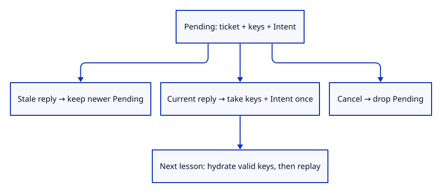

# 3.16.38 · Own the intent with its pending source ticket

**Chapter 3 · Documents, editing and ownership · Section 3.16 · Source ownership and restoration** · [Contents](contents.md)

**Typing: 9–18 minutes.** [Estimate](typing-load.md).

Generalize ReloadJob with a payload type P. Pending stores that payload beside its ticket and keys; begin_with installs them together, finish_with returns them together once, and cancel drops them together. The request sent to a future still owns only URL strings and a ticket.

## Type

Continue from [Route captured Move, Delete and Save results](32gibb-reply.md). [Save or recover your work](recovery.md).

### 1. `src/reload_job.rs`

Keep the intent and source keys inside the same ticket-owned value. Allow any payload without requiring that payload to have a default value. Capture the requested operation when beginning its scoped source request. Install keys and payload together after request validation succeeds. Take the current payload once; stale replies leave newer work untouched. Keep explicit Reload Sources using a unit payload and its existing interface.

Edit these blocks from bottom to top. Keep the surrounding lines unchanged.

<details>
<summary>Locate this block</summary>

```rust
        }
        let ticket = self.issued.checked_add(1).ok_or("Reload tickets exhausted; reload the viewer")?;
        self.issued = ticket;
        self.pending = Some(Pending { ticket, keys });
        Ok(Request { ticket, urls })
    }

    pub fn pending(&self) -> Option<u64> { self.pending.as_ref().map(|pending| pending.ticket) }

    pub fn finish(&mut self, ticket: u64) -> Option<Vec<ReloadKey>> {
        if self.pending() != Some(ticket) { return None; }
        self.pending.take().map(|pending| pending.keys)
    }

    pub fn cancel(&mut self) -> bool { self.pending.take().is_some() }
}

#[cfg(test)]
mod tests {
    use super::*;
```

</details>

Replace it with:

```rust
        }
        let ticket = self.issued.checked_add(1).ok_or("Reload tickets exhausted; reload the viewer")?;
        self.issued = ticket;
        self.pending = Some(Pending { ticket, keys, payload });
        Ok(Request { ticket, urls })
    }

    pub fn pending(&self) -> Option<u64> { self.pending.as_ref().map(|pending| pending.ticket) }

    pub fn finish_with(&mut self, ticket: u64) -> Option<(Vec<ReloadKey>, P)> {
        if self.pending() != Some(ticket) { return None; }
        self.pending.take().map(|pending| (pending.keys, pending.payload))
    }

    pub fn cancel(&mut self) -> bool { self.pending.take().is_some() }
}

impl ReloadJob<()> {
    pub fn begin(&mut self, keys: Vec<ReloadKey>) -> Result<Request, &'static str> {
        self.begin_with(keys, ())
    }
    pub fn finish(&mut self, ticket: u64) -> Option<Vec<ReloadKey>> {
        self.finish_with(ticket).map(|(keys, ())| keys)
    }
}

#[cfg(test)]
mod tests {
    use super::*;
```

<details>
<summary>Locate this block</summary>

```rust
    pub urls: Vec<String>,
}

struct Pending {
    ticket: u64,
    keys: Vec<ReloadKey>,
}

#[derive(Default)]
pub struct ReloadJob {
    issued: u64,
    pending: Option<Pending>,
}

impl ReloadJob {
    pub fn begin(&mut self, keys: Vec<ReloadKey>) -> Result<Request, &'static str> {
        self.cancel();
        if keys.is_empty() { return Err("No released sources to reload"); }
        let mut origins = std::collections::HashSet::new();
```

</details>

Replace it with:

```rust
    pub urls: Vec<String>,
}

struct Pending<P> {
    ticket: u64,
    keys: Vec<ReloadKey>,
    payload: P,
}

pub struct ReloadJob<P = ()> {
    issued: u64,
    pending: Option<Pending<P>>,
}

impl<P> Default for ReloadJob<P> {
    fn default() -> Self { Self { issued: 0, pending: None } }
}

impl<P> ReloadJob<P> {
    pub fn begin_with(&mut self, keys: Vec<ReloadKey>, payload: P) -> Result<Request, &'static str> {
        self.cancel();
        if keys.is_empty() { return Err("No released sources to reload"); }
        let mut origins = std::collections::HashSet::new();
```

<details>
<summary>Complete updated block reference</summary>

```rust
use crate::rehydrate::ReloadKey;

pub struct Request {
    pub ticket: u64,
    pub urls: Vec<String>,
}

struct Pending<P> {
    ticket: u64,
    keys: Vec<ReloadKey>,
    payload: P,
}

pub struct ReloadJob<P = ()> {
    issued: u64,
    pending: Option<Pending<P>>,
}

impl<P> Default for ReloadJob<P> {
    fn default() -> Self { Self { issued: 0, pending: None } }
}

impl<P> ReloadJob<P> {
    pub fn begin_with(&mut self, keys: Vec<ReloadKey>, payload: P) -> Result<Request, &'static str> {
        self.cancel();
        if keys.is_empty() { return Err("No released sources to reload"); }
        let mut origins = std::collections::HashSet::new();
        let mut urls = Vec::new();
        for key in &keys {
            if !origins.insert(key.origin.id) { return Err("Duplicate reload origin"); }
            let location = key.origin.location.as_ref().ok_or("Source has no reload location")?;
            urls.push(location.value().to_owned());
        }
        let ticket = self.issued.checked_add(1).ok_or("Reload tickets exhausted; reload the viewer")?;
        self.issued = ticket;
        self.pending = Some(Pending { ticket, keys, payload });
        Ok(Request { ticket, urls })
    }

    pub fn pending(&self) -> Option<u64> { self.pending.as_ref().map(|pending| pending.ticket) }

    pub fn finish_with(&mut self, ticket: u64) -> Option<(Vec<ReloadKey>, P)> {
        if self.pending() != Some(ticket) { return None; }
        self.pending.take().map(|pending| (pending.keys, pending.payload))
    }

    pub fn cancel(&mut self) -> bool { self.pending.take().is_some() }
}

impl ReloadJob<()> {
    pub fn begin(&mut self, keys: Vec<ReloadKey>) -> Result<Request, &'static str> {
        self.begin_with(keys, ())
    }
    pub fn finish(&mut self, ticket: u64) -> Option<Vec<ReloadKey>> {
        self.finish_with(ticket).map(|(keys, ())| keys)
    }
}

#[cfg(test)]
mod tests {
    use super::*;
    use crate::{editor::{Action, Editor}, reload_url::ReloadUrl};
    use std::{cell::RefCell, rc::Rc};

    fn cold() -> (Editor, Vec<ReloadKey>) {
        let mut editor = Editor::default();
        let location = Rc::new(ReloadUrl::new("test:request".into()));
        editor.apply(Action::ReplaceAt(crate::specimen::bytes(), location)).unwrap();
        editor.apply(Action::UnloadSources).unwrap();
        let keys = editor.reload_keys(); (editor, keys)
    }

    #[test]
    fn only_current_work_can_finish_and_it_finishes_once() {
        let (_, keys) = cold(); let mut job = ReloadJob::default();
        let first = job.begin(keys.clone()).unwrap();
        let second = job.begin(keys.clone()).unwrap();
        assert!(second.ticket > first.ticket);
        assert!(job.finish(first.ticket).is_none()); assert_eq!(job.pending(), Some(second.ticket));
        let accepted = job.finish(second.ticket).unwrap(); assert_eq!(accepted.len(), 1);
        assert!(Rc::ptr_eq(&accepted[0].origin, &keys[0].origin));
        assert!(job.finish(second.ticket).is_none());
        let third = job.begin(keys.clone()).unwrap(); assert!(job.cancel());
        assert!(!job.cancel()); assert!(job.finish(third.ticket).is_none());
        assert!(job.begin(vec![keys[0].clone(), keys[0].clone()]).is_err());
        assert!(job.begin(Vec::new()).is_err()); assert_eq!(job.pending(), None);
    }

    #[test]
    fn cancellation_drops_keys_even_when_abandoned_work_holds_the_job() {
        let (mut editor, keys) = cold();
        let origin = Rc::downgrade(&keys[0].origin);
        let location = Rc::downgrade(keys[0].origin.location.as_ref().unwrap());
        let job = Rc::new(RefCell::new(ReloadJob::default()));
        let request = job.borrow_mut().begin(keys).unwrap();
        let abandoned = Rc::clone(&job);
        editor.apply(Action::Close).unwrap(); assert!(origin.upgrade().is_some());
        assert!(job.borrow_mut().cancel());
        assert!(origin.upgrade().is_none() && location.upgrade().is_none());
        assert_eq!(request.urls, vec!["test:request".to_owned()]);
        assert!(abandoned.borrow_mut().finish(request.ticket).is_none());
    }

    #[test]
    fn exhaustion_cancels_old_keys_and_never_wraps() {
        let (_, keys) = cold(); let mut job = ReloadJob::default();
        job.begin(keys.clone()).unwrap(); job.issued = u64::MAX;
        assert!(job.begin(keys).is_err()); assert_eq!(job.pending(), None);
        assert_eq!(job.issued, u64::MAX);
    }
}
```

</details>

<details>
<summary>Optional patch references</summary>

Use these original edit fragments when comparing a saved checkpoint. Apply the complete blocks above.

```text
--8<-- "journey/code/32gic-owner-01.rs"
```

```text
--8<-- "journey/code/32gic-owner-02.rs"
```

```text
--8<-- "journey/code/32gic-owner-03.rs"
```

```text
--8<-- "journey/code/32gic-owner-04.rs"
```

```text
--8<-- "journey/code/32gic-owner-05.rs"
```

```text
--8<-- "journey/code/32gic-owner-06.rs"
```

</details>

### 2. `src/lib.rs`

Register native ownership checks without exposing test code to the browser.

<details>
<summary>Locate the existing block</summary>

```rust
pub mod edit_replay;
```

</details>

After that block, type:

```rust
--8<-- "journey/code/32gic-owner-07.rs" skip=21
```

<details>
<summary>Supplied validation fixture</summary>

Copy this supplied authoring fixture once. Continue with the browser build below; the course does not require running native tests.

### 3. `src/edit_owner_tests.rs`

Optional authoring fixture. Prove stale/duplicate/cancelled replies cannot consume an intent or retain its source metadata.

Copy this supplied file:

```text
--8<-- "journey/code/32gic-owner-08.rs"
```

</details>

## Run and check

In your project:

```sh
cd workspace/journey
REGEN_PROTO=0 cargo build --lib --locked --target wasm32-unknown-unknown -j1
REGEN_PROTO=0 CARGO_BUILD_JOBS=1 trunk serve --port 8780
```

Open `http://127.0.0.1:8780/`. Keep an existing Trunk server running; saving rebuilds it.

Run the owner checks below. A pending batch keeps its keys and captured intent together; cancellation and one-shot delivery must release that ownership.

### Recorded visual result

**Previous native render — current verification pending.**


*This recorded image predates a source or checker change. Rebuild this checkpoint before using it as current evidence; browser controls require separate acceptance.*

<details>
<summary>Code explanation and diagram</summary>

P is a Rust type parameter: ReloadJob<Intent> owns a captured modeling request, while ReloadJob<()> carries the unit value, which means no additional data. The default type keeps existing explicit Reload Sources callers unchanged. A manual Default implementation starts empty without requiring Intent to implement Default.

The normal begin/finish methods are thin wrappers for the unit specialization. Existing cancellation, ticket exhaustion, duplicate-origin and browser fetch checks still run. New native checks prove an old reply cannot consume the newer Save, the current reply returns its exact intent once, and cancellation drops pending metadata without retaining a kernel document.

A matching ticket establishes current request ownership, not document validity. The next browser lesson must still hydrate with the captured keys and reject changed origin/epoch context before replay. Success and failure both consume only their own current ticket; a stale failure must never abort newer work.

ReloadJob<Intent> → Pending { ticket, keys, payload } → current finish_with takes both once.



Why does a stale completion check the current ticket before taking the pending value?

Taking first would destroy a newer request. Checking first preserves newer keys and intent; only the matching current completion can consume the pair. Cancellation drops the whole pending owner.

Study estimate, including typing and experiments: 1–2 hours.

</details>

<details>
<summary>Optional experiment</summary>

Move pending.take before the ticket comparison in finish_with. Run the stale completion test and explain which newer request was lost.

</details>

<details>
<summary>Check and save your work</summary>

Restore experimental edits, then run from `session_viewer`:

```sh
npm --prefix ../session_tests run course -- check 3.16.38
npm --prefix ../session_tests run course -- save 3.16.38
```

Source comparison leaves your project untouched. [Save and recovery instructions](recovery.md).

</details>

<details>
<summary>Viewer coverage and verification</summary>

Request identity and its payload share one owner. Completion ownership is checked before document context; hydration and replay follow only after both checks.

Chrome checks the unchanged explicit reload/download/editor paths; this lesson does not yet connect an intent-bearing browser completion.

Chrome preserves the existing explicit reload, download and modeling paths. Native tests exercise intent-bearing ticket ownership, stale/duplicate replies and cancellation. Automatic browser replay follows next.

[Full validation scope](release.md).

To reproduce the scripted acceptance of the reference checkpoint, run from `session_viewer` with the [course bundle server](release.md#reproduce) running on port 8781:

```sh
npm --prefix ../session_tests run course -- capture 3.16.38
```

This uses the verified reference bundle; it does not check or change your typed project.

</details>
