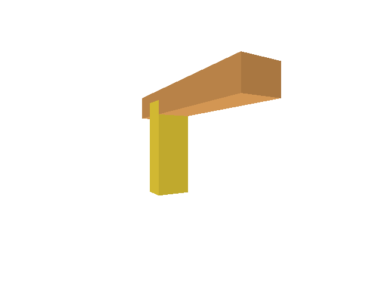
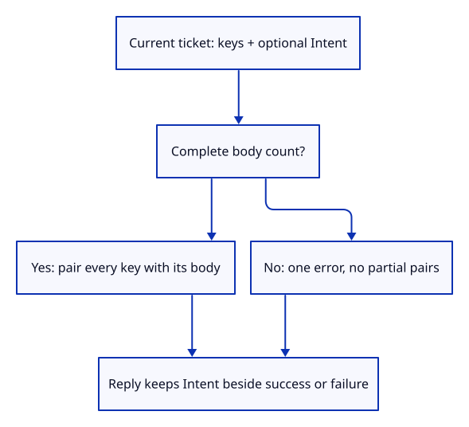

# 3.16.39 · Pair captured intent with complete source bodies

**Chapter 3 · Documents, editing and ownership · Section 3.16 · Source ownership and restoration** · [Contents](contents.md)

**Typing: 7–13 minutes.** [Estimate](typing-load.md).

A completion must keep its captured operation beside every returned source body, or beside its failure. Reply stores an optional Intent and one Result. None describes explicit Reload Sources; Some describes captured Move, Delete or Save.

## Type

Continue from [Own the intent with its pending source ticket](32gic-owner.md). [Save or recover your work](recovery.md).

### 1. `src/reload_reply.rs`

Keep the captured operation beside either its complete source bodies or its failure.

Create the file and type:

```rust
--8<-- "journey/code/32gica-reply-01.rs"
```

### 2. `src/lib.rs`

Register the completion value for native checks and browser delivery.

<details>
<summary>Locate the existing block</summary>

```rust
pub mod edit_replay;
```

</details>

After that block, type:

```rust
--8<-- "journey/code/32gica-reply-02.rs" skip=21
```

<details>
<summary>Supplied validation fixture</summary>

Copy this supplied authoring fixture once. Continue with the browser build below; the course does not require running native tests.

### 3. `src/reload_reply_tests.rs`

Optional authoring fixture. Check all captured operations, exact bodies, failures, partial counts and the explicit no-operation path.

Copy this supplied file:

```text
--8<-- "journey/code/32gica-reply-03.rs"
```

</details>

## Run and check

In your project:

```sh
cd workspace/journey
REGEN_PROTO=0 cargo build --lib --locked --target wasm32-unknown-unknown -j1
REGEN_PROTO=0 CARGO_BUILD_JOBS=1 trunk serve --port 8780
```

Open `http://127.0.0.1:8780/`. Keep an existing Trunk server running; saving rebuilds it.

Run the completed-body checks below. The reply must contain every requested body paired with its key and retain the captured intent until adoption.

### Recorded visual result

**Previous native render — current verification pending.**



*This recorded image predates a source or checker change. Rebuild this checkpoint before using it as current evidence; browser controls require separate acceptance.*

<details>
<summary>Code explanation and diagram</summary>

Before pairing bodies and keys, the constructor checks equal lengths. zip stops when either iterator ends; without this check a missing or extra body could silently become a partial restoration. A failure retains the operation and creates no source-body pairs.

This checkpoint does not change the browser flight or connect automatic commands. The next lesson gives the browser this completion value.

current ticket → keys + Intent → equal body count → complete pairs or error.



Why must body-count validation happen before pairing bodies with source keys?

zip stops at the shorter vector. Without checking equal lengths first, a partial response could look like a complete restoration request. Failure keeps the operation but exposes no partial body pairs.

Study estimate, including typing and experiments: 1–2 hours.

</details>

<details>
<summary>Optional experiment</summary>

Remove the body-count check and inspect the missing/extra body tests. Explain why zip alone cannot establish a complete response.

</details>

<details>
<summary>Check and save your work</summary>

Restore experimental edits, then run from `session_viewer`:

```sh
npm --prefix ../session_tests run course -- check 3.16.39
npm --prefix ../session_tests run course -- save 3.16.39
```

Source comparison leaves your project untouched. [Save and recovery instructions](recovery.md).

</details>

<details>
<summary>Viewer coverage and verification</summary>

Request ownership, complete source bodies and captured intent reach one completion boundary. Document-context validation still precedes replay; automatic commands follow next.

Native tests carry all three operations through a current ticket, preserve exact file bytes and hydrate without replaying the operation. They also check network errors, missing bodies, extra bodies and the explicit None path. Hydration must preserve selection, camera and placement.

Native checks exercise captured Move/Delete/Save, exact source bodies and failure counts. Chrome retains the existing explicit reload/editor; browser delivery integration follows next.

[Full validation scope](release.md).

To reproduce the scripted acceptance of the reference checkpoint, run from `session_viewer` with the [course bundle server](release.md#reproduce) running on port 8781:

```sh
npm --prefix ../session_tests run course -- capture 3.16.39
```

This uses the verified reference bundle; it does not check or change your typed project.

</details>
