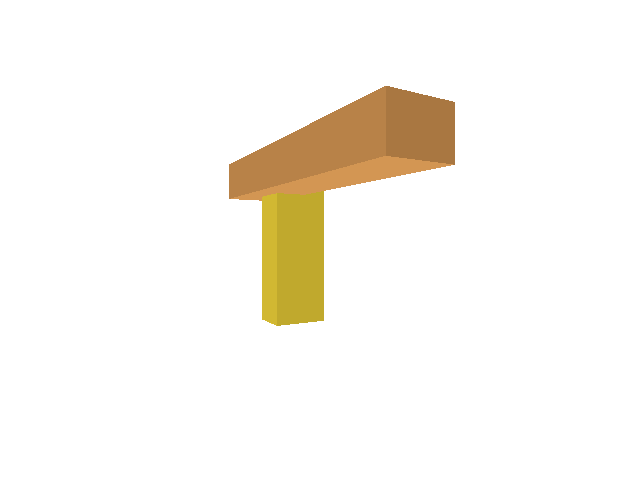
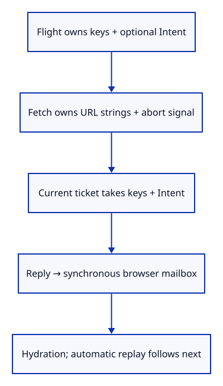

# 3.16.40 · Carry captured intent through browser completion

**Chapter 3 · Documents, editing and ownership · Section 3.16 · Source ownership and restoration** · [Contents](contents.md)

**Typing: 12–23 minutes.** [Estimate](typing-load.md).

The browser flight now uses ReloadJob<Option<Intent>>. None means explicit Reload Sources; Some carries the captured operation that an automatic command will request next. start keeps its existing interface and calls start_with using None.

## Type

Continue from [Pair captured intent with complete source bodies](32gica-reply.md). [Save or recover your work](recovery.md).

### 1. `src/browser_reload.rs`

Use the same completion value in the browser mailbox. Preserve explicit Reload Sources while allowing a captured operation to accompany its keys. Only a current ticket may collect its captured operation and deliver the complete reply. Let the existing abortable flight own an optional operation. Capture the operation when starting the abortable source flight. Install the optional operation and keys into one ticket owner. Return both keys and operation only after checking completion ownership.

<details>
<summary>Locate the existing block</summary>

```rust
use crate::{rehydrate::ReloadKey, reload_job::{ReloadJob, Request}};
use std::{cell::RefCell, rc::Rc};

pub type Shared = Rc<RefCell<Flight>>;

pub type Reply = Result<Vec<(ReloadKey, Vec<u8>)>, String>;
pub type Delivery = Rc<RefCell<Option<Reply>>>;

pub fn start(shared: Shared, keys: Vec<ReloadKey>, delivery: Delivery) -> Result<(), String> {
    let (request, signal) = shared.borrow_mut().begin(keys)?;
    crate::browser::report("Reloading editable sources…");
    wasm_bindgen_futures::spawn_local(async move {
        let result: Result<Vec<Vec<u8>>, String> = async {
            let mut values = Vec::new();
            for url in request.urls { values.push(crate::source_fetch::fetch(&url, &signal).await?); }
            Ok(values)
        }.await;
        let Some(keys) = shared.borrow_mut().finish(request.ticket, result.is_err()) else { return; };
        let result = result.map(|values| keys.into_iter().zip(values).collect());
        if let Err(error) = deliver(result, &delivery) {
            crate::browser::report(&format!("Cannot deliver reload: {error:?}"));
        }
    });
    Ok(())
}

fn deliver(result: Reply, delivery: &Delivery) -> Result<(), wasm_bindgen::JsValue> {
    let event = web_sys::Event::new("viewer-reload")?;
    *delivery.borrow_mut() = Some(result);
    let result = web_sys::window().ok_or_else(|| wasm_bindgen::JsValue::from_str("No browser window"))
        .and_then(|window| window.dispatch_event(&event));
    delivery.borrow_mut().take();
    result.map(|_| ())
}

#[derive(Default)]
pub struct Flight {
    job: ReloadJob,
    controller: Option<web_sys::AbortController>,
}

impl Flight {
    pub fn cancel(&mut self) -> bool {
        let cancelled = self.job.cancel();
        if let Some(controller) = self.controller.take() { controller.abort(); }
        cancelled
    }

    fn begin(&mut self, keys: Vec<ReloadKey>) -> Result<(Request, web_sys::AbortSignal), String> {
        self.cancel();
        let controller = web_sys::AbortController::new().map_err(|error| format!("Cannot start reload: {error:?}"))?;
        let request = self.job.begin(keys)?;
        let signal = controller.signal();
        self.controller = Some(controller);
        Ok((request, signal))
    }

    fn finish(&mut self, ticket: u64, failed: bool) -> Option<Vec<ReloadKey>> {
        let keys = self.job.finish(ticket)?;
        if let Some(controller) = self.controller.take() { if failed { controller.abort(); } }
        Some(keys)
    }
}
```

</details>

Edit the existing block to match this code; keep unchanged lines:

```rust
use crate::{rehydrate::ReloadKey, reload_job::{ReloadJob, Request}};
use std::{cell::RefCell, rc::Rc};

pub type Shared = Rc<RefCell<Flight>>;

pub type Reply = crate::reload_reply::Reply;
pub type Delivery = Rc<RefCell<Option<Reply>>>;

pub fn start(shared: Shared, keys: Vec<ReloadKey>, delivery: Delivery) -> Result<(), String> {
    start_with(shared, keys, None, delivery)
}

pub fn start_with(shared: Shared, keys: Vec<ReloadKey>, intent: Option<crate::edit_intent::Intent>, delivery: Delivery) -> Result<(), String> {
    let (request, signal) = shared.borrow_mut().begin(keys, intent)?;
    crate::browser::report("Reloading editable sources…");
    wasm_bindgen_futures::spawn_local(async move {
        let result: Result<Vec<Vec<u8>>, String> = async {
            let mut values = Vec::new();
            for url in request.urls { values.push(crate::source_fetch::fetch(&url, &signal).await?); }
            Ok(values)
        }.await;
        let Some((keys, intent)) = shared.borrow_mut().finish(request.ticket, result.is_err()) else { return; };
        let reply = Reply::new(keys, intent, result);
        if let Err(error) = deliver(reply, &delivery) {
            crate::browser::report(&format!("Cannot deliver reload: {error:?}"));
        }
    });
    Ok(())
}

fn deliver(result: Reply, delivery: &Delivery) -> Result<(), wasm_bindgen::JsValue> {
    let event = web_sys::Event::new("viewer-reload")?;
    *delivery.borrow_mut() = Some(result);
    let result = web_sys::window().ok_or_else(|| wasm_bindgen::JsValue::from_str("No browser window"))
        .and_then(|window| window.dispatch_event(&event));
    delivery.borrow_mut().take();
    result.map(|_| ())
}

#[derive(Default)]
pub struct Flight {
    job: ReloadJob<Option<crate::edit_intent::Intent>>,
    controller: Option<web_sys::AbortController>,
}

impl Flight {
    pub fn cancel(&mut self) -> bool {
        let cancelled = self.job.cancel();
        if let Some(controller) = self.controller.take() { controller.abort(); }
        cancelled
    }

    fn begin(&mut self, keys: Vec<ReloadKey>, intent: Option<crate::edit_intent::Intent>) -> Result<(Request, web_sys::AbortSignal), String> {
        self.cancel();
        let controller = web_sys::AbortController::new().map_err(|error| format!("Cannot start reload: {error:?}"))?;
        let request = self.job.begin_with(keys, intent)?;
        let signal = controller.signal();
        self.controller = Some(controller);
        Ok((request, signal))
    }

    fn finish(&mut self, ticket: u64, failed: bool) -> Option<(Vec<ReloadKey>, Option<crate::edit_intent::Intent>)> {
        let keys = self.job.finish_with(ticket)?;
        if let Some(controller) = self.controller.take() { if failed { controller.abort(); } }
        Some(keys)
    }
}
```

<details>
<summary>Optional patch references</summary>

Use these original edit fragments when comparing a saved checkpoint. Apply the complete blocks above.

```text
--8<-- "journey/code/32gicb-bridge-01.rs"
```

```text
--8<-- "journey/code/32gicb-bridge-02.rs"
```

```text
--8<-- "journey/code/32gicb-bridge-03.rs"
```

```text
--8<-- "journey/code/32gicb-bridge-04.rs"
```

```text
--8<-- "journey/code/32gicb-bridge-05.rs"
```

```text
--8<-- "journey/code/32gicb-bridge-06.rs"
```

```text
--8<-- "journey/code/32gicb-bridge-07.rs"
```

</details>

### 2. `src/browser.rs`

Keep the existing explicit source-restoration receiver reading the reply body.

<details>
<summary>Locate the existing block</summary>

```rust
            if let Some(result) = reload_delivery.borrow_mut().take() {
                match result.and_then(|values| editor.hydrate(values).map_err(str::to_owned)) {
```

</details>

Edit the existing block to match this code; keep unchanged lines:

```rust
            if let Some(reply) = reload_delivery.borrow_mut().take() {
                match reply.result.and_then(|values| editor.hydrate(values).map_err(str::to_owned)) {
```

<details>
<summary>Optional patch references</summary>

Use these original edit fragments when comparing a saved checkpoint. Apply the complete blocks above.

```text
--8<-- "journey/code/32gicb-bridge-08.rs"
```

</details>

## Run and check

In your project:

```sh
cd workspace/journey
REGEN_PROTO=0 cargo build --lib --locked --target wasm32-unknown-unknown -j1
REGEN_PROTO=0 CARGO_BUILD_JOBS=1 trunk serve --port 8780
```

Open `http://127.0.0.1:8780/`. Keep an existing Trunk server running; saving rebuilds it.

Build the browser bundle and run the checks below. Accepted delivery now carries the intent; an aborted older flight cannot deliver it. Automatic commands are not routed yet.

### Recorded visual result

**Previous native render — current verification pending.**



*This recorded image predates a source or checker change. Rebuild this checkpoint before using it as current evidence; browser controls require separate acceptance.*

<details>
<summary>Code explanation and diagram</summary>

The async future owns URL strings, an abort signal and a ticket. Current completion takes keys and optional intent together, constructs the previously taught Reply and delivers it through the synchronous browser mailbox. A stale reply returns before touching a newer flight or its controller; cancellation retains the existing abort path.

The existing receiver reads reply.result and restores sources. Automatic commands will call start_with and replay reply.intent only after document-context validation in the next lesson. This checkpoint wires the completion boundary, not automatic replay.

Flight → ReloadJob<Option<Intent>> → current finish_with → Reply → synchronous browser mailbox.



Why does the asynchronous future retain a ticket instead of owning the pending intent and keys?

The flight can cancel and release pending ownership while a delayed future remains alive. Only a matching current ticket can take the intent and keys; a stale completion cannot disturb newer work.

Study estimate, including typing and experiments: 1–2 hours.

</details>

<details>
<summary>Optional experiment</summary>

Return the intent from the future rather than finish_with. Explain why cancelling the pending owner would no longer release that future’s captured request.

</details>

<details>
<summary>Check and save your work</summary>

Restore experimental edits, then run from `session_viewer`:

```sh
npm --prefix ../session_tests run course -- check 3.16.40
npm --prefix ../session_tests run course -- save 3.16.40
```

Source comparison leaves your project untouched. [Save and recovery instructions](recovery.md).

</details>

<details>
<summary>Viewer coverage and verification</summary>

Request ownership, complete source bodies and captured intent reach one completion boundary. Document-context validation still precedes replay; automatic commands follow next.

Chrome checks explicit fetch, cancellation and editing through the changed delivery type. The native Reply and ticket tests still check all captured operations, exact bytes and failed completions.

Chrome checks explicit Reload Sources, cancellation and editing through the new reply. Native tests verify captured Move/Delete/Save and failures; automatic command replay is the next checkpoint.

[Full validation scope](release.md).

To reproduce the scripted acceptance of the reference checkpoint, run from `session_viewer` with the [course bundle server](release.md#reproduce) running on port 8781:

```sh
npm --prefix ../session_tests run course -- capture 3.16.40
```

This uses the verified reference bundle; it does not check or change your typed project.

</details>
