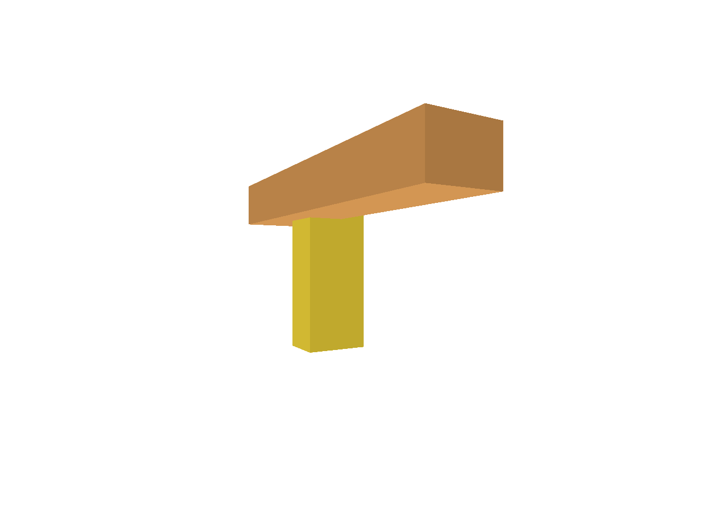
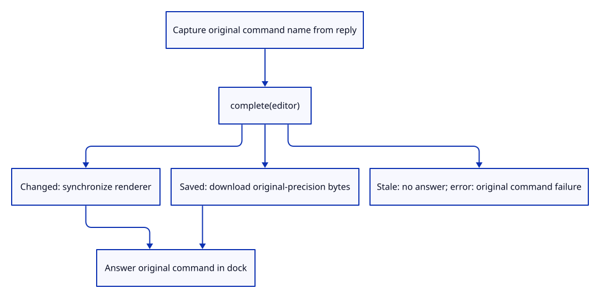

# 3.16.42 · Deliver restored edit and Save results to the dock

**Chapter 3 · Documents, editing and ownership · Section 3.16 · Source ownership and restoration** · [Contents](contents.md)

**Typing: 14–27 minutes.** [Estimate](typing-load.md).

Connect completed source replies to drawing and Save downloads. Report success or failure under the original command name.

## Type

Continue from [Validate restoration before replaying the command](32gid-complete.md). [Save or recover your work](recovery.md).

### 1. `src/edit_intent.rs`

Name the captured operation independently of the current input field or selection.

<details>
<summary>Locate the existing block</summary>

```rust
impl Intent {
```

</details>

After that block, type:

```rust
--8<-- "journey/code/32gie-response-01.rs" skip=14
```

### 2. `src/browser.rs`

Consume validated edit or Save results and associate success or failure with the original command. Keep download handling shared by immediate and restored Save results.

Edit these blocks from bottom to top. Keep the surrounding lines unchanged.

<details>
<summary>Locate this block</summary>

```rust
            None
        } else if event.type_() == "viewer-reload" {
            if let Some(reply) = reload_delivery.borrow_mut().take() {
                match reply.result.and_then(|values| editor.hydrate(values).map_err(str::to_owned)) {
                    Ok(true) => {
                        renderer.set_scene(&editor.scene, editor.selected);
                        let message = "Editable sources restored; display retained.";
                        report(message); panel.answer("Reload Sources", message);
                    }
                    Ok(false) => {}
                    Err(error) => { report(&error); panel.answer("Reload Sources", &error); }
                }
            }
            None
```

</details>

Replace it with:

```rust
            None
        } else if event.type_() == "viewer-reload" {
            if let Some(reply) = reload_delivery.borrow_mut().take() {
                let command = reply.intent.map_or("Reload Sources", |intent| intent.command());
                match reply.complete(&mut editor) {
                    Ok(Some(crate::edit_replay::Reply::Changed(_))) => {
                        renderer.set_scene(&editor.scene, editor.selected);
                        let message = if command == "Reload Sources" {
                            "Editable sources restored; display retained.".to_owned()
                        } else { format!("{command} completed after source reload.") };
                        report(&message); panel.answer(command, &message);
                    }
                    Ok(Some(crate::edit_replay::Reply::Saved(bytes))) => {
                        let message = save_result(&bytes).unwrap_or_else(|error| error);
                        report(&message); panel.answer(command, &message);
                    }
                    Ok(None) => {}
                    Err(error) => { report(&error); panel.answer(command, &error); }
                }
            }
            None
```

<details>
<summary>Locate this block</summary>

```rust
    }
}

pub async fn run() -> Result<(), JsValue> {
    let window = web_sys::window().ok_or("No browser window")?;
    let document = window.document().ok_or("No document")?;
```

</details>

Replace it with:

```rust
    }
}

fn save_result(bytes: &[u8]) -> Result<String, String> {
    crate::file_output::download(bytes)
        .map(|()| format!("Saved editable document ({} bytes)", bytes.len()))
        .map_err(|error| format!("Save failed: {error:?}"))
}

pub async fn run() -> Result<(), JsValue> {
    let window = web_sys::window().ok_or("No browser window")?;
    let document = window.document().ok_or("No document")?;
```

<details>
<summary>Complete updated block reference</summary>

```rust
use crate::background::Background;
use crate::editor::{Action, Change, Editor};
use crate::gesture::Gesture;
use crate::renderer::Renderer;
use crate::viewport::Viewport;
use wasm_bindgen::{JsCast, JsValue, closure::Closure};

pub fn report(message: &str) {
    if let Some(document) = web_sys::window().and_then(|window| window.document()) {
        if let Some(status) = document.get_element_by_id("status") {
            status.set_text_content(Some(message));
            if message.starts_with("Cannot draw:") { let _ = status.remove_attribute("hidden"); }
        }
    }
}

fn save_result(bytes: &[u8]) -> Result<String, String> {
    crate::file_output::download(bytes)
        .map(|()| format!("Saved editable document ({} bytes)", bytes.len()))
        .map_err(|error| format!("Save failed: {error:?}"))
}

pub async fn run() -> Result<(), JsValue> {
    let window = web_sys::window().ok_or("No browser window")?;
    let document = window.document().ok_or("No document")?;
    let canvas: web_sys::HtmlCanvasElement = document
        .get_element_by_id("canvas")
        .ok_or("Missing canvas")?
        .dyn_into()?;
    let instance = wgpu::Instance::new(wgpu::InstanceDescriptor {
        backends: wgpu::Backends::BROWSER_WEBGPU,
        flags: Default::default(),
        memory_budget_thresholds: Default::default(),
        backend_options: Default::default(),
        display: None,
    });
    let surface = instance
        .create_surface(wgpu::SurfaceTarget::Canvas(canvas.clone()))
        .map_err(|error| JsValue::from_str(&error.to_string()))?;
    let adapter = instance
        .request_adapter(&wgpu::RequestAdapterOptions {
            compatible_surface: Some(&surface),
            ..Default::default()
        })
        .await
        .map_err(|error| JsValue::from_str(&error.to_string()))?;
    let (device, queue) = adapter
        .request_device(&wgpu::DeviceDescriptor::default())
        .await
        .map_err(|error| JsValue::from_str(&error.to_string()))?;
    device.on_uncaptured_error(std::sync::Arc::new(|error| report(&error.to_string())));
    let limit = device.limits().max_texture_dimension_2d;
    let width = (window.inner_width()?.as_f64().ok_or("No window width")? as u32).clamp(1, limit);
    let height = (window.inner_height()?.as_f64().ok_or("No window height")? as u32).clamp(1, limit);
    canvas.set_width(width);
    canvas.set_height(height);
    let mut config = surface
        .get_default_config(&adapter, width, height)
        .ok_or("No compatible surface format")?;
    config.view_formats = vec![config.format.add_srgb_suffix()];
    surface.configure(&device, &config);
    let mut editor = Editor::default();
    let mut renderer = Renderer::new(
        device,
        queue,
        config.format.add_srgb_suffix(),
        &editor.scene,
    );
    renderer.resize(Viewport { width, height });
    inspect(&editor, &renderer)?;
    let mut panel = crate::panel::Panel::new(
        &renderer,
        config.format.add_srgb_suffix(),
        &[
            "Help",
            "Open",
            "Open Replace",
            "Cancel Open",
            "Close",
            "Unload Sources",
            "Reload Sources",
            "Cancel Reload",
            "Save",
            "Example Box",
            "Example Triangle",
            "Select Next",
            "Delete",
            "Undo",
            "Redo",
            "Background",
            "Zoom In",
            "Zoom Out",
            "Pan Left",
            "Pan Right",
            "Orbit Right",
            "Orbit Up",
            "View Isometric",
            "View Perspective",
            "View Orthographic",
            "Fit",
            "Fit Selected",
            "Move",
            "View Reset",
        ],
    );
    panel.update(None, &canvas)?;
    if resize(
        &window,
        &canvas,
        &surface,
        &mut config,
        &mut renderer,
        &mut editor,
    ) {
        panel.update(None, &canvas)?;
        present(
            &surface,
            &renderer,
            &editor.background,
            &editor.camera.uniform(),
            &mut panel,
        )?;
    }
    let input_canvas = canvas.clone();
    let browser_window = window.clone();
    let pointer_canvas = canvas.clone();
    let mut gesture = Gesture::default();
    let request = std::rc::Rc::new(std::cell::RefCell::new(crate::read_gate::ReadGate::default()));
    let read_mode = std::cell::Cell::new(crate::file_input::Mode::Append);
    let delivery: crate::file_input::Delivery = std::rc::Rc::new(std::cell::RefCell::new(None));
    let reload: crate::browser_reload::Shared = std::rc::Rc::new(std::cell::RefCell::new(Default::default()));
    let reload_delivery: crate::browser_reload::Delivery = std::rc::Rc::new(std::cell::RefCell::new(None));
    let update = Closure::<dyn FnMut(web_sys::Event)>::new(move |event: web_sys::Event| {
        let shortcut = event.dyn_ref::<web_sys::KeyboardEvent>().and_then(|key| panel.shortcut(key));
        let line = if let Some(shortcut) = shortcut {
            event.prevent_default();
            panel.answer(shortcut.command(), "");
            Some(shortcut.command().to_ascii_lowercase())
        } else { match panel.update(Some(&event), &input_canvas) {
            Ok(line) => line,
            Err(error) => {
                report(&format!("Cannot read command: {error:?}"));
                return;
            }
        } };

        let action = if event.type_() == "cancel" && event.target()
            .and_then(|target| target.dyn_into::<web_sys::HtmlInputElement>().ok())
            .is_some_and(|input| input.id() == "open")
        {
            request.borrow_mut().cancel();
            report("Open cancelled.");
            panel.answer("Open", "Open cancelled.");
            None
        } else if event.type_() == "change" {
            crate::file_input::choose(&event, std::rc::Rc::clone(&request), read_mode.get(), std::rc::Rc::clone(&delivery));
            None
        } else if event.type_() == "viewer-file-error" {
            if let Some(message) = event.dyn_ref::<web_sys::CustomEvent>().and_then(|event| event.detail().as_string()) {
                report(&message);
                panel.answer("Open", &message);
            }
            None
        } else if event.type_() == "viewer-reload" {
            if let Some(reply) = reload_delivery.borrow_mut().take() {
                let command = reply.intent.map_or("Reload Sources", |intent| intent.command());
                match reply.complete(&mut editor) {
                    Ok(Some(crate::edit_replay::Reply::Changed(_))) => {
                        renderer.set_scene(&editor.scene, editor.selected);
                        let message = if command == "Reload Sources" {
                            "Editable sources restored; display retained.".to_owned()
                        } else { format!("{command} completed after source reload.") };
                        report(&message); panel.answer(command, &message);
                    }
                    Ok(Some(crate::edit_replay::Reply::Saved(bytes))) => {
                        let message = save_result(&bytes).unwrap_or_else(|error| error);
                        report(&message); panel.answer(command, &message);
                    }
                    Ok(None) => {}
                    Err(error) => { report(&error); panel.answer(command, &error); }
                }
            }
            None
        } else if event.type_() == "viewer-file" {
            match crate::file_input::action(&event, &delivery) {
                Ok(action) => action,
                Err(error) => { let message = format!("Cannot retain reload file: {error:?}");
                    report(&message); panel.answer("Open", &message); None }
            }
        } else if let Some(line) = line {
            if line == "reload sources" {
                let result = crate::browser_reload::start(std::rc::Rc::clone(&reload), editor.reload_keys(), std::rc::Rc::clone(&reload_delivery));
                match result {
                    Ok(()) => panel.result("Reloading editable sources…"),
                    Err(error) => { report(&error); panel.result(&error); }
                }
                None
            } else if line == "cancel reload" {
                reload.borrow_mut().cancel();
                report("Reload cancelled."); panel.result("Reload cancelled.");
                None
            } else if line == "unload sources" {
                Some(Action::UnloadSources)
            } else if line == "close" {
                request.borrow_mut().cancel();
                Some(Action::Close)
            } else if line == "cancel open" {
                request.borrow_mut().cancel();
                report("Open cancelled.");
                panel.result("Open cancelled.");
                None
            } else if line == "open" || line == "open replace" {
                let ticket = request.borrow_mut().begin();
                if let Err(error) = ticket { report(error); panel.result(error); return; }
                if line == "open replace" { reload.borrow_mut().cancel(); }
                read_mode.set(if line == "open replace" { crate::file_input::Mode::Replace }
                    else { crate::file_input::Mode::Append });
                if let Some(input) = web_sys::window()
                    .and_then(|window| window.document())
                    .and_then(|document| document.get_element_by_id("open"))
                    .and_then(|element| element.dyn_into::<web_sys::HtmlInputElement>().ok())
                {
                    input.click();
                }
                None
            } else if line == "save" {
                match crate::document::snapshot(&editor.scene) {
                    Ok(bytes) => match crate::file_output::download(&bytes) {
                        Ok(()) => panel.result(&format!("Saved editable document ({} bytes)", bytes.len())),
                        Err(error) => panel.result(&format!("Save failed: {error:?}")),
                    },
                    Err(error) => panel.result(error),
                }
                None
            } else if line == "move" || line.starts_with("move ") {
                match crate::offset::parse(&line) {
                    Ok(offset) => Some(Action::Translate(offset)),
                    Err(error) => { panel.result(error); None }
                }
            } else {
                let action = match line.as_str() {
                    "example box" => Action::AddBox,
                    "example triangle" => Action::ToggleExtra,
                    "select next" => Action::SelectNext,
                    "delete" => Action::Delete,
                    "undo" => Action::Undo,
                    "redo" => Action::Redo,
                    "background" => Action::Background,
                    "zoom in" => Action::Zoom(2.0),
                    "zoom out" => Action::Zoom(0.5),
                    "pan left" => Action::Pan(-0.25, 0.0),
                    "pan right" => Action::Pan(0.25, 0.0),
                    "orbit right" => Action::Orbit(std::f64::consts::FRAC_PI_4, 0.0),
                    "orbit up" => Action::Orbit(0.0, std::f64::consts::FRAC_PI_6),
                    "view isometric" => Action::Isometric,
                    "view perspective" => {
                        Action::Projection(crate::camera::Projection::Perspective)
                    }
                    "view orthographic" => {
                        Action::Projection(crate::camera::Projection::Orthographic)
                    }
                    "fit" if shortcut.is_some() && editor.selected.is_some() => Action::FitSelected,
                    "fit" => Action::Fit,

                    "fit selected" => Action::FitSelected,
                    "view reset" => Action::ResetView,
                    _ => return,
                };
                Some(action)
            }
        } else if !panel.consumed {
            navigation_action(&event, &pointer_canvas, &mut gesture)
        } else {
            None
        };
        if let Some(action) = action {
            if matches!(&action, Action::Close | Action::UnloadSources | Action::Undo | Action::Redo
                | Action::Replace(_) | Action::ReplaceAt(_, _)) { reload.borrow_mut().cancel(); }
            let replacement = matches!(&action, Action::Replace(_) | Action::ReplaceAt(_, _));
            let closing = matches!(&action, Action::Close);
            let unloading = matches!(&action, Action::UnloadSources);
            match editor.apply(action) {
                Ok(Change::Scene) => {
                    renderer.set_scene(&editor.scene, editor.selected);
                    if unloading {
                        report("Editable sources unloaded; display retained.");
                        panel.result("Editable sources unloaded; display retained.");
                    } else if closing {
                        report("Document closed.");
                        panel.result("Document closed.");
                    } else if event.type_() == "viewer-file" {
                        let message = if replacement { "Document replaced. Undo restores the previous document." }
                            else { "File imported. Undo removes the entire import." };
                        report(message);
                        panel.answer(if replacement { "Open Replace" } else { "Open" }, message);
                    }
                }
                Ok(Change::View) => {}
                Err(error) => {
                    report(error);
                    if event.type_() == "viewer-file" { panel.answer("Open", error); }
                    else { panel.result(error); }
                }
            }
        }
        if let Err(error) = inspect(&editor, &renderer) {
            report(&format!("Cannot report projection: {error:?}"));
            return;
        }
        if resize(
            &browser_window,
            &pointer_canvas,
            &surface,
            &mut config,
            &mut renderer,
            &mut editor,
        ) {
            if let Err(error) = panel.update(None, &input_canvas) {
                report(&format!("Cannot lay out commands: {error:?}"));
                return;
            }
            if let Err(error) = present(
                &surface,
                &renderer,
                &editor.background,
                &editor.camera.uniform(),
                &mut panel,
            ) {
                report(&format!("Cannot redraw: {error:?}"));
            }
        }
    });
    for name in [
        "pointerdown",
        "pointermove",
        "pointerup",
        "pointercancel",
        "lostpointercapture",
        "contextmenu",
        "keydown",
        "keyup",
        "blur",
    ] {
        canvas.add_event_listener_with_callback(name, update.as_ref().unchecked_ref())?;
    }
    let options = web_sys::AddEventListenerOptions::new();
    options.set_passive(false);
    canvas.add_event_listener_with_callback_and_add_event_listener_options(
        "wheel",
        update.as_ref().unchecked_ref(),
        &options,
    )?;
    window.add_event_listener_with_callback("resize", update.as_ref().unchecked_ref())?;
    window.add_event_listener_with_callback("blur", update.as_ref().unchecked_ref())?;
    document.add_event_listener_with_callback("change", update.as_ref().unchecked_ref())?;
    document.add_event_listener_with_callback("cancel", update.as_ref().unchecked_ref())?;
    window.add_event_listener_with_callback("viewer-file", update.as_ref().unchecked_ref())?;
    window.add_event_listener_with_callback("viewer-file-error", update.as_ref().unchecked_ref())?;
    window.add_event_listener_with_callback("viewer-reload", update.as_ref().unchecked_ref())?;
    // Both event sources retain this one callback for the lifetime of the page.
    update.forget();
    report("Wheel zooms; type commands anywhere in the drawing. Escape cancels a drag.");
    Ok(())
}

fn inspect(editor: &Editor, renderer: &Renderer) -> Result<(), JsValue> {
    let document = web_sys::window()
        .and_then(|window| window.document())
        .ok_or("No document")?;
    let canvas = document
        .get_element_by_id("canvas")
        .ok_or("Missing canvas")?;
    canvas.set_attribute("data-object-count", &editor.scene.objects().len().to_string())?;
    let metadata: Vec<_> = editor.scene.objects().iter().map(|row| {
        let m = &row.metadata;
        (&row.guid, &m.source_guid, &m.name, m.is_visible, m.is_locked)
    }).collect();
    let origins: Vec<_> = editor.scene.objects().iter().filter_map(|row| row.origin().map(|origin|
        (&row.guid, origin.id.to_string(), origin.version.hex(),
            origin.location.as_ref().map(|location| location.value())))).collect();
    let residency: Vec<_> = editor.scene.objects().iter().map(|row|
        (&row.guid, row.geometry().is_some(), row.release_epoch())).collect();
    canvas.set_attribute("data-source-residency", &serde_json::to_string(&residency)
        .map_err(|error| JsValue::from_str(&error.to_string()))?)?;
    canvas.set_attribute("data-source-origins", &serde_json::to_string(&origins)
        .map_err(|error| JsValue::from_str(&error.to_string()))?)?;
    canvas.set_attribute("data-row-metadata", &serde_json::to_string(&metadata)
        .map_err(|error| JsValue::from_str(&error.to_string()))?)?;
    canvas.set_attribute("data-gpu-stats", &format!("{:?}", renderer.stats()))?;
    let cpu = crate::memory::cpu(editor.scenes(), renderer.geometry_owners().map(|owner| &owner.source));
    canvas.set_attribute("data-cpu-usage", &format!("{cpu:?}"))?;
    canvas.set_attribute("data-gpu-usage", &format!("{:?}", renderer.usage()))?;
    canvas.set_attribute("data-projection", &format!("{:?}", editor.camera.projection))
}

fn navigation_action(
    event: &web_sys::Event,
    canvas: &web_sys::HtmlCanvasElement,
    gesture: &mut Gesture,
) -> Option<Action> {
    let action = match event.type_().as_str() {
        "wheel" => {
            let wheel = event.dyn_ref::<web_sys::WheelEvent>()?;
            let mode = wheel.delta_mode();
            crate::navigation::wheel(
                wheel.delta_y(),
                mode,
                canvas.get_bounding_client_rect().height(),
            )
        }
        "keydown" => {
            let key = event.dyn_ref::<web_sys::KeyboardEvent>()?;
            if key.is_composing() || key.alt_key() {
                return None;
            }
            if key.key() == "Escape" {
                gesture.cancel();
                event.prevent_default();
                return None;
            }
            return None;
        }
        _ => return pointer_action(event, canvas, gesture),
    }?;
    event.prevent_default();
    Some(action)
}

fn pointer_action(
    event: &web_sys::Event,
    canvas: &web_sys::HtmlCanvasElement,
    gesture: &mut Gesture,
) -> Option<Action> {
    match event.type_().as_str() {
        "contextmenu" => {
            event.prevent_default();
            return None;
        }
        "blur" | "resize" => {
            gesture.cancel();
            return None;
        }
        _ => {}
    }
    let pointer = event.dyn_ref::<web_sys::PointerEvent>()?;
    let id = pointer.pointer_id();
    let position = [pointer.client_x() as f64, pointer.client_y() as f64];
    let motion = match event.type_().as_str() {
        "pointerdown" => {
            if pointer.is_primary() && gesture.press(id, pointer.button(), position) {
                event.prevent_default();
                let options = web_sys::FocusOptions::new();
                options.set_prevent_scroll(true);
                if canvas.focus_with_options(&options).is_err()
                    || canvas.set_pointer_capture(id).is_err()
                {
                    gesture.cancel();
                }
            }
            None
        }
        "pointermove" => gesture.move_to(id, position),
        "pointerup" => {
            let motion = gesture.release(id, position);
            let _ = canvas.release_pointer_capture(id);
            motion
        }
        "pointercancel" | "lostpointercapture" => {
            gesture.cancel_pointer(id);
            None
        }
        _ => None,
    }?;
    let rect = canvas.get_bounding_client_rect();
    motion.action([rect.left(), rect.top(), rect.width(), rect.height()])
}

fn resize(
    window: &web_sys::Window,
    canvas: &web_sys::HtmlCanvasElement,
    surface: &wgpu::Surface<'_>,
    config: &mut wgpu::SurfaceConfiguration,
    renderer: &mut Renderer,
    editor: &mut Editor,
) -> bool {
    let rect = canvas.get_bounding_client_rect();
    let limit = renderer.device.limits().max_texture_dimension_2d;
    let Some(size) = Viewport::from_css(
        rect.width(),
        rect.height(),
        window.device_pixel_ratio(),
        limit,
    ) else {
        return false;
    };
    if size.width != config.width || size.height != config.height {
        canvas.set_width(size.width);
        canvas.set_height(size.height);
        config.width = size.width;
        config.height = size.height;
        surface.configure(&renderer.device, config);
        renderer.resize(size);
    }
    editor.camera.aspect = size.aspect();
    true
}

fn present(
    surface: &wgpu::Surface<'_>,
    renderer: &Renderer,
    background: &Background,
    transform: &[f32; 16],
    panel: &mut crate::panel::Panel,
) -> Result<(), JsValue> {
    let frame = match surface.get_current_texture() {
        wgpu::CurrentSurfaceTexture::Success(frame)
        | wgpu::CurrentSurfaceTexture::Suboptimal(frame) => frame,
        other => {
            return Err(JsValue::from_str(&format!(
                "Surface unavailable: {other:?}"
            )));
        }
    };
    let view = frame.texture.create_view(&wgpu::TextureViewDescriptor {
        format: Some(frame.texture.format().add_srgb_suffix()),
        ..Default::default()
    });
    renderer.draw(&view, background, transform);
    panel.draw(renderer, &view);
    frame.present();
    Ok(())
}
```

</details>

<details>
<summary>Optional patch references</summary>

Use these original edit fragments when comparing a saved checkpoint. Apply the complete blocks above.

```text
--8<-- "journey/code/32gie-response-02.rs"
```

```text
--8<-- "journey/code/32gie-response-03.rs"
```

</details>

## Run and check

In your project:

```sh
cd workspace/journey
REGEN_PROTO=0 cargo build --lib --locked --target wasm32-unknown-unknown -j1
REGEN_PROTO=0 CARGO_BUILD_JOBS=1 trunk serve --port 8780
```

Open `http://127.0.0.1:8780/`. Keep an existing Trunk server running; saving rebuilds it.

Build and run the viewer. Explicit `Reload Sources` still restores without an Undo step; the browser can now consume scene or Save replies. Automatic command routing follows next.

### Recorded visual result

**Previous native render — current verification pending.**



*This recorded image predates a source or checker change. Rebuild this checkpoint before using it as current evidence; browser controls require separate acceptance.*

<details>
<summary>Code explanation and diagram</summary>

The browser receiver now calls complete instead of hydrating only the body. It records the command name from the captured intent before consuming the reply. Changed synchronizes the renderer; Saved downloads the bytes produced by the original-precision snapshot. A stale None does nothing. Errors use the same original command name.

Explicit Reload Sources still uses None intent and keeps its existing success message. save_result converts either the browser download failure or its success into one dock message. Actual automatic commands are connected next; this checkpoint prepares their result handling.

Current completion → captured command name → complete → Changed or Saved → dock answer.



Why is the command name read from the reply before completion consumes it?

The reply owns the operation submitted before fetching. Later selection and typing do not identify that operation. Completion consumes its source bodies and intent, so capture the name first.

Study estimate, including typing and experiments: 1–2 hours.

</details>

<details>
<summary>Optional experiment</summary>

Use the current command field as the completion label. Type a camera command while a fetch is held and explain why that label would attach the result to the wrong operation.

</details>

<details>
<summary>Check and save your work</summary>

Restore experimental edits, then run from `session_viewer`:

```sh
npm --prefix ../session_tests run course -- check 3.16.42
npm --prefix ../session_tests run course -- save 3.16.42
```

Source comparison leaves your project untouched. [Save and recovery instructions](recovery.md).

</details>

<details>
<summary>Viewer coverage and verification</summary>

Asynchronous result ownership follows the submitted operation; neither the latest input nor later selection renames the completed command.

Native completion checks still exercise captured Move/Delete/Save and stale or failed restoration. Chrome exercises explicit restoration through this new receiver, including the inherited fetch and cancellation checks. It does not yet claim an automatic browser edit.

Chrome checks explicit restoration through the result-aware receiver. Native tests verify captured edit and Save replies; browser command-triggered restoration follows next.

[Full validation scope](release.md).

To reproduce the scripted acceptance of the reference checkpoint, run from `session_viewer` with the [course bundle server](release.md#reproduce) running on port 8781:

```sh
npm --prefix ../session_tests run course -- capture 3.16.42
```

This uses the verified reference bundle; it does not check or change your typed project.

</details>
