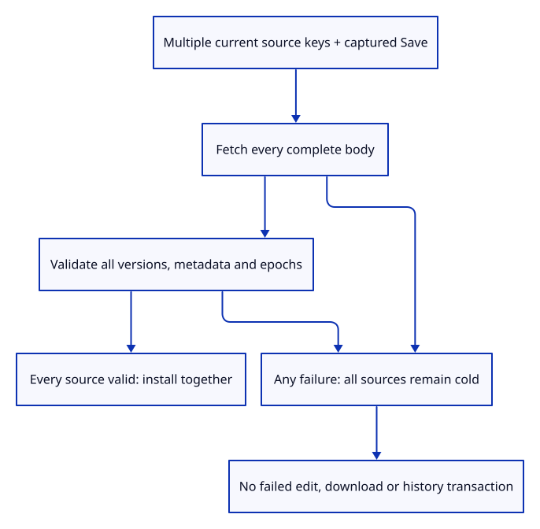

# 3.16.45 · Prove failed restoration cannot partly commit

**Chapter 3 · Documents, editing and ownership · Section 3.16 · Source ownership and restoration** · [Contents](contents.md)

**Typing: 1–1 minutes.** [Estimate](typing-load.md).

Test restoration as one transaction across two imported origins. If the second body is invalid, neither source may be restored and the captured Save must not download anything.

## Type

Continue from [Prove restored Save keeps the source doubles](32gj-precision.md). [Save or recover your work](recovery.md).

### 1. `src/lib.rs`

Register multiple-source completion acceptance checks.

<details>
<summary>Locate the existing block</summary>

```rust
mod reload_precision_tests;
```

</details>

After that block, type:

```rust
--8<-- "journey/code/32gja-failures-01.rs" skip=28
```

<details>
<summary>Supplied validation fixture</summary>

Copy this supplied authoring fixture once. Continue with the browser build below; the course does not require running native tests.

### 2. `src/reload_failure_tests.rs`

Optional authoring fixture. A failure, missing body, changed file, duplicate key or stale epoch must not partially restore a multi-source Save.

Copy this supplied file:

```text
--8<-- "journey/code/32gja-failures-02.rs"
```

</details>

## Run and check

In your project:

```sh
cd workspace/journey
REGEN_PROTO=0 cargo build --lib --locked --target wasm32-unknown-unknown -j1
REGEN_PROTO=0 CARGO_BUILD_JOBS=1 trunk serve --port 8780
```

Open `http://127.0.0.1:8780/`. Keep an existing Trunk server running; saving rebuilds it.

Run the failed-restoration checks below. An invalid or incomplete reply must leave the scene, source residency and history unchanged, with no edit or Save download.

### Recorded visual result

**Previous native render — current verification pending.**


*This recorded image predates a source or checker change. Rebuild this checkpoint before using it as current evidence; browser controls require separate acceptance.*

<details>
<summary>Code explanation and diagram</summary>

Use missing bodies, changed versions and stale keys as rejected examples. A late reply after Close must find its source URL already released. These checks exercise the existing implementation; they add no new viewer command.

Captured operation → complete body set → validate every source → all restored or none → no edit/download on failure.



Why must the first valid source remain cold when a second source fails?

Save represents one document operation. Installing the first source before checking the remaining responses would leave a partially restored editor after the operation failed. Validate the complete set before installation.

Study estimate, including typing and experiments: 1–2 hours.

</details>

<details>
<summary>Optional experiment</summary>

Trace a successful first fetch followed by a failed second fetch. Explain how the browser residency checks distinguish atomic adoption from a partial commit.

</details>

<details>
<summary>Check and save your work</summary>

Restore experimental edits, then run from `session_viewer`:

```sh
npm --prefix ../session_tests run course -- check 3.16.45
npm --prefix ../session_tests run course -- save 3.16.45
```

Source comparison leaves your project untouched. [Save and recovery instructions](recovery.md).

</details>

<details>
<summary>Viewer coverage and verification</summary>

Document restoration validates every response before committing editable source owners; errors and abandoned work cannot partially mutate the current document.

Chrome sends actual Move/Delete/Save commands through HTTP failure, invalid Content-Length, missing body, rejected fetch, oversized body, failed stream, invalid response type and changed source bytes. Each failure must leave placement, selection, camera, displayed pixels, residency and GPU counters unchanged; Save starts no download. It also imports a second source and fails its fetch after the first body has succeeded. No partial source restoration or document edit is accepted.

The final proof placement moves the post clear of the beam. Keeping two front faces in exactly the same plane can produce depth competition; this demonstration separates the solids instead of claiming the later rendering-quality lessons are already implemented.

The restoration implementation already separates preparation from installation. This acceptance checkpoint makes the boundary observable across two independently imported origins. Native checks combine a current Save with a network failure, missing body or changed second source and prove both sources remain cold. Duplicate or stale keys revoke the complete reply without replay.

The precision checkpoint remains active. Finally, a held real response is released after Close and its source URL must already be revoked. Controlled failures and waits test ownership and atomicity, not real device speed.

Visible Chrome checks automatic Move/Delete/Save failures, unchanged drawing/state/GPU counters, multiple-source Save atomicity, no failed download, and Close revoking a source URL before a held reply is released.

[Full validation scope](release.md).

To reproduce the scripted acceptance of the reference checkpoint, run from `session_viewer` with the [course bundle server](release.md#reproduce) running on port 8781:

```sh
npm --prefix ../session_tests run course -- capture 3.16.45
```

This uses the verified reference bundle; it does not check or change your typed project.

</details>
