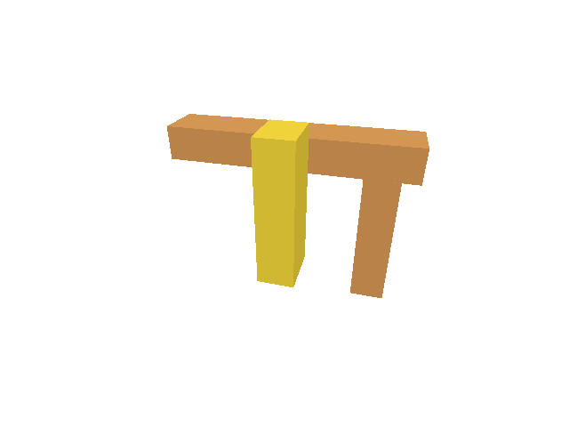
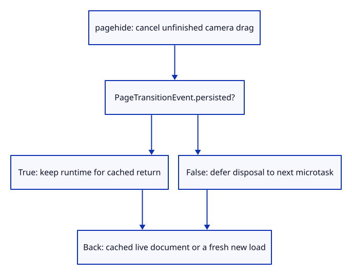

# 4.1.3 · Keep a cached viewer ready for Back navigation

**Chapter 4 · Browser lifetime and recovery · Section 4.1 · Listener and page lifetime** · [Contents](contents.md)

**Typing: 3–5 minutes.** [Estimate](typing-load.md).

Keep the viewer alive when the browser caches its page. Returning to that page must preserve working commands and camera control.

## Type

Continue from [Dispose the viewer without leaving pending work alive](33a-runtime.md). [Save or recover your work](recovery.md).

### 1. `Cargo.toml`

Enable the browser event type that tells us whether the page may return from its cache.

<details>
<summary>Locate the existing block</summary>

```toml
web-sys = { version = "=0.3.105", features = ["Window", "Document", "Element", "HtmlCanvasElement", "EventTarget", "AddEventListenerOptions", "Event", "MouseEvent", "PointerEvent", "DomRect", "KeyboardEvent", "WheelEvent", "AddEventListenerOptions", "HtmlElement", "HtmlInputElement", "File", "FileList", "Blob", "CustomEvent", "CustomEventInit", "FocusOptions", "Url", "HtmlAnchorElement", "AbortController", "AbortSignal", "RequestInit", "Response", "Headers", "ReadableStream", "ReadableStreamDefaultReader"] }
```

</details>

Edit the existing block to match this code; keep unchanged lines:

```toml
web-sys = { version = "=0.3.105", features = ["Window", "Document", "Element", "HtmlCanvasElement", "EventTarget", "AddEventListenerOptions", "PageTransitionEvent", "Event", "MouseEvent", "PointerEvent", "DomRect", "KeyboardEvent", "WheelEvent", "AddEventListenerOptions", "HtmlElement", "HtmlInputElement", "File", "FileList", "Blob", "CustomEvent", "CustomEventInit", "FocusOptions", "Url", "HtmlAnchorElement", "AbortController", "AbortSignal", "RequestInit", "Response", "Headers", "ReadableStream", "ReadableStreamDefaultReader"] }
```

<details>
<summary>Optional patch references</summary>

Use these original edit fragments when comparing a saved checkpoint. Apply the complete blocks above.

```text
--8<-- "journey/code/33b-cache-01.rs"
```

</details>

### 2. `src/browser.rs`

Cancel an unfinished drag, retain the cached page’s live owner, and dispose only a final page exit.

<details>
<summary>Locate the existing block</summary>

```rust
        if event.type_() == "pagehide" {
            wasm_bindgen_futures::spawn_local(async { crate::browser_runtime::stop(); });
```

</details>

Edit the existing block to match this code; keep unchanged lines:

```rust
        if event.type_() == "pagehide" {
            gesture.cancel();
            if event.dyn_ref::<web_sys::PageTransitionEvent>().is_some_and(|event| event.persisted()) { return; }
            wasm_bindgen_futures::spawn_local(async { crate::browser_runtime::stop(); });
```

<details>
<summary>Optional patch references</summary>

Use these original edit fragments when comparing a saved checkpoint. Apply the complete blocks above.

```text
--8<-- "journey/code/33b-cache-02.rs"
```

</details>

## Run and check

In your project:

```sh
cd workspace/journey
REGEN_PROTO=0 cargo build --lib --locked --target wasm32-unknown-unknown -j1
REGEN_PROTO=0 CARGO_BUILD_JOBS=1 trunk serve --port 8780
```

Open `http://127.0.0.1:8780/`. Keep an existing Trunk server running; saving rebuilds it.

In the debug console, run `window.dispatchEvent(new PageTransitionEvent("pagehide", {persisted: true}))`, then the same for `"pageshow"`. `window.wasmBindings.runtime_running()` stays true and typed commands still work.

### Recorded visual result

**Previous native render — current verification pending.**



*This recorded image predates a source or checker change. Rebuild this checkpoint before using it as current evidence; browser controls require separate acceptance.*

<details>
<summary>Code explanation and diagram</summary>

The [HTML lifecycle contract](https://html.spec.whatwg.org/dev/nav-history-apis.html#the-pagetransitionevent-interface) distinguishes final departure from a page that may return from the back/forward cache. A cached page reuses its existing document and scripts. Disposing its callbacks without restarting them would leave that restored viewer unable to accept commands.

The handler cancels an unfinished camera gesture, then checks the actual PageTransitionEvent. A persisted transition keeps the runtime. A final exit still schedules the disposal proved in the previous checkpoint. A plain synthetic Event has no persisted flag and retains the previous final-exit behavior. No new listener or feature control is needed.

pagehide → cancel drag → persisted? → keep owner for cached return; otherwise deferred disposal.



Does every pagehide mean the page and its WebAssembly instance are going away forever?

No. PageTransitionEvent.persisted marks a page that may be reused on Back navigation. Retain its runtime in that case; a final exit still disposes the viewer.

Study estimate, including typing and experiments: 1–2 hours.

</details>

<details>
<summary>Optional experiment</summary>

Remove the persisted check and run the retained-runtime assertions. Explain why a fresh normal load could conceal the broken cached-return path.

</details>

<details>
<summary>Check and save your work</summary>

Restore experimental edits, then run from `session_viewer`:

```sh
npm --prefix ../session_tests run course -- check 4.1.3
npm --prefix ../session_tests run course -- save 4.1.3
```

Source comparison leaves your project untouched. [Save and recovery instructions](recovery.md).

</details>

<details>
<summary>Viewer coverage and verification</summary>

A final disposal and a temporarily cached document have different ownership lifetimes. Device-loss recovery remains the next subject.

Chrome dispatches persisted hide/show events, verifies unchanged drawing, placement, selection and camera, and then uses real commands and a drag to prove the retained viewer works. It also navigates the SAME test tab away and Back: if Chrome caches the WebGPU page, its document token and drawing must survive; if the browser performs a fresh load, a newly running viewer is required. The test logs which path actually occurred, rather than claiming cache eligibility from a synthetic event. Final-exit and delayed source/file disposal checks remain inherited.

Chrome checks persisted transition handling, cancelled drag, retained state and working commands, then a real same-tab away/Back navigation. The test records whether Chrome reused the page or loaded it fresh; final-exit disposal remains verified.

[Full validation scope](release.md).

To reproduce the scripted acceptance of the reference checkpoint, run from `session_viewer` with the [course bundle server](release.md#reproduce) running on port 8781:

```sh
npm --prefix ../session_tests run course -- capture 4.1.3
```

This uses the verified reference bundle; it does not check or change your typed project.

</details>
