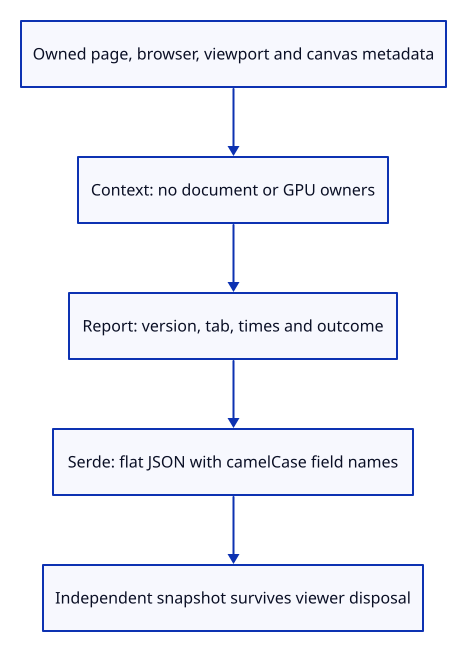

# 4.2.3 · Describe a viewer run without keeping its document

**Chapter 4 · Browser lifetime and recovery · Section 4.2 · GPU diagnostics and recovery** · [Contents](contents.md)

**Typing: 11–21 minutes.** [Estimate](typing-load.md).

Create a report that survives losing the GPU. `Context` stores page/browser details and dimensions. `Report` stores that context, run identity, timestamps and outcome; it owns no document or device.

## Type

Continue from [Stop the viewer when its GPU device fails](34a-stop.md). [Save or recover your work](recovery.md).

### 1. `src/diagnostic.rs`

Create a serializable report header with owned browser context and explicit run outcome.

Create the file and type:

```rust
--8<-- "journey/code/34b-report-01.rs"
```

<details>
<summary>Supplied validation fixture</summary>

Copy this supplied authoring fixture once. Continue with the browser build below; the course does not require running native tests.

### 2. `src/diagnostic_tests.rs`

Optional authoring fixture. Check the actual JSON field names, round trip and independence of a retained snapshot.

Copy this supplied file:

```text
--8<-- "journey/code/34b-report-02.rs"
```

</details>

### 3. `src/lib.rs`

Expose the report model and include its native tests.

<details>
<summary>Locate the existing block</summary>

```rust
pub mod gpu_fault;
```

</details>

Edit the existing block to match this code; keep unchanged lines:

```rust
pub mod diagnostic;
#[cfg(test)]
mod diagnostic_tests;
pub mod gpu_fault;
```

<details>
<summary>Optional patch references</summary>

Use these original edit fragments when comparing a saved checkpoint. Apply the complete blocks above.

```text
--8<-- "journey/code/34b-report-03.rs"
```

</details>

## Run and check

In your project:

```sh
cd workspace/journey
REGEN_PROTO=0 cargo build --lib --locked --target wasm32-unknown-unknown -j1
REGEN_PROTO=0 CARGO_BUILD_JOBS=1 trunk serve --port 8780
```

Open `http://127.0.0.1:8780/`. Keep an existing Trunk server running; saving rebuilds it.

Run the report checks below. Serialize a report and inspect its flat JSON header; changing a cloned snapshot must not change the live value. Browser metadata is connected later.

### Recorded visual result

**Previous native render — current verification pending.**


*This recorded image predates a source or checker change. Rebuild this checkpoint before using it as current evidence; browser controls require separate acceptance.*

<details>
<summary>Code explanation and diagram</summary>

Owned strings and copied dimensions make a clone an independent snapshot. `Outcome` distinguishes Running, Ready, Closed and Failed. A Running value alone is not proof of a crash.

Serde’s derives serialize and parse the value. `rename_all` writes camelCase JSON names; `flatten` puts Context fields in the report’s top level. `version` identifies the format. `started` stays fixed while `lastSeen` can advance.

This lesson builds the Rust value. Reading live browser metadata and downloading it are separate steps below.

browser metadata → owned Context → Report header → explicit JSON → independent snapshot.



Why does a diagnostic snapshot own small strings and dimensions instead of keeping the editor or renderer?

The report must survive the viewer’s disposal without extending scene or GPU lifetimes. Owned metadata records the relevant context independently; document values and rendering handles are absent.

Study estimate, including typing and experiments: 1–2 hours.

</details>

<details>
<summary>Optional experiment</summary>

Remove serde(flatten), run the JSON assertion, and explain how the public format changed. Then compare the live and cloned report after changing its drawing-buffer size.

</details>

<details>
<summary>Check and save your work</summary>

Restore experimental edits, then run from `session_viewer`:

```sh
npm --prefix ../session_tests run course -- check 4.2.3
npm --prefix ../session_tests run course -- save 4.2.3
```

Source comparison leaves your project untouched. [Save and recovery instructions](recovery.md).

</details>

<details>
<summary>Viewer coverage and verification</summary>

Production diagnostics retain browser/page/viewport/drawing-buffer context outside the renderer and version their reports. This checkpoint establishes that value; bounded observations, downloads, storage policy and recovery follow.

Native tests check actual JSON names, header values, round-trip decoding and independent context after resize. Chrome verifies the already-wired loss/input/lifetime behavior and a new proof view. This header is not yet populated from the live browser, downloadable or stored. Events, first-failure retention and browser connection follow.

Chrome verifies the inherited real GPU-loss and restart acceptance, then captures Orbit Up. The report header’s schema and ownership are checked natively; live reporting is not wired yet.

[Full validation scope](release.md).

To reproduce the scripted acceptance of the reference checkpoint, run from `session_viewer` with the [course bundle server](release.md#reproduce) running on port 8781:

```sh
npm --prefix ../session_tests run course -- capture 4.2.3
```

This uses the verified reference bundle; it does not check or change your typed project.

</details>
