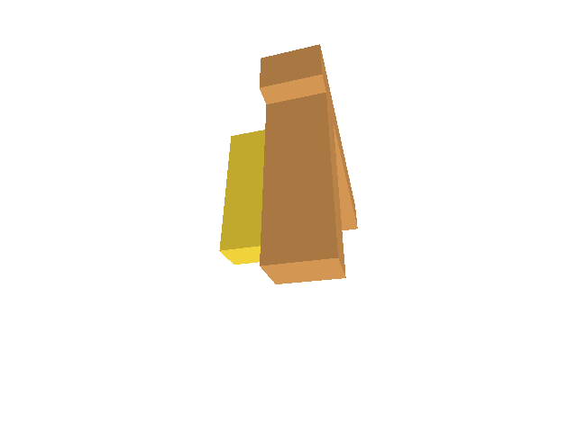
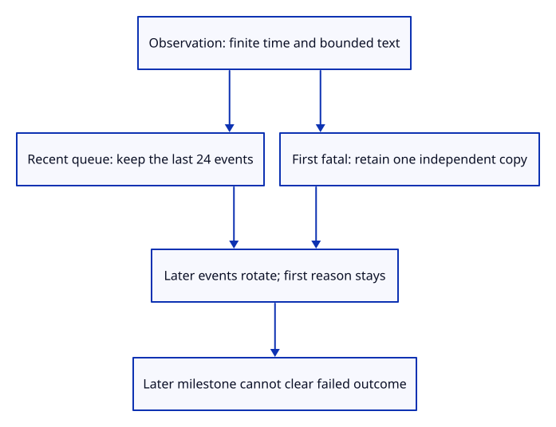

# 4.2.4 · Keep recent events without losing the first failure

**Chapter 4 · Browser lifetime and recovery · Section 4.2 · GPU diagnostics and recovery** · [Contents](contents.md)

**Typing: 14–27 minutes.** [Estimate](typing-load.md).

Keep recent observations and the first fatal reason separately. `VecDeque` is a queue: pop its oldest entry before appending when it reaches 24 events. The first-failure field survives that rotation.

## Type

Continue from [Describe a viewer run without keeping its document](34b-report.md). [Save or recover your work](recovery.md).

### 1. `src/diagnostic.rs`

Describe an observation separately from its bounded owner and preserve its relative timing. Retain the recent event window separately from the first failure, so rotation cannot erase it. Validate relative time, bound observation text/history, and make failure survive later milestones and event rotation.

<details>
<summary>Locate the existing block</summary>

```rust
use serde::{Deserialize, Serialize};

#[derive(Clone, Debug, PartialEq, Serialize, Deserialize)]
#[serde(rename_all = "camelCase")]
pub struct Context {
    pub page: String,
    pub browser: String,
    pub secure_context: bool,
    pub webgpu: bool,
    pub viewport: [u32; 2],
    pub canvas: [u32; 2],
    pub device_pixel_ratio: f64,
}

#[derive(Clone, Debug, PartialEq, Serialize, Deserialize)]
#[serde(rename_all = "lowercase")]
pub enum Outcome { Running, Ready, Closed, Failed }

#[derive(Clone, Debug, PartialEq, Serialize, Deserialize)]
#[serde(rename_all = "camelCase")]
pub struct Report {
    pub version: u32,
    pub tab: String,
    pub started: String,
    pub last_seen: String,
    pub outcome: Outcome,
    #[serde(flatten)]
    pub context: Context,
}

impl Report {
    pub fn new(tab: String, started: String, context: Context) -> Self {
        Self { version: 1, tab, last_seen: started.clone(), started, outcome: Outcome::Running, context }
    }
}
```

</details>

Edit the existing block to match this code; keep unchanged lines:

```rust
use serde::{Deserialize, Serialize};

#[derive(Clone, Debug, PartialEq, Serialize, Deserialize)]
#[serde(rename_all = "camelCase")]
pub struct Context {
    pub page: String,
    pub browser: String,
    pub secure_context: bool,
    pub webgpu: bool,
    pub viewport: [u32; 2],
    pub canvas: [u32; 2],
    pub device_pixel_ratio: f64,
}

#[derive(Clone, Debug, PartialEq, Serialize, Deserialize)]
#[serde(rename_all = "lowercase")]
pub enum Outcome { Running, Ready, Closed, Failed }

#[derive(Clone, Debug, PartialEq, Serialize, Deserialize)]
#[serde(rename_all = "camelCase")]
pub struct Event {
    pub time: String,
    pub elapsed_ms: f64,
    pub kind: String,
    pub message: String,
}

#[derive(Clone, Debug, PartialEq, Serialize, Deserialize)]
#[serde(rename_all = "camelCase")]
pub struct Report {
    pub version: u32,
    pub tab: String,
    pub started: String,
    pub last_seen: String,
    pub outcome: Outcome,
    #[serde(flatten)]
    pub context: Context,
    events: std::collections::VecDeque<Event>,
    failure: Option<Event>,
}

impl Report {
    pub fn new(tab: String, started: String, context: Context) -> Self {
        Self { version: 1, tab, last_seen: started.clone(), started, outcome: Outcome::Running,
            context, events: Default::default(), failure: None }
    }

    pub fn failure(&self) -> Option<&Event> { self.failure.as_ref() }

    pub fn record(&mut self, time: String, elapsed_ms: f64, kind: &str, message: &str) -> Result<(), &'static str> {
        if !elapsed_ms.is_finite() || elapsed_ms < 0.0 { return Err("Invalid elapsed time"); }
        let event = Event { time, elapsed_ms, kind: kind.chars().take(64).collect(), message: message.chars().take(4096).collect() };
        self.last_seen.clone_from(&event.time);
        if kind == "fatal" {
            if self.failure.is_none() { self.failure = Some(event.clone()); }
            self.outcome = Outcome::Failed;
        } else if kind == "milestone" && message == "geometry on screen" && self.failure.is_none() {
            self.outcome = Outcome::Ready;
        }
        if self.events.len() == 24 { self.events.pop_front(); }
        self.events.push_back(event);
        Ok(())
    }
}
```

<details>
<summary>Optional patch references</summary>

Use these original edit fragments when comparing a saved checkpoint. Apply the complete blocks above.

```text
--8<-- "journey/code/34ba-events-01.rs"
```

```text
--8<-- "journey/code/34ba-events-02.rs"
```

```text
--8<-- "journey/code/34ba-events-03.rs"
```

</details>

<details>
<summary>Supplied validation fixture</summary>

Copy this supplied authoring fixture once. Continue with the browser build below; the course does not require running native tests.

### 2. `src/diagnostic_tests.rs`

Optional authoring fixture. Prove bounded history/text, retained first failure, ready-state semantics and atomic rejection of invalid timing.

<details>
<summary>Locate the existing block</summary>

```text
use crate::diagnostic::{Context, Outcome, Report};

fn context() -> Context {
    Context { page: "https://example.test/viewer/".into(), browser: "Test browser".into(),
        secure_context: true, webgpu: true, viewport: [900, 760], canvas: [900, 760], device_pixel_ratio: 1.0 }
}

#[test]
fn report_starts_running_with_flat_browser_context() {
    let report = Report::new("tab-a".into(), "2026-10-03T18:00:00.000Z".into(), context());
    let value = serde_json::to_value(&report).unwrap();
    assert_eq!(value["version"], 1); assert_eq!(value["outcome"], "running");
    assert_eq!(value["started"], value["lastSeen"]);
    assert_eq!(value["secureContext"], true); assert_eq!(value["devicePixelRatio"], 1.0);
    assert_eq!(value["viewport"], serde_json::json!([900, 760]));
    assert!(value.get("context").is_none());
    assert_eq!(serde_json::from_value::<Report>(value).unwrap(), report);
}

#[test]
fn report_snapshot_keeps_its_own_context() {
    let mut live = Report::new("tab-a".into(), "start".into(), context()); let snapshot = live.clone();
    live.context.canvas = [618, 1373]; live.context.device_pixel_ratio = 2.625;
    live.outcome = Outcome::Ready;
    assert_eq!(snapshot.context.canvas, [900, 760]); assert_eq!(snapshot.outcome, Outcome::Running);
    assert_eq!(serde_json::from_str::<Report>(&serde_json::to_string(&live).unwrap()).unwrap(), live);
}
```

</details>

After that block, append this supplied code:

```text
--8<-- "journey/code/34ba-events-04.rs" skip=1382
```

</details>

## Run and check

In your project:

```sh
cd workspace/journey
REGEN_PROTO=0 cargo build --lib --locked --target wasm32-unknown-unknown -j1
REGEN_PROTO=0 CARGO_BUILD_JOBS=1 trunk serve --port 8780
```

Open `http://127.0.0.1:8780/`. Keep an existing Trunk server running; saving rebuilds it.

Run the event checks below. After 30 observations, exactly 24 remain, while the first fatal reason is preserved separately. Recording a success must not clear failure.

### Recorded visual result

**Previous native render — current verification pending.**



*This recorded image predates a source or checker change. Rebuild this checkpoint before using it as current evidence; browser controls require separate acceptance.*

<details>
<summary>Code explanation and diagram</summary>

`record` rejects negative or non-finite elapsed time before mutation, caps kind/message text at 64/4096 Unicode scalar values, updates lastSeen and appends one event. A fatal event sets Failed only once; a later ready milestone cannot clear the failure.

These limits govern recording. Deserialized JSON still needs an admission check before the viewer trusts it.

finite relative time → bounded event → first failure retained → last 24 observations → stable failed outcome.



Why keep the first failure separately from the recent event queue?

Recent observations rotate to bound memory. The original failure must remain available even after follow-on errors evict that event from the recent window.

Study estimate, including typing and experiments: 1–2 hours.

</details>

<details>
<summary>Optional experiment</summary>

Store failure only in the recent queue and run the rotation test. Then remove the failed-outcome guard and explain why a later successful milestone would misdescribe the run.

</details>

<details>
<summary>Check and save your work</summary>

Restore experimental edits, then run from `session_viewer`:

```sh
npm --prefix ../session_tests run course -- check 4.2.4
npm --prefix ../session_tests run course -- save 4.2.4
```

Source comparison leaves your project untouched. [Save and recovery instructions](recovery.md).

</details>

<details>
<summary>Viewer coverage and verification</summary>

Production diagnostics retain 24 recent events and the first fatal reason separately. This checkpoint implements that policy in the cumulative Rust report. Phases/resources/adapter metadata, browser connection, downloads and bounded storage/recovery still follow.

Native tests drive 30 follow-on errors, verify the exact 24-event window, preserve the first failure through a later success milestone, round-trip the report, cap multibyte text without cutting a character and reject invalid timings without mutation. The browser still verifies inherited GPU-loss behavior; actual report observation is wired next.

Chrome verifies inherited real GPU loss, cancellation and restart, then captures Orbit Right. Native tests establish bounded report observations and first-failure retention; the browser report producer follows next.

[Full validation scope](release.md).

To reproduce the scripted acceptance of the reference checkpoint, run from `session_viewer` with the [course bundle server](release.md#reproduce) running on port 8781:

```sh
npm --prefix ../session_tests run course -- capture 4.2.4
```

This uses the verified reference bundle; it does not check or change your typed project.

</details>
